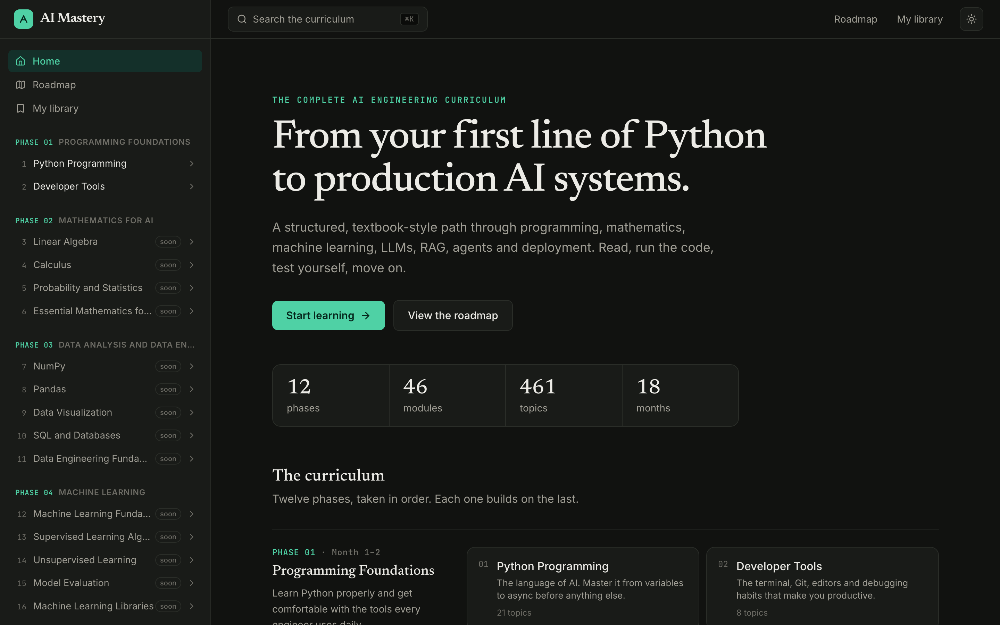

# AI Mastery

**From your first line of Python to production AI systems.**

A structured, textbook-style curriculum for becoming an AI engineer: programming, mathematics, machine learning, LLMs, RAG, agents and deployment. Read the lesson, run the code, test yourself, move on.

**12 phases · 46 modules · 461 topics · 18 months**

### [🌐 Open the website →](https://ai-mastery-docs.netlify.app)

---

## Curriculum

The full course, laid out exactly like the site's sidebar. Expand a module to see its lessons; every item opens that page on **[ai-mastery-docs.netlify.app](https://ai-mastery-docs.netlify.app)**.

<!-- SIDEBAR:START (generated by `npm run readme`, do not edit by hand) -->

🏠 [Home](https://ai-mastery-docs.netlify.app/) &nbsp;·&nbsp; 🗺️ [Roadmap](https://ai-mastery-docs.netlify.app/roadmap) &nbsp;·&nbsp; 🔖 [My library](https://ai-mastery-docs.netlify.app/library)

### Phase 01 · Programming Foundations

Month 1–2 · Learn Python properly and get comfortable with the tools every engineer uses daily.

<code> 1</code> <a href="https://ai-mastery-docs.netlify.app/learn/python-programming"><b>Python Programming</b></a> 21 lessons

- [Introduction to programming](https://ai-mastery-docs.netlify.app/learn/python-programming/introduction-to-programming)
- [Variables and data types](https://ai-mastery-docs.netlify.app/learn/python-programming/variables-and-data-types)
- [Operators and expressions](https://ai-mastery-docs.netlify.app/learn/python-programming/operators-and-expressions)
- [Conditional statements](https://ai-mastery-docs.netlify.app/learn/python-programming/conditional-statements)
- [Loops (for, while)](https://ai-mastery-docs.netlify.app/learn/python-programming/loops-for-while)
- [Functions and lambda functions](https://ai-mastery-docs.netlify.app/learn/python-programming/functions-and-lambda-functions)
- [Lists, tuples, sets, dictionaries](https://ai-mastery-docs.netlify.app/learn/python-programming/lists-tuples-sets-dictionaries)
- [String manipulation](https://ai-mastery-docs.netlify.app/learn/python-programming/string-manipulation)
- [List comprehensions](https://ai-mastery-docs.netlify.app/learn/python-programming/list-comprehensions)
- [File handling](https://ai-mastery-docs.netlify.app/learn/python-programming/file-handling)
- [Exception handling](https://ai-mastery-docs.netlify.app/learn/python-programming/exception-handling)
- [Object-oriented programming (OOP)](https://ai-mastery-docs.netlify.app/learn/python-programming/object-oriented-programming-oop)
- [Classes, objects, inheritance, polymorphism](https://ai-mastery-docs.netlify.app/learn/python-programming/classes-objects-inheritance-polymorphism)
- [Modules and packages](https://ai-mastery-docs.netlify.app/learn/python-programming/modules-and-packages)
- [Virtual environments](https://ai-mastery-docs.netlify.app/learn/python-programming/virtual-environments)
- [Package management with pip](https://ai-mastery-docs.netlify.app/learn/python-programming/package-management-with-pip)
- [Type hints](https://ai-mastery-docs.netlify.app/learn/python-programming/type-hints)
- [Decorators and generators](https://ai-mastery-docs.netlify.app/learn/python-programming/decorators-and-generators)
- [Asynchronous programming](https://ai-mastery-docs.netlify.app/learn/python-programming/asynchronous-programming)
- [Working with APIs](https://ai-mastery-docs.netlify.app/learn/python-programming/working-with-apis)
- [JSON and CSV](https://ai-mastery-docs.netlify.app/learn/python-programming/json-and-csv)
- 📝 **[Module quiz](https://ai-mastery-docs.netlify.app/learn/python-programming/assessment)**

<code> 2</code> <a href="https://ai-mastery-docs.netlify.app/learn/developer-tools"><b>Developer Tools</b></a> 8 lessons

- [Linux fundamentals](https://ai-mastery-docs.netlify.app/learn/developer-tools/linux-fundamentals)
- [Terminal and command-line operations](https://ai-mastery-docs.netlify.app/learn/developer-tools/terminal-and-command-line-operations)
- [Git and GitHub](https://ai-mastery-docs.netlify.app/learn/developer-tools/git-and-github)
- [VS Code](https://ai-mastery-docs.netlify.app/learn/developer-tools/vs-code)
- [Jupyter Notebook](https://ai-mastery-docs.netlify.app/learn/developer-tools/jupyter-notebook)
- [Python debugging](https://ai-mastery-docs.netlify.app/learn/developer-tools/python-debugging)
- [Virtual environments](https://ai-mastery-docs.netlify.app/learn/developer-tools/virtual-environments)
- [Basic software development practices](https://ai-mastery-docs.netlify.app/learn/developer-tools/basic-software-development-practices)
- 📝 **[Module quiz](https://ai-mastery-docs.netlify.app/learn/developer-tools/assessment)**

### Phase 02 · Mathematics for AI

Month 2–3 · You do not need to become a mathematician, but you must understand the maths behind AI.

<code> 3</code> <a href="https://ai-mastery-docs.netlify.app/learn/linear-algebra"><b>Linear Algebra</b></a> 9 lessons

- [Scalars, vectors and matrices](https://ai-mastery-docs.netlify.app/learn/linear-algebra/scalars-vectors-and-matrices)
- [Matrix operations](https://ai-mastery-docs.netlify.app/learn/linear-algebra/matrix-operations)
- [Matrix multiplication](https://ai-mastery-docs.netlify.app/learn/linear-algebra/matrix-multiplication)
- [Transpose and inverse](https://ai-mastery-docs.netlify.app/learn/linear-algebra/transpose-and-inverse)
- [Identity matrix](https://ai-mastery-docs.netlify.app/learn/linear-algebra/identity-matrix)
- [Dot product](https://ai-mastery-docs.netlify.app/learn/linear-algebra/dot-product)
- [Eigenvalues and eigenvectors](https://ai-mastery-docs.netlify.app/learn/linear-algebra/eigenvalues-and-eigenvectors)
- [Vector spaces](https://ai-mastery-docs.netlify.app/learn/linear-algebra/vector-spaces)
- [Norms and distances](https://ai-mastery-docs.netlify.app/learn/linear-algebra/norms-and-distances)
- 📝 **[Module quiz](https://ai-mastery-docs.netlify.app/learn/linear-algebra/assessment)**

<code> 4</code> <a href="https://ai-mastery-docs.netlify.app/learn/calculus"><b>Calculus</b></a> 8 lessons

- [Functions and graphs](https://ai-mastery-docs.netlify.app/learn/calculus/functions-and-graphs)
- [Limits](https://ai-mastery-docs.netlify.app/learn/calculus/limits)
- [Derivatives](https://ai-mastery-docs.netlify.app/learn/calculus/derivatives)
- [Partial derivatives](https://ai-mastery-docs.netlify.app/learn/calculus/partial-derivatives)
- [Chain rule](https://ai-mastery-docs.netlify.app/learn/calculus/chain-rule)
- [Gradients](https://ai-mastery-docs.netlify.app/learn/calculus/gradients)
- [Gradient descent](https://ai-mastery-docs.netlify.app/learn/calculus/gradient-descent)
- [Optimization](https://ai-mastery-docs.netlify.app/learn/calculus/optimization)
- 📝 **[Module quiz](https://ai-mastery-docs.netlify.app/learn/calculus/assessment)**

<code> 5</code> <a href="https://ai-mastery-docs.netlify.app/learn/probability-and-statistics"><b>Probability and Statistics</b></a> 11 lessons

- [Mean, median and mode](https://ai-mastery-docs.netlify.app/learn/probability-and-statistics/mean-median-and-mode)
- [Variance and standard deviation](https://ai-mastery-docs.netlify.app/learn/probability-and-statistics/variance-and-standard-deviation)
- [Probability fundamentals](https://ai-mastery-docs.netlify.app/learn/probability-and-statistics/probability-fundamentals)
- [Conditional probability](https://ai-mastery-docs.netlify.app/learn/probability-and-statistics/conditional-probability)
- [Bayes' theorem](https://ai-mastery-docs.netlify.app/learn/probability-and-statistics/bayes-theorem)
- [Probability distributions](https://ai-mastery-docs.netlify.app/learn/probability-and-statistics/probability-distributions)
- [Normal distribution](https://ai-mastery-docs.netlify.app/learn/probability-and-statistics/normal-distribution)
- [Sampling](https://ai-mastery-docs.netlify.app/learn/probability-and-statistics/sampling)
- [Hypothesis testing](https://ai-mastery-docs.netlify.app/learn/probability-and-statistics/hypothesis-testing)
- [Correlation and covariance](https://ai-mastery-docs.netlify.app/learn/probability-and-statistics/correlation-and-covariance)
- [Statistical significance](https://ai-mastery-docs.netlify.app/learn/probability-and-statistics/statistical-significance)
- 📝 **[Module quiz](https://ai-mastery-docs.netlify.app/learn/probability-and-statistics/assessment)**

<code> 6</code> <a href="https://ai-mastery-docs.netlify.app/learn/essential-mathematics-for-machine-learning"><b>Essential Mathematics for Machine Learning</b></a> 6 lessons

- [Loss functions](https://ai-mastery-docs.netlify.app/learn/essential-mathematics-for-machine-learning/loss-functions)
- [Optimization algorithms](https://ai-mastery-docs.netlify.app/learn/essential-mathematics-for-machine-learning/optimization-algorithms)
- [Maximum likelihood estimation](https://ai-mastery-docs.netlify.app/learn/essential-mathematics-for-machine-learning/maximum-likelihood-estimation)
- [Entropy](https://ai-mastery-docs.netlify.app/learn/essential-mathematics-for-machine-learning/entropy)
- [Cross-entropy](https://ai-mastery-docs.netlify.app/learn/essential-mathematics-for-machine-learning/cross-entropy)
- [KL divergence](https://ai-mastery-docs.netlify.app/learn/essential-mathematics-for-machine-learning/kl-divergence)
- 📝 **[Module quiz](https://ai-mastery-docs.netlify.app/learn/essential-mathematics-for-machine-learning/assessment)**

### Phase 03 · Data Analysis and Data Engineering

Month 3–4 · AI engineers work with data every day. Learn to load, clean, query and move it.

<code> 7</code> <a href="https://ai-mastery-docs.netlify.app/learn/numpy"><b>NumPy</b></a> 7 lessons

- [Arrays and dimensions](https://ai-mastery-docs.netlify.app/learn/numpy/arrays-and-dimensions)
- [Indexing and slicing](https://ai-mastery-docs.netlify.app/learn/numpy/indexing-and-slicing)
- [Broadcasting](https://ai-mastery-docs.netlify.app/learn/numpy/broadcasting)
- [Vectorization](https://ai-mastery-docs.netlify.app/learn/numpy/vectorization)
- [Matrix operations](https://ai-mastery-docs.netlify.app/learn/numpy/matrix-operations)
- [Mathematical functions](https://ai-mastery-docs.netlify.app/learn/numpy/mathematical-functions)
- [Random number generation](https://ai-mastery-docs.netlify.app/learn/numpy/random-number-generation)
- 📝 **[Module quiz](https://ai-mastery-docs.netlify.app/learn/numpy/assessment)**

<code> 8</code> <a href="https://ai-mastery-docs.netlify.app/learn/pandas"><b>Pandas</b></a> 9 lessons

- [Series and DataFrames](https://ai-mastery-docs.netlify.app/learn/pandas/series-and-dataframes)
- [Reading CSV, Excel and JSON](https://ai-mastery-docs.netlify.app/learn/pandas/reading-csv-excel-and-json)
- [Data cleaning](https://ai-mastery-docs.netlify.app/learn/pandas/data-cleaning)
- [Handling missing values](https://ai-mastery-docs.netlify.app/learn/pandas/handling-missing-values)
- [Filtering and sorting](https://ai-mastery-docs.netlify.app/learn/pandas/filtering-and-sorting)
- [Grouping and aggregation](https://ai-mastery-docs.netlify.app/learn/pandas/grouping-and-aggregation)
- [Merging and joining](https://ai-mastery-docs.netlify.app/learn/pandas/merging-and-joining)
- [Data transformation](https://ai-mastery-docs.netlify.app/learn/pandas/data-transformation)
- [Feature preparation](https://ai-mastery-docs.netlify.app/learn/pandas/feature-preparation)
- 📝 **[Module quiz](https://ai-mastery-docs.netlify.app/learn/pandas/assessment)**

<code> 9</code> <a href="https://ai-mastery-docs.netlify.app/learn/data-visualization"><b>Data Visualization</b></a> 8 lessons

- [Matplotlib](https://ai-mastery-docs.netlify.app/learn/data-visualization/matplotlib)
- [Seaborn](https://ai-mastery-docs.netlify.app/learn/data-visualization/seaborn)
- [Plotly](https://ai-mastery-docs.netlify.app/learn/data-visualization/plotly)
- [Histograms](https://ai-mastery-docs.netlify.app/learn/data-visualization/histograms)
- [Scatter plots](https://ai-mastery-docs.netlify.app/learn/data-visualization/scatter-plots)
- [Heatmaps](https://ai-mastery-docs.netlify.app/learn/data-visualization/heatmaps)
- [Box plots](https://ai-mastery-docs.netlify.app/learn/data-visualization/box-plots)
- [Correlation visualization](https://ai-mastery-docs.netlify.app/learn/data-visualization/correlation-visualization)
- 📝 **[Module quiz](https://ai-mastery-docs.netlify.app/learn/data-visualization/assessment)**

<code>10</code> <a href="https://ai-mastery-docs.netlify.app/learn/sql-and-databases"><b>SQL and Databases</b></a> 11 lessons

- [Database fundamentals](https://ai-mastery-docs.netlify.app/learn/sql-and-databases/database-fundamentals)
- [Tables and relationships](https://ai-mastery-docs.netlify.app/learn/sql-and-databases/tables-and-relationships)
- [SELECT, INSERT, UPDATE, DELETE](https://ai-mastery-docs.netlify.app/learn/sql-and-databases/select-insert-update-delete)
- [WHERE, GROUP BY, ORDER BY](https://ai-mastery-docs.netlify.app/learn/sql-and-databases/where-group-by-order-by)
- [Joins](https://ai-mastery-docs.netlify.app/learn/sql-and-databases/joins)
- [Subqueries](https://ai-mastery-docs.netlify.app/learn/sql-and-databases/subqueries)
- [CTEs](https://ai-mastery-docs.netlify.app/learn/sql-and-databases/ctes)
- [Window functions](https://ai-mastery-docs.netlify.app/learn/sql-and-databases/window-functions)
- [Indexing](https://ai-mastery-docs.netlify.app/learn/sql-and-databases/indexing)
- [PostgreSQL](https://ai-mastery-docs.netlify.app/learn/sql-and-databases/postgresql)
- [Database optimization](https://ai-mastery-docs.netlify.app/learn/sql-and-databases/database-optimization)
- 📝 **[Module quiz](https://ai-mastery-docs.netlify.app/learn/sql-and-databases/assessment)**

<code>11</code> <a href="https://ai-mastery-docs.netlify.app/learn/data-engineering-fundamentals"><b>Data Engineering Fundamentals</b></a> 9 lessons

- [Data pipelines](https://ai-mastery-docs.netlify.app/learn/data-engineering-fundamentals/data-pipelines)
- [ETL and ELT](https://ai-mastery-docs.netlify.app/learn/data-engineering-fundamentals/etl-and-elt)
- [Data ingestion](https://ai-mastery-docs.netlify.app/learn/data-engineering-fundamentals/data-ingestion)
- [Data validation](https://ai-mastery-docs.netlify.app/learn/data-engineering-fundamentals/data-validation)
- [Data preprocessing](https://ai-mastery-docs.netlify.app/learn/data-engineering-fundamentals/data-preprocessing)
- [APIs and data collection](https://ai-mastery-docs.netlify.app/learn/data-engineering-fundamentals/apis-and-data-collection)
- [Batch processing](https://ai-mastery-docs.netlify.app/learn/data-engineering-fundamentals/batch-processing)
- [Basic Apache Airflow](https://ai-mastery-docs.netlify.app/learn/data-engineering-fundamentals/basic-apache-airflow)
- [Basic Spark](https://ai-mastery-docs.netlify.app/learn/data-engineering-fundamentals/basic-spark)
- 📝 **[Module quiz](https://ai-mastery-docs.netlify.app/learn/data-engineering-fundamentals/assessment)**

### Phase 04 · Machine Learning

Month 4–6 · One of the most important phases: classical ML, from theory to evaluation.

<code>12</code> <a href="https://ai-mastery-docs.netlify.app/learn/machine-learning-fundamentals"><b>Machine Learning Fundamentals</b></a> 12 lessons

- [What is machine learning?](https://ai-mastery-docs.netlify.app/learn/machine-learning-fundamentals/what-is-machine-learning)
- [AI vs ML vs Deep Learning](https://ai-mastery-docs.netlify.app/learn/machine-learning-fundamentals/ai-vs-ml-vs-deep-learning)
- [Supervised learning](https://ai-mastery-docs.netlify.app/learn/machine-learning-fundamentals/supervised-learning)
- [Unsupervised learning](https://ai-mastery-docs.netlify.app/learn/machine-learning-fundamentals/unsupervised-learning)
- [Semi-supervised learning](https://ai-mastery-docs.netlify.app/learn/machine-learning-fundamentals/semi-supervised-learning)
- [Reinforcement learning](https://ai-mastery-docs.netlify.app/learn/machine-learning-fundamentals/reinforcement-learning)
- [Training, validation and testing](https://ai-mastery-docs.netlify.app/learn/machine-learning-fundamentals/training-validation-and-testing)
- [Underfitting and overfitting](https://ai-mastery-docs.netlify.app/learn/machine-learning-fundamentals/underfitting-and-overfitting)
- [Bias-variance tradeoff](https://ai-mastery-docs.netlify.app/learn/machine-learning-fundamentals/bias-variance-tradeoff)
- [Feature engineering](https://ai-mastery-docs.netlify.app/learn/machine-learning-fundamentals/feature-engineering)
- [Feature selection](https://ai-mastery-docs.netlify.app/learn/machine-learning-fundamentals/feature-selection)
- [Data preprocessing](https://ai-mastery-docs.netlify.app/learn/machine-learning-fundamentals/data-preprocessing)
- 📝 **[Module quiz](https://ai-mastery-docs.netlify.app/learn/machine-learning-fundamentals/assessment)**

<code>13</code> <a href="https://ai-mastery-docs.netlify.app/learn/supervised-learning-algorithms"><b>Supervised Learning Algorithms</b></a> 12 lessons

- [Linear regression](https://ai-mastery-docs.netlify.app/learn/supervised-learning-algorithms/linear-regression)
- [Multiple linear regression](https://ai-mastery-docs.netlify.app/learn/supervised-learning-algorithms/multiple-linear-regression)
- [Logistic regression](https://ai-mastery-docs.netlify.app/learn/supervised-learning-algorithms/logistic-regression)
- [Decision trees](https://ai-mastery-docs.netlify.app/learn/supervised-learning-algorithms/decision-trees)
- [Random forests](https://ai-mastery-docs.netlify.app/learn/supervised-learning-algorithms/random-forests)
- [Support vector machines](https://ai-mastery-docs.netlify.app/learn/supervised-learning-algorithms/support-vector-machines)
- [K-nearest neighbors](https://ai-mastery-docs.netlify.app/learn/supervised-learning-algorithms/k-nearest-neighbors)
- [Naive Bayes](https://ai-mastery-docs.netlify.app/learn/supervised-learning-algorithms/naive-bayes)
- [Gradient boosting](https://ai-mastery-docs.netlify.app/learn/supervised-learning-algorithms/gradient-boosting)
- [XGBoost](https://ai-mastery-docs.netlify.app/learn/supervised-learning-algorithms/xgboost)
- [LightGBM](https://ai-mastery-docs.netlify.app/learn/supervised-learning-algorithms/lightgbm)
- [CatBoost](https://ai-mastery-docs.netlify.app/learn/supervised-learning-algorithms/catboost)
- 📝 **[Module quiz](https://ai-mastery-docs.netlify.app/learn/supervised-learning-algorithms/assessment)**

<code>14</code> <a href="https://ai-mastery-docs.netlify.app/learn/unsupervised-learning"><b>Unsupervised Learning</b></a> 6 lessons

- [K-means clustering](https://ai-mastery-docs.netlify.app/learn/unsupervised-learning/k-means-clustering)
- [Hierarchical clustering](https://ai-mastery-docs.netlify.app/learn/unsupervised-learning/hierarchical-clustering)
- [DBSCAN](https://ai-mastery-docs.netlify.app/learn/unsupervised-learning/dbscan)
- [Principal Component Analysis (PCA)](https://ai-mastery-docs.netlify.app/learn/unsupervised-learning/principal-component-analysis-pca)
- [Dimensionality reduction](https://ai-mastery-docs.netlify.app/learn/unsupervised-learning/dimensionality-reduction)
- [Anomaly detection](https://ai-mastery-docs.netlify.app/learn/unsupervised-learning/anomaly-detection)
- 📝 **[Module quiz](https://ai-mastery-docs.netlify.app/learn/unsupervised-learning/assessment)**

<code>15</code> <a href="https://ai-mastery-docs.netlify.app/learn/model-evaluation"><b>Model Evaluation</b></a> 13 lessons

- [Accuracy](https://ai-mastery-docs.netlify.app/learn/model-evaluation/accuracy)
- [Precision](https://ai-mastery-docs.netlify.app/learn/model-evaluation/precision)
- [Recall](https://ai-mastery-docs.netlify.app/learn/model-evaluation/recall)
- [F1-score](https://ai-mastery-docs.netlify.app/learn/model-evaluation/f1-score)
- [Confusion matrix](https://ai-mastery-docs.netlify.app/learn/model-evaluation/confusion-matrix)
- [ROC-AUC](https://ai-mastery-docs.netlify.app/learn/model-evaluation/roc-auc)
- [MAE](https://ai-mastery-docs.netlify.app/learn/model-evaluation/mae)
- [MSE](https://ai-mastery-docs.netlify.app/learn/model-evaluation/mse)
- [RMSE](https://ai-mastery-docs.netlify.app/learn/model-evaluation/rmse)
- [Cross-validation](https://ai-mastery-docs.netlify.app/learn/model-evaluation/cross-validation)
- [Hyperparameter tuning](https://ai-mastery-docs.netlify.app/learn/model-evaluation/hyperparameter-tuning)
- [Grid search](https://ai-mastery-docs.netlify.app/learn/model-evaluation/grid-search)
- [Random search](https://ai-mastery-docs.netlify.app/learn/model-evaluation/random-search)
- 📝 **[Module quiz](https://ai-mastery-docs.netlify.app/learn/model-evaluation/assessment)**

<code>16</code> <a href="https://ai-mastery-docs.netlify.app/learn/machine-learning-libraries"><b>Machine Learning Libraries</b></a> 4 lessons

- [Scikit-learn](https://ai-mastery-docs.netlify.app/learn/machine-learning-libraries/scikit-learn)
- [XGBoost](https://ai-mastery-docs.netlify.app/learn/machine-learning-libraries/xgboost)
- [LightGBM](https://ai-mastery-docs.netlify.app/learn/machine-learning-libraries/lightgbm)
- [Imbalanced-learn](https://ai-mastery-docs.netlify.app/learn/machine-learning-libraries/imbalanced-learn)
- 📝 **[Module quiz](https://ai-mastery-docs.netlify.app/learn/machine-learning-libraries/assessment)**

### Phase 05 · Deep Learning

Month 6–8 · Learn how modern neural networks work, and build them in PyTorch.

<code>17</code> <a href="https://ai-mastery-docs.netlify.app/learn/neural-network-fundamentals"><b>Neural Network Fundamentals</b></a> 15 lessons

- [Biological vs artificial neurons](https://ai-mastery-docs.netlify.app/learn/neural-network-fundamentals/biological-vs-artificial-neurons)
- [Perceptrons](https://ai-mastery-docs.netlify.app/learn/neural-network-fundamentals/perceptrons)
- [Neural network architecture](https://ai-mastery-docs.netlify.app/learn/neural-network-fundamentals/neural-network-architecture)
- [Input, hidden and output layers](https://ai-mastery-docs.netlify.app/learn/neural-network-fundamentals/input-hidden-and-output-layers)
- [Activation functions](https://ai-mastery-docs.netlify.app/learn/neural-network-fundamentals/activation-functions)
- [Forward propagation](https://ai-mastery-docs.netlify.app/learn/neural-network-fundamentals/forward-propagation)
- [Backpropagation](https://ai-mastery-docs.netlify.app/learn/neural-network-fundamentals/backpropagation)
- [Loss functions](https://ai-mastery-docs.netlify.app/learn/neural-network-fundamentals/loss-functions)
- [Optimizers](https://ai-mastery-docs.netlify.app/learn/neural-network-fundamentals/optimizers)
- [Learning rates](https://ai-mastery-docs.netlify.app/learn/neural-network-fundamentals/learning-rates)
- [Batch size](https://ai-mastery-docs.netlify.app/learn/neural-network-fundamentals/batch-size)
- [Epochs](https://ai-mastery-docs.netlify.app/learn/neural-network-fundamentals/epochs)
- [Regularization](https://ai-mastery-docs.netlify.app/learn/neural-network-fundamentals/regularization)
- [Dropout](https://ai-mastery-docs.netlify.app/learn/neural-network-fundamentals/dropout)
- [Batch normalization](https://ai-mastery-docs.netlify.app/learn/neural-network-fundamentals/batch-normalization)
- 📝 **[Module quiz](https://ai-mastery-docs.netlify.app/learn/neural-network-fundamentals/assessment)**

<code>18</code> <a href="https://ai-mastery-docs.netlify.app/learn/pytorch"><b>PyTorch</b></a> 11 lessons

- [Tensors](https://ai-mastery-docs.netlify.app/learn/pytorch/tensors)
- [Tensor operations](https://ai-mastery-docs.netlify.app/learn/pytorch/tensor-operations)
- [Autograd](https://ai-mastery-docs.netlify.app/learn/pytorch/autograd)
- [Building neural networks](https://ai-mastery-docs.netlify.app/learn/pytorch/building-neural-networks)
- [Training loops](https://ai-mastery-docs.netlify.app/learn/pytorch/training-loops)
- [Dataset and DataLoader](https://ai-mastery-docs.netlify.app/learn/pytorch/dataset-and-dataloader)
- [Loss functions](https://ai-mastery-docs.netlify.app/learn/pytorch/loss-functions)
- [Optimizers](https://ai-mastery-docs.netlify.app/learn/pytorch/optimizers)
- [GPU acceleration](https://ai-mastery-docs.netlify.app/learn/pytorch/gpu-acceleration)
- [Model saving and loading](https://ai-mastery-docs.netlify.app/learn/pytorch/model-saving-and-loading)
- [Transfer learning](https://ai-mastery-docs.netlify.app/learn/pytorch/transfer-learning)
- 📝 **[Module quiz](https://ai-mastery-docs.netlify.app/learn/pytorch/assessment)**

<code>19</code> <a href="https://ai-mastery-docs.netlify.app/learn/tensorflow-and-keras"><b>TensorFlow and Keras</b></a> 8 lessons

- [TensorFlow fundamentals](https://ai-mastery-docs.netlify.app/learn/tensorflow-and-keras/tensorflow-fundamentals)
- [Keras models](https://ai-mastery-docs.netlify.app/learn/tensorflow-and-keras/keras-models)
- [Sequential API](https://ai-mastery-docs.netlify.app/learn/tensorflow-and-keras/sequential-api)
- [Functional API](https://ai-mastery-docs.netlify.app/learn/tensorflow-and-keras/functional-api)
- [Model training](https://ai-mastery-docs.netlify.app/learn/tensorflow-and-keras/model-training)
- [Callbacks](https://ai-mastery-docs.netlify.app/learn/tensorflow-and-keras/callbacks)
- [Model evaluation](https://ai-mastery-docs.netlify.app/learn/tensorflow-and-keras/model-evaluation)
- [Model deployment](https://ai-mastery-docs.netlify.app/learn/tensorflow-and-keras/model-deployment)
- 📝 **[Module quiz](https://ai-mastery-docs.netlify.app/learn/tensorflow-and-keras/assessment)**

<code>20</code> <a href="https://ai-mastery-docs.netlify.app/learn/computer-vision"><b>Computer Vision</b></a> 9 lessons

- [Image processing](https://ai-mastery-docs.netlify.app/learn/computer-vision/image-processing)
- [Image classification](https://ai-mastery-docs.netlify.app/learn/computer-vision/image-classification)
- [Convolutional Neural Networks (CNNs)](https://ai-mastery-docs.netlify.app/learn/computer-vision/convolutional-neural-networks-cnns)
- [Image augmentation](https://ai-mastery-docs.netlify.app/learn/computer-vision/image-augmentation)
- [Transfer learning](https://ai-mastery-docs.netlify.app/learn/computer-vision/transfer-learning)
- [Object detection](https://ai-mastery-docs.netlify.app/learn/computer-vision/object-detection)
- [Image segmentation](https://ai-mastery-docs.netlify.app/learn/computer-vision/image-segmentation)
- [YOLO fundamentals](https://ai-mastery-docs.netlify.app/learn/computer-vision/yolo-fundamentals)
- [Vision Transformers](https://ai-mastery-docs.netlify.app/learn/computer-vision/vision-transformers)
- 📝 **[Module quiz](https://ai-mastery-docs.netlify.app/learn/computer-vision/assessment)**

<code>21</code> <a href="https://ai-mastery-docs.netlify.app/learn/sequence-models"><b>Sequence Models</b></a> 6 lessons

- [Recurrent Neural Networks](https://ai-mastery-docs.netlify.app/learn/sequence-models/recurrent-neural-networks)
- [LSTM](https://ai-mastery-docs.netlify.app/learn/sequence-models/lstm)
- [GRU](https://ai-mastery-docs.netlify.app/learn/sequence-models/gru)
- [Sequence modeling](https://ai-mastery-docs.netlify.app/learn/sequence-models/sequence-modeling)
- [Time-series forecasting](https://ai-mastery-docs.netlify.app/learn/sequence-models/time-series-forecasting)
- [Attention mechanisms](https://ai-mastery-docs.netlify.app/learn/sequence-models/attention-mechanisms)
- 📝 **[Module quiz](https://ai-mastery-docs.netlify.app/learn/sequence-models/assessment)**

### Phase 06 · Natural Language Processing

Month 8–9 · How machines understand and process human language.

<code>22</code> <a href="https://ai-mastery-docs.netlify.app/learn/nlp-fundamentals"><b>NLP Fundamentals</b></a> 14 lessons

- [Text preprocessing](https://ai-mastery-docs.netlify.app/learn/nlp-fundamentals/text-preprocessing)
- [Tokenization](https://ai-mastery-docs.netlify.app/learn/nlp-fundamentals/tokenization)
- [Stemming](https://ai-mastery-docs.netlify.app/learn/nlp-fundamentals/stemming)
- [Lemmatization](https://ai-mastery-docs.netlify.app/learn/nlp-fundamentals/lemmatization)
- [Stop-word removal](https://ai-mastery-docs.netlify.app/learn/nlp-fundamentals/stop-word-removal)
- [Bag of Words](https://ai-mastery-docs.netlify.app/learn/nlp-fundamentals/bag-of-words)
- [TF-IDF](https://ai-mastery-docs.netlify.app/learn/nlp-fundamentals/tf-idf)
- [N-grams](https://ai-mastery-docs.netlify.app/learn/nlp-fundamentals/n-grams)
- [Word embeddings](https://ai-mastery-docs.netlify.app/learn/nlp-fundamentals/word-embeddings)
- [Word2Vec](https://ai-mastery-docs.netlify.app/learn/nlp-fundamentals/word2vec)
- [GloVe](https://ai-mastery-docs.netlify.app/learn/nlp-fundamentals/glove)
- [Named Entity Recognition](https://ai-mastery-docs.netlify.app/learn/nlp-fundamentals/named-entity-recognition)
- [Sentiment analysis](https://ai-mastery-docs.netlify.app/learn/nlp-fundamentals/sentiment-analysis)
- [Text classification](https://ai-mastery-docs.netlify.app/learn/nlp-fundamentals/text-classification)
- 📝 **[Module quiz](https://ai-mastery-docs.netlify.app/learn/nlp-fundamentals/assessment)**

<code>23</code> <a href="https://ai-mastery-docs.netlify.app/learn/advanced-nlp"><b>Advanced NLP</b></a> 10 lessons

- [Sequence-to-sequence models](https://ai-mastery-docs.netlify.app/learn/advanced-nlp/sequence-to-sequence-models)
- [Attention mechanisms](https://ai-mastery-docs.netlify.app/learn/advanced-nlp/attention-mechanisms)
- [Encoder-decoder architecture](https://ai-mastery-docs.netlify.app/learn/advanced-nlp/encoder-decoder-architecture)
- [Transformer architecture](https://ai-mastery-docs.netlify.app/learn/advanced-nlp/transformer-architecture)
- [BERT](https://ai-mastery-docs.netlify.app/learn/advanced-nlp/bert)
- [GPT architecture](https://ai-mastery-docs.netlify.app/learn/advanced-nlp/gpt-architecture)
- [T5](https://ai-mastery-docs.netlify.app/learn/advanced-nlp/t5)
- [Text summarization](https://ai-mastery-docs.netlify.app/learn/advanced-nlp/text-summarization)
- [Machine translation](https://ai-mastery-docs.netlify.app/learn/advanced-nlp/machine-translation)
- [Question answering](https://ai-mastery-docs.netlify.app/learn/advanced-nlp/question-answering)
- 📝 **[Module quiz](https://ai-mastery-docs.netlify.app/learn/advanced-nlp/assessment)**

### Phase 07 · Generative AI and Large Language Models

Month 9–11 · The core specialization for modern AI engineering.

<code>24</code> <a href="https://ai-mastery-docs.netlify.app/learn/generative-ai-fundamentals"><b>Generative AI Fundamentals</b></a> 15 lessons

- [What is Generative AI?](https://ai-mastery-docs.netlify.app/learn/generative-ai-fundamentals/what-is-generative-ai)
- [Discriminative vs generative models](https://ai-mastery-docs.netlify.app/learn/generative-ai-fundamentals/discriminative-vs-generative-models)
- [LLM fundamentals](https://ai-mastery-docs.netlify.app/learn/generative-ai-fundamentals/llm-fundamentals)
- [Transformer architecture](https://ai-mastery-docs.netlify.app/learn/generative-ai-fundamentals/transformer-architecture)
- [Self-attention](https://ai-mastery-docs.netlify.app/learn/generative-ai-fundamentals/self-attention)
- [Multi-head attention](https://ai-mastery-docs.netlify.app/learn/generative-ai-fundamentals/multi-head-attention)
- [Positional encoding](https://ai-mastery-docs.netlify.app/learn/generative-ai-fundamentals/positional-encoding)
- [Tokenization](https://ai-mastery-docs.netlify.app/learn/generative-ai-fundamentals/tokenization)
- [Embeddings](https://ai-mastery-docs.netlify.app/learn/generative-ai-fundamentals/embeddings)
- [Context windows](https://ai-mastery-docs.netlify.app/learn/generative-ai-fundamentals/context-windows)
- [Pretraining](https://ai-mastery-docs.netlify.app/learn/generative-ai-fundamentals/pretraining)
- [Fine-tuning](https://ai-mastery-docs.netlify.app/learn/generative-ai-fundamentals/fine-tuning)
- [Inference](https://ai-mastery-docs.netlify.app/learn/generative-ai-fundamentals/inference)
- [Temperature](https://ai-mastery-docs.netlify.app/learn/generative-ai-fundamentals/temperature)
- [Top-k and top-p sampling](https://ai-mastery-docs.netlify.app/learn/generative-ai-fundamentals/top-k-and-top-p-sampling)
- 📝 **[Module quiz](https://ai-mastery-docs.netlify.app/learn/generative-ai-fundamentals/assessment)**

<code>25</code> <a href="https://ai-mastery-docs.netlify.app/learn/working-with-llms"><b>Working with LLMs</b></a> 12 lessons

- [OpenAI API](https://ai-mastery-docs.netlify.app/learn/working-with-llms/openai-api)
- [Open-source LLMs](https://ai-mastery-docs.netlify.app/learn/working-with-llms/open-source-llms)
- [Hugging Face](https://ai-mastery-docs.netlify.app/learn/working-with-llms/hugging-face)
- [Model loading](https://ai-mastery-docs.netlify.app/learn/working-with-llms/model-loading)
- [Prompt construction](https://ai-mastery-docs.netlify.app/learn/working-with-llms/prompt-construction)
- [System and user instructions](https://ai-mastery-docs.netlify.app/learn/working-with-llms/system-and-user-instructions)
- [Structured outputs](https://ai-mastery-docs.netlify.app/learn/working-with-llms/structured-outputs)
- [Function calling](https://ai-mastery-docs.netlify.app/learn/working-with-llms/function-calling)
- [Tool calling](https://ai-mastery-docs.netlify.app/learn/working-with-llms/tool-calling)
- [Streaming responses](https://ai-mastery-docs.netlify.app/learn/working-with-llms/streaming-responses)
- [Token usage and cost optimization](https://ai-mastery-docs.netlify.app/learn/working-with-llms/token-usage-and-cost-optimization)
- [Model evaluation](https://ai-mastery-docs.netlify.app/learn/working-with-llms/model-evaluation)
- 📝 **[Module quiz](https://ai-mastery-docs.netlify.app/learn/working-with-llms/assessment)**

<code>26</code> <a href="https://ai-mastery-docs.netlify.app/learn/prompt-engineering"><b>Prompt Engineering</b></a> 9 lessons

- [Zero-shot prompting](https://ai-mastery-docs.netlify.app/learn/prompt-engineering/zero-shot-prompting)
- [Few-shot prompting](https://ai-mastery-docs.netlify.app/learn/prompt-engineering/few-shot-prompting)
- [Role prompting](https://ai-mastery-docs.netlify.app/learn/prompt-engineering/role-prompting)
- [Chain-of-thought concepts](https://ai-mastery-docs.netlify.app/learn/prompt-engineering/chain-of-thought-concepts)
- [Prompt templates](https://ai-mastery-docs.netlify.app/learn/prompt-engineering/prompt-templates)
- [Structured prompting](https://ai-mastery-docs.netlify.app/learn/prompt-engineering/structured-prompting)
- [Output constraints](https://ai-mastery-docs.netlify.app/learn/prompt-engineering/output-constraints)
- [Prompt injection awareness](https://ai-mastery-docs.netlify.app/learn/prompt-engineering/prompt-injection-awareness)
- [Prompt testing and evaluation](https://ai-mastery-docs.netlify.app/learn/prompt-engineering/prompt-testing-and-evaluation)
- 📝 **[Module quiz](https://ai-mastery-docs.netlify.app/learn/prompt-engineering/assessment)**

<code>27</code> <a href="https://ai-mastery-docs.netlify.app/learn/hugging-face-ecosystem"><b>Hugging Face Ecosystem</b></a> 10 lessons

- [Transformers](https://ai-mastery-docs.netlify.app/learn/hugging-face-ecosystem/transformers)
- [Tokenizers](https://ai-mastery-docs.netlify.app/learn/hugging-face-ecosystem/tokenizers)
- [Datasets](https://ai-mastery-docs.netlify.app/learn/hugging-face-ecosystem/datasets)
- [Model Hub](https://ai-mastery-docs.netlify.app/learn/hugging-face-ecosystem/model-hub)
- [Pipelines](https://ai-mastery-docs.netlify.app/learn/hugging-face-ecosystem/pipelines)
- [Fine-tuning models](https://ai-mastery-docs.netlify.app/learn/hugging-face-ecosystem/fine-tuning-models)
- [PEFT](https://ai-mastery-docs.netlify.app/learn/hugging-face-ecosystem/peft)
- [LoRA](https://ai-mastery-docs.netlify.app/learn/hugging-face-ecosystem/lora)
- [QLoRA](https://ai-mastery-docs.netlify.app/learn/hugging-face-ecosystem/qlora)
- [Quantization](https://ai-mastery-docs.netlify.app/learn/hugging-face-ecosystem/quantization)
- 📝 **[Module quiz](https://ai-mastery-docs.netlify.app/learn/hugging-face-ecosystem/assessment)**

### Phase 08 · RAG and Vector Databases

Month 10–12 · Build AI systems that answer questions using external knowledge.

<code>28</code> <a href="https://ai-mastery-docs.netlify.app/learn/rag-fundamentals"><b>RAG Fundamentals</b></a> 13 lessons

- [What is RAG?](https://ai-mastery-docs.netlify.app/learn/rag-fundamentals/what-is-rag)
- [Why RAG is needed](https://ai-mastery-docs.netlify.app/learn/rag-fundamentals/why-rag-is-needed)
- [Document ingestion](https://ai-mastery-docs.netlify.app/learn/rag-fundamentals/document-ingestion)
- [Document parsing](https://ai-mastery-docs.netlify.app/learn/rag-fundamentals/document-parsing)
- [Text chunking](https://ai-mastery-docs.netlify.app/learn/rag-fundamentals/text-chunking)
- [Chunking strategies](https://ai-mastery-docs.netlify.app/learn/rag-fundamentals/chunking-strategies)
- [Embedding generation](https://ai-mastery-docs.netlify.app/learn/rag-fundamentals/embedding-generation)
- [Semantic search](https://ai-mastery-docs.netlify.app/learn/rag-fundamentals/semantic-search)
- [Vector similarity](https://ai-mastery-docs.netlify.app/learn/rag-fundamentals/vector-similarity)
- [Retrieval mechanisms](https://ai-mastery-docs.netlify.app/learn/rag-fundamentals/retrieval-mechanisms)
- [Context construction](https://ai-mastery-docs.netlify.app/learn/rag-fundamentals/context-construction)
- [Answer generation](https://ai-mastery-docs.netlify.app/learn/rag-fundamentals/answer-generation)
- [RAG evaluation](https://ai-mastery-docs.netlify.app/learn/rag-fundamentals/rag-evaluation)
- 📝 **[Module quiz](https://ai-mastery-docs.netlify.app/learn/rag-fundamentals/assessment)**

<code>29</code> <a href="https://ai-mastery-docs.netlify.app/learn/vector-databases"><b>Vector Databases</b></a> 12 lessons

- [Vector embeddings](https://ai-mastery-docs.netlify.app/learn/vector-databases/vector-embeddings)
- [Vector indexing](https://ai-mastery-docs.netlify.app/learn/vector-databases/vector-indexing)
- [Similarity search](https://ai-mastery-docs.netlify.app/learn/vector-databases/similarity-search)
- [Metadata filtering](https://ai-mastery-docs.netlify.app/learn/vector-databases/metadata-filtering)
- [Approximate nearest neighbors](https://ai-mastery-docs.netlify.app/learn/vector-databases/approximate-nearest-neighbors)
- [Hybrid search](https://ai-mastery-docs.netlify.app/learn/vector-databases/hybrid-search)
- [Reranking](https://ai-mastery-docs.netlify.app/learn/vector-databases/reranking)
- [FAISS](https://ai-mastery-docs.netlify.app/learn/vector-databases/faiss)
- [ChromaDB](https://ai-mastery-docs.netlify.app/learn/vector-databases/chromadb)
- [Pinecone](https://ai-mastery-docs.netlify.app/learn/vector-databases/pinecone)
- [Qdrant](https://ai-mastery-docs.netlify.app/learn/vector-databases/qdrant)
- [Weaviate](https://ai-mastery-docs.netlify.app/learn/vector-databases/weaviate)
- 📝 **[Module quiz](https://ai-mastery-docs.netlify.app/learn/vector-databases/assessment)**

<code>30</code> <a href="https://ai-mastery-docs.netlify.app/learn/advanced-rag"><b>Advanced RAG</b></a> 11 lessons

- [Advanced chunking](https://ai-mastery-docs.netlify.app/learn/advanced-rag/advanced-chunking)
- [Query transformation](https://ai-mastery-docs.netlify.app/learn/advanced-rag/query-transformation)
- [Query expansion](https://ai-mastery-docs.netlify.app/learn/advanced-rag/query-expansion)
- [Hybrid retrieval](https://ai-mastery-docs.netlify.app/learn/advanced-rag/hybrid-retrieval)
- [Reranking models](https://ai-mastery-docs.netlify.app/learn/advanced-rag/reranking-models)
- [Multi-query retrieval](https://ai-mastery-docs.netlify.app/learn/advanced-rag/multi-query-retrieval)
- [Parent-child retrieval](https://ai-mastery-docs.netlify.app/learn/advanced-rag/parent-child-retrieval)
- [Contextual retrieval](https://ai-mastery-docs.netlify.app/learn/advanced-rag/contextual-retrieval)
- [Graph RAG fundamentals](https://ai-mastery-docs.netlify.app/learn/advanced-rag/graph-rag-fundamentals)
- [Multimodal RAG](https://ai-mastery-docs.netlify.app/learn/advanced-rag/multimodal-rag)
- [RAG evaluation](https://ai-mastery-docs.netlify.app/learn/advanced-rag/rag-evaluation)
- 📝 **[Module quiz](https://ai-mastery-docs.netlify.app/learn/advanced-rag/assessment)**

### Phase 09 · AI Agents and Agentic AI

Month 11–13 · Systems that plan, use tools and act over multiple steps.

<code>31</code> <a href="https://ai-mastery-docs.netlify.app/learn/ai-agent-fundamentals"><b>AI Agent Fundamentals</b></a> 12 lessons

- [What is an AI agent?](https://ai-mastery-docs.netlify.app/learn/ai-agent-fundamentals/what-is-an-ai-agent)
- [Agent architecture](https://ai-mastery-docs.netlify.app/learn/ai-agent-fundamentals/agent-architecture)
- [Reasoning and planning](https://ai-mastery-docs.netlify.app/learn/ai-agent-fundamentals/reasoning-and-planning)
- [Tool usage](https://ai-mastery-docs.netlify.app/learn/ai-agent-fundamentals/tool-usage)
- [Function calling](https://ai-mastery-docs.netlify.app/learn/ai-agent-fundamentals/function-calling)
- [Agent memory](https://ai-mastery-docs.netlify.app/learn/ai-agent-fundamentals/agent-memory)
- [Short-term memory](https://ai-mastery-docs.netlify.app/learn/ai-agent-fundamentals/short-term-memory)
- [Long-term memory](https://ai-mastery-docs.netlify.app/learn/ai-agent-fundamentals/long-term-memory)
- [Planning and execution](https://ai-mastery-docs.netlify.app/learn/ai-agent-fundamentals/planning-and-execution)
- [Reflection](https://ai-mastery-docs.netlify.app/learn/ai-agent-fundamentals/reflection)
- [Multi-step workflows](https://ai-mastery-docs.netlify.app/learn/ai-agent-fundamentals/multi-step-workflows)
- [Human-in-the-loop systems](https://ai-mastery-docs.netlify.app/learn/ai-agent-fundamentals/human-in-the-loop-systems)
- 📝 **[Module quiz](https://ai-mastery-docs.netlify.app/learn/ai-agent-fundamentals/assessment)**

<code>32</code> <a href="https://ai-mastery-docs.netlify.app/learn/agent-frameworks"><b>Agent Frameworks</b></a> 5 lessons

- [LangChain](https://ai-mastery-docs.netlify.app/learn/agent-frameworks/langchain)
- [LangGraph](https://ai-mastery-docs.netlify.app/learn/agent-frameworks/langgraph)
- [LlamaIndex](https://ai-mastery-docs.netlify.app/learn/agent-frameworks/llamaindex)
- [AutoGen concepts](https://ai-mastery-docs.netlify.app/learn/agent-frameworks/autogen-concepts)
- [CrewAI](https://ai-mastery-docs.netlify.app/learn/agent-frameworks/crewai)
- 📝 **[Module quiz](https://ai-mastery-docs.netlify.app/learn/agent-frameworks/assessment)**

<code>33</code> <a href="https://ai-mastery-docs.netlify.app/learn/advanced-agent-systems"><b>Advanced Agent Systems</b></a> 10 lessons

- [Single-agent architecture](https://ai-mastery-docs.netlify.app/learn/advanced-agent-systems/single-agent-architecture)
- [Multi-agent systems](https://ai-mastery-docs.netlify.app/learn/advanced-agent-systems/multi-agent-systems)
- [Agent orchestration](https://ai-mastery-docs.netlify.app/learn/advanced-agent-systems/agent-orchestration)
- [Tool selection](https://ai-mastery-docs.netlify.app/learn/advanced-agent-systems/tool-selection)
- [State management](https://ai-mastery-docs.netlify.app/learn/advanced-agent-systems/state-management)
- [Workflow design](https://ai-mastery-docs.netlify.app/learn/advanced-agent-systems/workflow-design)
- [Agent evaluation](https://ai-mastery-docs.netlify.app/learn/advanced-agent-systems/agent-evaluation)
- [Error handling](https://ai-mastery-docs.netlify.app/learn/advanced-agent-systems/error-handling)
- [Guardrails](https://ai-mastery-docs.netlify.app/learn/advanced-agent-systems/guardrails)
- [Human approval workflows](https://ai-mastery-docs.netlify.app/learn/advanced-agent-systems/human-approval-workflows)
- 📝 **[Module quiz](https://ai-mastery-docs.netlify.app/learn/advanced-agent-systems/assessment)**

### Phase 10 · Backend Development and AI APIs

Month 12–14 · Turn models into usable software.

<code>34</code> <a href="https://ai-mastery-docs.netlify.app/learn/backend-development"><b>Backend Development</b></a> 11 lessons

- [HTTP and HTTPS](https://ai-mastery-docs.netlify.app/learn/backend-development/http-and-https)
- [REST APIs](https://ai-mastery-docs.netlify.app/learn/backend-development/rest-apis)
- [JSON](https://ai-mastery-docs.netlify.app/learn/backend-development/json)
- [Request and response](https://ai-mastery-docs.netlify.app/learn/backend-development/request-and-response)
- [Authentication](https://ai-mastery-docs.netlify.app/learn/backend-development/authentication)
- [Authorization](https://ai-mastery-docs.netlify.app/learn/backend-development/authorization)
- [Middleware](https://ai-mastery-docs.netlify.app/learn/backend-development/middleware)
- [Error handling](https://ai-mastery-docs.netlify.app/learn/backend-development/error-handling)
- [API documentation](https://ai-mastery-docs.netlify.app/learn/backend-development/api-documentation)
- [WebSockets](https://ai-mastery-docs.netlify.app/learn/backend-development/websockets)
- [Asynchronous APIs](https://ai-mastery-docs.netlify.app/learn/backend-development/asynchronous-apis)
- 📝 **[Module quiz](https://ai-mastery-docs.netlify.app/learn/backend-development/assessment)**

<code>35</code> <a href="https://ai-mastery-docs.netlify.app/learn/fastapi"><b>FastAPI</b></a> 10 lessons

- [FastAPI fundamentals](https://ai-mastery-docs.netlify.app/learn/fastapi/fastapi-fundamentals)
- [Routing](https://ai-mastery-docs.netlify.app/learn/fastapi/routing)
- [Pydantic](https://ai-mastery-docs.netlify.app/learn/fastapi/pydantic)
- [Request validation](https://ai-mastery-docs.netlify.app/learn/fastapi/request-validation)
- [Response models](https://ai-mastery-docs.netlify.app/learn/fastapi/response-models)
- [Dependency injection](https://ai-mastery-docs.netlify.app/learn/fastapi/dependency-injection)
- [Authentication](https://ai-mastery-docs.netlify.app/learn/fastapi/authentication)
- [Background tasks](https://ai-mastery-docs.netlify.app/learn/fastapi/background-tasks)
- [Async endpoints](https://ai-mastery-docs.netlify.app/learn/fastapi/async-endpoints)
- [API testing](https://ai-mastery-docs.netlify.app/learn/fastapi/api-testing)
- 📝 **[Module quiz](https://ai-mastery-docs.netlify.app/learn/fastapi/assessment)**

<code>36</code> <a href="https://ai-mastery-docs.netlify.app/learn/software-engineering"><b>Software Engineering</b></a> 10 lessons

- [Clean code](https://ai-mastery-docs.netlify.app/learn/software-engineering/clean-code)
- [Modular architecture](https://ai-mastery-docs.netlify.app/learn/software-engineering/modular-architecture)
- [Design patterns](https://ai-mastery-docs.netlify.app/learn/software-engineering/design-patterns)
- [Logging](https://ai-mastery-docs.netlify.app/learn/software-engineering/logging)
- [Unit testing](https://ai-mastery-docs.netlify.app/learn/software-engineering/unit-testing)
- [Integration testing](https://ai-mastery-docs.netlify.app/learn/software-engineering/integration-testing)
- [Pytest](https://ai-mastery-docs.netlify.app/learn/software-engineering/pytest)
- [Error monitoring](https://ai-mastery-docs.netlify.app/learn/software-engineering/error-monitoring)
- [Git branching](https://ai-mastery-docs.netlify.app/learn/software-engineering/git-branching)
- [Code reviews](https://ai-mastery-docs.netlify.app/learn/software-engineering/code-reviews)
- 📝 **[Module quiz](https://ai-mastery-docs.netlify.app/learn/software-engineering/assessment)**

<code>37</code> <a href="https://ai-mastery-docs.netlify.app/learn/application-development"><b>Application Development</b></a> 5 lessons

- [Streamlit](https://ai-mastery-docs.netlify.app/learn/application-development/streamlit)
- [Gradio](https://ai-mastery-docs.netlify.app/learn/application-development/gradio)
- [Basic React](https://ai-mastery-docs.netlify.app/learn/application-development/basic-react)
- [Frontend and backend integration](https://ai-mastery-docs.netlify.app/learn/application-development/frontend-and-backend-integration)
- [AI application interfaces](https://ai-mastery-docs.netlify.app/learn/application-development/ai-application-interfaces)
- 📝 **[Module quiz](https://ai-mastery-docs.netlify.app/learn/application-development/assessment)**

### Phase 11 · MLOps, LLMOps and Cloud Deployment

Month 13–15 · Ship models, keep them running, and know when they break.

<code>38</code> <a href="https://ai-mastery-docs.netlify.app/learn/docker-and-containers"><b>Docker and Containers</b></a> 6 lessons

- [Docker fundamentals](https://ai-mastery-docs.netlify.app/learn/docker-and-containers/docker-fundamentals)
- [Images and containers](https://ai-mastery-docs.netlify.app/learn/docker-and-containers/images-and-containers)
- [Dockerfile](https://ai-mastery-docs.netlify.app/learn/docker-and-containers/dockerfile)
- [Docker Compose](https://ai-mastery-docs.netlify.app/learn/docker-and-containers/docker-compose)
- [Container networking](https://ai-mastery-docs.netlify.app/learn/docker-and-containers/container-networking)
- [Persistent storage](https://ai-mastery-docs.netlify.app/learn/docker-and-containers/persistent-storage)
- 📝 **[Module quiz](https://ai-mastery-docs.netlify.app/learn/docker-and-containers/assessment)**

<code>39</code> <a href="https://ai-mastery-docs.netlify.app/learn/mlops"><b>MLOps</b></a> 13 lessons

- [Model lifecycle management](https://ai-mastery-docs.netlify.app/learn/mlops/model-lifecycle-management)
- [Experiment tracking](https://ai-mastery-docs.netlify.app/learn/mlops/experiment-tracking)
- [Model versioning](https://ai-mastery-docs.netlify.app/learn/mlops/model-versioning)
- [Model registry](https://ai-mastery-docs.netlify.app/learn/mlops/model-registry)
- [Model monitoring](https://ai-mastery-docs.netlify.app/learn/mlops/model-monitoring)
- [Data drift](https://ai-mastery-docs.netlify.app/learn/mlops/data-drift)
- [Model drift](https://ai-mastery-docs.netlify.app/learn/mlops/model-drift)
- [Model retraining](https://ai-mastery-docs.netlify.app/learn/mlops/model-retraining)
- [Reproducible experiments](https://ai-mastery-docs.netlify.app/learn/mlops/reproducible-experiments)
- [MLflow](https://ai-mastery-docs.netlify.app/learn/mlops/mlflow)
- [Weights & Biases](https://ai-mastery-docs.netlify.app/learn/mlops/weights-and-biases)
- [DVC](https://ai-mastery-docs.netlify.app/learn/mlops/dvc)
- [Evidently AI](https://ai-mastery-docs.netlify.app/learn/mlops/evidently-ai)
- 📝 **[Module quiz](https://ai-mastery-docs.netlify.app/learn/mlops/assessment)**

<code>40</code> <a href="https://ai-mastery-docs.netlify.app/learn/ci-cd"><b>CI/CD</b></a> 6 lessons

- [GitHub Actions](https://ai-mastery-docs.netlify.app/learn/ci-cd/github-actions)
- [Automated testing](https://ai-mastery-docs.netlify.app/learn/ci-cd/automated-testing)
- [Automated deployment](https://ai-mastery-docs.netlify.app/learn/ci-cd/automated-deployment)
- [Continuous integration](https://ai-mastery-docs.netlify.app/learn/ci-cd/continuous-integration)
- [Continuous delivery](https://ai-mastery-docs.netlify.app/learn/ci-cd/continuous-delivery)
- [Deployment pipelines](https://ai-mastery-docs.netlify.app/learn/ci-cd/deployment-pipelines)
- 📝 **[Module quiz](https://ai-mastery-docs.netlify.app/learn/ci-cd/assessment)**

<code>41</code> <a href="https://ai-mastery-docs.netlify.app/learn/cloud-computing"><b>Cloud Computing</b></a> 11 lessons

- [AWS](https://ai-mastery-docs.netlify.app/learn/cloud-computing/aws)
- [Google Cloud Platform](https://ai-mastery-docs.netlify.app/learn/cloud-computing/google-cloud-platform)
- [Microsoft Azure](https://ai-mastery-docs.netlify.app/learn/cloud-computing/microsoft-azure)
- [Cloud storage](https://ai-mastery-docs.netlify.app/learn/cloud-computing/cloud-storage)
- [Virtual machines](https://ai-mastery-docs.netlify.app/learn/cloud-computing/virtual-machines)
- [GPU instances](https://ai-mastery-docs.netlify.app/learn/cloud-computing/gpu-instances)
- [Managed databases](https://ai-mastery-docs.netlify.app/learn/cloud-computing/managed-databases)
- [Model hosting](https://ai-mastery-docs.netlify.app/learn/cloud-computing/model-hosting)
- [Serverless computing](https://ai-mastery-docs.netlify.app/learn/cloud-computing/serverless-computing)
- [IAM and security](https://ai-mastery-docs.netlify.app/learn/cloud-computing/iam-and-security)
- [Monitoring and logging](https://ai-mastery-docs.netlify.app/learn/cloud-computing/monitoring-and-logging)
- 📝 **[Module quiz](https://ai-mastery-docs.netlify.app/learn/cloud-computing/assessment)**

<code>42</code> <a href="https://ai-mastery-docs.netlify.app/learn/production-ai-systems"><b>Production AI Systems</b></a> 12 lessons

- [Model serving](https://ai-mastery-docs.netlify.app/learn/production-ai-systems/model-serving)
- [Inference optimization](https://ai-mastery-docs.netlify.app/learn/production-ai-systems/inference-optimization)
- [Quantization](https://ai-mastery-docs.netlify.app/learn/production-ai-systems/quantization)
- [Batching](https://ai-mastery-docs.netlify.app/learn/production-ai-systems/batching)
- [Caching](https://ai-mastery-docs.netlify.app/learn/production-ai-systems/caching)
- [GPU utilization](https://ai-mastery-docs.netlify.app/learn/production-ai-systems/gpu-utilization)
- [Latency optimization](https://ai-mastery-docs.netlify.app/learn/production-ai-systems/latency-optimization)
- [Cost optimization](https://ai-mastery-docs.netlify.app/learn/production-ai-systems/cost-optimization)
- [Scaling](https://ai-mastery-docs.netlify.app/learn/production-ai-systems/scaling)
- [Load balancing](https://ai-mastery-docs.netlify.app/learn/production-ai-systems/load-balancing)
- [Observability](https://ai-mastery-docs.netlify.app/learn/production-ai-systems/observability)
- [Reliability](https://ai-mastery-docs.netlify.app/learn/production-ai-systems/reliability)
- 📝 **[Module quiz](https://ai-mastery-docs.netlify.app/learn/production-ai-systems/assessment)**

### Phase 12 · Advanced AI Engineering

Month 15–18 · Move from AI application developer to strong AI systems engineer.

<code>43</code> <a href="https://ai-mastery-docs.netlify.app/learn/advanced-llm-engineering"><b>Advanced LLM Engineering</b></a> 12 lessons

- [LLM fine-tuning](https://ai-mastery-docs.netlify.app/learn/advanced-llm-engineering/llm-fine-tuning)
- [Supervised fine-tuning (SFT)](https://ai-mastery-docs.netlify.app/learn/advanced-llm-engineering/supervised-fine-tuning-sft)
- [LoRA and QLoRA](https://ai-mastery-docs.netlify.app/learn/advanced-llm-engineering/lora-and-qlora)
- [Preference optimization](https://ai-mastery-docs.netlify.app/learn/advanced-llm-engineering/preference-optimization)
- [RLHF fundamentals](https://ai-mastery-docs.netlify.app/learn/advanced-llm-engineering/rlhf-fundamentals)
- [DPO](https://ai-mastery-docs.netlify.app/learn/advanced-llm-engineering/dpo)
- [Model quantization](https://ai-mastery-docs.netlify.app/learn/advanced-llm-engineering/model-quantization)
- [Distillation](https://ai-mastery-docs.netlify.app/learn/advanced-llm-engineering/distillation)
- [vLLM](https://ai-mastery-docs.netlify.app/learn/advanced-llm-engineering/vllm)
- [Efficient inference](https://ai-mastery-docs.netlify.app/learn/advanced-llm-engineering/efficient-inference)
- [Continuous batching](https://ai-mastery-docs.netlify.app/learn/advanced-llm-engineering/continuous-batching)
- [KV caching](https://ai-mastery-docs.netlify.app/learn/advanced-llm-engineering/kv-caching)
- 📝 **[Module quiz](https://ai-mastery-docs.netlify.app/learn/advanced-llm-engineering/assessment)**

<code>44</code> <a href="https://ai-mastery-docs.netlify.app/learn/multimodal-ai"><b>Multimodal AI</b></a> 8 lessons

- [Image understanding](https://ai-mastery-docs.netlify.app/learn/multimodal-ai/image-understanding)
- [Vision-language models](https://ai-mastery-docs.netlify.app/learn/multimodal-ai/vision-language-models)
- [Speech recognition](https://ai-mastery-docs.netlify.app/learn/multimodal-ai/speech-recognition)
- [Text-to-speech](https://ai-mastery-docs.netlify.app/learn/multimodal-ai/text-to-speech)
- [Audio processing](https://ai-mastery-docs.netlify.app/learn/multimodal-ai/audio-processing)
- [Video understanding](https://ai-mastery-docs.netlify.app/learn/multimodal-ai/video-understanding)
- [Multimodal embeddings](https://ai-mastery-docs.netlify.app/learn/multimodal-ai/multimodal-embeddings)
- [Multimodal RAG](https://ai-mastery-docs.netlify.app/learn/multimodal-ai/multimodal-rag)
- 📝 **[Module quiz](https://ai-mastery-docs.netlify.app/learn/multimodal-ai/assessment)**

<code>45</code> <a href="https://ai-mastery-docs.netlify.app/learn/ai-security-and-responsible-ai"><b>AI Security and Responsible AI</b></a> 11 lessons

- [Prompt injection](https://ai-mastery-docs.netlify.app/learn/ai-security-and-responsible-ai/prompt-injection)
- [Data leakage](https://ai-mastery-docs.netlify.app/learn/ai-security-and-responsible-ai/data-leakage)
- [Model security](https://ai-mastery-docs.netlify.app/learn/ai-security-and-responsible-ai/model-security)
- [Adversarial attacks](https://ai-mastery-docs.netlify.app/learn/ai-security-and-responsible-ai/adversarial-attacks)
- [Privacy](https://ai-mastery-docs.netlify.app/learn/ai-security-and-responsible-ai/privacy)
- [Secure API design](https://ai-mastery-docs.netlify.app/learn/ai-security-and-responsible-ai/secure-api-design)
- [Output validation](https://ai-mastery-docs.netlify.app/learn/ai-security-and-responsible-ai/output-validation)
- [Hallucination mitigation](https://ai-mastery-docs.netlify.app/learn/ai-security-and-responsible-ai/hallucination-mitigation)
- [Bias and fairness](https://ai-mastery-docs.netlify.app/learn/ai-security-and-responsible-ai/bias-and-fairness)
- [Responsible AI](https://ai-mastery-docs.netlify.app/learn/ai-security-and-responsible-ai/responsible-ai)
- [AI governance](https://ai-mastery-docs.netlify.app/learn/ai-security-and-responsible-ai/ai-governance)
- 📝 **[Module quiz](https://ai-mastery-docs.netlify.app/learn/ai-security-and-responsible-ai/assessment)**

<code>46</code> <a href="https://ai-mastery-docs.netlify.app/learn/ai-system-design"><b>AI System Design</b></a> 10 lessons

- [Designing scalable AI applications](https://ai-mastery-docs.netlify.app/learn/ai-system-design/designing-scalable-ai-applications)
- [LLM application architecture](https://ai-mastery-docs.netlify.app/learn/ai-system-design/llm-application-architecture)
- [RAG architecture](https://ai-mastery-docs.netlify.app/learn/ai-system-design/rag-architecture)
- [Distributed inference](https://ai-mastery-docs.netlify.app/learn/ai-system-design/distributed-inference)
- [Model serving architecture](https://ai-mastery-docs.netlify.app/learn/ai-system-design/model-serving-architecture)
- [High availability](https://ai-mastery-docs.netlify.app/learn/ai-system-design/high-availability)
- [Database architecture](https://ai-mastery-docs.netlify.app/learn/ai-system-design/database-architecture)
- [Cost and latency tradeoffs](https://ai-mastery-docs.netlify.app/learn/ai-system-design/cost-and-latency-tradeoffs)
- [System reliability](https://ai-mastery-docs.netlify.app/learn/ai-system-design/system-reliability)
- [Monitoring and observability](https://ai-mastery-docs.netlify.app/learn/ai-system-design/monitoring-and-observability)
- 📝 **[Module quiz](https://ai-mastery-docs.netlify.app/learn/ai-system-design/assessment)**

<!-- SIDEBAR:END -->
