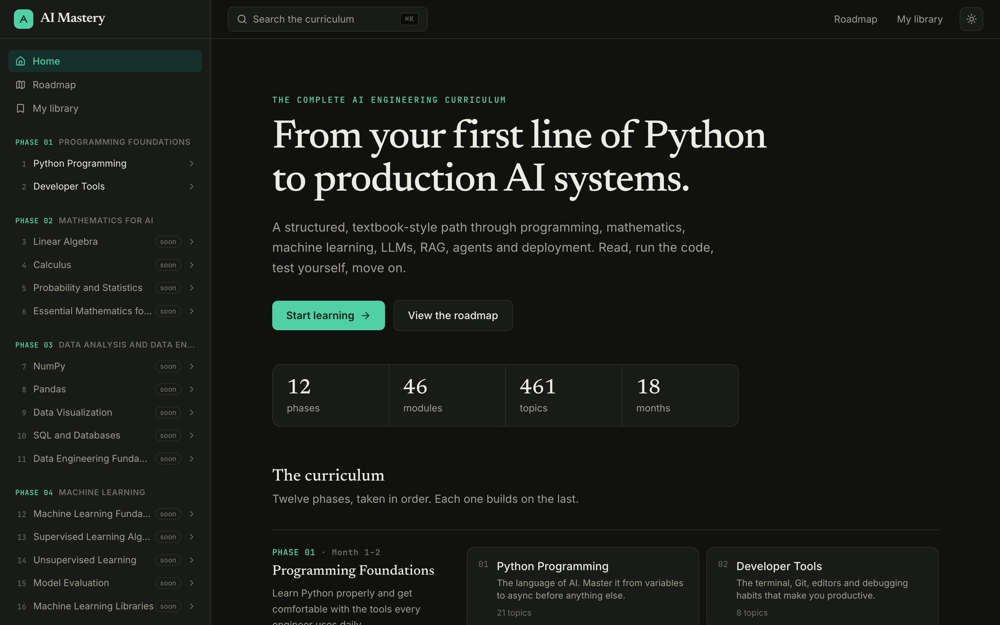
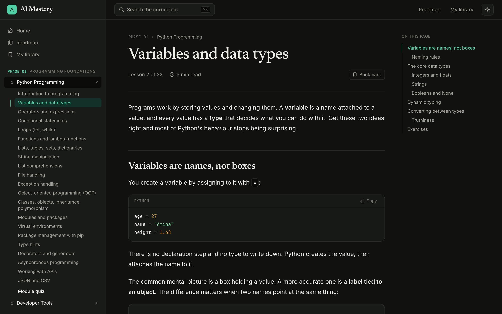

<div align="center">



# AI Mastery

**From your first line of Python to production AI systems.**

A structured, textbook-style curriculum for becoming an AI engineer: programming, mathematics, machine learning, LLMs, RAG, agents and deployment. Read the lesson, run the code, test yourself, move on.


**12 phases · 46 modules · 461 topics · 18 months**

</div>

---

## Features

- **Textbook-style lessons**, written in Markdown with syntax-highlighted code, expected output blocks, and callouts (tips, notes, warnings, key ideas).
- **Diagrams and maths.** Mermaid diagrams and KaTeX formulas render inline.
- **Interactive blocks.** Quizzes with instant feedback, and step-through code traces that show variables changing line by line.
- **Exercises with hidden solutions** in every lesson, plus an assessment quiz at the end of each module.
- **Progress tracking.** Mark lessons complete, see per-module progress, and pick up where you left off from the home page.
- **My library.** Bookmarks, personal notes per lesson, and saved quiz scores.
- **Search** across the whole curriculum with <kbd>⌘</kbd> <kbd>K</kbd>.
- **Light and dark mode.**
- **No backend and no account.** Everything is stored in the browser's `localStorage`.



## Curriculum

| Phase | Title | Timeline | Modules |
| :---: | --- | --- | --- |
| 01 | Programming Foundations | Month 1–2 | Python Programming, Developer Tools |
| 02 | Mathematics for AI | Month 2–3 | Linear Algebra, Calculus, Probability and Statistics, Essential Mathematics for ML |
| 03 | Data Analysis and Data Engineering | Month 3–4 | NumPy, Pandas, Data Visualization, SQL and Databases, Data Engineering Fundamentals |
| 04 | Machine Learning | Month 4–6 | ML Fundamentals, Supervised Learning, Unsupervised Learning, Model Evaluation, ML Libraries |
| 05 | Deep Learning | Month 6–8 | Neural Network Fundamentals, PyTorch, TensorFlow and Keras, Computer Vision, Sequence Models |
| 06 | Natural Language Processing | Month 8–9 | NLP Fundamentals, Advanced NLP |
| 07 | Generative AI and LLMs | Month 9–11 | Generative AI Fundamentals, Working with LLMs, Prompt Engineering, Hugging Face Ecosystem |
| 08 | RAG and Vector Databases | Month 10–12 | RAG Fundamentals, Vector Databases, Advanced RAG |
| 09 | AI Agents and Agentic AI | Month 11–13 | AI Agent Fundamentals, Agent Frameworks, Advanced Agent Systems |
| 10 | Backend Development and AI APIs | Month 12–14 | Backend Development, FastAPI, Software Engineering, Application Development |
| 11 | MLOps, LLMOps and Cloud Deployment | Month 13–15 | Docker and Containers, MLOps, CI/CD, Cloud Computing, Production AI Systems |
| 12 | Advanced AI Engineering | Month 15–18 | Advanced LLM Engineering, Multimodal AI, AI Security and Responsible AI, AI System Design |

**Status:** Module 1, *Python Programming* (21 lessons and a module quiz), is published. The remaining modules show as "soon" and are added one at a time.

## Getting started

You need Node.js 20 or newer.

```bash
npm install
npm run dev       # start the dev server at http://localhost:5173
npm run build     # type-check and build to dist/
npm run preview   # serve the production build locally
```

## Project structure

```
src/
├── App.tsx                 # routes
├── data/curriculum.ts      # every phase, module and topic (single source of truth)
├── content/                # lesson Markdown, one folder per module
│   └── python-programming/
│       ├── variables-and-data-types.md
│       ├── ...
│       └── assessment.md   # module quiz
├── components/             # Layout, Sidebar, Markdown, CodeBlock, Mermaid, Quiz, Trace, SearchDialog
├── lib/
│   ├── content.ts          # discovers and lazy-loads lesson files
│   └── store.ts            # progress, bookmarks, notes, quiz scores, theme (localStorage)
└── pages/                  # Home, Roadmap, Library, ModulePage, LessonPage, NotFound
```

## Writing lessons

A lesson is published as soon as its Markdown file exists. Nothing needs to be registered.

1. Find the module and topic in [src/data/curriculum.ts](src/data/curriculum.ts). File and folder names are the slugified titles, so *Loops (for, while)* in *Python Programming* becomes `src/content/python-programming/loops-for-while.md`.
2. Add `assessment.md` in the module folder for the end-of-module quiz.

Lessons are standard GitHub-flavoured Markdown with a few extra blocks:

| Block | Syntax | Renders as |
| --- | --- | --- |
| Code | ` ```python ` | Highlighted code with a copy button |
| Output | ` ```output ` | Program output under a code block |
| Diagram | ` ```mermaid ` | Mermaid diagram |
| Quiz | ` ```quiz ` with JSON | Multiple-choice questions with feedback |
| Trace | ` ```trace ` with JSON | Step-through code execution |
| Callout | `> [!TIP]`, `> [!NOTE]`, `> [!WARNING]`, `> [!KEY]` | Styled callout box |
| Maths | `$...$` and `$$...$$` | KaTeX formulas |
| Solution | `<details><summary>Solution</summary>…</details>` | Collapsible answer |

## Tech stack

- [React 19](https://react.dev) with [React Router](https://reactrouter.com)
- [Vite](https://vite.dev) and TypeScript
- [Tailwind CSS 4](https://tailwindcss.com)
- [react-markdown](https://github.com/remarkjs/react-markdown) with remark-gfm, remark-math, rehype-katex, rehype-highlight and rehype-slug
- [Mermaid](https://mermaid.js.org) for diagrams, [KaTeX](https://katex.org) for maths
- [Lucide](https://lucide.dev) icons; Inter, Newsreader and JetBrains Mono fonts
