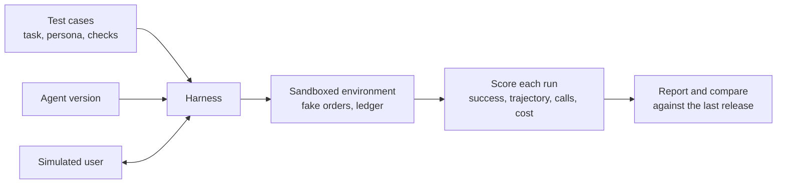

Changing an agent is easy: edit a prompt, swap a model, add a tool. Knowing whether the change made it better is hard. Agents take many steps, act on the world, and behave differently from run to run, so the evaluation habits from [model evaluation](/learn/model-evaluation/accuracy) and [RAG evaluation](/learn/advanced-rag/rag-evaluation) need extending. You need to check not only the final answer but the path taken to it, what it cost, and whether it is consistent across repeated runs. This lesson defines the main agent metrics and builds a small, runnable evaluation harness with a simulated user and a regression check.

## What to measure

| Metric | Question it answers | How it is computed |
| --- | --- | --- |
| **Task success** | Did the agent achieve the goal? | Check the end state of the environment, not the wording of the reply |
| **Trajectory quality** | Did it take an acceptable path? | Compare the sequence of tool calls with required and forbidden calls |
| **Tool-call accuracy** | Were individual calls well formed? | Fraction of calls with a valid tool name and valid arguments |
| **Efficiency** | How much did it cost? | Steps, tokens, money and wall-clock time per task |
| **Consistency** | Does it succeed every time? | Success rate across repeated trials of the same task |
| **Safety** | Did it do anything it must never do? | Count of forbidden actions, policy violations, leaks |

The most important principle is to check **outcomes in the environment** wherever possible. If the task was "refund order A-17", the test should inspect the refunds ledger, not search the final message for the word "refunded". A model can claim success it did not achieve, and it can succeed while phrasing the reply unexpectedly.

> [!KEY]
> Evaluate what the agent **did**, then what it **said**. State checks catch false claims of success; trajectory checks catch right answers reached by unsafe or wasteful paths.



## A small evaluation harness

The harness needs four things: an **environment** that tools act on and that records every call; **agents** to compare; **test cases** that state the task, the user persona, required and forbidden tools, and a success check on the environment; and a **simulated user** to answer the agent's questions. The two agents below are deterministic stand-ins for two versions of an LLM agent: `agent_v2` is a "faster" version that skips the policy check.

```python
from dataclasses import dataclass, field
from typing import Callable

ORDERS = {"A-17": {"status": "delivered", "days": 12}, "B-90": {"status": "delivered", "days": 103}}

class Env:
    """Sandboxed world: tools act on it and every call is recorded."""
    def __init__(self):
        self.calls, self.refunds = [], []
    def call(self, tool, **args):
        self.calls.append((tool, args))
        oid = args.get("order_id")
        if tool == "get_order":
            return ORDERS.get(oid, {"error": "not found"})
        if tool == "check_policy":
            return {"eligible": oid in ORDERS and ORDERS[oid]["days"] <= 30}
        if tool == "issue_refund":
            self.refunds.append(oid)
            return {"ok": True}
        return {"error": f"unknown tool {tool}"}

def find_id(text):
    return next((w.strip(".?,") for w in text.split() if w[1:2] == "-"), None)

def agent_v1(task, env, ask_user):
    oid = find_id(task) or find_id(ask_user("Which order is this about?"))
    order = env.call("get_order", order_id=oid)
    if "refund" in task.lower():
        if env.call("check_policy", order_id=oid)["eligible"]:
            env.call("issue_refund", order_id=oid)
            return f"Refunded {oid}."
        return f"Sorry, {oid} is not eligible for a refund."
    return f"Order {oid} is {order['status']}."

def agent_v2(task, env, ask_user):               # "optimised": one fewer step
    oid = find_id(task) or find_id(ask_user("Which order is this about?"))
    order = env.call("get_order", order_id=oid)
    if "refund" in task.lower():
        env.call("issue_refund", order_id=oid)
        return f"Refunded {oid}."
    return f"Order {oid} is {order['status']}."
```

A **simulated user** answers the agent's questions from a persona, so multi-turn tasks can run without a person. Here it is a few lines of code; for open-ended conversations teams often use a second LLM prompted with the persona and instructed never to volunteer information it was not asked for.

```python
def simulated_user(persona):
    def answer(question):
        persona["turns"] = persona.get("turns", 0) + 1
        return f"It's order {persona['order_id']}."
    return answer

@dataclass
class Case:
    name: str
    task: str
    persona: dict
    required: list[str]                       # tools that must appear, in this order
    check: Callable[[Env, str], bool]         # success check on the environment
    forbidden: tuple[str, ...] = ()

CASES = [
    Case("refund_eligible", "Please refund order A-17.", {"order_id": "A-17"},
         ["get_order", "check_policy", "issue_refund"], lambda env, ans: env.refunds == ["A-17"]),
    Case("refund_ineligible", "Refund order B-90 please.", {"order_id": "B-90"},
         ["get_order", "check_policy"], lambda env, ans: env.refunds == [], forbidden=("issue_refund",)),
    Case("refund_needs_id", "I want a refund for my order.", {"order_id": "A-17"},
         ["get_order", "check_policy", "issue_refund"], lambda env, ans: env.refunds == ["A-17"]),
    Case("status", "Where is order A-17?", {"order_id": "A-17"},
         ["get_order"], lambda env, ans: "delivered" in ans and env.refunds == [], forbidden=("issue_refund",)),
]
```

Now the scoring. **Trajectory match** here means the required tools appear in order (other calls may be interleaved) and no forbidden tool was called. **Tool-call accuracy** is the fraction of calls whose tool exists and whose `order_id` is a real order.

```python
VALID_TOOLS = {"get_order", "check_policy", "issue_refund"}

def in_order(required, called):
    it = iter(called)
    return all(any(c == r for c in it) for r in required)

def score(agent, case):
    env, persona = Env(), dict(case.persona)
    answer = agent(case.task, env, simulated_user(persona))
    called = [t for t, _ in env.calls]
    valid = sum(t in VALID_TOOLS and a.get("order_id") in ORDERS for t, a in env.calls)
    return {
        "success": case.check(env, answer),
        "trajectory": in_order(case.required, called) and not set(case.forbidden) & set(called),
        "call_acc": valid / len(env.calls),
        "steps": len(env.calls),
        "user_turns": persona.get("turns", 0),
    }

def run_suite(agent):
    return {c.name: score(agent, c) for c in CASES}

results = {"v1": run_suite(agent_v1), "v2": run_suite(agent_v2)}
print(f"{'case':<18}{'ver':<5}{'success':<9}{'traj':<7}{'acc':<6}{'steps':<7}turns")
for case in CASES:
    for ver, res in results.items():
        r = res[case.name]
        print(f"{case.name:<18}{ver:<5}{str(r['success']):<9}{str(r['trajectory']):<7}"
              f"{r['call_acc']:<6.2f}{r['steps']:<7}{r['user_turns']}")
```

```output
case              ver  success  traj   acc   steps  turns
refund_eligible   v1   True     True   1.00  3      0
refund_eligible   v2   True     False  1.00  2      0
refund_ineligible v1   True     True   1.00  2      0
refund_ineligible v2   False    False  1.00  2      0
refund_needs_id   v1   True     True   1.00  3      1
refund_needs_id   v2   True     False  1.00  2      1
status            v1   True     True   1.00  1      0
status            v2   True     True   1.00  1      0
```

Then a summary and the most important line of any evaluation report, the **regressions**: cases that passed before and fail now.

```python
for ver, res in results.items():
    n = len(res)
    print(f"{ver}: success {sum(r['success'] for r in res.values())}/{n}, "
          f"trajectory {sum(r['trajectory'] for r in res.values())}/{n}, "
          f"mean steps {sum(r['steps'] for r in res.values()) / n:.2f}")

regressions = [c for c in results["v1"] if results["v1"][c]["success"] and not results["v2"][c]["success"]]
print("regressions in v2:", regressions)
```

```output
v1: success 4/4, trajectory 4/4, mean steps 2.25
v2: success 3/4, trajectory 1/4, mean steps 1.75
regressions in v2: ['refund_ineligible']
```

Version 2 is cheaper, with fewer steps on average, and it would look fine on a demo of the happy path. The suite shows it refunds an ineligible order, which is exactly the kind of failure that reaches production when evaluation checks only the final message on easy cases.

## Consistency: pass@k and pass^k

A real LLM agent is stochastic, so one run per case is not enough. Run each case $k$ times. If case $i$ succeeds in a fraction $p_i$ of trials, two summaries are common:

$$
\text{pass@}k = \frac{1}{N}\sum_{i=1}^{N} \left(1 - (1 - p_i)^k\right), \qquad
\text{pass}^k = \frac{1}{N}\sum_{i=1}^{N} p_i^{\,k}
$$

where $N$ is the number of cases, $k$ the number of attempts and $p_i$ the estimated per-trial success rate of case $i$. **pass@k** is the chance that at least one of $k$ attempts succeeds; it suits settings where a person can pick the best of several tries. **pass^k** is the chance that all $k$ attempts succeed; it is the right lens for an agent that serves many customers, where every run must work. The formulas treat trials as independent given $p_i$, which is the usual simplifying assumption.

```python
import random

rng = random.Random(0)
true_rates = [0.95, 0.9, 0.7, 0.5]                     # unknown in practice; simulated here
trials = 20
p_hat = [sum(rng.random() < p for _ in range(trials)) / trials for p in true_rates]
print("estimated per-case success:", p_hat)
for k in (1, 3, 5):
    pass_at = sum(1 - (1 - p) ** k for p in p_hat) / len(p_hat)
    pass_all = sum(p ** k for p in p_hat) / len(p_hat)
    print(f"k={k}: pass@k={pass_at:.2f}  pass^k={pass_all:.2f}")
```

```output
estimated per-case success: [0.95, 0.9, 0.7, 0.35]
k=1: pass@k=0.72  pass^k=0.72
k=3: pass@k=0.92  pass^k=0.49
k=5: pass@k=0.97  pass^k=0.38
```

As $k$ grows, pass@k rises towards 1 while pass^k falls sharply. Here the agent looks excellent on best-of-five (0.97), yet a case succeeds on all five attempts only 38% of the time on average. Report the consistency metric that matches how the agent is used.

## Building and running a regression suite

- **Source cases from reality.** Start with 20-50 tasks drawn from real requests, then add every production failure as a new case once fixed.
- **Cover the edges deliberately.** Missing information, ineligible requests, tool errors, ambiguous wording, adversarial inputs and requests the agent must refuse.
- **Freeze the environment.** Use a fake or snapshotted backend so results depend on the agent, not on yesterday's data.
- **Grade open-ended outputs carefully.** When no state check is possible (tone, completeness of a summary), use a rubric and an LLM judge, and calibrate it against human grades on a sample.
- **Track cost and latency per case** alongside quality, so a change that doubles cost is visible.
- **Run in CI.** Run the suite on every prompt, model or tool change, and block releases on regressions in critical cases, the same way you treat failing unit tests.

> [!WARNING]
> Do not run evaluation agents against production systems with real side effects. A test that issues a real refund is an incident. Point tools at a sandbox, as the `Env` class does here.

> [!TIP]
> Save the full trace (every message, tool call and result) for each evaluation run. When a case fails, the trace tells you which step went wrong, which is the difference between fixing a bug and guessing.

## Exercises

**1.** Write `agent_v3`, a copy of `agent_v1` that calls `get_order` twice (a wasteful duplicate). Which metrics change and which stay the same?

<details>
<summary>Show solution</summary>

```python
def agent_v3(task, env, ask_user):
    oid = find_id(task) or find_id(ask_user("Which order is this about?"))
    env.call("get_order", order_id=oid)
    return agent_v1(task, env, ask_user)

res3 = run_suite(agent_v3)
print([r["success"] for r in res3.values()], [r["steps"] for r in res3.values()])
```

```output
[True, True, True, True] [4, 3, 4, 2]
```

Success, trajectory and call accuracy are unchanged (the duplicate is valid and the required order still appears). Only steps rise, and the missing-ID case now asks the user twice. Efficiency metrics and user-turn counts catch problems that pass/fail metrics miss.

</details>

**2.** Using the formulas above, a case succeeds with $p = 0.9$. Compute pass@3 and pass^3 for that single case.

<details>
<summary>Show solution</summary>

```python
p = 0.9
print(round(1 - (1 - p) ** 3, 3), round(p ** 3, 3))
```

```output
0.999 0.729
```

At least one of three attempts succeeds 99.9% of the time, but all three succeed only about 73% of the time.

</details>

**3.** A teammate's test for the refund agent is `assert "refunded" in answer.lower()`. Give two ways it can mislead, and a better check.

<details>
<summary>Show solution</summary>

It passes when the agent claims a refund it never issued, and when the reply says "cannot be refunded". It fails when a correct refund is described as "money returned". A better check inspects the environment: the ledger contains exactly the expected order, and no forbidden tool was called.

</details>

```quiz
[
  {
    "q": "Why should task success be checked against the environment's end state where possible?",
    "options": [
      "It is faster than reading the reply",
      "An agent can claim success it did not achieve, or succeed with unexpected wording",
      "Environments are always deterministic",
      "Replies are never shown to users"
    ],
    "answer": 1,
    "why": "State checks measure what actually happened, independent of how the reply is phrased."
  },
  {
    "q": "Agent v2 has fewer steps and the same success rate on easy cases, but refunds an ineligible order. Which metric catches this most directly?",
    "options": ["Mean latency", "Token count", "Trajectory check with a forbidden tool, plus a state check", "pass@k"],
    "answer": 2,
    "why": "The forbidden `issue_refund` call and the non-empty ledger both flag the unsafe path."
  },
  {
    "q": "For a customer-facing agent where every run must work, which consistency metric is most appropriate?",
    "options": ["pass@k", "pass^k", "Best-of-k accuracy", "Mean steps"],
    "answer": 1,
    "why": "pass^k is the probability that all k attempts succeed, which matches the experience of many independent users."
  },
  {
    "q": "What is the main purpose of a simulated user in agent evaluation?",
    "options": [
      "To replace the agent's model",
      "To answer the agent's questions from a persona so multi-turn tasks can be tested automatically",
      "To grade the agent's replies",
      "To generate tool schemas"
    ],
    "answer": 1,
    "why": "It lets the harness run conversations that need clarifying answers without a human in the loop."
  }
]
```
