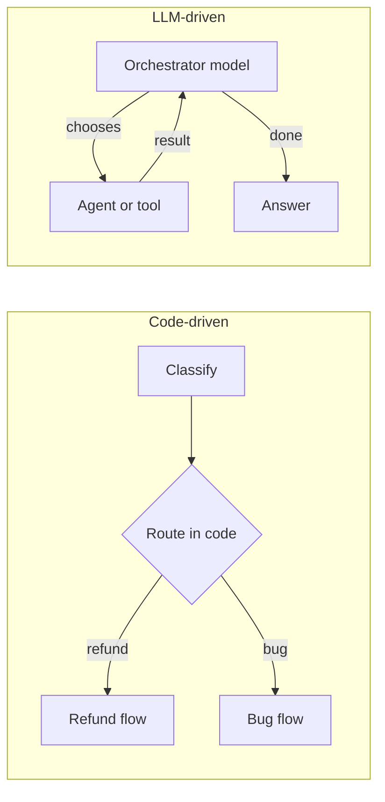
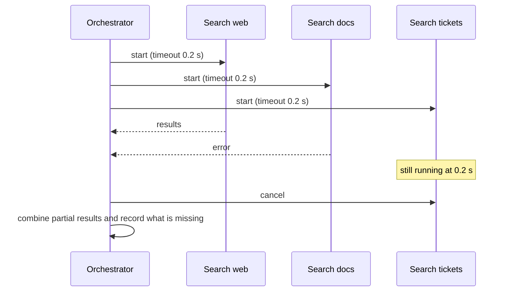

**Orchestration** is the layer that decides what runs, in what order, in parallel or not, and when to stop. In a single agent the model orchestrates itself: it picks the next tool on every step. In larger systems you have a choice for every decision point: let a model decide, or decide in code. That choice, made well, is the difference between a system you can reason about and one that surprises you in production. This lesson covers the two styles of control flow, the building blocks of routers and fan-out/fan-in, and the timeouts and budgets that keep any of it from running away.

## Two styles of control flow

**Code-driven orchestration** means your program fixes the sequence: call the classifier, then branch, then run the extractor, then validate. Models are called at fixed points to do judgement tasks, but they never choose what happens next. **LLM-driven orchestration** means a model decides the next step: which agent to call, which tool to use, whether the task is done.



| Property | Code-driven | LLM-driven |
| --- | --- | --- |
| Predictability | High: the same input follows the same path | Lower: the path can change between runs |
| Handles unforeseen cases | Only the cases you coded | Often, if the model understands the goal |
| Testing | Ordinary unit tests per branch | Needs trajectory evaluation and many samples |
| Cost and latency | Known in advance | Variable, sometimes large |
| Debugging | Read the code | Read traces of model decisions |

Most production systems mix the two: a deterministic skeleton with LLM-driven steps inside it where flexibility is genuinely needed. Code owns the things that must always happen (authentication, validation, logging, approval gates); the model owns the things that need judgement (what to search for, how to phrase a reply).

> [!KEY]
> Put a decision in code whenever you can write down the rule. Give it to a model only when the rule cannot be written down but examples of good decisions can be recognised.

## Routers

A **router** is the simplest LLM-driven decision: a model classifies the input into one of a few fixed routes, and code dispatches. The model chooses among options you defined, so the system stays predictable. Production routers need two extra things: a **confidence threshold**, below which the input goes to a safe default, and a check that the chosen route actually exists.

```python
ROUTES = {"refund": "refund_workflow", "bug": "bug_triage_agent", "sales": "sales_handoff"}

def stub_classifier(text: str) -> tuple[str, float]:
    """Stand-in for an LLM classifier returning (label, confidence)."""
    t = text.lower()
    if "refund" in t or "charged" in t:
        return "refund", 0.93
    if "error" in t or "crash" in t:
        return "bug", 0.88
    if "price" in t:
        return "sales", 0.55
    return "poetry", 0.40          # a label we never defined

def route(text: str, threshold: float = 0.7) -> str:
    label, conf = stub_classifier(text)
    if label not in ROUTES:
        return "general_agent (unknown label)"
    if conf < threshold:
        return f"general_agent (low confidence {conf})"
    return ROUTES[label]

for msg in ["I was charged twice", "App crashes on login", "What is the price for 40 seats?", "Write me a poem"]:
    print(f"{msg:<34} -> {route(msg)}")
```

```output
I was charged twice                -> refund_workflow
App crashes on login               -> bug_triage_agent
What is the price for 40 seats?    -> general_agent (low confidence 0.55)
Write me a poem                    -> general_agent (unknown label)
```

The model never causes an exception or an undefined branch: invalid labels and uncertain answers both land on a general-purpose fallback. With a real model you would obtain the label through structured output constrained to the allowed values, and log the confidence so you can tune the threshold against real traffic.

## Fan-out and fan-in

**Fan-out** runs several independent steps at once; **fan-in** waits for them and combines the results. It is the engine behind parallel research and behind checking a draft against several policies simultaneously. The hard part is not starting the work but deciding what happens when some branches are slow or fail.



Python's `asyncio` handles this directly. `asyncio.wait_for` cancels a coroutine that exceeds its timeout, and `asyncio.gather(..., return_exceptions=True)` returns exceptions as values instead of aborting the whole batch.

```python
import asyncio

async def search(source: str, delay: float, fail: bool = False) -> str:
    await asyncio.sleep(delay)                  # simulated network and model latency
    if fail:
        raise ConnectionError(f"{source} unavailable")
    return f"3 results from {source}"

async def fan_out(timeout: float = 0.2):
    branches = {
        "web": search("web", 0.05),
        "docs": search("docs", 0.02, fail=True),
        "tickets": search("tickets", 1.0),      # too slow
    }
    wrapped = [asyncio.wait_for(coro, timeout) for coro in branches.values()]
    outcomes = await asyncio.gather(*wrapped, return_exceptions=True)
    results, missing = {}, {}
    for name, out in zip(branches, outcomes):
        if isinstance(out, Exception):
            missing[name] = type(out).__name__
        else:
            results[name] = out
    return results, missing

results, missing = asyncio.run(fan_out())
print("results:", results)
print("missing:", missing)
```

```output
results: {'web': '3 results from web'}
missing: {'docs': 'ConnectionError', 'tickets': 'TimeoutError'}
```

The orchestrator returns within the timeout with one good result and an explicit record of what is missing and why. That record matters: the final answer should say "ticket search timed out" rather than present partial evidence as complete. The [error handling](/learn/advanced-agent-systems/error-handling) lesson returns to partial results.

> [!TIP]
> Set a timeout on every external call and a separate, larger deadline on the whole run. Per-call timeouts stop one slow tool from blocking; the overall deadline stops many reasonable calls from adding up to an unreasonable wait.

## Budgets

An agent that decides its own next step also decides, implicitly, how much to spend. Budgets turn that into an explicit, enforced contract. A **budget** tracks one or more resources (steps, tokens, money, wall-clock time) and stops the run when any is exhausted.

```python
import time
from dataclasses import dataclass, field

class BudgetExceeded(Exception):
    pass

@dataclass
class Budget:
    max_steps: int
    max_tokens: int
    max_seconds: float
    steps: int = 0
    tokens: int = 0
    started: float = field(default_factory=time.monotonic)

    def charge(self, tokens: int) -> None:
        self.steps += 1
        self.tokens += tokens
        if self.steps > self.max_steps:
            raise BudgetExceeded(f"steps {self.steps} > {self.max_steps}")
        if self.tokens > self.max_tokens:
            raise BudgetExceeded(f"tokens {self.tokens} > {self.max_tokens}")
        if time.monotonic() - self.started > self.max_seconds:
            raise BudgetExceeded("deadline passed")

def orchestrate(budget: Budget, step_tokens: list[int]) -> str:
    done = []
    try:
        for i, t in enumerate(step_tokens, 1):
            budget.charge(t)                 # charge before doing the work
            done.append(i)
        return f"finished steps {done}"
    except BudgetExceeded as e:
        return f"stopped after steps {done}: {e}"

print(orchestrate(Budget(max_steps=10, max_tokens=5000, max_seconds=5), [800, 1200, 900]))
print(orchestrate(Budget(max_steps=10, max_tokens=5000, max_seconds=5), [800, 1200, 2500, 900]))
print(orchestrate(Budget(max_steps=2, max_tokens=5000, max_seconds=5), [100, 100, 100]))
```

```output
finished steps [1, 2, 3]
stopped after steps [1, 2, 3]: tokens 5400 > 5000
stopped after steps [1, 2]: steps 3 > 2
```

Three design points are worth copying. The budget is **charged before** the step's work runs, so the limit is never overshot by a whole step. Exceeding it raises a dedicated exception that the orchestrator turns into a **clean stop with a reason**. And one budget object can be **shared** between a supervisor and its workers, so a team of agents cannot collectively outspend a single limit. In practice you charge an estimate before each call (the prompt size plus the maximum output tokens you allow), then correct it with the real counts from the API response's usage data, converting tokens to money with your provider's current prices.

## Common orchestration patterns

| Pattern | Control | Use when |
| --- | --- | --- |
| Prompt chain | Code | Steps are known and sequential: extract, then check, then format |
| Router | Model picks a branch, code dispatches | A few clearly different kinds of input |
| Fan-out/fan-in | Code | Independent subtasks; results can be merged |
| Orchestrator and workers | Model plans, code executes | Subtasks are not known until the input is read |
| Evaluator loop | Code loop, model judges | Output can be checked and improved iteratively, with a cap on rounds |
| Autonomous agent | Model | Open-ended tasks where steps cannot be planned in advance |

The list is roughly ordered from most to least predictable. Choose the earliest pattern that can do the job; the [workflow design](/learn/advanced-agent-systems/workflow-design) lesson shows how to draw and implement these as state machines.

> [!WARNING]
> Budgets and timeouts must live in your orchestration code, not in the prompt. Telling a model "use at most five searches" is a useful hint; it is not a limit.

## Exercises

**1.** Change `route` so that a confidence between 0.5 and 0.7 asks the user a clarifying question instead of going to the general agent. Test it on the sales message.

<details>
<summary>Show solution</summary>

```python
def route2(text, threshold=0.7, ask_below=0.5):
    label, conf = stub_classifier(text)
    if label not in ROUTES or conf < ask_below:
        return "general_agent"
    if conf < threshold:
        return f"ask user: did you mean {label}?"
    return ROUTES[label]

print(route2("What is the price for 40 seats?"))
```

```output
ask user: did you mean sales?
```

</details>

**2.** In `fan_out`, raise the timeout to 1.5 seconds. What changes in the output, and what is the cost of that change?

<details>
<summary>Show solution</summary>

```python
results, missing = asyncio.run(fan_out(timeout=1.5))
print(sorted(results), missing)
```

```output
['tickets', 'web'] {'docs': 'ConnectionError'}
```

Ticket search now completes, so you have more evidence, but the whole fan-out takes about a second instead of 0.2 seconds, because fan-in waits for the slowest successful branch. Timeouts trade completeness for latency.

</details>

**3.** A supervisor gives each of four workers its own `Budget(max_tokens=10000)`. The product owner wants a hard ceiling of 25,000 tokens per user request. What is wrong, and how do you fix it?

<details>
<summary>Show solution</summary>

Four independent budgets allow up to 40,000 tokens in total, and the supervisor's own calls are not counted at all. Create one `Budget(max_tokens=25000)` per request and pass the same object to the supervisor and every worker, so all charges draw from one pool. If workers run in parallel threads, protect `charge` with a lock so concurrent updates are not lost.

</details>

```quiz
[
  {
    "q": "Which decision belongs in code rather than with a model?",
    "options": [
      "How to phrase an apology to a customer",
      "Whether a user is authenticated before an account is changed",
      "Which search query is most likely to find the answer",
      "How to summarise a long document"
    ],
    "answer": 1,
    "why": "Anything that must always happen, and whose rule can be written down, belongs in deterministic code."
  },
  {
    "q": "What does `asyncio.gather(*tasks, return_exceptions=True)` do when one task raises?",
    "options": [
      "Cancels all other tasks and re-raises immediately",
      "Returns the exception object in that task's position in the results list",
      "Silently drops that task from the results",
      "Retries the failed task automatically"
    ],
    "answer": 1,
    "why": "With `return_exceptions=True`, exceptions are returned as values, so you can keep the successful results."
  },
  {
    "q": "A router's model returns a label that is not one of the defined routes. What should the orchestrator do?",
    "options": [
      "Raise an exception and fail the request",
      "Create a new route on the fly",
      "Send the input to a safe default route and log it",
      "Ask the model to try again forever"
    ],
    "answer": 2,
    "why": "Invalid or low-confidence classifications should fall back to a safe default, never to an undefined branch."
  },
  {
    "q": "Why should a budget be charged before a step runs rather than after?",
    "options": [
      "It makes the step run faster",
      "So the limit is never overshot by the cost of a whole extra step",
      "Because token counts are only known in advance",
      "To avoid logging the step"
    ],
    "answer": 1,
    "why": "Checking first means the step that would exceed the limit is never started."
  }
]
```
