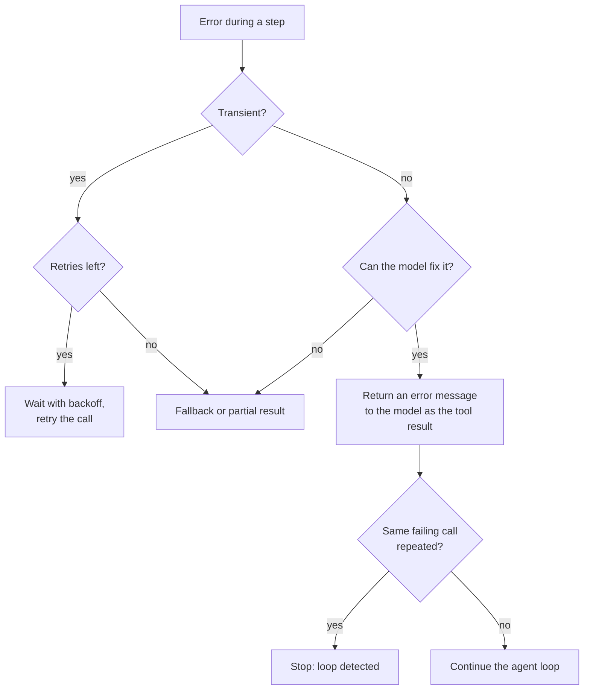

In a demo, every API answers and every tool call is well formed. In production, a search service times out, a model returns arguments that do not match the schema, a database rejects a query, and an agent calls the same failing tool five times in a row. Agents add their own failure modes to those of ordinary software, and they are surprisingly good at turning a small error into a long, expensive loop. This lesson builds the defences in layers: retries for transient faults, informative error messages that let the model correct itself, loop detection, hard limits, fallbacks, and honest partial results. It assumes the general Python techniques from [exception handling](/learn/python-programming/exception-handling).

## A taxonomy of agent failures

Different failures need different responses. Treating them all the same, for example by retrying everything, makes some of them worse.

| Failure | Example | Right response |
| --- | --- | --- |
| Transient infrastructure | Timeout, rate limit, connection reset | Retry with backoff |
| Permanent tool error | Order not found, permission denied | Do not retry; tell the model what went wrong |
| Malformed model output | Invalid JSON, unknown tool, missing argument | Return a precise error to the model; it can usually fix it next step |
| Model behaviour | Loops, wanders off task, never finishes | Loop detection, step limits, budgets |
| Provider outage | Model API down for minutes | Fallback model or degraded mode |
| Partial failure | Two of three sources answered | Return what you have and say what is missing |



## Retries with exponential backoff

A transient error is likely to succeed if you try again a little later. Retrying immediately, in a tight loop, hammers a service that may already be overloaded. **Exponential backoff** waits longer after each failure, and **jitter** randomises the wait so that many clients do not retry in lockstep. The delay before retry number $n$ (starting at 0) is

$$
d_n = \text{uniform}\left(0,\ \min\left(d_{\max},\ d_0 \cdot 2^{n}\right)\right)
$$

where $d_0$ is the base delay, $d_{\max}$ caps the growth and the uniform draw is the "full jitter" variant. The sketch below injects the `sleep` function, so the test records delays instead of actually waiting, and uses a seeded random generator for repeatable output.

```python
import random

class TransientError(Exception): pass
class PermanentError(Exception): pass

def with_retries(fn, *, attempts=4, base=0.5, cap=8.0, sleep, rng):
    for n in range(attempts):
        try:
            return fn()
        except TransientError as e:
            if n == attempts - 1:
                raise
            delay = rng.uniform(0, min(cap, base * 2 ** n))
            print(f"attempt {n + 1} failed ({e}); sleeping {delay:.2f}s")
            sleep(delay)
        # PermanentError is not caught: retrying cannot help

def flaky_search(fail_times):
    state = {"calls": 0}
    def call():
        state["calls"] += 1
        if state["calls"] <= fail_times:
            raise TransientError("503 service unavailable")
        return "5 results"
    return call

slept = []
print(with_retries(flaky_search(2), sleep=slept.append, rng=random.Random(1)))
print("total wait:", round(sum(slept), 2), "s")
```

```output
attempt 1 failed (503 service unavailable); sleeping 0.07s
attempt 2 failed (503 service unavailable); sleeping 0.85s
5 results
total wait: 0.91 s
```

Step through the retry loop to see how the cap on attempts and the growing delay interact:

```trace
{
  "title": "retrying a transient failure",
  "code": [
    "for n in range(attempts):",
    "    try:",
    "        return fn()",
    "    except TransientError as e:",
    "        if n == attempts - 1:",
    "            raise",
    "        delay = rng.uniform(0, min(cap, base * 2 ** n))",
    "        sleep(delay)"
  ],
  "steps": [
    { "line": 3, "vars": { "n": "0", "calls": "1" }, "note": "First call fails with a 503." },
    { "line": 7, "vars": { "n": "0", "upper bound": "0.5" }, "note": "Delay drawn from 0 to base * 2^0 = 0.5 seconds." },
    { "line": 3, "vars": { "n": "1", "calls": "2" }, "note": "Second call also fails." },
    { "line": 7, "vars": { "n": "1", "upper bound": "1.0" }, "note": "The upper bound doubles to 1.0 second." },
    { "line": 3, "vars": { "n": "2", "calls": "3" }, "out": ["5 results"], "note": "Third call succeeds and its value is returned. Had it failed on the last attempt, line 6 would re-raise." }
  ]
}
```

> [!WARNING]
> Only retry operations that are safe to repeat. Reads are safe; a payment or an email is safe only with an idempotency key, as described in [state management](/learn/advanced-agent-systems/state-management). Also respect any retry-after information the provider returns on rate-limit errors.

## Tool errors as messages to the model

When a tool fails for a reason the model can act on, the worst responses are crashing the run and returning a bare `"error"`. The best is a **tool result that explains what went wrong and how to fix it**. Models are good at correcting a call when told precisely what was wrong.

```python
import json

SCHEMAS = {"get_weather": {"required": {"city": str, "unit": str}, "enums": {"unit": {"C", "F"}}}}

def execute(tool: str, raw_args: str) -> str:
    if tool not in SCHEMAS:
        return f"error: unknown tool '{tool}'. Available tools: {sorted(SCHEMAS)}"
    try:
        args = json.loads(raw_args)
    except json.JSONDecodeError as e:
        return f"error: arguments are not valid JSON ({e.msg} at position {e.pos}). Send a JSON object."
    spec = SCHEMAS[tool]
    missing = [k for k in spec["required"] if k not in args]
    if missing:
        return f"error: missing required argument(s) {missing} for {tool}"
    for k, allowed in spec["enums"].items():
        if args[k] not in allowed:
            return f"error: {k} must be one of {sorted(allowed)}, got {args[k]!r}"
    return f"{args['city']}: 18 degrees {args['unit']}"

attempts = [("get_wether", '{"city": "Oslo"}'),
            ("get_weather", '{"city": "Oslo", unit: "C"}'),
            ("get_weather", '{"city": "Oslo"}'),
            ("get_weather", '{"city": "Oslo", "unit": "celsius"}'),
            ("get_weather", '{"city": "Oslo", "unit": "C"}')]
for tool, raw in attempts:
    print(execute(tool, raw))
```

```output
error: unknown tool 'get_wether'. Available tools: ['get_weather']
error: arguments are not valid JSON (Expecting property name enclosed in double quotes at position 17). Send a JSON object.
error: missing required argument(s) ['unit'] for get_weather
error: unit must be one of ['C', 'F'], got 'celsius'
Oslo: 18 degrees C
```

Each message names the problem and the correct form, so a model reading it as the tool result can repair the call. In practice, most providers can also constrain tool-call arguments to the schema, which removes many of these errors at the source, but your executor should still validate: the schema cannot express every rule.

Equally important is what error messages must **not** contain: stack traces, internal hostnames, credentials or other users' data. The tool result goes into the model's context and may be repeated to the user.

## Loop detection and hard limits

A model that receives the same error repeatedly may simply try the same call again. Detect this by keeping a short history of recent call signatures and counting repeats.

```python
from collections import deque

class LoopDetector:
    def __init__(self, window=6, max_repeats=3):
        self.recent = deque(maxlen=window)
        self.max_repeats = max_repeats

    def check(self, tool, args) -> str | None:
        sig = (tool, json.dumps(args, sort_keys=True))
        self.recent.append(sig)
        if self.recent.count(sig) >= self.max_repeats:
            return f"loop: {tool}{args} called {self.max_repeats} times in the last {len(self.recent)} steps"
        return None

detector = LoopDetector()
calls = [("search", {"q": "refund policy"}), ("search", {"q": "refund policy"}),
         ("open", {"id": 3}), ("search", {"q": "refund policy"})]
for step, (tool, args) in enumerate(calls, 1):
    problem = detector.check(tool, args)
    print(step, tool, "->", problem or "ok")
    if problem:
        break
```

```output
1 search -> ok
2 search -> ok
3 open -> ok
4 search -> loop: search{'q': 'refund policy'} called 3 times in the last 4 steps
```

On detection you have two options: inject a message telling the model the approach is not working and asking it to try something different (one chance), or stop the run. Detectors catch exact repeats; oscillation between two calls and near-identical arguments need fuzzier signatures, so keep a **maximum step count** and a [budget](/learn/advanced-agent-systems/agent-orchestration) as the backstop that always terminates the run.

> [!KEY]
> Every agent loop needs three independent stop conditions: the model says it is done, a hard step or budget limit is reached, or a detector sees it is stuck. Only the first is under the model's control.

## Fallbacks and partial results

When a component is down, a **fallback** keeps the system useful: a secondary model provider, a cached answer, a simpler non-agent workflow, or a hand-off to a human. A fallback chain tries options in order and records which one served the request.

```python
def primary_model(prompt):   raise TransientError("provider timeout")
def secondary_model(prompt): return "Refunds are allowed within 30 days."
def cached_answer(prompt):   return "Please see our refund policy page."

def answer_with_fallbacks(prompt):
    for source in (primary_model, secondary_model, cached_answer):
        try:
            return {"answer": source(prompt), "served_by": source.__name__}
        except Exception as e:
            print(f"{source.__name__} failed: {e}")
    return {"answer": None, "served_by": "none"}

print(answer_with_fallbacks("What is the refund policy?"))
```

```output
primary_model failed: provider timeout
{'answer': 'Refunds are allowed within 30 days.', 'served_by': 'secondary_model'}
```

Two cautions apply. A fallback model may behave differently, so it must be in your [evaluation suite](/learn/advanced-agent-systems/agent-evaluation) too, with prompts adjusted for it. And a fallback must not be less safe than the primary: if the main path has guardrails, the degraded path needs them as well.

When some subtasks succeed and others fail, return a **partial result** that states its own limits rather than an all-or-nothing failure:

```python
def research(sources):
    found, failed = {}, {}
    for name, outcome in sources.items():
        if isinstance(outcome, Exception):
            failed[name] = str(outcome)
        else:
            found[name] = outcome
    status = "complete" if not failed else ("partial" if found else "failed")
    return {"status": status, "findings": found, "unavailable": failed}

print(research({"docs": "policy v3 found", "tickets": TimeoutError("timed out after 10s")}))
```

```output
{'status': 'partial', 'findings': {'docs': 'policy v3 found'}, 'unavailable': {'tickets': 'timed out after 10s'}}
```

The final answer should then say, in plain words, which sources could not be checked. Presenting partial evidence as complete is a quiet way for an agent to be confidently wrong.

## Exercises

**1.** Run `with_retries` on `flaky_search(5)`, a search that fails five times in a row, with the default four attempts. What happens, and why is that the right behaviour?

<details>
<summary>Show solution</summary>

```python
try:
    with_retries(flaky_search(5), sleep=lambda d: None, rng=random.Random(1))
except TransientError as e:
    print("gave up:", e)
```

```output
attempt 1 failed (503 service unavailable); sleeping 0.07s
attempt 2 failed (503 service unavailable); sleeping 0.85s
attempt 3 failed (503 service unavailable); sleeping 1.53s
gave up: 503 service unavailable
```

All four attempts fail, so the final error is re-raised for the caller to handle with a fallback or a partial result. Retrying for ever would only hide an outage.

</details>

**2.** Extend `execute` so that a non-string `city` (for example `{"city": 42, "unit": "C"}`) returns a helpful type error.

<details>
<summary>Show solution</summary>

```python
def execute_typed(tool, raw_args):
    msg = execute(tool, raw_args)
    if msg.startswith("error"):
        return msg
    args = json.loads(raw_args)
    for k, typ in SCHEMAS[tool]["required"].items():
        if not isinstance(args[k], typ):
            return f"error: {k} must be a {typ.__name__}, got {type(args[k]).__name__}"
    return msg

print(execute_typed("get_weather", '{"city": 42, "unit": "C"}'))
```

```output
error: city must be a str, got int
```

The type check must run before the tool's body uses the value; here `execute` only formats the value into a string, so checking afterwards is harmless, but in a real tool you would validate first.

</details>

**3.** The loop detector misses an agent that alternates `search(q="refund")` and `search(q="refunds")` indefinitely. Suggest two fixes.

<details>
<summary>Show solution</summary>

Normalise arguments before building the signature (lower-case, strip plurals or punctuation, or compare embeddings for similarity), and count repeats per tool name regardless of arguments, with a higher threshold, for example "more than five searches in eight steps". The step limit remains the final backstop.

</details>

```quiz
[
  {
    "q": "Which error should not be retried?",
    "options": ["A 503 from a search API", "A connection reset", "\"Order not found\" for an ID that does not exist", "A rate-limit response"],
    "answer": 2,
    "why": "A permanent error will fail the same way again; return it to the model or the caller instead."
  },
  {
    "q": "Why add jitter to exponential backoff?",
    "options": [
      "To make each retry faster",
      "To stop many clients retrying at exactly the same moments and overloading the service again",
      "To make tests deterministic",
      "Because providers require random delays"
    ],
    "answer": 1,
    "why": "Randomised delays spread retries out so they do not arrive in synchronised waves."
  },
  {
    "q": "A model calls a tool with a misspelled name. What should the executor return?",
    "options": [
      "Raise an exception and end the run",
      "An empty string",
      "An error message naming the unknown tool and listing the available ones",
      "The result of the closest matching tool, silently"
    ],
    "answer": 2,
    "why": "A precise error lets the model correct itself on the next step, without guessing on its behalf."
  },
  {
    "q": "Which statement about partial results is correct?",
    "options": [
      "They should be hidden; return an error instead",
      "They should be returned with an explicit record of what could not be checked",
      "They are only acceptable for internal tools",
      "They should be presented as complete to avoid confusing users"
    ],
    "answer": 1,
    "why": "Honest partial results are useful; presenting them as complete makes the agent confidently wrong."
  }
]
```
