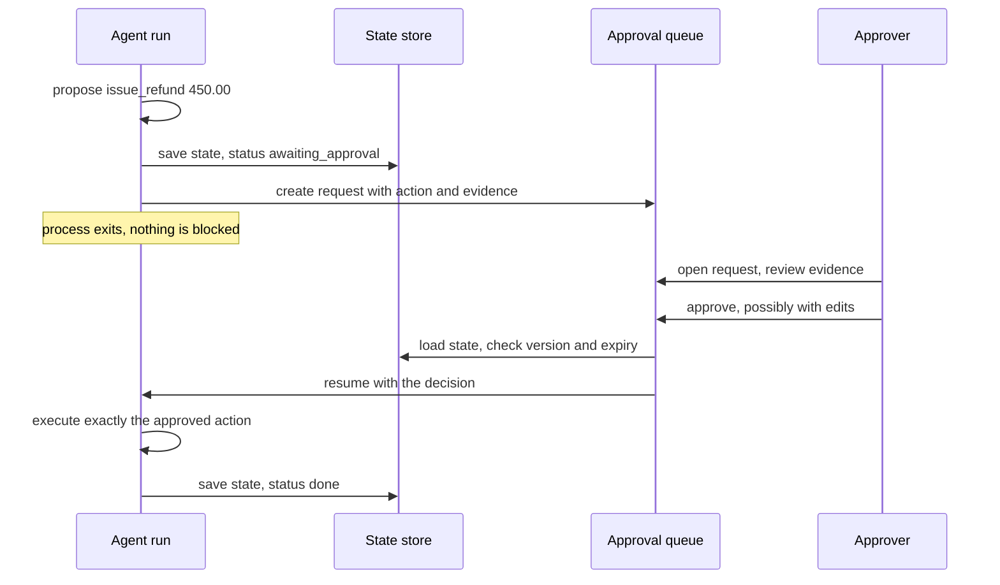

Some actions are too consequential to leave to a model alone: sending money, emailing a customer, deleting data, merging code, changing access rights. A **human approval workflow** lets the agent do the work of preparing such an action, then pauses until an authorised person approves, edits or rejects it, and records who decided what. The [human-in-the-loop systems](/learn/ai-agent-fundamentals/human-in-the-loop-systems) lesson introduced the idea. This lesson is about building it properly: deciding which actions need approval, pausing and resuming a run safely, keeping a tamper-evident audit trail, and designing approvals people can make well rather than rubber-stamp.

## Risk tiers

Asking for approval on everything is as bad as asking for none. People approve dozens of trivial requests without reading them, and then approve the dangerous one the same way. Sort actions into **risk tiers** and reserve human attention for the ones that need it.

| Tier | Policy | Examples |
| --- | --- | --- |
| 0. Automatic | Run without asking; log it | Read a document, search, draft text that is not sent |
| 1. Notify | Run, then tell a human, who can undo | Add an internal note, tag a ticket |
| 2. Approve | Pause until an authorised human approves | Send an external email, refund above a threshold, merge code |
| 3. Forbidden | Never allowed to the agent, whatever the approval | Change your own permissions, delete backups, transfer to new payees |

The factors that move an action up a tier are **reversibility** (can it be undone?), **blast radius** (how many people or records it affects), **external visibility** (does it leave the organisation?), **monetary value**, and whether the context is **tainted** by untrusted content, as described in [guardrails](/learn/advanced-agent-systems/guardrails). The policy belongs in code, where it can be reviewed and tested:

```python
from dataclasses import dataclass

@dataclass
class Action:
    tool: str
    args: dict
    tainted: bool = False

FORBIDDEN = {"grant_permission", "delete_backup"}
READ_ONLY = {"search_docs", "get_order", "draft_reply"}

def risk_tier(a: Action) -> int:
    if a.tool in FORBIDDEN:
        return 3
    if a.tool in READ_ONLY:
        return 0
    if a.tool == "issue_refund":
        return 2 if a.args["amount"] > 100 or a.tainted else 1
    if a.tool == "send_email":
        external = not a.args["to"].endswith("@ourco.com")
        return 2 if external or a.tainted else 1
    return 2                                    # unknown tools default to approval

for a in [Action("get_order", {"order_id": "A-17"}),
          Action("issue_refund", {"order_id": "A-17", "amount": 59.0}),
          Action("issue_refund", {"order_id": "C-5", "amount": 450.0}),
          Action("send_email", {"to": "ops@ourco.com"}),
          Action("send_email", {"to": "ops@ourco.com"}, tainted=True),
          Action("grant_permission", {"user": "agent", "role": "admin"})]:
    print(f"tier {risk_tier(a)}  {a.tool} {a.args}{'  [tainted]' if a.tainted else ''}")
```

```output
tier 0  get_order {'order_id': 'A-17'}
tier 1  issue_refund {'order_id': 'A-17', 'amount': 59.0}
tier 2  issue_refund {'order_id': 'C-5', 'amount': 450.0}
tier 1  send_email {'to': 'ops@ourco.com'}
tier 2  send_email {'to': 'ops@ourco.com'}  [tainted]
tier 3  grant_permission {'user': 'agent', 'role': 'admin'}
```

Note the final `return 2`: a tool the policy does not recognise defaults to requiring approval. Safe defaults matter because new tools get added faster than policies get updated.

> [!KEY]
> An approval gate is enforced by the executor, not requested by the model. The model never gets to decide whether its own action needs approval.

## Interrupt and resume

An approval can take seconds or days, so the agent cannot simply block a thread waiting for it. Instead the run **interrupts**: it saves its state, including the exact proposed action, marks itself `awaiting_approval`, and exits. When the decision arrives, a new process loads the state and **resumes**. This relies on the checkpointing from [state management](/learn/advanced-agent-systems/state-management); frameworks such as [LangGraph](/learn/agent-frameworks/langgraph) provide the same mechanism as an interrupt primitive.



Three properties make this safe. The action executed is **exactly** the one approved (or the approver's edited version), never a fresh proposal from the model. The approver must be **authorised** for that tier, and must not be the person who requested the action. And requests **expire**, so a stale approval cannot be used weeks later on a changed situation.

```python
import hashlib, json

RUNS, QUEUE = {}, {}
APPROVERS = {"maria": {"max_refund": 1000}, "sam": {"max_refund": 200}}

def fingerprint(action: dict) -> str:
    return hashlib.sha256(json.dumps(action, sort_keys=True).encode()).hexdigest()[:12]

def propose(run_id: str, requester: str, action: dict, now: int) -> str:
    RUNS[run_id] = {"status": "awaiting_approval", "action": action}
    QUEUE[run_id] = {"action": action, "fp": fingerprint(action), "requester": requester,
                     "expires": now + 3600}
    return f"{run_id}: waiting for approval of {action}"

def resume(run_id: str, approver: str, decision: str, now: int, edits: dict | None = None) -> str:
    req = QUEUE.pop(run_id, None)
    if req is None or RUNS[run_id]["status"] != "awaiting_approval":
        return f"{run_id}: no pending request"
    if now > req["expires"]:
        RUNS[run_id]["status"] = "expired"
        return f"{run_id}: request expired, agent must re-propose"
    if approver == req["requester"]:
        QUEUE[run_id] = req
        return f"{run_id}: requester cannot approve their own action"
    action = {**req["action"], **(edits or {})}
    if decision == "reject":
        RUNS[run_id]["status"] = "rejected"
        return f"{run_id}: rejected by {approver}; reason returned to the agent"
    if action["amount"] > APPROVERS.get(approver, {}).get("max_refund", 0):
        QUEUE[run_id] = req
        return f"{run_id}: {approver} is not authorised for {action['amount']:.2f}"
    RUNS[run_id] = {"status": "done", "action": action}
    edited = " (edited)" if fingerprint(action) != req["fp"] else ""
    return f"{run_id}: executed {action}{edited}, approved by {approver}"

print(propose("run-1", "agent:support", {"tool": "issue_refund", "order_id": "C-5", "amount": 450.0}, now=0))
print(resume("run-1", "sam", "approve", now=60))
print(resume("run-1", "maria", "approve", now=120, edits={"amount": 300.0}))
print(propose("run-2", "agent:support", {"tool": "issue_refund", "order_id": "D-8", "amount": 150.0}, now=0))
print(resume("run-2", "maria", "approve", now=7200))
```

```output
run-1: waiting for approval of {'tool': 'issue_refund', 'order_id': 'C-5', 'amount': 450.0}
run-1: sam is not authorised for 450.00
run-1: executed {'tool': 'issue_refund', 'order_id': 'C-5', 'amount': 300.0} (edited), approved by maria
run-2: waiting for approval of {'tool': 'issue_refund', 'order_id': 'D-8', 'amount': 150.0}
run-2: request expired, agent must re-propose
```

A rejection is not the end of the run. Feed the approver's reason back into the agent's context as a tool result ("refund rejected: customer already received a replacement") so the agent can choose a different course, such as drafting an explanation to the customer.

## Audit trails

Every proposal, decision and execution should be recorded in an **audit log**: who or what acted, when, on what, and with what evidence. For high-stakes systems, make the log **tamper-evident** by chaining entries: each entry stores the hash of the previous one, so altering or deleting any entry breaks every hash after it.

```python
def append(log: list, event: dict) -> None:
    prev = log[-1]["hash"] if log else "genesis"
    body = json.dumps(event, sort_keys=True)
    log.append({"event": event, "prev": prev,
                "hash": hashlib.sha256((prev + body).encode()).hexdigest()})

def verify(log: list) -> str:
    prev = "genesis"
    for i, entry in enumerate(log):
        body = json.dumps(entry["event"], sort_keys=True)
        if entry["prev"] != prev or entry["hash"] != hashlib.sha256((prev + body).encode()).hexdigest():
            return f"tampering detected at entry {i}"
        prev = entry["hash"]
    return f"ok: {len(log)} entries verified"

audit = []
append(audit, {"t": 0, "actor": "agent:support", "type": "proposed", "amount": 450.0, "run": "run-1"})
append(audit, {"t": 120, "actor": "maria", "type": "approved", "amount": 300.0, "run": "run-1"})
append(audit, {"t": 121, "actor": "system", "type": "executed", "amount": 300.0, "run": "run-1"})
print(verify(audit))
audit[1]["event"]["actor"] = "sam"             # someone rewrites history
print(verify(audit))
```

```output
ok: 3 entries verified
tampering detected at entry 1
```

In production the log goes to append-only storage that the agent's credentials cannot modify, and the latest hash can be periodically copied somewhere independent. Record the evidence the approver saw, not just the decision: an audit trail that says "approved" without what was shown cannot answer "should they have approved it?".

## Designing approvals people can make well

An approval is only as good as the decision behind it. The interface should make the right decision quick and the wrong one hard.

| Show | Why |
| --- | --- |
| The exact action in plain words, and the raw parameters | "Refund 450.00 to card ending 1111 for order C-5" leaves no ambiguity |
| A diff for changes | For edits to records or code, show before and after, not just the new state |
| The agent's evidence and reasoning, with sources | The approver can check claims rather than trust them |
| Risk signals | Why this needed approval: amount, external recipient, untrusted input |
| Reversibility | Whether and how it can be undone |
| Approve, edit, reject with a reason | Editing avoids a full re-run; reasons teach the agent and the team |

Practical rules:

- **Fight approval fatigue.** Track the approval rate per action type. If people approve 99% of something, consider moving it down a tier with monitoring; if they read nothing, the gate is theatre.
- **Default to deny on timeout.** An unanswered request expires; it is never auto-approved.
- **Batch similar low-risk approvals** with the option to inspect individually, but never batch high-value or irreversible ones.
- **Route by expertise and authority**: finance approves money, engineers approve merges, with escalation when the first approver is unavailable.
- **Notify where people already work**, such as chat or a ticket queue, with a link to the full approval page rather than an approve button in the notification itself.

> [!TIP]
> Measure the approval workflow like any other system: time to decision, approval and edit rates, and how often approved actions are later reversed. Those numbers tell you whether humans are adding judgement or only latency.

> [!WARNING]
> The approval page is itself a target. Display agent-generated text as text, never as rendered HTML or clickable links the agent chose, and make sure the action executed matches the one displayed, as the fingerprint check above does.

## Exercises

**1.** Write `risk_tier2`, which makes any `send_email` with more than 10 recipients (given as a `count` argument) tier 2, even when the address is internal, and otherwise defers to `risk_tier`. Test it with `Action("send_email", {"to": "team@ourco.com", "count": 25})`.

<details>
<summary>Show solution</summary>

```python
def risk_tier2(a: Action) -> int:
    if a.tool == "send_email" and a.args.get("count", 1) > 10:
        return 2
    return risk_tier(a)

print(risk_tier2(Action("send_email", {"to": "team@ourco.com", "count": 25})))
```

```output
2
```

Blast radius moved an internal email from tier 1 to tier 2.

</details>

**2.** In `resume`, what stops an approver from approving an action that differs from the one the agent proposed without that being visible?

<details>
<summary>Show solution</summary>

Edits are allowed but explicit: the executed action is built from the queued action plus the approver's `edits`, and its fingerprint is compared with the original. A mismatch is reported as "(edited)" and would be recorded in the audit log, so every change is attributable. The model cannot substitute a new action at resume time, because `resume` never asks the model for one.

</details>

**3.** Delete the middle entry of `audit` (after rebuilding it untampered) and run `verify`. What does it report and why?

<details>
<summary>Show solution</summary>

```python
audit = []
append(audit, {"t": 0, "type": "proposed"})
append(audit, {"t": 1, "type": "approved"})
append(audit, {"t": 2, "type": "executed"})
del audit[1]
print(verify(audit))
```

```output
tampering detected at entry 1
```

The third event's `prev` field holds the hash of the deleted entry, which no longer matches the hash of the entry now before it.

</details>

```quiz
[
  {
    "q": "Which factor should push an action into a higher risk tier?",
    "options": [
      "It reads from an internal database",
      "It cannot be undone and leaves the organisation",
      "It is called frequently",
      "It returns a long result"
    ],
    "answer": 1,
    "why": "Irreversibility and external visibility increase the cost of a mistake, so they raise the tier."
  },
  {
    "q": "Why should an agent interrupt and save its state rather than block a thread while waiting for approval?",
    "options": [
      "Blocking threads is not allowed in Python",
      "Approvals can take hours or days, and the process may restart in the meantime",
      "Saving state makes the model more accurate",
      "Approvers can only see saved runs"
    ],
    "answer": 1,
    "why": "Persisted state lets any process resume the run whenever the decision arrives."
  },
  {
    "q": "What should happen when an approval request is not answered before it expires?",
    "options": [
      "It is automatically approved",
      "It is denied or expires, and the agent must re-propose if still needed",
      "The agent executes a smaller version of the action",
      "The request is reassigned to the agent itself"
    ],
    "answer": 1,
    "why": "Timeouts must fail closed; silence is never consent."
  },
  {
    "q": "In a hash-chained audit log, why does editing one old entry get detected?",
    "options": [
      "The log is encrypted",
      "Each entry's hash covers the previous hash, so the edited entry's recomputed hash no longer matches",
      "Old entries are read-only in Python",
      "The agent signs each entry with its API key"
    ],
    "answer": 1,
    "why": "Changing an entry changes its hash, breaking the link that the following entries depend on."
  }
]
```
