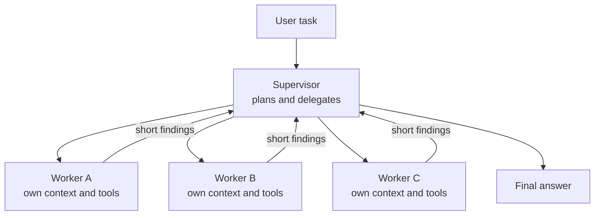
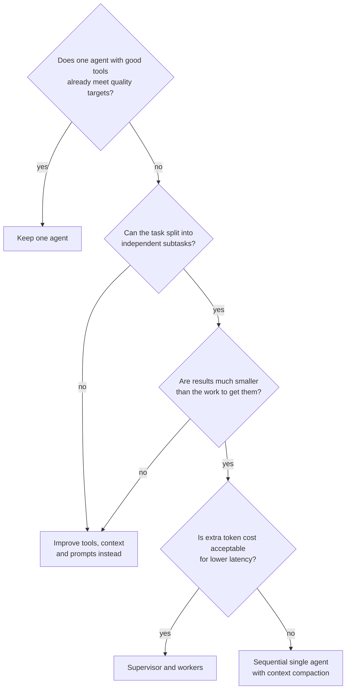

A **multi-agent system** is one in which several model-driven loops, each with its own instructions, tools and context window, cooperate on a task. You met the idea through frameworks such as [AutoGen](/learn/agent-frameworks/autogen-concepts) and [CrewAI](/learn/agent-frameworks/crewai), which make it easy to declare a "team". Easy to declare is not the same as worth building. Multiple agents multiply model calls, add coordination failures, and lose information at every handoff. They also genuinely help in a few situations, most clearly when a task splits into independent pieces that can be explored in parallel. This lesson covers the main patterns, what each costs, and how to tell whether your problem is one of the cases where splitting pays.

## The four common patterns

| Pattern | How it works | Good for | Main risk |
| --- | --- | --- | --- |
| **Supervisor and workers** | One agent plans, delegates subtasks to workers, and combines their results | Parallel research, broad searches, batch analysis | Supervisor writes vague subtasks; workers duplicate effort |
| **Hierarchical** | Supervisors of supervisors: a tree of teams | Very large tasks with natural sub-domains | Every level adds latency and another lossy summary |
| **Peer handoff** | One agent at a time is in control and passes the conversation to a specialist | Customer service routing: triage, billing, technical support | Context lost or garbled in the handoff |
| **Debate or critique** | Agents propose answers and challenge each other, then a judge decides | Hard reasoning where independent checking helps | Expensive; agents may converge on a shared error |



The defining feature of the supervisor pattern is the **compression** on the return edges. Each worker may read thousands of tokens of documents, but it sends back only a short summary. That is both the benefit (the supervisor's context stays small) and the cost (whatever the worker left out is gone).

## What coordination costs

Suppose a supervisor delegates to $k$ workers. Each worker consumes $c_w$ tokens of context over its run and returns a summary of $s$ tokens; the supervisor's own planning and synthesis consume $c_0$ tokens. The total processed is roughly

$$
C_{\text{multi}} \approx c_0 + k\,c_w + k\,s
$$

where $k$ is the number of workers, $c_w$ the tokens each worker processes, $s$ the size of each returned summary and $c_0$ the supervisor's own overhead. Compare a single agent that does all the work sequentially in one context: it processes the same raw material, but without $c_0$ and the summaries, and its context keeps growing. Multi-agent systems usually spend **more** tokens in total. What they buy is lower **wall-clock time** (workers run in parallel) and a **smaller peak context** per model call, which can improve quality when one window would otherwise overflow.

Coordination also adds failure modes that a single agent does not have:

- **Context loss.** A worker does not know what the supervisor knows unless it is written into the subtask.
- **Duplicated work.** Two workers search for the same thing because the subtasks overlapped.
- **Inconsistent assumptions.** Workers make different choices (units, dates, definitions) that the supervisor must reconcile.
- **Error cascade.** One worker's confident mistake becomes a "fact" in the final answer.

> [!KEY]
> Multi-agent designs trade tokens for parallelism and context isolation. They pay off when subtasks are independent and the results are much smaller than the work needed to produce them. When subtasks are sequential and tightly coupled, one agent is usually better.

## A supervisor with parallel workers

The example below researches three independent questions about a product launch. Each worker is a stub agent with its own context; a real worker would be a full agent loop with search tools. The supervisor writes self-contained subtasks, runs the workers in parallel threads, and synthesises. Context size is measured in characters as a stand-in for tokens.

```python
import time
from concurrent.futures import ThreadPoolExecutor

CORPUS = {
    "pricing": ["Competitor X charges per seat.", "Competitor Y has a free tier.", "Most rivals bill monthly."],
    "regulation": ["EU rules require a data processing agreement.", "No licence is needed for B2B sales."],
    "channels": ["Partners drive most enterprise deals.", "Self-serve sign-ups dominate small teams.",
                 "Webinars convert well for mid-size firms."],
}

def worker(subtask: dict) -> dict:
    """A research worker: reads many documents, returns a short summary."""
    context = subtask["brief"]
    for doc in CORPUS[subtask["topic"]]:
        context += " " + doc * 20          # pretend each document is long
    time.sleep(0.05)                       # simulated model and tool latency
    summary = f"{subtask['topic']}: " + CORPUS[subtask["topic"]][0]
    return {"topic": subtask["topic"], "summary": summary, "context_chars": len(context)}

def supervisor(task: str) -> str:
    subtasks = [
        {"topic": t, "brief": f"Goal: {task}. Research only {t}. Return one sentence with a source."}
        for t in ["pricing", "regulation", "channels"]
    ]
    start = time.perf_counter()
    with ThreadPoolExecutor(max_workers=3) as pool:
        results = list(pool.map(worker, subtasks))
    elapsed = time.perf_counter() - start
    for r in results:
        print(f"worker {r['topic']:<10} read {r['context_chars']:>5} chars, returned {len(r['summary'])}")
    synthesis_ctx = sum(len(r["summary"]) for r in results)
    print(f"supervisor synthesis context: {synthesis_ctx} chars")
    print(f"parallel wall time under 0.1 s: {elapsed < 0.1}")
    return " | ".join(r["summary"] for r in results)

print(supervisor("Plan the launch of our analytics product in Europe"))
```

```output
worker pricing    read  1798 chars, returned 39
worker regulation read  1720 chars, returned 57
worker channels   read  2499 chars, returned 47
supervisor synthesis context: 143 chars
parallel wall time under 0.1 s: True
pricing: Competitor X charges per seat. | regulation: EU rules require a data processing agreement. | channels: Partners drive most enterprise deals.
```

The workers together read thousands of characters; the supervisor sees fewer than two hundred. The three 0.05-second workers finish in about 0.05 seconds, not 0.15, because they run concurrently. That is the multi-agent bargain in miniature. Notice also how each subtask **brief** restates the overall goal and tells the worker exactly what to return. A worker cannot ask what the supervisor meant, so the brief must be self-contained.

> [!TIP]
> Write each delegated subtask as if for a contractor with no background on the work. Include the overall objective, the precise question, what is out of scope, the expected output format, and a limit on effort (for example, "at most five searches").

## Handoffs and context loss

In the **peer handoff** pattern, control moves between agents: a triage agent decides the customer has a billing problem and hands the conversation to a billing agent. The receiving agent sees only what the handoff carries. A free-text summary is the usual culprit when details go missing.

```python
transcript = [
    "user: I was charged twice for invoice 8812.",
    "user: Please don't email me, phone only. Number is on file.",
    "user: Also I'm travelling until Friday.",
]

def freeform_handoff(lines):
    # what a model often writes: the main issue, nothing else
    return {"to": "billing", "summary": "Customer reports a duplicate charge on invoice 8812."}

def structured_handoff(lines):
    text = " ".join(lines).lower()
    return {
        "to": "billing",
        "summary": "Customer reports a duplicate charge on invoice 8812.",
        "invoice_id": "8812",
        "contact_preference": "phone" if "phone only" in text else "any",
        "constraints": ["travelling until Friday"] if "travelling" in text else [],
        "transcript_ref": "conv-311",    # the receiver can fetch the full text if needed
    }

for make in (freeform_handoff, structured_handoff):
    h = make(transcript)
    print(make.__name__, "-> knows contact preference:", "contact_preference" in h)
```

```output
freeform_handoff -> knows contact preference: False
structured_handoff -> knows contact preference: True
```

The billing agent that receives the free-form handoff may well email the customer, breaking an explicit request. Two cheap defences fix most handoff problems: a **schema** for the handoff with fields the receiver needs (here enforced in code; with a real model you would request structured output), and a **reference to the full transcript**, so the receiver can look up anything the summary omitted. The extraction here uses string matching only to keep the example deterministic; in practice a model fills the schema and your code validates it.

## Debate and critique

In a **debate** pattern, two or more agents answer independently, read each other's answers, and revise; a judge (another model call or a rule) picks the result. A lighter variant is a single **critic** that reviews one agent's output, which you saw as [reflection](/learn/ai-agent-fundamentals/reflection). Debate helps most when errors are uncorrelated: different prompts, different retrieved evidence, or different models. If every agent is the same model with the same context, they tend to share the same mistakes, and you pay several times for one opinion. Measure whether it improves your task before adopting it.

## Deciding whether to go multi-agent



Other legitimate reasons to separate agents are **permission isolation** (the agent that reads untrusted web pages should not be the one holding the payments tool) and **organisational ownership** (different teams maintain different specialists). Both are about boundaries, not intelligence.

> [!WARNING]
> Never let agents talk to each other in an open-ended loop without a turn limit and a clear termination condition. Two agents politely asking each other for clarification can burn through a budget without producing anything.

## Exercises

**1.** Using $C_{\text{multi}} \approx c_0 + k c_w + k s$, compute the total for $c_0 = 3000$, $k = 4$, $c_w = 20000$, $s = 500$, and compare it with a single agent that processes $4 \times 20000$ tokens of material plus 3000 of overhead.

<details>
<summary>Show solution</summary>

```python
c0, k, cw, s = 3000, 4, 20000, 500
multi = c0 + k * cw + k * s
single = 4 * 20000 + 3000
print(multi, single, multi - single)
```

```output
85000 83000 2000
```

The multi-agent version processes 2,000 more tokens, the cost of the summaries. In reality the single agent's figure is an underestimate: its context grows with every step, so each later call re-reads earlier material, while each worker's context is reset. Which design is cheaper depends on how much history the single agent carries per call.

</details>

**2.** Rewrite `supervisor` so it runs the workers sequentially with a plain `for` loop, and print the elapsed time. What changes and what does not?

<details>
<summary>Show solution</summary>

```python
def sequential_supervisor(task):
    subtasks = [{"topic": t, "brief": f"Goal: {task}. Research only {t}."}
                for t in ["pricing", "regulation", "channels"]]
    start = time.perf_counter()
    results = [worker(st) for st in subtasks]
    print(f"sequential wall time at least 0.15 s: {time.perf_counter() - start >= 0.15}")
    return results

_ = sequential_supervisor("Plan the launch")
```

```output
sequential wall time at least 0.15 s: True
```

The token cost is essentially the same; only the wall-clock time grows, to roughly the sum of the workers' latencies. Parallelism is the main thing the supervisor pattern buys.

</details>

**3.** A legal team wants a "drafter" agent and a "reviewer" agent for contracts, both using the same model and the same retrieved clauses. What would you check before building it?

<details>
<summary>Show solution</summary>

Whether the reviewer actually catches errors the drafter makes. With the same model and the same evidence, their errors are likely correlated. Build a small evaluation set of contracts with known problems and compare drafter-only against drafter-plus-reviewer. If the reviewer adds little, try giving it a different checklist, different evidence (for example the firm's playbook), or a deterministic checker for the rules that can be coded.

</details>

```quiz
[
  {
    "q": "What do multi-agent systems most reliably buy you compared with one agent doing the same work?",
    "options": [
      "Fewer total tokens",
      "Lower wall-clock time through parallelism and smaller per-call contexts",
      "Guaranteed higher accuracy",
      "Elimination of prompt injection"
    ],
    "answer": 1,
    "why": "Total tokens usually rise. The gains are parallel execution and context isolation."
  },
  {
    "q": "A triage agent hands off to a billing agent with a one-line free-text summary. What is the main risk?",
    "options": [
      "The billing agent runs too fast",
      "Details the summary omitted, such as contact preferences, are lost",
      "The billing agent cannot call tools",
      "The handoff doubles the cost of every tool"
    ],
    "answer": 1,
    "why": "The receiver knows only what the handoff carries. Use a schema and a reference to the full transcript."
  },
  {
    "q": "Why does a debate between copies of the same model with the same context often add little?",
    "options": [
      "Models cannot read each other's outputs",
      "Their errors are correlated, so they tend to agree on the same mistakes",
      "Debate is not supported by LLM APIs",
      "Judges always pick the first answer"
    ],
    "answer": 1,
    "why": "Independent checking helps only when the checkers fail in different ways."
  },
  {
    "q": "Which is a good reason, unrelated to model quality, to separate work into different agents?",
    "options": [
      "To make the architecture diagram look balanced",
      "So the agent that reads untrusted content does not hold high-risk tools",
      "To increase the number of model calls",
      "To avoid writing a system prompt"
    ],
    "answer": 1,
    "why": "Permission isolation limits the damage a manipulated agent can do."
  }
]
```
