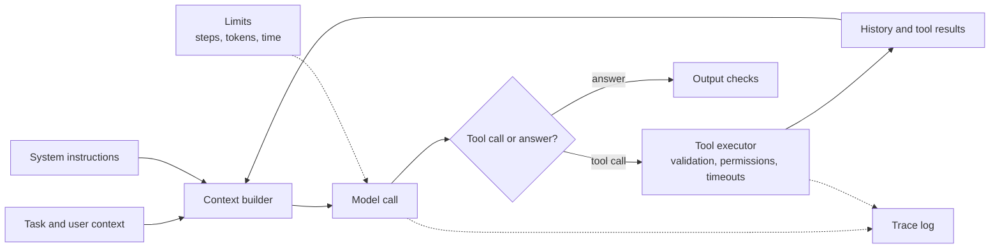

In [AI Agent Fundamentals](/learn/ai-agent-fundamentals/what-is-an-ai-agent) you built an agent loop in a dozen lines, and in [Agent Frameworks](/learn/agent-frameworks/langgraph) you saw libraries that package the same loop. Neither tells you how to design an agent that a business can rely on: which tools it should have, what goes into its context on every call, when to stop, and when one agent is not enough. This module is about engineering agent systems for production, and it starts with the most common and most underrated design of all: a single, well-built agent.

Most agent systems that work reliably in production are one model, a carefully chosen set of tools, and a loop with firm limits. Before you reach for teams of agents, you should be able to build that well.

## The anatomy of a production agent

A toy agent is a model plus a loop. A production agent has a few more parts, each with a clear owner.



| Component | Responsibility | Lesson in this module |
| --- | --- | --- |
| System instructions | Role, goal, rules, output format | This lesson |
| Context builder | Decides exactly what the model sees on each call | This lesson |
| Tools | The actions available, with descriptions and schemas | [Tool selection](/learn/advanced-agent-systems/tool-selection) |
| Tool executor | Runs tools safely and turns failures into messages | [Error handling](/learn/advanced-agent-systems/error-handling) |
| Limits | Step, token, time and money budgets | [Agent orchestration](/learn/advanced-agent-systems/agent-orchestration) |
| State and trace | What happened, so runs can be resumed, debugged and evaluated | [State management](/learn/advanced-agent-systems/state-management) |
| Output checks | Validation before anything leaves the system | [Guardrails](/learn/advanced-agent-systems/guardrails) |

The model is the only component you do not write. Everything else is ordinary software, and that is where most of the reliability comes from.

## When one agent beats many

It is tempting to split a problem into a "planner agent", a "research agent" and a "writer agent". Often that makes things worse. Every boundary between agents is a place where context is summarised, and every summary loses something. A single agent with good tools keeps the whole task in one context window, so it never has to explain the task to a colleague.

| Situation | Prefer | Reason |
| --- | --- | --- |
| Steps depend tightly on each other's results | One agent | Every step needs the full history; splitting it forces lossy handoffs |
| The task fits comfortably in one context window | One agent | No benefit from splitting, only extra calls |
| Many independent subtasks that can run in parallel | Multi-agent | Workers can explore separately and return short findings |
| Subtasks need very different tools or permissions | Multi-agent or separate workflows | Smaller tool sets and narrower permissions per agent |
| The context would overflow even with compaction | Multi-agent | Each worker gets a fresh, focused window |

> [!KEY]
> Start with one agent. Split only when you can name the specific limit you have hit: context size, parallelism, or the need to separate tools and permissions. "It feels more organised" is not a limit.

## Context engineering

The model knows nothing except what is in its context window on this call. **Context engineering** is the discipline of deciding what goes into that window, in what order and in what form. It matters more than prompt wording, because a long agent run quickly fills the window with stale tool output.

A useful way to think about it is as a budget. If the window holds $W$ tokens, then on every call

$$
T_{\text{system}} + T_{\text{task}} + T_{\text{history}} + T_{\text{tool defs}} + T_{\text{reserve}} \le W
$$

where $T_{\text{system}}$ is the instructions, $T_{\text{task}}$ the user's request and relevant facts, $T_{\text{history}}$ the previous steps and tool results, $T_{\text{tool defs}}$ the tool descriptions and schemas, and $T_{\text{reserve}}$ the space kept free for the model's own output. History is the only term that grows on its own, so it is the one you must manage.

Common techniques:

- **Trim tool output at the source.** Return the five rows the model needs, not the whole table. Tools should be designed to produce model-sized results.
- **Elide old results.** Keep the newest tool results in full and replace older ones with a short marker. The model can call the tool again if it really needs the old data.
- **Summarise.** Periodically compress the history into a running summary (covered in [short-term memory](/learn/ai-agent-fundamentals/short-term-memory)).
- **Retrieve rather than preload.** Fetch documents with a tool when needed instead of pasting everything into the system prompt.
- **Put stable content first.** Instructions and tool definitions that never change belong at the start, which also lets provider-side prompt caching work.

Here is a small context builder that applies elision under a character budget. Characters stand in for tokens; a rough rule of thumb for English is about four characters per token, but use a real tokenizer when it matters.

```python
def build_context(system, task, history, budget_chars=420, keep_full=2):
    """Assemble messages; older tool results are elided until the budget fits."""
    msgs = [{"role": "system", "content": system}, {"role": "user", "content": task}]
    tool_idx = [i for i, m in enumerate(history) if m["role"] == "tool"]
    hist = [dict(m) for m in history]
    size = lambda: sum(len(m["content"]) for m in msgs + hist)
    for i in tool_idx[:-keep_full]:            # oldest first, never the newest
        if size() <= budget_chars:
            break
        hist[i]["content"] = f"[elided {hist[i]['name']} result, {len(history[i]['content'])} chars]"
    return msgs + hist, size()

history = []
for n in range(1, 5):
    history.append({"role": "assistant", "content": f"call search(page={n})"})
    history.append({"role": "tool", "name": "search", "content": f"page {n}: " + "x" * 90})

ctx, size = build_context("You are a support agent.", "Find the refund policy.", history)
for m in ctx[2:]:
    if m["role"] == "tool":
        print(m["content"][:40])
print("context size:", size)
```

```output
[elided search result, 98 chars]
[elided search result, 98 chars]
page 3: xxxxxxxxxxxxxxxxxxxxxxxxxxxxxxxx
page 4: xxxxxxxxxxxxxxxxxxxxxxxxxxxxxxxx
context size: 383
```

The two oldest results were replaced by markers and the newest two kept in full, so the context fits the budget while still recording that the earlier searches happened. Recording that is important: if you delete history silently, the model may repeat the same calls.

## A single agent, built properly

The next block puts the pieces together: a typed configuration, a tool registry with descriptions, a context builder, explicit stop conditions and a trace. The model is a deterministic stub that behaves as a real model would on this task, so you can run it; in production `stub_llm` becomes an API call that receives the messages and tool schemas.

```python
import json
from dataclasses import dataclass, field
from typing import Callable

@dataclass
class Tool:
    name: str
    description: str
    fn: Callable[..., str]

@dataclass
class AgentConfig:
    system: str
    tools: dict[str, Tool]
    max_steps: int = 6
    budget_chars: int = 2000

@dataclass
class RunResult:
    answer: str | None
    stop_reason: str
    trace: list[str] = field(default_factory=list)

ORDERS = {"A-17": {"status": "delivered", "days_since_delivery": 12, "total": 59.0}}

def get_order(order_id: str) -> str:
    order = ORDERS.get(order_id)
    return json.dumps(order) if order else f"error: no order {order_id}"

def get_policy(topic: str) -> str:
    return "Refunds: allowed within 30 days of delivery for delivered orders."

TOOLS = {t.name: t for t in [
    Tool("get_order", "Look up one order by its ID, e.g. A-17. Returns status and dates.", get_order),
    Tool("get_policy", "Return the company policy text for a topic such as 'refunds'.", get_policy),
]}

def stub_llm(messages, tools):
    results = [m["content"] for m in messages if m["role"] == "tool"]
    if not results:
        return {"tool": "get_order", "args": {"order_id": "A-17"}}
    if len(results) == 1:
        return {"tool": "get_policy", "args": {"topic": "refunds"}}
    order = json.loads(results[0])
    ok = order["status"] == "delivered" and order["days_since_delivery"] <= 30
    return {"answer": f"Order A-17 {'is' if ok else 'is not'} eligible for a refund."}

def run(task, cfg, llm):
    history, trace = [], []
    for step in range(1, cfg.max_steps + 1):
        msgs, size = build_context(cfg.system, task, history, cfg.budget_chars)
        decision = llm(msgs, cfg.tools)
        if "answer" in decision:
            trace.append(f"{step}: answer ({size} chars of context)")
            return RunResult(decision["answer"], "answered", trace)
        tool = cfg.tools.get(decision["tool"])
        result = tool.fn(**decision["args"]) if tool else f"error: unknown tool {decision['tool']}"
        trace.append(f"{step}: {decision['tool']}({decision['args']})")
        history += [{"role": "assistant", "content": json.dumps(decision)},
                    {"role": "tool", "name": decision["tool"], "content": result}]
    return RunResult(None, "max_steps", trace)

cfg = AgentConfig(system="You are a refunds assistant. Use tools; never guess order data.", tools=TOOLS)
res = run("Can I get a refund for order A-17?", cfg, stub_llm)
print(res.answer, "|", res.stop_reason)
print("\n".join(res.trace))
```

```output
Order A-17 is eligible for a refund. | answered
1: get_order({'order_id': 'A-17'})
2: get_policy({'topic': 'refunds'})
3: answer (330 chars of context)
```

Three details make this production-shaped rather than a demo. The result carries a **stop reason**, so the caller can tell an answer from a step-limit exhaustion. An unknown tool name becomes an error message instead of a crash. And the **trace** records every decision, which is the raw material for debugging and for [agent evaluation](/learn/advanced-agent-systems/agent-evaluation).

## How many tools is too many?

Every tool definition costs context on every call, and every extra tool is another option the model can pick by mistake. Selection accuracy tends to fall as the tool list grows, especially when tools overlap. There is no universal limit, and it depends on the model and how distinct the tools are, but a few dozen well-separated tools is a reasonable working ceiling to test against, and a handful is better.

| Symptom | Likely cause | Fix |
| --- | --- | --- |
| Model calls `search_customers` when it needed `search_orders` | Overlapping names and descriptions | Merge tools, or sharpen descriptions with when-to-use guidance |
| Model chains five tiny calls for one logical action | Tools are too low-level | Offer one higher-level tool, such as `refund_order` instead of three CRUD calls |
| Tool definitions take a large share of the context | Too many tools loaded at once | Retrieve the relevant subset per task (see [tool selection](/learn/advanced-agent-systems/tool-selection)) |
| Model ignores a tool it needs | Description does not say when to use it | Describe the situations it is for, not just what it does |

> [!TIP]
> Design tools for the model the way you would design an API for a new colleague: few, clearly named, each doing one meaningful job, with errors that explain how to fix the call.

## Pitfalls

- **Stuffing the system prompt.** Long lists of rules dilute each other. Keep instructions short and move reference material behind a retrieval tool.
- **Unbounded tool output.** One tool returning a 50-page document can crowd out the task itself. Cap and paginate at the tool.
- **Hidden state.** If the agent's progress lives only in the message list, you cannot resume or inspect it. Keep explicit state alongside it.
- **No stop reason.** A run that silently returns nothing after hitting a limit looks identical to a bug.

## Exercises

**1.** Run `build_context` on the same `history` with `budget_chars=1000`. How many results are elided, and why?

<details>
<summary>Show solution</summary>

```python
ctx, size = build_context("You are a support agent.", "Find the refund policy.", history, budget_chars=1000)
print(sum(m["content"].startswith("[elided") for m in ctx), size)
```

```output
0 515
```

None: the full context is 515 characters, already under the budget, so the loop exits before eliding anything. Elision only happens under pressure.

</details>

**2.** Add a third tool, `get_customer(email)`, to `TOOLS`, and change `stub_llm` so that on its first step it calls a tool named `get_orders` (a typo). What does `run` return, and why is that better than an exception?

<details>
<summary>Show solution</summary>

`run` appends `error: unknown tool get_orders` as a tool result and continues. With the stub as written, the next decision is then `get_policy` (because one result now exists), and the stub crashes when it tries to parse the error as JSON. With a real model, the error message lets it correct the name on the next step. The lesson is that the executor must never crash on a bad call, and that the error text is part of the model's input, so it should say what went wrong.

</details>

**3.** A team proposes three agents for drafting sales emails: one looks up the customer, one reads past emails, one writes the draft. Each step needs the previous step's full output. Argue for or against.

<details>
<summary>Show solution</summary>

Against. The steps are sequential and tightly dependent, the combined context is small, and no step needs different permissions. One agent with three tools (`get_customer`, `get_email_history`, and a final answer) keeps everything in one window and avoids two lossy handoffs. A plain workflow with no agent at all may be better still, since the sequence is fixed.

</details>

```quiz
[
  {
    "q": "Which term in the context budget grows on its own during an agent run and therefore needs active management?",
    "options": ["System instructions", "Tool definitions", "History and tool results", "Output reserve"],
    "answer": 2,
    "why": "Each step appends a tool call and a result, so history grows until it is trimmed, elided or summarised."
  },
  {
    "q": "Why should elided tool results be replaced with a marker rather than deleted?",
    "options": [
      "Markers are cheaper to tokenize than nothing",
      "The model still sees that the call happened, so it is less likely to repeat it blindly",
      "LLM APIs reject conversations with missing messages",
      "Markers make the model ignore old instructions"
    ],
    "answer": 1,
    "why": "Silent deletion hides the agent's own past actions from it; a marker preserves the fact without the bulk."
  },
  {
    "q": "Which is the strongest reason to split a single agent into several?",
    "options": [
      "The code would look more modular",
      "Each step needs the previous step's full output",
      "Several independent subtasks can run in parallel and each needs only a short result returned",
      "The model sometimes makes mistakes"
    ],
    "answer": 2,
    "why": "Parallel, independent work with compact results is where multiple agents pay for their coordination cost."
  },
  {
    "q": "An agent keeps choosing a similar but wrong tool. What is the best first fix?",
    "options": [
      "Add more tools so it has more choice",
      "Sharpen or merge the overlapping tool descriptions",
      "Raise the step limit",
      "Increase the temperature"
    ],
    "answer": 1,
    "why": "Overlapping descriptions are the usual cause of selection errors; disambiguate or merge them."
  }
]
```
