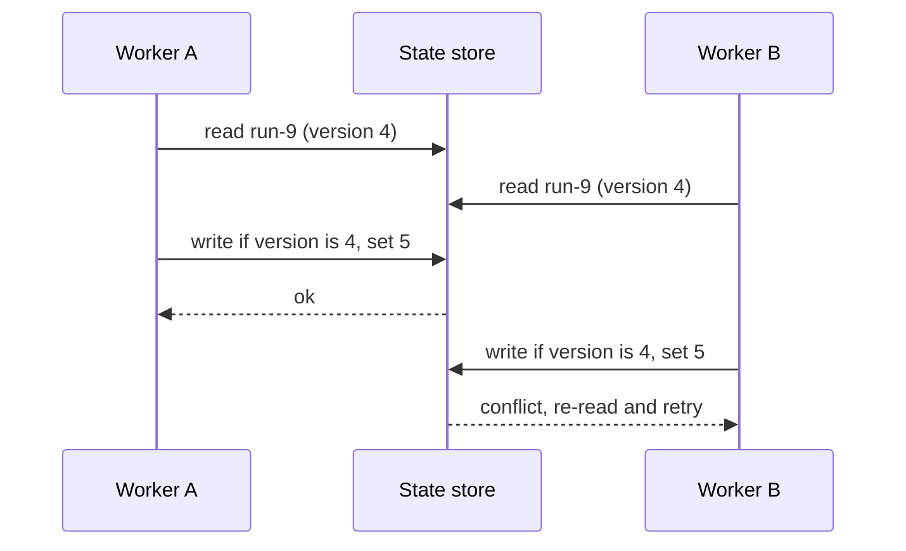

A demo agent keeps its whole life in a Python list of messages. If the process restarts, the list is gone and the run starts again from nothing, repeating every model call and, worse, every side effect: the email is sent twice, the refund issued twice. Production agents run for seconds to days, wait for humans, survive deployments and share infrastructure with other runs. They need **state management**: an explicit record of where the run is, saved at safe points, from which it can resume without repeating work. This lesson builds that record step by step. The [agent memory](/learn/ai-agent-fundamentals/agent-memory) lessons covered what the model remembers; this one covers what the **system** must remember.

## Messages are not state

The message list is a log of what the model has seen. It is not a good place to keep facts your code depends on, such as "the refund has been issued" or "we are waiting for approval". Those should be **explicit, typed fields** that code reads and writes directly.

| Kept in the message list | Kept in explicit state |
| --- | --- |
| What the model was told and what it said | Current phase: `planning`, `awaiting_approval`, `done` |
| Tool results as text | Structured results your code acts on: order ID, amount |
| Free-form reasoning | Counters and limits: steps taken, tokens used |
| | Side effects already performed, with their keys |
| | Version number for concurrency control |

```python
from dataclasses import dataclass, field, asdict
from enum import Enum

class Phase(str, Enum):
    PLANNING = "planning"
    ACTING = "acting"
    AWAITING_APPROVAL = "awaiting_approval"
    DONE = "done"
    FAILED = "failed"

@dataclass
class RunState:
    run_id: str
    task: str
    phase: Phase = Phase.PLANNING
    step: int = 0
    completed: list[str] = field(default_factory=list)     # names of finished steps
    results: dict[str, str] = field(default_factory=dict)  # structured outputs by step
    version: int = 0

s = RunState(run_id="run-7", task="Refund order A-17")
print(asdict(s))
```

```output
{'run_id': 'run-7', 'task': 'Refund order A-17', 'phase': <Phase.PLANNING: 'planning'>, 'step': 0, 'completed': [], 'results': {}, 'version': 0}
```

Because the state is a plain dataclass, it serialises to JSON, can be inspected in a debugger or a dashboard, and can be validated. Using an `Enum` for the phase means a typo such as `"awaiting_aproval"` fails immediately instead of creating a run that no code path will ever pick up again. Frameworks such as [LangGraph](/learn/agent-frameworks/langgraph) are built around the same idea: a typed state object that each node reads and updates.

## Checkpointing

A **checkpoint** is a saved copy of the state at a safe point, usually after each completed step. Saving to a database rather than a file gives you atomic writes and lets other processes read the state. The example uses SQLite from the standard library; in production the same table could live in PostgreSQL or a key-value store.

```python
import json, sqlite3

db = sqlite3.connect(":memory:")
db.execute("CREATE TABLE checkpoints (run_id TEXT, step INTEGER, state TEXT, PRIMARY KEY (run_id, step))")

def save(state: RunState) -> None:
    db.execute("INSERT OR REPLACE INTO checkpoints VALUES (?, ?, ?)",
               (state.run_id, state.step, json.dumps(asdict(state))))
    db.commit()

def load_latest(run_id: str) -> RunState | None:
    row = db.execute("SELECT state FROM checkpoints WHERE run_id = ? ORDER BY step DESC LIMIT 1",
                     (run_id,)).fetchone()
    if row is None:
        return None
    data = json.loads(row[0])
    data["phase"] = Phase(data["phase"])
    return RunState(**data)
```

Keeping every step's checkpoint, rather than overwriting one row, gives you a history you can inspect and lets you **replay** or branch a run from any earlier point, which is invaluable for debugging.

## Resuming after a crash

Now the agent itself. Each step is a function from state to result. The runner skips steps that are already in `state.completed`, runs the rest, and checkpoints after each one. A `crash_at` parameter simulates the process dying mid-run.

```python
CALLS = []                                     # records every real execution

def look_up_order(st):  CALLS.append("look_up_order");  return "A-17: delivered, 59.00"
def check_policy(st):   CALLS.append("check_policy");   return "eligible"
def issue_refund(st):   CALLS.append("issue_refund");   return "refund R-1 for 59.00"

STEPS = [look_up_order, check_policy, issue_refund]

def run(run_id: str, task: str, crash_at: str | None = None) -> RunState:
    state = load_latest(run_id) or RunState(run_id=run_id, task=task)
    state.phase = Phase.ACTING
    for fn in STEPS:
        if fn.__name__ in state.completed:
            continue                           # already done before the crash
        if fn.__name__ == crash_at:
            raise RuntimeError(f"process died before {fn.__name__}")
        state.results[fn.__name__] = fn(state)
        state.completed.append(fn.__name__)
        state.step += 1
        save(state)                            # checkpoint after every step
    state.phase = Phase.DONE
    save(state)
    return state

try:
    run("run-7", "Refund order A-17", crash_at="issue_refund")
except RuntimeError as e:
    print("crash:", e)

final = run("run-7", "Refund order A-17")      # a new process picks the run up
print("phase:", final.phase.value, "| steps:", final.step)
print("executions:", CALLS)
```

```output
crash: process died before issue_refund
phase: done | steps: 3
executions: ['look_up_order', 'check_policy', 'issue_refund']
```

Each step ran exactly once, even though the run was started twice. Step through the resume to see why:

```trace
{
  "title": "resuming from a checkpoint",
  "code": [
    "state = load_latest(run_id) or RunState(...)",
    "for fn in STEPS:",
    "    if fn.__name__ in state.completed:",
    "        continue",
    "    state.results[fn.__name__] = fn(state)",
    "    state.completed.append(fn.__name__)",
    "    save(state)"
  ],
  "steps": [
    { "line": 1, "vars": { "state.step": "2", "completed": "['look_up_order', 'check_policy']" }, "note": "The second run finds the checkpoint written just before the crash." },
    { "line": 3, "vars": { "fn": "look_up_order", "completed": "['look_up_order', 'check_policy']" }, "note": "Already completed, so it is skipped. No repeated call." },
    { "line": 4, "vars": { "fn": "check_policy", "completed": "['look_up_order', 'check_policy']" }, "note": "Also completed: skipped." },
    { "line": 5, "vars": { "fn": "issue_refund", "completed": "['look_up_order', 'check_policy']" }, "note": "The first step not yet done. It runs now, for the first time." },
    { "line": 7, "vars": { "fn": "issue_refund", "state.step": "3", "completed": "['look_up_order', 'check_policy', 'issue_refund']" }, "note": "Checkpoint saved. A crash after this point would not repeat the refund." }
  ]
}
```

## The gap between acting and saving: idempotency

There is still a window of danger. If the process dies **after** `issue_refund` calls the payment API but **before** the checkpoint is saved, the resumed run will call it again. You cannot close this window with checkpoints alone. You close it by making side-effecting steps **idempotent**: running them twice has the same effect as running them once.

The standard technique is an **idempotency key**: a unique identifier for the intended action, derived deterministically from the run and step, which the receiving system uses to recognise and ignore duplicates. Many payment and messaging APIs accept such a key for exactly this reason; when a tool's API does not, you keep your own ledger of completed keys.

```python
LEDGER: dict[str, str] = {}                    # stands in for the payment provider's records

def pay_refund(order_id: str, amount: float, idempotency_key: str) -> str:
    if idempotency_key in LEDGER:
        return LEDGER[idempotency_key] + " (duplicate ignored)"
    LEDGER[idempotency_key] = f"refunded {amount:.2f} on {order_id}"
    return LEDGER[idempotency_key]

key = "run-7:issue_refund"                     # same run and step -> same key
print(pay_refund("A-17", 59.0, key))
print(pay_refund("A-17", 59.0, key))           # a retry after a crash
print("refunds recorded:", len(LEDGER))
```

```output
refunded 59.00 on A-17
refunded 59.00 on A-17 (duplicate ignored)
refunds recorded: 1
```

> [!KEY]
> Checkpoints make a run **resumable**; idempotency makes it **safe to resume**. You need both. Derive keys from stable identifiers (run ID and step name), never from timestamps or random values generated on each attempt.

Read-only steps such as lookups are naturally idempotent. A model call is not idempotent in its output, since it may answer differently the second time, so store its result in the state once it has been accepted rather than calling the model again on resume.

## Concurrency

Two processes may touch the same run: a worker resuming after a timeout while the original is still alive, or a human approving in one tab while another tab rejects. Without protection, the later write silently overwrites the earlier one. **Optimistic concurrency control** prevents this: each saved state carries a version number, and a write succeeds only if the version in storage is still the one the writer read.



```python
store = {"run-9": {"version": 4, "phase": "awaiting_approval"}}

class Conflict(Exception):
    pass

def compare_and_set(run_id: str, expected_version: int, changes: dict) -> None:
    current = store[run_id]
    if current["version"] != expected_version:
        raise Conflict(f"expected v{expected_version}, found v{current['version']}")
    store[run_id] = {**current, **changes, "version": expected_version + 1}

compare_and_set("run-9", 4, {"phase": "acting"})            # worker A approves
try:
    compare_and_set("run-9", 4, {"phase": "failed"})        # worker B, stale read
except Conflict as e:
    print("worker B:", e)
print(store["run-9"])
```

```output
worker B: expected v4, found v5
{'version': 5, 'phase': 'acting'}
```

In SQL the same check is a single statement, `UPDATE runs SET state = ?, version = version + 1 WHERE id = ? AND version = ?`, followed by checking that one row was updated. For long-running steps, add a **lease**: a worker claims a run for a limited time and must renew the claim, so a crashed worker's run is picked up by another only after the lease expires.

> [!WARNING]
> Never keep run state only in the memory of a web server process. Servers restart, scale out and route requests to different instances; the next request for a run may reach a process that has never seen it.

## Exercises

**1.** Start a fresh run `"run-8"` that crashes before `check_policy`, then resume it. Which entries are appended to `CALLS`?

<details>
<summary>Show solution</summary>

```python
CALLS.clear()
try:
    run("run-8", "Refund order B-2", crash_at="check_policy")
except RuntimeError:
    pass
run("run-8", "Refund order B-2")
print(CALLS)
```

```output
['look_up_order', 'check_policy', 'issue_refund']
```

`look_up_order` runs once in the first attempt; the resumed run skips it and runs the remaining two.

</details>

**2.** Why would `key = f"run-7:issue_refund:{time.time()}"` defeat the purpose of an idempotency key?

<details>
<summary>Show solution</summary>

The timestamp differs on every attempt, so the retry after a crash carries a new key and the provider treats it as a new refund. Keys must be identical across retries of the same intended action, which is why they are derived from the run ID and step name.

</details>

**3.** Modify `save` so that it refuses to write a checkpoint whose `step` is lower than the latest saved step for that run. What bug does this guard against?

<details>
<summary>Show solution</summary>

```python
def save(state: RunState) -> None:
    row = db.execute("SELECT MAX(step) FROM checkpoints WHERE run_id = ?", (state.run_id,)).fetchone()
    if row[0] is not None and state.step < row[0]:
        raise ValueError(f"stale checkpoint: step {state.step} < {row[0]}")
    db.execute("INSERT OR REPLACE INTO checkpoints VALUES (?, ?, ?)",
               (state.run_id, state.step, json.dumps(asdict(state))))
    db.commit()
```

It stops a stale worker, one that loaded an old state and kept running, from writing progress that goes backwards and would cause later steps to be repeated on the next resume. It is a simple form of the version check from the concurrency section.

</details>

```quiz
[
  {
    "q": "Why should the fact \"refund issued\" be stored in explicit state rather than only in the message list?",
    "options": [
      "Message lists cannot contain numbers",
      "Your code must reliably read it to avoid repeating the action, and text in messages is not a dependable source for that",
      "Models refuse to read refund information",
      "Explicit state is cheaper to send to the model"
    ],
    "answer": 1,
    "why": "Code that controls side effects needs typed fields it can check, not facts buried in conversation text."
  },
  {
    "q": "A run crashes after the payment API succeeded but before the checkpoint was saved. What prevents a double payment on resume?",
    "options": [
      "Saving checkpoints more often",
      "An idempotency key derived from the run ID and step",
      "A higher step limit",
      "Using an Enum for the phase"
    ],
    "answer": 1,
    "why": "Checkpoints cannot close the gap between acting and saving; idempotency makes the repeated call harmless."
  },
  {
    "q": "In optimistic concurrency control, what happens when a writer's expected version does not match the stored version?",
    "options": [
      "The write silently overwrites the newer state",
      "The write is rejected and the writer must re-read and retry",
      "The two states are merged automatically",
      "The version number is reset to zero"
    ],
    "answer": 1,
    "why": "The mismatch shows someone else changed the state since it was read, so the stale write is refused."
  },
  {
    "q": "On resume, why should an accepted model output be read from saved state rather than regenerated?",
    "options": [
      "Model calls are always idempotent",
      "A second call may produce a different output, making the resumed run inconsistent with what already happened",
      "Models cannot be called twice for the same task",
      "Saved state is always more accurate than the model"
    ],
    "answer": 1,
    "why": "Model outputs vary between calls; replaying from state keeps the run consistent and avoids extra cost."
  }
]
```
