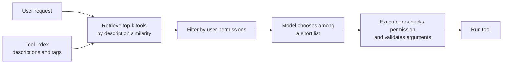

An agent can only be as good as its choice of tools. When it picks the wrong one, passes the wrong arguments, or does not realise a tool exists, the rest of the run is built on a bad step. You learnt the mechanics in [tool usage](/learn/ai-agent-fundamentals/tool-usage) and [function calling](/learn/ai-agent-fundamentals/function-calling). This lesson is about the engineering around them: writing descriptions that a model chooses correctly from, retrieving the right subset when you have dozens or hundreds of tools, resolving ambiguity between similar tools, and scoping permissions so an agent can only use what the current user is allowed to.

## The model chooses from text

The model never sees your Python function. It sees a **name**, a **description** and a **parameter schema**, and it picks a tool by matching that text against the task. Everything you want the model to know about when and how to use a tool must be in that text.

A weak definition:

```json
{
  "name": "search",
  "description": "Searches.",
  "parameters": {"type": "object", "properties": {"q": {"type": "string"}}}
}
```

A strong one:

```json
{
  "name": "search_orders",
  "description": "Find a customer's orders by email or order ID. Use this when the user asks about a purchase, delivery or refund. Do not use it for product catalogue questions (use search_products). Returns at most 10 orders, newest first.",
  "parameters": {
    "type": "object",
    "properties": {
      "email": {"type": "string", "description": "Customer email, e.g. ana@example.com"},
      "order_id": {"type": "string", "description": "Order ID in the form A-123"},
      "status": {"type": "string", "enum": ["pending", "shipped", "delivered", "refunded"]}
    },
    "required": []
  }
}
```

| Element | What to include | Why |
| --- | --- | --- |
| Name | Verb plus object, namespaced if needed: `orders_search`, `crm_update_contact` | Names alone carry a lot of the selection signal |
| Description, first sentence | What it does, in plain words | The model often decides on this |
| When to use, when not to | Situations, and the sibling tool to use instead | Resolves overlaps between similar tools |
| Output shape and limits | "Returns at most 10 rows" | The model can plan follow-up calls |
| Parameter descriptions | Format and an example value | Fewer malformed arguments |
| Enums | Allowed values for categorical parameters | Invalid values become impossible rather than unlikely |

> [!TIP]
> Test descriptions empirically. Collect real user requests, record which tool each should trigger, and measure how often the model picks it. A description change that looks better to you is only better if that number goes up.

## Tool retrieval for large tool sets

Loading every tool definition into every call stops working as a platform grows. Definitions consume context, and selection gets harder as more similar options compete. **Tool retrieval** treats tools like documents in a RAG system: index their descriptions, retrieve the few most relevant to the current request, and show the model only those.



The example uses TF-IDF from scikit-learn to keep it small and deterministic; in production you would usually embed descriptions with an embedding model, as in [similarity search](/learn/vector-databases/similarity-search), possibly combined with keyword matching.

```python
import numpy as np
from sklearn.feature_extraction.text import TfidfVectorizer

TOOLS = {
    "orders_search": "find customer orders purchases by email or order id delivery status",
    "orders_refund": "refund an order money back to the customer for a purchase",
    "products_search": "search the product catalogue items prices stock availability",
    "invoices_get": "get an invoice pdf billing document for an order",
    "invoices_resend": "email an invoice to the customer again",
    "tickets_create": "open a support ticket for a technical problem bug or outage",
    "tickets_search": "search existing support tickets by keyword or customer",
    "users_reset_password": "send a password reset link to a user account login problem",
    "users_update_email": "change the email address on a user account",
    "calendar_book": "book a meeting or call with a sales representative",
    "kb_search": "search help centre articles how-to guides and documentation",
    "shipping_track": "track a parcel shipment with the carrier tracking number",
}
names = list(TOOLS)
vectorizer = TfidfVectorizer().fit(TOOLS.values())
tool_matrix = vectorizer.transform(TOOLS.values())

def retrieve_tools(query: str, k: int = 3):
    scores = (tool_matrix @ vectorizer.transform([query]).T).toarray().ravel()
    top = np.argsort(-scores)[:k]
    return [(names[i], round(float(scores[i]), 2)) for i in top]

for q in ["I want my money back for order A-17", "where is my parcel", "I cannot login to my account"]:
    print(f"{q:<38}", retrieve_tools(q))
```

```output
I want my money back for order A-17    [('orders_refund', 0.67), ('invoices_get', 0.23), ('tickets_create', 0.12)]
where is my parcel                     [('shipping_track', 0.37), ('orders_search', 0.0), ('orders_refund', 0.0)]
I cannot login to my account           [('users_reset_password', 0.54), ('users_update_email', 0.21), ('invoices_resend', 0.15)]
```

Each request now reaches the model with three candidates instead of twelve, and the right tool is in the shortlist. Two rules keep retrieval safe. First, measure **recall at k**: how often the correct tool is in the shortlist. If retrieval misses the tool, the model cannot choose it, however capable it is. Second, keep a few **always-on** tools (for example `kb_search` or a "request more tools" tool) so the agent has a way forward when retrieval gets it wrong.

## Disambiguation

Some requests genuinely match more than one tool. "Send me my invoice" could mean `invoices_get` or `invoices_resend`. There are three places to resolve it, in order of preference:

1. **Design it away.** Merge near-duplicates into one tool with a parameter: `invoices_get(order_id, deliver="download" | "email")`. Fewer, broader tools are easier to choose between.
2. **Describe the boundary.** State in each description when to use the other one.
3. **Ask.** When the candidates are close and the actions have different consequences, ask the user rather than guess.

The orchestrator can detect a close call from retrieval scores and decide to ask before even calling the model:

```python
def choose_or_ask(query: str, margin: float = 0.15):
    (first, s1), (second, s2) = retrieve_tools(query, k=2)
    if s1 == 0:
        return "no matching tool: fall back to kb_search"
    if s1 - s2 < margin:
        return f"ambiguous: ask the user to choose between {first} and {second}"
    return f"use {first}"

for q in ["my invoice", "invoice for order A-17", "track my shipment", "tell me a joke"]:
    print(f"{q:<22} -> {choose_or_ask(q)}")
```

```output
my invoice             -> ambiguous: ask the user to choose between invoices_resend and invoices_get
invoice for order A-17 -> use invoices_get
track my shipment      -> use shipping_track
tell me a joke         -> no matching tool: fall back to kb_search
```

The score margin is a crude signal and you would tune it on real data, but the structure is the point: the decision to ask is made by code from measurable evidence, not left entirely to the model's mood.

## Permission scoping

An agent should be able to use only the tools, and only the data, that **the user it is acting for** is allowed to. Never give an agent a single all-powerful service account and trust the prompt to restrain it. Instead, attach required scopes to each tool and check them twice: once when building the list the model sees, and again at execution time, because a model can still emit a call to a tool name it was not shown.

```python
from dataclasses import dataclass

REQUIRED_SCOPE = {
    "orders_search": "orders:read", "orders_refund": "orders:refund",
    "users_update_email": "users:write", "kb_search": "kb:read",
}
ROLE_SCOPES = {
    "customer": {"orders:read", "kb:read"},
    "support_agent": {"orders:read", "orders:refund", "kb:read"},
}

@dataclass
class Caller:
    user_id: str
    role: str

def visible_tools(caller: Caller) -> list[str]:
    return [t for t, s in REQUIRED_SCOPE.items() if s in ROLE_SCOPES[caller.role]]

def execute(caller: Caller, tool: str, args: dict) -> str:
    needed = REQUIRED_SCOPE.get(tool)
    if needed is None or needed not in ROLE_SCOPES[caller.role]:
        return f"error: {tool} is not permitted for role {caller.role}"
    if tool == "orders_search" and caller.role == "customer":
        args = {**args, "user_id": caller.user_id}     # row-level scoping: own orders only
    return f"ran {tool} with {args}"

alice = Caller("u-42", "customer")
print(visible_tools(alice))
print(execute(alice, "orders_search", {"status": "shipped"}))
print(execute(alice, "orders_refund", {"order_id": "A-17"}))
```

```output
['orders_search', 'kb_search']
ran orders_search with {'status': 'shipped', 'user_id': 'u-42'}
error: orders_refund is not permitted for role customer
```

Note the row-level rule: even a permitted tool is narrowed so a customer can search only their own orders, and the `user_id` comes from the authenticated caller, never from the model's arguments. The model cannot talk its way past a check it does not control.

> [!WARNING]
> Scope credentials to the task as well as the role. An agent summarising a shared drive needs read access to that drive for the length of the job, not standing write access to everything. Short-lived, narrow credentials limit what a manipulated agent can do, which matters once tool outputs can contain [prompt injection](/learn/ai-security-and-responsible-ai/prompt-injection).

## Pitfalls

| Pitfall | Effect | Fix |
| --- | --- | --- |
| Generic names like `run`, `query`, `do_action` | Frequent wrong selection | Verb-object names with namespaces |
| Tools that return huge raw payloads | Context fills; the model loses the task | Return the fields the model needs, paginated |
| Retrieval without a fallback | A retrieval miss becomes a dead end | Always-on fallback tools and recall monitoring |
| Permissions only in the prompt | One injected instruction bypasses them | Enforce scopes in the executor |
| Free-text parameters for fixed choices | Invalid values | Enums in the schema |

## Exercises

**1.** Add the tool `"invoices_dispute": "dispute a charge on an invoice that looks wrong"` to `TOOLS`, refit the vectorizer and matrix, and run `retrieve_tools("this invoice charge is wrong")`.

<details>
<summary>Show solution</summary>

```python
TOOLS["invoices_dispute"] = "dispute a charge on an invoice that looks wrong"
names = list(TOOLS)
vectorizer = TfidfVectorizer().fit(TOOLS.values())
tool_matrix = vectorizer.transform(TOOLS.values())
print(retrieve_tools("this invoice charge is wrong"))
```

```output
[('invoices_dispute', 0.62), ('invoices_resend', 0.18), ('invoices_get', 0.13)]
```

The new tool ranks first. Note that every tool's vector changes when you refit, because TF-IDF weights depend on the whole collection; embedding-based indexes do not have this property.

</details>

**2.** Write a function `recall_at_k(cases, k)` where `cases` is a list of `(query, correct_tool)` pairs, returning the fraction whose correct tool appears in `retrieve_tools(query, k)`. Evaluate it on three cases of your own for $k = 1$ and $k = 3$.

<details>
<summary>Show solution</summary>

```python
def recall_at_k(cases, k):
    hits = sum(tool in [n for n, _ in retrieve_tools(q, k)] for q, tool in cases)
    return hits / len(cases)

cases = [("where is my parcel", "shipping_track"),
         ("reset my password please", "users_reset_password"),
         ("is the blue kettle in stock", "products_search")]
print(recall_at_k(cases, 1), recall_at_k(cases, 3))
```

```output
1.0 1.0
```

</details>

**3.** A support agent's executor reads `user_id` from the model's tool-call arguments to decide whose orders to show. Explain the attack and the fix.

<details>
<summary>Show solution</summary>

A user (or text injected into a tool output) can persuade the model to pass another customer's ID, and the executor would happily return that customer's orders. Identity must come from the authenticated session, as `execute` does with `caller.user_id`, and the executor should override or reject any identity argument from the model.

</details>

```quiz
[
  {
    "q": "What information does a model use to choose a tool?",
    "options": [
      "The tool's Python source code",
      "The tool's name, description and parameter schema",
      "The tool's runtime performance",
      "Only the order in which tools are listed"
    ],
    "answer": 1,
    "why": "The model sees only the text definition, so names and descriptions carry the selection signal."
  },
  {
    "q": "Why must permissions be checked again at execution time even if forbidden tools are hidden from the model?",
    "options": [
      "Hidden tools are slower to run",
      "The model can still emit a call to a tool name it was not shown",
      "Execution checks make retrieval more accurate",
      "Tool schemas expire after one call"
    ],
    "answer": 1,
    "why": "The executor is the enforcement point; hiding tools only reduces the chance of misuse."
  },
  {
    "q": "In tool retrieval, which metric tells you whether the right tool reached the model at all?",
    "options": ["Precision of the final answer", "Recall at k of the shortlist", "Average tool latency", "Number of tools indexed"],
    "answer": 1,
    "why": "If the correct tool is not in the top-k shortlist, the model cannot choose it."
  },
  {
    "q": "Two tools, `invoices_get` and `invoices_resend`, are often confused. What is usually the best fix?",
    "options": [
      "Add a third invoice tool",
      "Merge them into one tool with a parameter for how the invoice is delivered",
      "Raise the model's temperature",
      "Remove the descriptions"
    ],
    "answer": 1,
    "why": "Fewer, broader tools with clear parameters remove the ambiguity at its source."
  }
]
```
