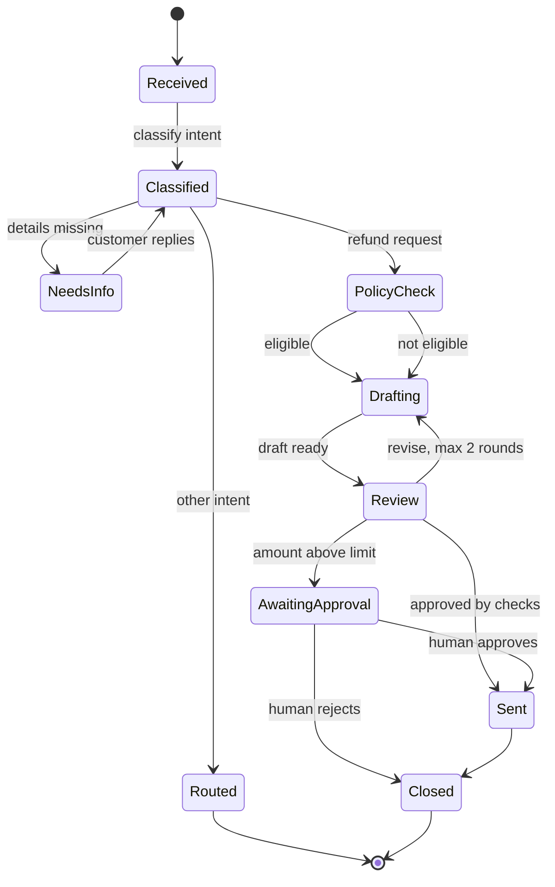
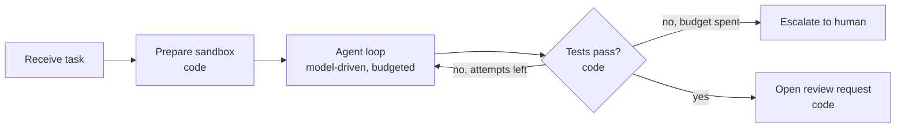

Most reliable "agent" products are, under the hood, **workflows**: a defined set of states and transitions in which a model is called at specific points to make judgements. The [multi-step workflows](/learn/ai-agent-fundamentals/multi-step-workflows) lesson introduced chains of LLM calls. This lesson is about designing them deliberately: drawing the process as a state machine, deciding for each decision point whether a model or code should make it, and implementing the result so that illegal transitions are impossible. A well-designed workflow gives you the flexibility of a model where you need it and the predictability of code everywhere else.

## Start from the process, not the model

Before writing a prompt, write down the business process as states and events. A **state** is a stable situation the work can be in ("waiting for the customer", "refund approved"). An **event** is something that moves it to another state ("customer replied", "check passed"). Ask, for each state: what must be true to enter it, what happens in it, and what can happen next.

Here is a support workflow for refund requests:



The diagram makes several design decisions visible that would be invisible in a free-running agent: the revise loop is bounded, high-value refunds always pass through a human, and a ticket with missing details waits rather than letting the model guess. Reviewers, product owners and auditors can read it, which is not true of a system prompt.

> [!KEY]
> If you can draw the process as a state machine, implement it as one. Use model calls inside states for judgement, and let code own the transitions.

## Where to use model judgement and where to use code

For each step, ask: can the rule be written down exactly? If yes, use code. If the input is unstructured language and correct outputs can only be recognised, not specified, use a model.

| Decision in the refund workflow | Owner | Reason |
| --- | --- | --- |
| What does the customer want? | Model | Free text, many phrasings |
| Are the order ID and reason present? | Model extracts, code checks | Extraction needs language understanding; presence is a rule |
| Is the order within 30 days of delivery? | Code | A date comparison; a model adds only risk |
| Does the amount need human approval? | Code | A threshold set by the business |
| Write the reply | Model | Tone and wording vary with the case |
| Does the reply promise anything the policy forbids? | Model judge plus code checks | Some rules are patterns (amounts must match), some need reading |
| Which state comes next? | Code | Transitions must be legal and auditable |

A useful heuristic is that models **produce and assess language**, and code **enforces rules and moves state**. When you find yourself writing "the model should always..." in a prompt, ask whether that "always" belongs in code.

## Implementing the state machine

The implementation separates three things: a table of legal transitions, a handler per state that does the work and returns an event, and a runner that applies the table. The two model calls (classification and drafting) are stubs here so the code runs; everything else is ordinary code.

```python
from datetime import date

TRANSITIONS = {
    ("received", "classified_refund"): "policy_check",
    ("received", "classified_other"): "routed",
    ("received", "missing_info"): "needs_info",
    ("policy_check", "eligible"): "drafting",
    ("policy_check", "not_eligible"): "drafting",
    ("drafting", "draft_ready"): "review",
    ("review", "needs_approval"): "awaiting_approval",
    ("review", "ok"): "sent",
}
TERMINAL = {"sent", "routed", "needs_info", "awaiting_approval"}  # wait for an external event

ORDERS = {"A-17": {"delivered": date(2026, 10, 30), "amount": 59.0},
          "B-90": {"delivered": date(2026, 8, 1), "amount": 640.0},
          "C-5": {"delivered": date(2026, 11, 1), "amount": 450.0}}
TODAY = date(2026, 11, 12)
APPROVAL_LIMIT = 200.0

def llm_classify(text):                       # stub for a model call with structured output
    order = next((w.strip(".,") for w in text.split() if w[1:2] == "-"), None)
    intent = "refund" if "refund" in text.lower() else "other"
    return {"intent": intent, "order_id": order}

def llm_draft(ctx):                            # stub for a model call that writes the reply
    verdict = "approved" if ctx["eligible"] else "declined, as it is outside our 30-day window"
    return f"Your refund for order {ctx['order_id']} has been {verdict}."

def handle(state, ctx):
    if state == "received":
        c = llm_classify(ctx["text"])
        ctx.update(c)
        if c["intent"] != "refund":
            return "classified_other"
        return "classified_refund" if c["order_id"] in ORDERS else "missing_info"
    if state == "policy_check":                 # pure code: a rule we can write down
        order = ORDERS[ctx["order_id"]]
        ctx["eligible"] = (TODAY - order["delivered"]).days <= 30
        ctx["amount"] = order["amount"]
        return "eligible" if ctx["eligible"] else "not_eligible"
    if state == "drafting":
        ctx["reply"] = llm_draft(ctx)
        return "draft_ready"
    if state == "review":                       # pure code: business threshold
        return "needs_approval" if ctx["eligible"] and ctx["amount"] > APPROVAL_LIMIT else "ok"
    raise ValueError(f"no handler for {state}")

def run_workflow(text):
    state, ctx, path = "received", {"text": text}, ["received"]
    while state not in TERMINAL:
        event = handle(state, ctx)
        nxt = TRANSITIONS.get((state, event))
        if nxt is None:
            raise RuntimeError(f"illegal transition: {state} --{event}-->")
        state = nxt
        path.append(state)
    return " -> ".join(path), ctx.get("reply")

for ticket in ["Please refund order A-17, it arrived broken.",
               "I want a refund for B-90.",
               "Refund C-5 please, wrong size.",
               "Refund please",
               "How do I export my data?"]:
    path, reply = run_workflow(ticket)
    print(path)
    if reply:
        print("   reply:", reply)
```

```output
received -> policy_check -> drafting -> review -> sent
   reply: Your refund for order A-17 has been approved.
received -> policy_check -> drafting -> review -> sent
   reply: Your refund for order B-90 has been declined, as it is outside our 30-day window.
received -> policy_check -> drafting -> review -> awaiting_approval
   reply: Your refund for order C-5 has been approved.
received -> needs_info
received -> routed
```

The C-5 refund is above the approval limit, so its drafted reply is held in `awaiting_approval` and is only sent if a person approves. Every path through the system is visible in the output and constrained by `TRANSITIONS`. If a future change makes a handler return an event that has no entry in the table, the runner raises immediately rather than drifting into an undefined state. That is the property free-running agents lack: you can enumerate everything the system is able to do.

## Bounded loops: the evaluator-optimiser

One common pattern needs a loop: generate, evaluate, revise. The rule is that the loop has a **hard cap** and a defined exit when the cap is reached. Here the evaluator is a code check (a reply must not exceed a length and must mention the order), and the generator is a stub that improves when given feedback.

```python
def generate(feedback=None):
    if feedback is None:
        return "Thanks for reaching out about your recent purchase, we really appreciate it and are looking into everything carefully for you."
    return "Your refund for order A-17 is approved."

def evaluate(reply):
    problems = []
    if "A-17" not in reply:
        problems.append("must mention the order ID")
    if len(reply) > 80:
        problems.append("must be under 80 characters")
    return problems

def generate_with_review(max_rounds=2):
    feedback = None
    for round_no in range(1, max_rounds + 1):
        reply = generate(feedback)
        problems = evaluate(reply)
        print(f"round {round_no}: {problems or 'passed'}")
        if not problems:
            return reply
        feedback = "; ".join(problems)
    return None                         # cap reached: escalate to a human

print(generate_with_review())
```

```output
round 1: ['must mention the order ID', 'must be under 80 characters']
round 2: passed
Your refund for order A-17 is approved.
```

If the cap is reached, the function returns `None` and the workflow moves to a human review state. It never loops indefinitely, and the decision to stop is code, not the model's opinion that the draft is now good.

## Choosing the level of autonomy

Not every task can be drawn in advance. A coding assistant fixing an unknown bug cannot have every step pre-planned. Even then, you can usually wrap the open-ended part in a workflow: a deterministic **outer** machine (receive, set up sandbox, run the agent with a budget, run tests, request review) around an autonomous **inner** loop.



> [!TIP]
> Design the outer workflow first, then decide which states genuinely need an agent inside them. You will often find that only one or two do.

## Pitfalls

- **Implicit states.** If "waiting for approval" exists only as a phrase in the conversation, nothing can find runs stuck in it. Make every waiting state explicit and queryable.
- **Unbounded loops.** Every cycle in the diagram needs a counter and an exit.
- **Model-chosen transitions for business rules.** Thresholds, eligibility and permissions are code.
- **One giant prompt doing everything.** Splitting into states with small, focused model calls makes each call easier to test and each failure easier to locate.

## Exercises

**1.** Add a state so that tickets where `llm_classify` finds the word "urgent" go to `escalated` instead of `policy_check`. Which three parts of the code change?

<details>
<summary>Show solution</summary>

The classifier output (add an `urgent` flag), the `received` handler (return a new event such as `"urgent"`), and the tables: add `("received", "urgent"): "escalated"` to `TRANSITIONS` and `"escalated"` to `TERMINAL`. Update the state diagram too, so documentation and code stay in step.

```python
TRANSITIONS[("received", "urgent")] = "escalated"
TERMINAL.add("escalated")
print(sorted(s for s in TERMINAL))
```

```output
['awaiting_approval', 'escalated', 'needs_info', 'routed', 'sent']
```

</details>

**2.** What happens if `handle` returns `"eligible"` while in the `review` state? Verify it.

<details>
<summary>Show solution</summary>

```python
print(TRANSITIONS.get(("review", "eligible")))
```

```output
None
```

There is no such transition, so `run_workflow` raises `RuntimeError: illegal transition`. That is the intended behaviour: a bug in a handler stops the run loudly instead of moving it somewhere undefined.

</details>

**3.** For an expense-claim assistant, classify each decision as model, code, or both: reading a receipt photo; checking the claim is under the per-diem limit; deciding whether "client dinner with team" is a business expense; choosing the next state.

<details>
<summary>Show solution</summary>

Reading the receipt: model (vision and extraction), with code validating that the extracted total is a positive number. Per-diem limit: code. Business-expense judgement: model, ideally with a human approval path for borderline cases. Next state: code.

</details>

```quiz
[
  {
    "q": "In a well-designed workflow, who decides which state comes next?",
    "options": [
      "The model, based on its reasoning",
      "Code, using a table of legal transitions driven by events",
      "The user, on every step",
      "Whichever handler finishes first"
    ],
    "answer": 1,
    "why": "Handlers may use models to produce events, but code applies the transition table so only legal moves happen."
  },
  {
    "q": "Which decision is the worst candidate for an LLM?",
    "options": [
      "Identifying the customer's intent from a free-text email",
      "Writing a polite reply",
      "Checking whether a refund amount exceeds a fixed approval threshold",
      "Summarising a long complaint"
    ],
    "answer": 2,
    "why": "A numeric threshold is a rule you can write down exactly; a model adds cost and risk without benefit."
  },
  {
    "q": "What must every evaluator-optimiser loop have?",
    "options": [
      "A temperature of zero",
      "A hard cap on rounds and a defined exit when the cap is reached",
      "At least three rounds",
      "A second model as the generator"
    ],
    "answer": 1,
    "why": "Without a cap and an exit path, the loop can run indefinitely or end in an undefined state."
  },
  {
    "q": "A coding agent cannot have its steps planned in advance. How can workflow design still help?",
    "options": [
      "It cannot help; use a fully autonomous agent",
      "Wrap the autonomous loop in a deterministic outer workflow with setup, budgets, tests and review",
      "Replace the agent with a single prompt",
      "Let the agent decide when to request review"
    ],
    "answer": 1,
    "why": "An outer state machine contains the open-ended part and enforces the steps that must always happen."
  }
]
```
