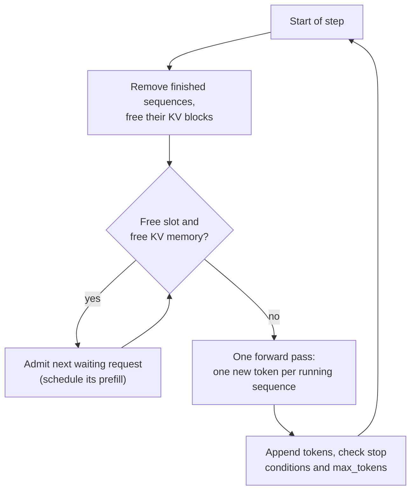

Batching is the single biggest throughput lever in LLM serving: because each decode step is limited by reading the weights from memory (see [Inference optimization](/learn/production-ai-systems/inference-optimization) and [Efficient inference](/learn/advanced-llm-engineering/efficient-inference)), running 16 sequences in one step costs little more than running one. But LLM requests are awkward to batch. Their outputs range from a few tokens to thousands, and nobody knows in advance which is which. **Continuous batching**, also called iteration-level scheduling or in-flight batching, solves this by changing the batch at every decode step instead of once per batch. It is used by essentially every modern LLM inference engine, including [vLLM](/learn/advanced-llm-engineering/vllm). This lesson shows why static batching wastes the GPU, how iteration-level scheduling works, and, with a simulation you can run, how large the difference is.

## Static batching and its waste

The general batching patterns from [Batching](/learn/production-ai-systems/batching) collect requests into a batch and run it to completion. For a classifier that is fine: every input takes one forward pass. For generation, a batch is only finished when its **longest** sequence is finished.

Imagine a batch of four requests whose responses need 20, 35, 400 and 60 tokens. After 60 steps, three of them are done, but their slots stay occupied (padded, producing nothing) for another 340 steps until the 400-token response finishes. Meanwhile new requests wait in the queue for the whole batch to end. Two costs follow:

- **Wasted compute**: most slot-steps in the batch produce padding.
- **Head-of-line blocking**: a short request that arrives just after a batch starts waits for the longest response in that batch, which ruins latency.

## Iteration-level scheduling

Continuous batching makes the scheduling decision at **every step**. After each forward pass, finished sequences leave the batch immediately, and waiting requests take their places before the next step.



This works because a transformer forward pass does not require the sequences in a batch to be aligned. Each sequence has its own position and its own KV cache (this is where [PagedAttention](/learn/advanced-llm-engineering/vllm)'s per-sequence block tables help), so a sequence at token 3 and another at token 900 can share a step.

Step through a tiny scheduler with two slots and three requests needing 3, 1 and 2 tokens:

```trace
{
  "title": "continuous batching with 2 slots",
  "code": [
    "queue = [(\"A\", 3), (\"B\", 1), (\"C\", 2)]",
    "running, step = {}, 0",
    "while queue or running:",
    "    while queue and len(running) < 2:",
    "        name, n = queue.pop(0)",
    "        running[name] = n",
    "    step += 1",
    "    for name in list(running):",
    "        running[name] -= 1",
    "        if running[name] == 0:",
    "            del running[name]",
    "            print(step, name, \"done\")"
  ],
  "steps": [
    { "line": 2, "vars": { "queue": "[A:3, B:1, C:2]", "running": "{}", "step": "0" }, "note": "Three requests wait. Each needs a number of decode steps." },
    { "line": 6, "vars": { "queue": "[C:2]", "running": "{A: 3, B: 1}", "step": "0" }, "note": "Both slots fill with A and B. C waits." },
    { "line": 7, "vars": { "queue": "[C:2]", "running": "{A: 3, B: 1}", "step": "1" }, "note": "One forward pass generates one token for every running sequence." },
    { "line": 12, "vars": { "queue": "[C:2]", "running": "{A: 2}", "step": "1" }, "out": ["1 B done"], "note": "B finishes after one token and leaves immediately, freeing its slot." },
    { "line": 6, "vars": { "queue": "[]", "running": "{A: 2, C: 2}", "step": "1" }, "out": ["1 B done"], "note": "Before the next step, C takes B's slot. Static batching would have made C wait until A finished." },
    { "line": 9, "vars": { "queue": "[]", "running": "{A: 1, C: 1}", "step": "2" }, "out": ["1 B done"], "note": "A and C advance together although A is further along: positions need not be aligned." },
    { "line": 12, "vars": { "queue": "[]", "running": "{}", "step": "3" }, "out": ["1 B done", "3 A done", "3 C done"], "note": "Everything finishes in 3 steps. Static batching would need 3 steps for the A+B batch, then 2 more for C: 5 in total." }
  ]
}
```

## Simulating the difference

The simulation below drives both policies with the same workload: 400 requests arriving at random times, output lengths drawn from a skewed (log-normal) distribution so most are short and a few are long, and 16 batch slots. Time is measured in decode steps, and each running sequence produces one token per step. Static batching starts a new batch only when the previous one has completely finished.

```python
from collections import deque
import numpy as np

rng = np.random.default_rng(0)
n_requests, slots = 400, 16
arrivals = np.cumsum(rng.exponential(scale=10.0, size=n_requests)).astype(int)
out_lens = np.clip(rng.lognormal(mean=4.5, sigma=0.8, size=n_requests).astype(int), 5, 1000)

def simulate(policy):
    waiting, running, finish = deque(), {}, {}
    nxt = step = generated = batch_left = 0
    while len(finish) < n_requests:
        while nxt < n_requests and arrivals[nxt] <= step:       # new arrivals join the queue
            waiting.append(nxt)
            nxt += 1
        if policy == "continuous" or batch_left == 0:           # static: only between batches
            while waiting and len(running) < slots:
                r = waiting.popleft()
                running[r] = out_lens[r]
            if policy == "static" and running:
                batch_left = max(running.values())              # batch lasts as long as its longest
        step += 1
        generated += len(running)                               # one token per running sequence
        for r in list(running):
            running[r] -= 1
            if running[r] == 0:
                finish[r] = step
                del running[r]
        batch_left = max(batch_left - 1, 0)
    latency = np.array([finish[r] - arrivals[r] for r in range(n_requests)])
    print(f"{policy:<10}  steps {step:5d}  tokens/step {generated / step:5.2f}  "
          f"slot use {generated / (step * slots):5.1%}  "
          f"mean latency {latency.mean():6.0f}  p90 {np.percentile(latency, 90):6.0f}")

print(f"{n_requests} requests, {out_lens.sum()} output tokens, last arrival at step {arrivals[-1]}")
simulate("static")
simulate("continuous")
```

```output
400 requests, 47683 output tokens, last arrival at step 4505
static      steps  9216  tokens/step  5.17  slot use 32.3%  mean latency   2273  p90   4151
continuous  steps  4711  tokens/step 10.12  slot use 63.3%  mean latency    121  p90    248
```

Read the numbers carefully. The offered load is roughly 47,700 tokens over about 4,500 steps, a little over 10 tokens per step. Continuous batching keeps up: it finishes shortly after the last arrival, its throughput matches the load, and a typical request completes within a couple of hundred steps of arriving. Static batching cannot keep up even though the slot count is the same, because about two thirds of its slot-steps are spent waiting for the longest member of each batch. Its queue grows throughout the run, so its latency is more than an order of magnitude worse. The simulation is generous to static batching: each request counts as finished when its own tokens are done, even though its slot stays blocked until the batch ends.

The model is deliberately simple: in a real engine a step with more sequences takes slightly longer, and prefill work must be scheduled too. The conclusion holds: when output lengths vary, scheduling per iteration rather than per batch multiplies effective capacity.

> [!KEY]
> Continuous batching decides batch membership at every decode step. Finished sequences leave at once and waiting ones join at once, so slots stay busy and short requests are not trapped behind long ones.

## Real engines: prefill, memory and preemption

Production schedulers add three complications to the simple loop.

**Prefill scheduling.** A newly admitted request needs a prefill pass over its whole prompt, which is much heavier than one decode token. Running a long prefill stalls every decoding sequence for that step, causing a visible pause in their token streams. **Chunked prefill** splits long prompts into pieces and mixes them with decode tokens across several steps, smoothing latency for everyone.

**KV memory as the real limit.** The slot count is not fixed: what limits admission is free KV cache memory. A request is admitted only if there are enough free blocks for it to make progress, and engines cap concurrency with a setting such as vLLM's `--max-num-seqs`.

**Preemption.** Running sequences grow, and memory can run out mid-generation. The scheduler then **preempts** some sequences: it frees their KV blocks and either recomputes them later from the tokens produced so far or swaps them to CPU memory. Preemption keeps the server alive under load spikes but costs throughput, so frequent preemption in the logs means the deployment needs more KV memory, a lower concurrency cap or shorter maximum lengths.

| Knob | Raise it to | Watch out for |
| --- | --- | --- |
| Max concurrent sequences | Increase throughput | Higher time per output token for each user |
| Max context length | Serve longer prompts | Fewer sequences fit in KV memory |
| Chunked prefill size | Faster time to first token for long prompts | Smaller values smooth decode latency but add steps |

> [!TIP]
> Throughput and per-user latency trade off. Benchmark with a load generator that replays your real distribution of prompt and output lengths, and record tokens per second, time to first token and time per output token at several concurrency levels before picking settings.

## Exercises

**1.** Rerun the simulation with `slots = 32`. What happens to each policy?

<details>
<summary>Show solution</summary>

```python
slots = 32
simulate("static")
simulate("continuous")
slots = 16
```

```output
static      steps  5785  tokens/step  8.24  slot use 25.8%  mean latency    729  p90   1153
continuous  steps  4711  tokens/step 10.12  slot use 31.6%  mean latency    119  p90    248
```

Static batching benefits a lot from more slots, because larger batches mean fewer of the long waits between batches, but it still wastes most of its slot-steps. Continuous batching was already keeping up with the load, so its latency barely changes; its slot use falls because the extra slots are rarely needed.

</details>

**2.** In the trace, how many slot-steps did static batching (A+B, then C) waste, compared with continuous batching?

<details>
<summary>Show solution</summary>

Static: the A+B batch runs 3 steps with 2 slots (6 slot-steps) but B uses only 1, so 2 are wasted; then C runs alone for 2 steps with one slot empty, wasting 2 more. That is 4 wasted out of 10. Continuous: 3 steps with 2 slots is 6 slot-steps, all used (A 3 + B 1 + C 2 = 6). None wasted.

</details>

**3.** Users complain that their token stream freezes for a moment whenever someone else submits a very long document. Which mechanism explains this, and which feature addresses it?

<details>
<summary>Show solution</summary>

The new request's prefill over the whole long document runs in one step, and every decoding sequence waits for that step to finish. Chunked prefill splits the prompt into pieces processed over several steps alongside decode tokens, so no single step stalls for long.

</details>

```quiz
[
  {
    "q": "With static batching, when does a batch of generation requests finish?",
    "options": [
      "When its shortest sequence finishes",
      "When its longest sequence finishes",
      "After a fixed number of seconds",
      "When the queue is empty"
    ],
    "answer": 1,
    "why": "Slots of finished sequences stay occupied until the longest member completes."
  },
  {
    "q": "What is the defining feature of continuous batching?",
    "options": [
      "Batch membership is updated at every decode step",
      "All requests are padded to the same length",
      "Batches are formed by a fixed timer",
      "Each request runs on its own GPU"
    ],
    "answer": 0,
    "why": "Iteration-level scheduling admits and retires sequences between individual forward passes."
  },
  {
    "q": "In an engine like vLLM, what usually limits how many sequences can run at once?",
    "options": [
      "The number of CPU cores",
      "The tokenizer vocabulary size",
      "Free KV cache memory (and a configured concurrency cap)",
      "The length of the system prompt only"
    ],
    "answer": 2,
    "why": "Each running sequence needs KV blocks; admission depends on free memory and settings such as `--max-num-seqs`."
  },
  {
    "q": "Why do schedulers use chunked prefill?",
    "options": [
      "To reduce the model's parameter count",
      "To increase the vocabulary",
      "To make sampling deterministic",
      "To avoid long prompts stalling every decoding sequence for one big step"
    ],
    "answer": 3,
    "why": "Splitting long prefills into chunks interleaved with decode steps keeps inter-token latency smooth."
  }
]
```
