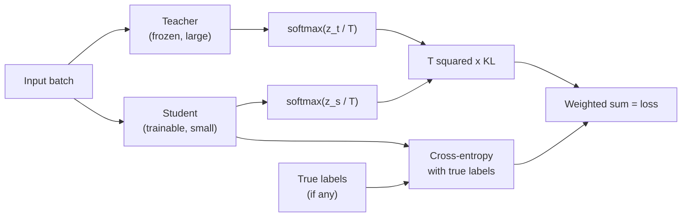
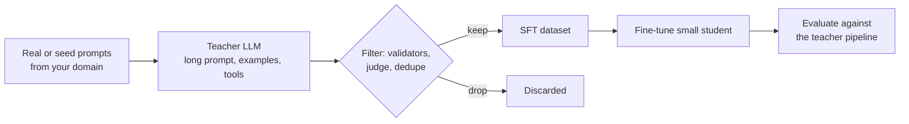

**Knowledge distillation** trains a small **student** model to imitate a larger **teacher**. The student ends up much cheaper to run than the teacher and, on the tasks it was distilled for, often far better than the same small model trained on labelled data alone. For LLM engineers distillation is one of the most practical cost levers there is: a large model with a long, carefully engineered prompt can be distilled into a small fine-tuned model that does the same job in a fraction of the time and price. This lesson covers the classic soft-target formulation, a runnable example, how distillation works for LLMs in practice, and the licence questions you must answer before using another model's outputs.

## Soft targets carry more information than labels

A hard label says only "this is class 3". A trained teacher's output distribution says much more: "most likely class 3, quite possibly class 5, certainly not class 1". These relative probabilities among wrong answers, sometimes called **dark knowledge**, describe how the teacher generalises, and a student can learn that structure from far fewer examples than it would need to rediscover it from labels.

To expose that structure, both models' logits are softened with a **temperature** $T$, as in [temperature sampling](/learn/generative-ai-fundamentals/temperature):

$$
p_i^{(T)} = \frac{\exp(z_i / T)}{\sum_j \exp(z_j / T)}
$$

where $z_i$ are the logits and $T > 1$ spreads probability mass towards the less likely classes, making the small probabilities large enough to learn from.

```python
import torch
import torch.nn.functional as F

teacher_logits = torch.tensor([1.0, 6.0, 3.5, 0.5])
for T in [1.0, 2.0, 4.0]:
    print(f"T={T}:", F.softmax(teacher_logits / T, dim=-1).numpy().round(3))
```

```output
T=1.0: [0.006 0.915 0.075 0.004]
T=2.0: [0.057 0.698 0.2   0.045]
T=4.0: [0.138 0.482 0.258 0.122]
```

At $T = 1$ the distribution is nearly one-hot; at higher temperatures the teacher's ranking of the other classes becomes visible.

## The distillation loss

The student is trained to match the teacher's softened distribution, measured with the [KL divergence](/learn/essential-mathematics-for-machine-learning/kl-divergence), often combined with ordinary cross-entropy on true labels when they exist:

$$
\mathcal{L} = \alpha\, T^2\, \mathbb{D}_{\text{KL}}\big(p_{\text{teacher}}^{(T)} \,\|\, p_{\text{student}}^{(T)}\big) + (1 - \alpha)\, \text{CE}\big(y, p_{\text{student}}^{(1)}\big)
$$

Here $\alpha \in [0, 1]$ balances the two terms and $y$ is the true label. The factor $T^2$ compensates for the fact that gradients of the softened loss scale as $1/T^2$, so changing $T$ does not silently change the effective learning rate. Because the teacher distribution is fixed, minimising this KL is equivalent to minimising cross-entropy against the teacher's soft targets.



## A runnable toy distillation

The example below builds a synthetic four-class problem. A large teacher network is trained on 4,000 labelled examples. Then we compare three ways of training a tiny student (8 hidden units):

1. Only on a small labelled set of 300 examples.
2. On a larger **unlabelled transfer set** of 4,000 inputs, labelled with the teacher's hard predictions.
3. On the same transfer set with soft targets at $T = 2$.

```python
import torch.nn as nn

torch.manual_seed(0)
D, C = 10, 4
W1, W2 = torch.randn(D, 32) * 0.5, torch.randn(32, C)

def make(n):
    x = torch.randn(n, D)
    y = (torch.tanh(x @ W1) @ W2 + 0.3 * torch.randn(n, C)).argmax(1)   # noisy rule
    return x, y

x_lab, y_lab = make(4000)
x_transfer = torch.randn(4000, D)                 # unlabelled inputs
x_test, y_test = make(4000)

def mlp(hidden):
    return nn.Sequential(nn.Linear(D, hidden), nn.ReLU(), nn.Linear(hidden, C))

def accuracy(model):
    with torch.no_grad():
        return (model(x_test).argmax(1) == y_test).float().mean().item()

def train(model, x, loss_fn, epochs=40, bs=128):
    opt = torch.optim.Adam(model.parameters(), lr=3e-3)
    for _ in range(epochs):
        perm = torch.randperm(len(x))
        for i in range(0, len(x), bs):
            idx = perm[i:i + bs]
            opt.zero_grad()
            loss_fn(model(x[idx]), idx).backward()
            opt.step()
    return model

def kd_loss(student_logits, teacher_logits, T):
    return F.kl_div(F.log_softmax(student_logits / T, dim=-1),
                    F.log_softmax(teacher_logits / T, dim=-1),
                    log_target=True, reduction="batchmean") * T * T

teacher = train(mlp(256), x_lab, lambda out, i: F.cross_entropy(out, y_lab[i]))
with torch.no_grad():
    t_logits = teacher(x_transfer)
print(f"teacher (256 hidden):                 {accuracy(teacher):.3f}")

torch.manual_seed(1)
s1 = train(mlp(8), x_lab[:300], lambda out, i: F.cross_entropy(out, y_lab[:300][i]), epochs=200)
print(f"student, 300 true labels:             {accuracy(s1):.3f}")

torch.manual_seed(1)
s2 = train(mlp(8), x_transfer, lambda out, i: F.cross_entropy(out, t_logits[i].argmax(1)))
print(f"student, teacher hard labels:         {accuracy(s2):.3f}")

torch.manual_seed(1)
s3 = train(mlp(8), x_transfer, lambda out, i: kd_loss(out, t_logits[i], T=2.0))
print(f"student, teacher soft targets (T=2):  {accuracy(s3):.3f}")
```

```output
teacher (256 hidden):                 0.878
student, 300 true labels:             0.826
student, teacher hard labels:         0.841
student, teacher soft targets (T=2):  0.845
```

Two lessons come out of this. First, the biggest gain comes from the teacher labelling plentiful unlabelled inputs: the student learns from 4,000 teacher-labelled examples instead of 300 human-labelled ones. Second, soft targets add a further small gain on top of hard teacher labels in this run. On toy problems that difference is modest and varies with the seed; on real tasks with many classes, such as a vocabulary of tens of thousands of tokens, the extra information in the full distribution matters more. Neither student reaches the teacher, which is normal: an 8-unit network has limited capacity.

> [!NOTE]
> In `F.kl_div` the first argument is the student's log-probabilities and the second the teacher's (here also as log-probabilities, with `log_target=True`). Swapping them computes a different divergence. The order matches $\mathbb{D}_{\text{KL}}(p_{\text{teacher}} \,\|\, p_{\text{student}})$.

## Distilling LLMs: logits or text

For language models there are two practical forms, which differ in what you need from the teacher.

| | Logit (token-level) distillation | Sequence-level (synthetic data) distillation |
| --- | --- | --- |
| Signal | Teacher's full next-token distribution at every position | Teacher's generated text, used as SFT targets |
| Needs | Teacher weights or logits, and the **same tokenizer** in teacher and student | Only the teacher's outputs, so any model or API works |
| Cost | Teacher forward pass during training, large logit tensors | Generate once, then ordinary SFT |
| Information | Richest | Only the sampled tokens |

Logit distillation applies the loss above at every token position, with the vocabulary as the set of classes. It is the method of choice when you control both models, typically within one model family. Sequence-level distillation is what most application teams do: it is [SFT](/learn/advanced-llm-engineering/supervised-fine-tuning-sft) on data written by a stronger model.

## Synthetic-data distillation from a larger LLM



The steps, in engineering terms:

1. **Collect prompts** that match real traffic. Sampled production inputs (with appropriate consent and privacy handling) are better than invented ones.
2. **Generate with the teacher at its best**: the long system prompt, few-shot examples, retrieved context, even multiple samples with a judge picking the best. The student will learn to produce that output from a short prompt.
3. **Filter hard.** Schema validation, unit tests for code, an LLM judge for quality, deduplication. Teacher errors become student errors.
4. **Fine-tune** the student, usually with [LoRA](/learn/advanced-llm-engineering/lora-and-qlora).
5. **Evaluate the student against the teacher pipeline** on held-out prompts. The goal is "close enough to the teacher at a fraction of the cost", and you should know the gap in numbers.

## Licences and terms of use

Before distilling from any model, read its licence or terms of service. They differ widely and change over time:

- Some commercial API terms restrict using outputs to develop models that compete with the provider.
- Some open-weight model licences place conditions on using the model or its outputs to train other models, such as naming or attribution requirements, or restrictions for certain uses or organisation sizes.
- Permissively licensed models (for example under Apache 2.0 or MIT) generally impose fewer conditions, but check the specific model card, since a model can be released under custom terms.
- The prompts you send to a teacher may contain personal or confidential data; distillation through an external API is a data transfer that needs the same review as any other.

> [!WARNING]
> Record the teacher model, its version, the licence or terms in force at generation time, and the generation date alongside every synthetic dataset. If the question "where did this training data come from?" is ever asked, you need to be able to answer it precisely.

## Exercises

**1.** Train another student on the transfer set with soft targets at $T = 1$ and $T = 4$ and compare accuracy with $T = 2$.

<details>
<summary>Show solution</summary>

```python
for T in [1.0, 4.0]:
    torch.manual_seed(1)
    s = train(mlp(8), x_transfer, lambda out, i: kd_loss(out, t_logits[i], T=T))
    print(f"T={T}: {accuracy(s):.3f}")
```

```output
T=1.0: 0.845
T=4.0: 0.842
```

The differences between temperatures are small here. In practice $T$ is a hyperparameter tuned on a validation set; values from about 1 to 4 are common starting points.

</details>

**2.** Why must teacher and student share a tokenizer for token-level distillation, but not for sequence-level distillation?

<details>
<summary>Show solution</summary>

Token-level distillation compares probability distributions over the vocabulary at each position, which only makes sense if both models use the same vocabulary and split text into the same positions. Sequence-level distillation uses only the teacher's text, which the student tokenises its own way.

</details>

**3.** A teacher pipeline uses a 3,000-token system prompt with examples. After distillation the student uses a 50-token prompt. Besides model size, name two sources of cost saving.

<details>
<summary>Show solution</summary>

Far fewer input tokens per request (prompt processing time and per-token charges), and a smaller KV cache per request, so more concurrent requests fit on the same GPU. Latency to first token also falls because the prefill is shorter.

</details>

```quiz
[
  {
    "q": "Why is temperature T greater than 1 used when distilling classifiers?",
    "options": [
      "To make the teacher more accurate",
      "To soften the distributions so the relative probabilities of wrong classes become learnable",
      "To speed up training",
      "To make the student's output deterministic"
    ],
    "answer": 1,
    "why": "Softening exposes the teacher's ranking of non-top classes, the dark knowledge the student learns from."
  },
  {
    "q": "Why is the KL term multiplied by T squared?",
    "options": [
      "To convert nats to bits",
      "Because the teacher is larger",
      "To keep gradient magnitudes roughly independent of the chosen temperature",
      "To penalise long sequences"
    ],
    "answer": 2,
    "why": "Gradients of the softened loss scale as 1/T^2; multiplying by T^2 keeps the effective learning rate stable as T changes."
  },
  {
    "q": "Which form of LLM distillation works with a teacher you can only access through a text API?",
    "options": [
      "Sequence-level distillation using generated text as SFT data",
      "Logit distillation at every token",
      "Distillation of attention maps",
      "None; distillation needs the teacher's weights"
    ],
    "answer": 0,
    "why": "Sequence-level distillation needs only the teacher's outputs, which is why it is the common approach with API models."
  },
  {
    "q": "Before training on outputs generated by a third-party model, what must you check?",
    "options": [
      "Only the output length",
      "Whether the teacher uses the same GPU",
      "Nothing, outputs are always free to use",
      "The licence or terms of use governing the model and its outputs"
    ],
    "answer": 3,
    "why": "Terms differ widely; some restrict using outputs to train other or competing models."
  }
]
```
