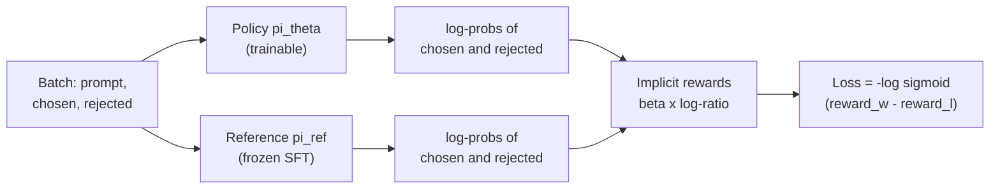

**Direct Preference Optimization (DPO)** trains a language model on preference pairs with a single supervised loss: no reward model to train separately, no sampling inside the training loop, no reinforcement learning. It optimises the same KL-regularised objective as [RLHF](/learn/advanced-llm-engineering/rlhf-fundamentals), but a short derivation shows that the optimal policy can be fitted to preferences directly. Because it is stable, cheap and looks like SFT from an engineering point of view, DPO and its relatives have become a default choice for preference-tuning open models. In this lesson you will derive the loss, implement it in PyTorch, and learn what its one hyperparameter, $\beta$, controls.

## Step 1: the optimal policy has a closed form

Start from the RLHF objective for a single prompt $x$, with reward $r(x, y)$, reference policy $\pi_{\text{ref}}$ and penalty strength $\beta > 0$:

$$
\max_{\pi}\; \mathbb{E}_{y \sim \pi(\cdot \mid x)}\big[r(x, y)\big] - \beta\, \mathbb{D}_{\text{KL}}\big(\pi(\cdot \mid x) \,\|\, \pi_{\text{ref}}(\cdot \mid x)\big)
$$

Define the normalising constant $Z(x) = \sum_{y} \pi_{\text{ref}}(y \mid x)\, e^{r(x, y)/\beta}$ and the distribution $\pi^*(y \mid x) = \pi_{\text{ref}}(y \mid x)\, e^{r(x, y)/\beta} / Z(x)$. Writing the KL as an expectation of a log-ratio and rearranging, the objective equals

$$
-\beta\, \mathbb{D}_{\text{KL}}\big(\pi(\cdot \mid x) \,\|\, \pi^*(\cdot \mid x)\big) + \beta \log Z(x)
$$

The second term does not depend on $\pi$, and a KL divergence is zero only when the two distributions are equal. So the objective is maximised exactly at $\pi = \pi^*$: the optimal policy is the reference policy reweighted by exponentiated reward.

## Step 2: express the reward through the policy

Take logs of $\pi^*$ and solve for the reward:

$$
r(x, y) = \beta \log \frac{\pi^*(y \mid x)}{\pi_{\text{ref}}(y \mid x)} + \beta \log Z(x)
$$

Any reward function corresponds to an optimal policy, and the policy determines the reward up to the term $\beta \log Z(x)$, which depends only on the prompt.

## Step 3: substitute into Bradley-Terry

The [Bradley-Terry model](/learn/advanced-llm-engineering/preference-optimization) uses only the **difference** of rewards for two responses to the same prompt, so $\beta \log Z(x)$ cancels:

$$
P(y_w \succ y_l \mid x) = \sigma\!\left(\beta \log \frac{\pi^*(y_w \mid x)}{\pi_{\text{ref}}(y_w \mid x)} - \beta \log \frac{\pi^*(y_l \mid x)}{\pi_{\text{ref}}(y_l \mid x)}\right)
$$

The intractable $Z(x)$ has disappeared. Replace $\pi^*$ with the trainable model $\pi_\theta$ and minimise the negative log-likelihood of the observed preferences. That is the DPO loss:

$$
\mathcal{L}_{\text{DPO}}(\theta) = -\mathbb{E}_{(x, y_w, y_l)}\left[\log \sigma\!\left(\beta \log \frac{\pi_\theta(y_w \mid x)}{\pi_{\text{ref}}(y_w \mid x)} - \beta \log \frac{\pi_\theta(y_l \mid x)}{\pi_{\text{ref}}(y_l \mid x)}\right)\right]
$$

The quantity $\hat{r}_\theta(x, y) = \beta \log \frac{\pi_\theta(y \mid x)}{\pi_{\text{ref}}(y \mid x)}$ is called the **implicit reward**. The policy is its own reward model: training raises the implicit reward of chosen responses relative to rejected ones.



## Implementing the loss

Sequence log-probabilities are sums of per-token log-probabilities over the **response** tokens only, using the same masking as in [SFT](/learn/advanced-llm-engineering/supervised-fine-tuning-sft). The reference log-probabilities are computed without gradients. Here is the whole computation for a toy batch of three pairs, with random logits standing in for model outputs:

```python
import torch
import torch.nn.functional as F

torch.manual_seed(0)
vocab, B, T = 50, 3, 6

def sequence_logps(logits, labels, mask):
    """Sum of log p(label) over response positions (mask = 1)."""
    logp = torch.log_softmax(logits, dim=-1)
    token_logp = logp.gather(-1, labels.unsqueeze(-1)).squeeze(-1)
    return (token_logp * mask).sum(-1)

def dpo_loss(pol_w, pol_l, ref_w, ref_l, beta):
    reward_w = beta * (pol_w - ref_w)          # implicit rewards
    reward_l = beta * (pol_l - ref_l)
    loss = -F.logsigmoid(reward_w - reward_l).mean()
    return loss, reward_w.detach(), reward_l.detach()

labels_w = torch.randint(0, vocab, (B, T))     # chosen response tokens
labels_l = torch.randint(0, vocab, (B, T))     # rejected response tokens
mask = torch.tensor([[0, 0, 1, 1, 1, 1],       # 0 = prompt or padding
                     [0, 0, 0, 1, 1, 1],
                     [0, 1, 1, 1, 1, 0]], dtype=torch.float)

ref_logits_w, ref_logits_l = torch.randn(B, T, vocab), torch.randn(B, T, vocab)
pol_logits_w = (ref_logits_w + 0.5 * torch.randn(B, T, vocab)).requires_grad_()
pol_logits_l = (ref_logits_l + 0.5 * torch.randn(B, T, vocab)).requires_grad_()

with torch.no_grad():
    ref_w = sequence_logps(ref_logits_w, labels_w, mask)
    ref_l = sequence_logps(ref_logits_l, labels_l, mask)

loss, rw, rl = dpo_loss(sequence_logps(pol_logits_w, labels_w, mask),
                        sequence_logps(pol_logits_l, labels_l, mask), ref_w, ref_l, beta=0.1)
print(f"loss: {loss.item():.4f}  (log 2 = {torch.log(torch.tensor(2.0)).item():.4f})")
print("reward chosen:  ", rw.numpy().round(3))
print("reward rejected:", rl.numpy().round(3))
print(f"reward accuracy: {(rw > rl).float().mean().item():.2f}")
```

```output
loss: 0.6826  (log 2 = 0.6931)
reward chosen:   [ 0.021 -0.133 -0.113]
reward rejected: [-0.126 -0.056 -0.113]
reward accuracy: 0.67
```

When the policy equals the reference, every implicit reward is zero and the loss is exactly $\log 2$, the loss of a coin flip. Here the policy is a small random perturbation of the reference, so the loss is close to $\log 2$ and the pairs are ranked correctly only by chance.

Now treat the policy logits as parameters and take gradient steps, which is what DPO training does to the real model's weights:

```python
opt = torch.optim.Adam([pol_logits_w, pol_logits_l], lr=0.05)
for step in range(61):
    loss, rw, rl = dpo_loss(sequence_logps(pol_logits_w, labels_w, mask),
                            sequence_logps(pol_logits_l, labels_l, mask), ref_w, ref_l, beta=0.1)
    if step % 20 == 0:
        print(f"step {step:2d}  loss {loss.item():.4f}  margin {(rw - rl).mean().item():+.3f}"
              f"  accuracy {(rw > rl).float().mean().item():.2f}")
    opt.zero_grad()
    loss.backward()
    opt.step()
```

```output
step  0  loss 0.6826  margin +0.023  accuracy 0.67
step 20  loss 0.2302  margin +1.375  accuracy 1.00
step 40  loss 0.1003  margin +2.291  accuracy 1.00
step 60  loss 0.0608  margin +2.816  accuracy 1.00
```

The loss falls as the margin between chosen and rejected implicit rewards grows. These three quantities (loss, reward margin, reward accuracy on held-out pairs) are exactly the metrics a real DPO run logs.

## What beta controls

Differentiating the loss shows how each pair is weighted:

$$
\nabla_\theta \mathcal{L}_{\text{DPO}} = -\beta\, \mathbb{E}\Big[\sigma\big(\hat{r}_\theta(x, y_l) - \hat{r}_\theta(x, y_w)\big)\big(\nabla_\theta \log \pi_\theta(y_w \mid x) - \nabla_\theta \log \pi_\theta(y_l \mid x)\big)\Big]
$$

The weight $\sigma(\hat{r}_l - \hat{r}_w)$ is large when the model currently ranks the pair the wrong way and shrinks towards zero once a pair is ranked correctly with a comfortable margin. $\beta$ plays the same role as the KL coefficient in RLHF:

| $\beta$ | Behaviour |
| --- | --- |
| Large (for example 0.5) | Small log-ratio changes already give a big margin, so the loss saturates early; the policy stays close to the reference |
| Typical (around 0.1) | A common default and a sensible starting point |
| Small (for example 0.01) | The policy must move far from the reference to reduce the loss; stronger preference fitting, more risk of degraded fluency |

```python
log_ratio_gap = torch.tensor(2.0)      # (log-ratio chosen) - (log-ratio rejected)
for beta in [0.01, 0.1, 0.5]:
    margin = beta * log_ratio_gap
    print(f"beta {beta:<4}  margin {margin.item():.2f}  loss {-F.logsigmoid(margin).item():.3f}"
          f"  pair weight {torch.sigmoid(-margin).item():.3f}")
```

```output
beta 0.01  margin 0.02  loss 0.683  pair weight 0.495
beta 0.1   margin 0.20  loss 0.598  pair weight 0.450
beta 0.5   margin 1.00  loss 0.313  pair weight 0.269
```

For the same movement away from the reference, a larger $\beta$ means the pair is considered nearly learned and receives little further push.

> [!WARNING]
> DPO is an offline method that drives the probability of rejected responses down. A known failure mode is that the log-probabilities of **both** chosen and rejected responses fall during training, with the margin growing only because rejected falls faster. Log chosen and rejected log-probs separately and evaluate generations, not just the margin.

## DPO in practice

The TRL library provides `DPOTrainer`. With a dataset of `prompt`, `chosen` and `rejected` fields, a run looks like this (needs a GPU, shown without output):

```python
from datasets import load_dataset
from trl import DPOConfig, DPOTrainer
from transformers import AutoModelForCausalLM, AutoTokenizer

model_id = "your-org/your-sft-model"
model = AutoModelForCausalLM.from_pretrained(model_id)
tokenizer = AutoTokenizer.from_pretrained(model_id)
pairs = load_dataset("json", data_files="preferences.jsonl", split="train")

args = DPOConfig(output_dir="dpo-run", beta=0.1, learning_rate=5e-7,
                 num_train_epochs=1, per_device_train_batch_size=4, bf16=True)
trainer = DPOTrainer(model=model, args=args, train_dataset=pairs, processing_class=tokenizer)
trainer.train()
```

If you do not pass `ref_model`, TRL creates the reference from the initial model (or, with a PEFT adapter, uses the base with the adapter disabled). Learning rates for full-parameter DPO are typically much lower than for SFT, because the loss pushes directly on log-probabilities. Start from your SFT model: DPO on a base model that has never been instruction-tuned works poorly.

Several variants change the loss while keeping the idea of learning directly from preferences. You will meet names such as **IPO**, **KTO** and **ORPO**: IPO modifies the objective to reduce over-fitting to the preference data, KTO learns from individually labelled good or bad responses rather than pairs, and ORPO combines the SFT and preference steps without a separate reference model. Check each method's paper and your library's documentation before relying on its specific properties.

> [!KEY]
> DPO is maximum-likelihood Bradley-Terry with the reward written as $\beta$ times the policy-to-reference log-ratio. The reference model and $\beta$ do the job that the KL penalty does in RLHF.

## Exercises

**1.** Verify numerically that the DPO loss is $\log 2$ when the policy equals the reference, by calling `dpo_loss` with `ref_w, ref_l, ref_w, ref_l`.

<details>
<summary>Show solution</summary>

```python
loss0, _, _ = dpo_loss(ref_w, ref_l, ref_w, ref_l, beta=0.1)
print(round(loss0.item(), 4))
```

```output
0.6931
```

</details>

**2.** After training, compare the policy's sequence log-probs for chosen and rejected responses with the reference values. Did the chosen log-probs go up?

<details>
<summary>Show solution</summary>

```python
with torch.no_grad():
    pw = sequence_logps(pol_logits_w, labels_w, mask)
    pl = sequence_logps(pol_logits_l, labels_l, mask)
print("chosen change:  ", (pw - ref_w).numpy().round(2))
print("rejected change:", (pl - ref_l).numpy().round(2))
```

```output
chosen change:   [13.86 10.2  13.52]
rejected change: [-16.9  -13.82 -16.79]
```

In this toy, the logits for each response are separate parameters, so chosen log-probs rise and rejected fall. In a real model both responses share weights, which is why chosen log-probs can fall too, as the warning above describes.

</details>

**3.** Why does $\log Z(x)$ not need to be computed in DPO, when computing it would require summing over every possible response?

<details>
<summary>Show solution</summary>

Bradley-Terry depends only on the difference of the rewards of two responses to the same prompt. Both rewards contain the same $\beta \log Z(x)$, so it cancels in the difference.

</details>

```quiz
[
  {
    "q": "What is the implicit reward in DPO?",
    "options": [
      "The output of a separately trained reward model",
      "`beta * log(pi_theta(y|x) / pi_ref(y|x))`",
      "The cross-entropy of the chosen response",
      "The length of the response"
    ],
    "answer": 1,
    "why": "DPO's derivation expresses the reward as beta times the log-ratio of the policy to the reference, up to a prompt-only term that cancels."
  },
  {
    "q": "What is the DPO loss for every pair at initialisation, when the policy equals the reference?",
    "options": [
      "0",
      "1",
      "`log 2`",
      "Undefined"
    ],
    "answer": 2,
    "why": "All implicit rewards are zero, so the loss is `-log sigmoid(0) = log 2`."
  },
  {
    "q": "Increasing `beta` in DPO tends to:",
    "options": [
      "Keep the policy closer to the reference model",
      "Remove the need for a reference model",
      "Make the loss ignore the rejected response",
      "Increase the learning rate"
    ],
    "answer": 0,
    "why": "Larger beta means small deviations already produce large margins, so the loss saturates and the policy moves less from the reference."
  },
  {
    "q": "Which models must be evaluated in a DPO training step?",
    "options": [
      "Policy, reference, reward model and value model",
      "Only a reward model",
      "Only the policy",
      "Policy (with gradients) and reference (without gradients)"
    ],
    "answer": 3,
    "why": "DPO needs log-probs from the trainable policy and the frozen reference; no reward or value model is used."
  }
]
```
