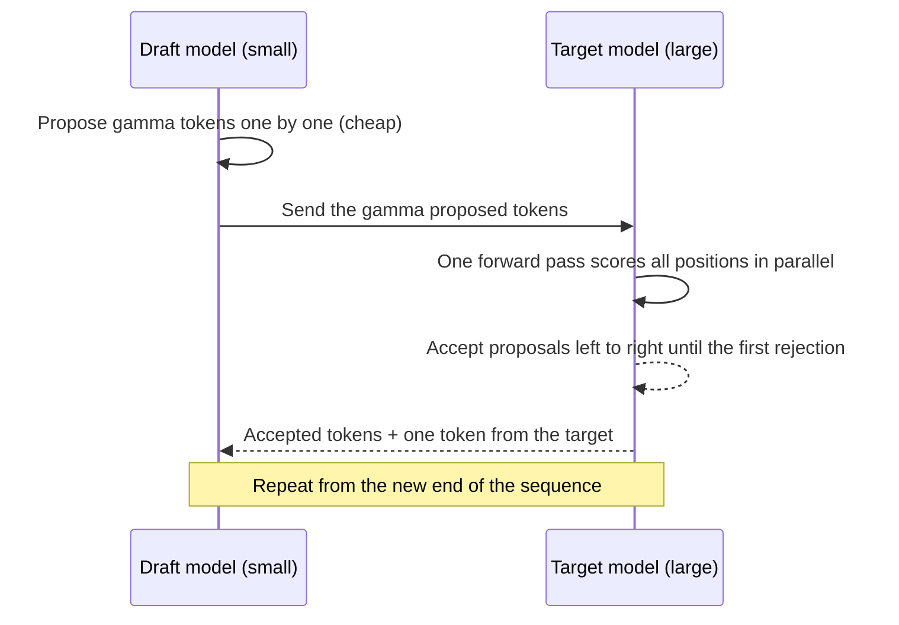
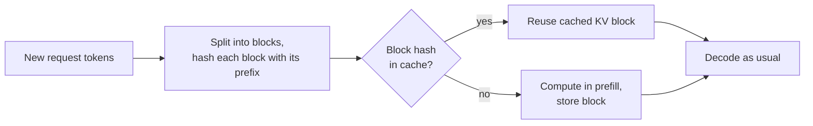

Serving an LLM is expensive because generation is sequential: each new token needs a full forward pass through the model, and the next token cannot start until the previous one is known. The production-level levers (batching, autoscaling, caching responses) were covered in [Inference optimization](/learn/production-ai-systems/inference-optimization) and [Latency optimization](/learn/production-ai-systems/latency-optimization). This lesson goes inside the engine to three techniques that modern inference stacks rely on: **speculative decoding**, which produces several tokens per expensive forward pass; **FlashAttention**, which computes attention without ever writing the full attention matrix to memory; and **prefix caching**, which skips recomputing work shared between requests. To see why each one helps, start with where the time goes.

## Prefill and decode are different workloads

A request runs in two phases.

| | Prefill | Decode |
| --- | --- | --- |
| What happens | Process all prompt tokens in one forward pass, fill the KV cache | Generate one token per forward pass, appending to the KV cache |
| Parallelism | All prompt tokens at once | One token per sequence per step |
| Bottleneck | Compute (large matrix multiplies) | Memory bandwidth (read all weights for little work) |
| User-facing metric | Time to first token (TTFT) | Time per output token (TPOT), or inter-token latency |

The decode bottleneck is worth quantifying. Every decode step must read every weight from GPU memory. For a model with 14 GB of bf16 weights on a GPU with, say, 2,000 GB/s of memory bandwidth (illustrative figures), reading the weights alone takes about 7 ms, capping a single sequence at roughly 140 tokens per second no matter how fast the arithmetic units are. During that step the compute units are mostly idle. Every technique below either uses that idle compute or avoids moving bytes.

## Speculative decoding

If the expensive target model can verify several tokens in one forward pass (it can, exactly as in prefill), then the bottleneck is only in **proposing** tokens. Speculative decoding uses a small, fast **draft model** to propose $\gamma$ tokens, then runs the target model once over all of them.



Verification works position by position. A draft token $x$ that the draft proposed with probability $q(x)$ and the target assigns probability $p(x)$ is accepted with probability $\min(1, p(x)/q(x))$. At the first rejection, a replacement is sampled from the normalised leftover distribution $\max(0, p - q)$ and the rest of the draft is discarded. This rule makes the output distribution **exactly** the target model's: speculative decoding changes speed, not quality. With greedy decoding the rule reduces to "accept while the draft token equals the target's top token". If all $\gamma$ proposals are accepted, the target's pass also yields one bonus token for free.

### Expected speedup

Assume each draft token is accepted independently with probability $\alpha$ (the **acceptance rate**). The number of tokens produced per target forward pass is the accepted run plus one, with expectation

$$
\mathbb{E}[\text{tokens per pass}] = \frac{1 - \alpha^{\gamma + 1}}{1 - \alpha}
$$

If one draft forward pass costs a fraction $c$ of a target pass, each round costs $\gamma c + 1$ target-pass equivalents, so the expected speedup over ordinary decoding is

$$
\text{speedup} = \frac{1 - \alpha^{\gamma + 1}}{(1 - \alpha)(\gamma c + 1)}
$$

```python
import numpy as np

def expected_tokens(alpha, gamma):
    return (1 - alpha ** (gamma + 1)) / (1 - alpha)

def speedup(alpha, gamma, c):
    return expected_tokens(alpha, gamma) / (gamma * c + 1)

# Check the formula by simulation: accept each draft token with prob alpha
rng = np.random.default_rng(0)
alpha, gamma = 0.8, 4
accepted = (rng.random((100_000, gamma)) < alpha).cumprod(axis=1).sum(axis=1)
print(f"simulated tokens/pass: {(accepted + 1).mean():.3f}, formula: {expected_tokens(alpha, gamma):.3f}")

print("\nspeedup with draft cost c = 0.05")
print("alpha  " + "  ".join(f"gamma={g}" for g in [2, 4, 8]))
for a in [0.5, 0.7, 0.9]:
    print(f"{a:<5}  " + "  ".join(f"{speedup(a, g, 0.05):7.2f}" for g in [2, 4, 8]))
```

```output
simulated tokens/pass: 3.361, formula: 3.362

speedup with draft cost c = 0.05
alpha  gamma=2  gamma=4  gamma=8
0.5       1.59     1.61     1.43
0.7       1.99     2.31     2.28
0.9       2.46     3.41     4.38
```

The table shows the engineering trade-off. With a high acceptance rate, longer drafts pay off; with a low one, they are wasted work and the gain is small. The acceptance rate depends on how well the draft model imitates the target on your traffic, which is why drafts are usually small models from the same family (sharing the tokenizer), sometimes [distilled](/learn/advanced-llm-engineering/distillation) from the target. Variants avoid a separate draft model altogether by adding extra prediction heads to the target or by matching n-grams from the prompt, which works well when outputs copy from inputs, as in code editing or retrieval-grounded answers.

> [!NOTE]
> Speculative decoding helps most when the GPU has spare compute, which is the case at small batch sizes. Under heavy load with large batches, decoding is already closer to compute-bound and the extra verification work buys less. Measure on your real traffic.

## FlashAttention

Standard attention for a sequence of length $n$ computes the $n \times n$ score matrix $S = QK^\top / \sqrt{d}$, applies softmax, and multiplies by $V$, as in [self-attention](/learn/generative-ai-fundamentals/self-attention). A straightforward implementation writes $S$ and the softmax result to GPU main memory (HBM) and reads them back. For long sequences that matrix is large, and the reads and writes, not the arithmetic, dominate the time.

**FlashAttention** is an exact attention algorithm that never materialises the full matrix in HBM. It splits $Q$, $K$ and $V$ into tiles that fit in the GPU's small, fast on-chip memory, and computes the output tile by tile. The obstacle is softmax, which seems to need the whole row before normalising. The solution is an **online softmax**: keep a running maximum and running sum for each row, and rescale the partial output whenever a new tile raises the maximum. The result is identical to standard attention (up to floating-point rounding), with memory that grows linearly in $n$ rather than quadratically.

```python
rng = np.random.default_rng(1)
n, d, tile = 8, 4, 3
q = rng.normal(size=d)                      # one query row
K, V = rng.normal(size=(n, d)), rng.normal(size=(n, d))

# Standard: full score row, softmax, weighted sum
s = K @ q / np.sqrt(d)
w = np.exp(s - s.max())
standard = (w / w.sum()) @ V

# Online: process K, V in tiles, never holding all scores at once
m, l, acc = -np.inf, 0.0, np.zeros(d)       # running max, running sum, running output
for start in range(0, n, tile):
    s_tile = K[start:start + tile] @ q / np.sqrt(d)
    m_new = max(m, s_tile.max())
    scale = np.exp(m - m_new)               # rescale old partial results
    p = np.exp(s_tile - m_new)
    l = l * scale + p.sum()
    acc = acc * scale + p @ V[start:start + tile]
    m = m_new
online = acc / l

print("standard:", standard.round(6))
print("online:  ", online.round(6))
print("max abs difference:", float(np.abs(standard - online).max()))
```

```output
standard: [ 0.028868 -0.141415 -0.271848 -0.549282]
online:   [ 0.028868 -0.141415 -0.271848 -0.549282]
max abs difference: 5.551115123125783e-17
```

You do not implement FlashAttention yourself: inference engines and recent versions of PyTorch use fused attention kernels of this kind automatically when the hardware supports them. What matters for engineering is the consequence: long contexts become practical, and attention stops being the memory bottleneck during prefill.

## Prefix caching

Many requests share the same beginning: a long system prompt, a fixed set of few-shot examples, a document that several questions are asked about, or the earlier turns of a chat. The KV cache entries for those tokens are identical every time. **Prefix caching** keeps them after a request finishes and reuses them when a new request starts with the same tokens, skipping that part of the prefill.



Each block's hash covers all tokens before it as well, because a key or value depends on everything earlier in the sequence. A single changed token therefore invalidates every block after it. The practical rule follows directly: **put stable content first and variable content last**. A timestamp or user name at the top of a system prompt defeats prefix caching for the whole prompt. Hosted APIs apply the same principle in their prompt caching features, discussed in [Caching](/learn/production-ai-systems/caching).

| Technique | Speeds up | Exact? | Best when |
| --- | --- | --- | --- |
| Speculative decoding | Decode (time per output token) | Yes, with the acceptance rule | Small batches, predictable outputs, good draft available |
| FlashAttention | Prefill and long-context attention | Yes | Always, when kernels support your hardware |
| Prefix caching | Prefill (time to first token) | Yes | Shared system prompts, multi-turn chat, repeated documents |
| Quantisation | Decode, memory | No, small approximation | Memory-bound serving, see [Model quantization](/learn/advanced-llm-engineering/model-quantization) |

> [!KEY]
> Decode is limited by moving weights, prefill by arithmetic. Speculative decoding fills idle compute during decode, FlashAttention cuts memory traffic in attention, and prefix caching removes repeated prefill entirely, all without changing the output.

## Exercises

**1.** With draft cost $c = 0.05$ and acceptance rate $\alpha = 0.7$, which $\gamma$ from 1 to 10 maximises the expected speedup?

<details>
<summary>Show solution</summary>

```python
best = max(range(1, 11), key=lambda g: speedup(0.7, g, 0.05))
print(best, round(speedup(0.7, best, 0.05), 3))
```

```output
6 2.353
```

Beyond this point, the chance that later draft tokens survive is too small to justify the cost of proposing them.

</details>

**2.** Modify the online-softmax code to use a tile size of 1 and of 8. Does the output change?

<details>
<summary>Show solution</summary>

No. Any tile size gives the same result up to rounding, because the running maximum and sum make the computation exact. Tile size is a performance choice, determined by how much fast on-chip memory the GPU has.

</details>

**3.** A system prompt starts with `Current time: 2025-06-01 14:03:22` followed by 2,000 tokens of fixed instructions. Why is prefix caching ineffective, and how would you fix it?

<details>
<summary>Show solution</summary>

The timestamp changes on every request and comes first, so the very first block differs and every following block's hash differs too. Move the fixed instructions to the start and put the timestamp (and any other per-request data) at the end of the system prompt or in the user message.

</details>

```quiz
[
  {
    "q": "Why does speculative decoding not change the quality of the output?",
    "options": [
      "The draft model is trained on the same data",
      "Its acceptance rule makes the output distribution exactly the target model's",
      "It only runs on short prompts",
      "The target model rewrites the full output afterwards"
    ],
    "answer": 1,
    "why": "Accepting with probability min(1, p/q) and resampling from the leftover distribution on rejection provably preserves the target distribution."
  },
  {
    "q": "With acceptance rate alpha = 0.5 and gamma = 3, what is the expected number of tokens per target forward pass?",
    "options": [
      "1.5",
      "1.875",
      "2.5",
      "3.0"
    ],
    "answer": 1,
    "why": "(1 - 0.5^4) / (1 - 0.5) = 0.9375 / 0.5 = 1.875."
  },
  {
    "q": "What does FlashAttention avoid?",
    "options": [
      "Computing the softmax",
      "Using the key and value matrices",
      "Writing the full n x n attention matrix to GPU main memory",
      "Exact attention, by approximating it"
    ],
    "answer": 2,
    "why": "It tiles the computation in fast on-chip memory with an online softmax, giving exact results with linear memory."
  },
  {
    "q": "Which phase of a request does prefix caching speed up?",
    "options": [
      "Decode, by predicting several tokens at once",
      "Tokenisation",
      "Network transfer of the response",
      "Prefill, by reusing KV entries for a shared prompt prefix"
    ],
    "answer": 3,
    "why": "Cached KV blocks for the shared prefix need not be recomputed, cutting time to first token."
  }
]
```
