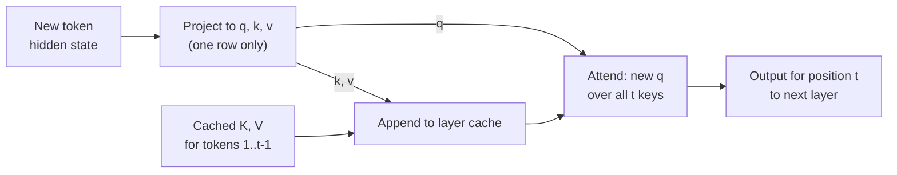
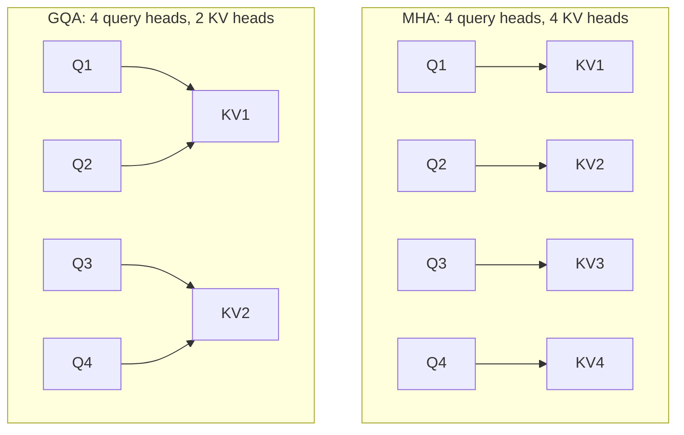

Every fast LLM inference engine relies on the **KV cache**. Without it, generating each new token would mean reprocessing the entire prompt and everything generated so far, making a long response quadratically expensive. With it, each step processes just one new token. The price is memory: the cache often takes more GPU memory than the model weights at high concurrency, and it is the resource that schedulers such as [vLLM](/learn/advanced-llm-engineering/vllm) spend most of their effort managing. You met the cache briefly in [Inference](/learn/generative-ai-fundamentals/inference). This lesson explains exactly what is cached and why that is valid, how to compute its size, how grouped-query attention shrinks it, and proves with code that cached and uncached decoding give identical results.

## What is cached, and why it is allowed

In each attention layer, every token's hidden state $h_t$ is projected into a query, a key and a value: $q_t = W_Q h_t$, $k_t = W_K h_t$, $v_t = W_V h_t$, as in [self-attention](/learn/generative-ai-fundamentals/self-attention). With a causal mask, the output at position $t$ is

$$
o_t = \sum_{j \le t} \operatorname{softmax}_j\!\left(\frac{q_t^\top k_j}{\sqrt{d_h}}\right) v_j
$$

where $d_h$ is the head dimension. Two facts make caching possible:

1. Token $t$ only attends to positions $j \le t$. So the keys and values of earlier tokens never depend on later tokens, and once computed they never change.
2. To produce the next token, only the **last** position's output is needed, so only its query is needed.

At each decode step, therefore, the model computes $q$, $k$ and $v$ for the single new token, appends $k$ and $v$ to the stored lists for that layer, and attends from the new $q$ over all stored keys and values. Queries are not cached: each is used once. The cache holds a $k$ and a $v$ vector per token, per layer, per key-value head.



The prefill phase fills the cache for all prompt tokens in one parallel pass; each decode step then adds one entry per layer.

## Cached and uncached decoding give identical outputs

The NumPy model below is a single causal multi-head attention layer with token and position embeddings and an output projection to a small vocabulary, enough to generate greedily. We decode 12 tokens twice: once recomputing everything from scratch at each step, once with a KV cache.

```python
import numpy as np

rng = np.random.default_rng(0)
vocab, d, n_heads, max_len = 50, 32, 4, 64
d_h = d // n_heads
E = rng.normal(0, 1, (vocab, d))            # token embeddings
P = rng.normal(0, 1, (max_len, d))          # position embeddings
Wq, Wk, Wv, Wo = (rng.normal(0, d ** -0.5, (d, d)) for _ in range(4))
W_out = rng.normal(0, d ** -0.5, (d, vocab))

def heads(x):                               # (T, d) -> (n_heads, T, d_h)
    return x.reshape(x.shape[0], n_heads, d_h).transpose(1, 0, 2)

def attend(q, K, V, causal):
    scores = q @ K.transpose(0, 2, 1) / np.sqrt(d_h)        # (heads, Tq, Tk)
    if causal:
        Tq, Tk = scores.shape[1:]
        scores = np.where(np.tril(np.ones((Tq, Tk)), k=Tk - Tq) == 1, scores, -np.inf)
    w = np.exp(scores - scores.max(-1, keepdims=True))
    w /= w.sum(-1, keepdims=True)
    out = (w @ V).transpose(1, 0, 2).reshape(q.shape[1], d)
    return out @ Wo

def decode_uncached(prompt, steps):
    tokens, rows = list(prompt), 0
    for _ in range(steps):
        x = E[tokens] + P[:len(tokens)]
        rows += len(tokens)                                   # rows projected this step
        h = x + attend(heads(x @ Wq), heads(x @ Wk), heads(x @ Wv), causal=True)
        tokens.append(int(np.argmax(h[-1] @ W_out)))
    return tokens, rows, h[-1] @ W_out

def decode_cached(prompt, steps):
    tokens = list(prompt)
    x = E[tokens] + P[:len(tokens)]                           # prefill the whole prompt
    K, V, rows = heads(x @ Wk), heads(x @ Wv), len(tokens)
    h = x + attend(heads(x @ Wq), K, V, causal=True)
    for i in range(steps):
        tokens.append(int(np.argmax(h[-1] @ W_out)))
        if i == steps - 1:
            break
        x = E[tokens[-1:]] + P[len(tokens) - 1:len(tokens)]   # only the new token
        K = np.concatenate([K, heads(x @ Wk)], axis=1)        # append to the cache
        V = np.concatenate([V, heads(x @ Wv)], axis=1)
        rows += 1
        h = x + attend(heads(x @ Wq), K, V, causal=False)     # new q sees all cached keys
    return tokens, rows, h[-1] @ W_out

prompt = [3, 17, 8, 42, 5]
t_plain, rows_plain, _ = decode_uncached(prompt, 12)
t_cache, rows_cache, _ = decode_cached(prompt, 12)
print("uncached:", t_plain[5:])
print("cached:  ", t_cache[5:])
print("identical:", t_plain == t_cache)
print("token rows projected:", rows_plain, "vs", rows_cache)
```

```output
uncached: [7, 43, 8, 33, 17, 38, 30, 26, 13, 4, 5, 23]
cached:   [7, 43, 8, 33, 17, 38, 30, 26, 13, 4, 5, 23]
identical: True
token rows projected: 126 vs 16
```

The generated tokens are identical, and the cached version projected far fewer rows. The gap grows quadratically with length: without a cache, generating $n$ tokens after a prompt of length $p$ reprocesses roughly $np + n^2/2$ token positions, while the cache processes $p + n$.

Step through the cached loop to see the cache grow:

```trace
{
  "title": "KV cache during decoding",
  "code": [
    "K, V = project_kv(prompt)",
    "h = attend(q_of(prompt), K, V)",
    "for i in range(steps):",
    "    tok = argmax(h[-1] @ W_out)",
    "    x = embed(tok)",
    "    K = append(K, x @ Wk)",
    "    V = append(V, x @ Wv)",
    "    h = attend(x @ Wq, K, V)"
  ],
  "steps": [
    { "line": 1, "vars": { "cache length": "5", "prompt": "[3, 17, 8, 42, 5]" }, "note": "Prefill: keys and values for all 5 prompt tokens are computed in one parallel pass and stored." },
    { "line": 2, "vars": { "cache length": "5" }, "note": "Causal attention over the prompt. Only the last position's output is needed to choose the first new token." },
    { "line": 4, "vars": { "cache length": "5", "i": "0", "tok": "first new token" }, "note": "Greedy choice of the next token from the last hidden state." },
    { "line": 7, "vars": { "cache length": "6", "i": "0" }, "note": "Only the new token is embedded and projected. Its k and v are appended; the 5 cached entries are reused untouched." },
    { "line": 8, "vars": { "cache length": "6", "i": "0" }, "note": "One query row attends over all 6 keys. No mask is needed: every cached key is in the past." },
    { "line": 7, "vars": { "cache length": "7", "i": "1" }, "note": "Next step: one more entry. The work per step stays one row of projections, while attention reads a cache that grows by one each time." }
  ]
}
```

## KV memory arithmetic

The cache stores one key and one value vector per token, per layer, per **key-value head**. In bytes per token:

$$
\text{KV bytes per token} = 2 \times L \times n_{\text{kv}} \times d_h \times b
$$

where $L$ is the number of layers, $n_{\text{kv}}$ the number of key-value heads, $d_h$ the head dimension, $b$ the bytes per number (2 for fp16 or bf16) and the leading 2 counts keys and values. Total cache memory is this times the number of tokens across all running sequences.

```python
def kv_bytes_per_token(layers, kv_heads, head_dim, bytes_per=2):
    return 2 * layers * kv_heads * head_dim * bytes_per

KiB, GiB = 1024, 1024 ** 3
# Illustrative 7B-class dimensions: 32 layers, 32 query heads of size 128
for name, kv_heads in [("MHA (32 KV heads)", 32), ("GQA (8 KV heads)", 8), ("MQA (1 KV head)", 1)]:
    per_tok = kv_bytes_per_token(32, kv_heads, 128)
    seq = per_tok * 4096                          # one 4,096-token sequence
    print(f"{name:<18} {per_tok / KiB:6.0f} KiB/token  {seq / GiB:6.3f} GiB per 4k sequence  "
          f"{32 * seq / GiB:6.1f} GiB for 32 such sequences")
```

```output
MHA (32 KV heads)     512 KiB/token   2.000 GiB per 4k sequence    64.0 GiB for 32 such sequences
GQA (8 KV heads)      128 KiB/token   0.500 GiB per 4k sequence    16.0 GiB for 32 such sequences
MQA (1 KV head)        16 KiB/token   0.062 GiB per 4k sequence     2.0 GiB for 32 such sequences
```

With full multi-head attention, 32 concurrent 4k-token sequences need 64 GiB of KV cache, several times the roughly 13 GiB of bf16 weights for a model this size. This is why long contexts and high concurrency are limited by KV memory rather than by the weights, and why techniques that shrink the cache matter so much.

## MQA and GQA: fewer key-value heads

In standard **multi-head attention (MHA)**, every query head has its own key and value heads. **Multi-query attention (MQA)** shares a single key-value head across all query heads. **Grouped-query attention (GQA)** sits between them: query heads are divided into groups, and each group shares one key-value head.



The cache shrinks by the factor $n_{\text{heads}} / n_{\text{kv}}$: four times for 32 query heads sharing 8 key-value heads, as the table above shows. Decoding also gets faster, because each step reads the whole cache from memory and there is less of it to read. MQA saves the most but can cost quality; GQA keeps quality close to MHA while capturing most of the saving, which is why many recent open models use it. The choice is made when the model is designed and trained, so as an engineer you read it from the model's `config.json` (the `num_key_value_heads` field in Hugging Face configs) when budgeting memory.

> [!TIP]
> To size a deployment, compute KV bytes per token from the config, multiply by the maximum context length and the number of concurrent sequences you need, and add it to the weight memory. If the total does not fit, reduce context length or concurrency, quantise the KV cache to 8-bit, or add GPUs.

## Other ways to shrink or reuse the cache

| Technique | Effect | Trade-off |
| --- | --- | --- |
| KV cache quantisation (for example FP8) | About half the memory of a 16-bit cache | Small accuracy risk; check long-context evals |
| Paged allocation | Removes reservation waste, see [vLLM](/learn/advanced-llm-engineering/vllm) | Kernel complexity, handled by the engine |
| Prefix caching | Shares blocks of common prefixes across requests, see [Efficient inference](/learn/advanced-llm-engineering/efficient-inference) | Only helps when prefixes repeat exactly |
| Sliding-window attention | Keeps only the most recent $w$ tokens per layer | A property of the model architecture; distant tokens are not attended directly |
| Offloading to CPU memory | Holds more sequences than GPU memory allows | Transfers add latency |

> [!KEY]
> The KV cache trades memory for computation: keys and values of past tokens never change under causal attention, so storing them makes each decode step one token of work. Its size is $2 \times L \times n_{\text{kv}} \times d_h \times b$ bytes per token, and that number, not the weights, usually sets your concurrency and context limits.

## Exercises

**1.** Compute KV bytes per token for an illustrative 70B-class model with 80 layers, 8 key-value heads and head dimension 128 in bf16, and the cache for a single 32,000-token context.

<details>
<summary>Show solution</summary>

```python
per_tok = kv_bytes_per_token(80, 8, 128)
print(f"{per_tok / KiB:.0f} KiB/token, {per_tok * 32_000 / GiB:.2f} GiB for 32k tokens")
```

```output
320 KiB/token, 9.77 GiB for 32k tokens
```

</details>

**2.** In `decode_uncached`, how many token rows are projected in total for a prompt of length 5 and 12 steps? Derive the number by formula and check it against the program.

<details>
<summary>Show solution</summary>

Step $i$ (from 0) processes $5 + i$ rows, so the total is $\sum_{i=0}^{11} (5 + i) = 12 \times 5 + 66 = 126$, matching the printed value. The cached version processes 5 rows of prefill plus 11 single-token steps, 16 in total.

</details>

**3.** A model has 32 query heads and you are told it uses GQA with a group size of 4. How many KV heads does it have, and by what factor is its cache smaller than the MHA equivalent?

<details>
<summary>Show solution</summary>

A group size of 4 means 4 query heads share each KV head, so there are $32 / 4 = 8$ KV heads, and the cache is 4 times smaller than with 32 KV heads.

</details>

```quiz
[
  {
    "q": "Why are queries not stored in the KV cache?",
    "options": [
      "They are too large",
      "Each query is used only once, for its own position's attention, and only the newest position's output is needed",
      "Queries change when new tokens arrive",
      "Queries are recomputed from the values"
    ],
    "answer": 1,
    "why": "Past keys and values are reused at every later step; a past query is never needed again."
  },
  {
    "q": "A model has 40 layers, 8 KV heads and head dimension 128, with a bf16 cache. How many bytes of KV cache per token?",
    "options": [
      "81,920",
      "163,840",
      "327,680",
      "1,310,720"
    ],
    "answer": 1,
    "why": "2 x 40 x 8 x 128 x 2 = 163,840 bytes, or 160 KiB per token."
  },
  {
    "q": "What does grouped-query attention share?",
    "options": [
      "Query heads across layers",
      "One key-value head across a group of query heads",
      "The output projection across heads",
      "The KV cache across different users"
    ],
    "answer": 1,
    "why": "Groups of query heads share key and value heads, dividing the KV cache size by the group size."
  },
  {
    "q": "Why does the KV cache make decoding cheaper without changing the output?",
    "options": [
      "It approximates attention with fewer heads",
      "It skips the softmax",
      "It reduces the vocabulary",
      "Causal attention means past keys and values do not depend on later tokens, so storing them is exact"
    ],
    "answer": 3,
    "why": "Under a causal mask, earlier keys and values never change, so reusing them gives exactly the same result."
  }
]
```
