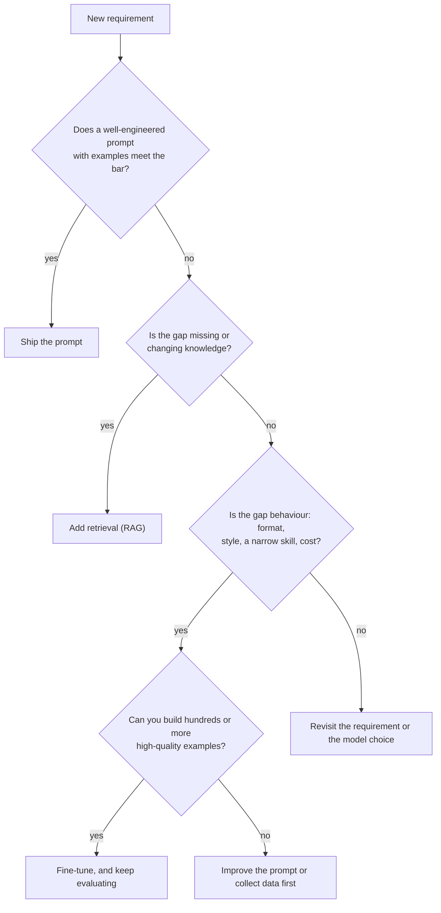
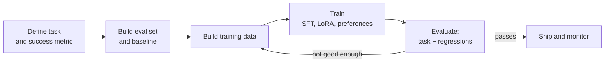

You met fine-tuning as a concept in [Generative AI Fundamentals](/learn/generative-ai-fundamentals/fine-tuning) and ran a first training job with the Hugging Face `Trainer` in [Fine-tuning models](/learn/hugging-face-ecosystem/fine-tuning-models). This module goes further: it treats fine-tuning a large language model as an engineering project with a decision to make, data to build, a budget to respect and a release to defend. Most failed fine-tuning projects do not fail in the training loop. They fail because fine-tuning was the wrong tool, because the data was inconsistent, or because nobody measured what the model forgot. This lesson is about getting those decisions right before any GPU is switched on.

## What fine-tuning actually changes

Pretraining gives a model broad knowledge and language ability. Fine-tuning continues training on a much smaller, targeted dataset and nudges the weights towards a particular behaviour. In practice it is very good at some things and poor at others.

| Fine-tuning is good at | Fine-tuning is poor at |
| --- | --- |
| A consistent output format or schema | Teaching facts that change often |
| A house style, tone or persona | Giving the model knowledge it can cite |
| A narrow task done reliably, such as classification or extraction | Fixing problems caused by missing context at request time |
| Shorter prompts, because instructions are baked in | Making a small model as capable as a much larger one in general |
| Teaching a small model one skill a large model already has | Anything you cannot write good examples for |

The key mental model: fine-tuning changes **how** the model responds far more reliably than **what it knows**. Facts injected by fine-tuning are stored diffusely in the weights, cannot be updated without retraining, and are prone to being blended or hallucinated. Knowledge that must be current or traceable belongs in retrieval, covered in [RAG fundamentals](/learn/rag-fundamentals/what-is-rag).

## Prompt, RAG or fine-tune?

Fine-tuning is the most expensive of the three levers, both to build and to maintain, so it should usually be the last one you reach for. The decision usually goes like this:



The levers combine. A common production pattern is a fine-tuned model that has learned the output format and tone, fed by a retrieval step that supplies the facts. Another is fine-tuning a small, cheap model to imitate what a large model does with a long prompt, which cuts latency and cost per request; that idea is developed in [Distillation](/learn/advanced-llm-engineering/distillation).

| Lever | Cost to try | Cost to change later | Best for |
| --- | --- | --- | --- |
| Prompting | Minutes | Edit a string | Most requirements, always the baseline |
| RAG | Days | Update the index | Knowledge that is large, private or changing |
| Fine-tuning | Days to weeks, plus GPUs | Rebuild data and retrain | Behaviour, format, latency and cost at scale |

> [!KEY]
> Always build the prompting baseline first, and keep it. It is your fallback, your comparison point in evaluation, and very often the solution.

## The fine-tuning lifecycle

Once you have decided to fine-tune, the work has a predictable shape. Note that evaluation appears twice: before training, to know what you are starting from, and after, to know what changed.



The arrow from evaluation goes back to **data**, not to hyperparameters. In practice most improvements come from fixing, adding or removing examples. The rest of this module covers the training stages: [supervised fine-tuning](/learn/advanced-llm-engineering/supervised-fine-tuning-sft), parameter-efficient methods in [LoRA and QLoRA](/learn/advanced-llm-engineering/lora-and-qlora), and [preference optimisation](/learn/advanced-llm-engineering/preference-optimization).

## Data quality beats data quantity

For behaviour-shaping fine-tunes, a modest number of carefully curated examples routinely beats a large noisy pile. The model learns whatever patterns are in the data, including the bad ones: inconsistent formats, truncated answers, a labeller's habit of starting every reply with "Certainly". Useful rules:

- **Consistency.** The same kind of input should get the same kind of output. Write a short style guide for the data and check examples against it.
- **Coverage.** Include the hard and rare cases you care about, not just the easy majority. Include examples of what to do when the answer is "I cannot help with that" or "the information is not provided".
- **Correctness.** Every target output is something you would be happy for the model to say. One wrong answer repeated in fifty near-duplicates becomes a learned fact.
- **No leakage.** No training example may appear in, or be a near-copy of, the evaluation set, or your evaluation measures memory.

How much data? There is no universal number. A narrow format or style change can respond to a few hundred good examples; a genuinely new skill usually needs thousands. The honest method is empirical: train on, say, 25%, 50% and 100% of your data and plot the eval metric. If quality is still climbing, more data will help; if it has flattened, more of the same data will not.

A quick audit catches the most common data bugs before they cost you a training run:

```python
import hashlib
from collections import Counter

train = [
    {"prompt": "Summarise: The meeting moved to Friday.", "response": "Meeting rescheduled to Friday."},
    {"prompt": "Summarise: The meeting moved to Friday.", "response": "Meeting rescheduled to Friday."},
    {"prompt": "Summarise: Invoices are due in 30 days.", "response": "Certainly! Invoices: 30-day terms."},
    {"prompt": "Summarise: The office closes at 6pm.", "response": ""},
    {"prompt": "Summarise: Server maintenance is on Sunday.", "response": "Maintenance scheduled for Sunday."},
]
eval_set = [{"prompt": "Summarise: Server maintenance is on Sunday.", "response": "Sunday maintenance."}]

def key(text):
    return hashlib.sha256(" ".join(text.lower().split()).encode()).hexdigest()

counts = Counter(key(ex["prompt"] + ex["response"]) for ex in train)
eval_prompts = {key(ex["prompt"]) for ex in eval_set}

print("duplicates:", sum(c - 1 for c in counts.values()))
print("empty responses:", sum(1 for ex in train if not ex["response"].strip()))
print("leaked into eval:", sum(1 for ex in train if key(ex["prompt"]) in eval_prompts))
openers = Counter(ex["response"].split()[0] for ex in train if ex["response"].strip())
print("most common opening words:", openers.most_common(2))
```

```output
duplicates: 1
empty responses: 1
leaked into eval: 1
most common opening words: [('Meeting', 2), ('Certainly!', 1)]
```

Exact hashing only finds exact duplicates. On real data, add near-duplicate detection (for example MinHash or embedding similarity) and read a random sample of a hundred examples yourself. Reading the data is the highest-value hour in any fine-tuning project.

## Catastrophic forgetting

Training on a narrow dataset moves the weights towards that task, and can damage abilities the dataset never exercised. This is **catastrophic forgetting**. A model fine-tuned hard on terse JSON extraction may become worse at ordinary conversation, at following instructions outside the training distribution, or at refusing harmful requests, because the safety behaviour learned during the original alignment is also just weights.

Forgetting gets worse with more steps, higher learning rates and narrower data. The standard mitigations are:

| Mitigation | Why it helps |
| --- | --- |
| Parameter-efficient fine-tuning (LoRA) | Most weights stay frozen, so the base model is changed less |
| Lower learning rate, fewer epochs | Smaller total movement away from the starting weights |
| Mix in general data ("replay") | Keeps gradients flowing for the abilities you want to keep |
| Start from an instruction-tuned model when you need chat behaviour | You keep its alignment instead of rebuilding it |
| A regression evaluation suite | You cannot fix forgetting you do not measure |

> [!WARNING]
> Fine-tuning can weaken a model's safety behaviour even when the training data is entirely harmless. If the base model was safety-tuned, include refusal and safety checks in your regression suite and re-run them after every fine-tune.

## Evaluating before and after

A fine-tune is a change to production behaviour and deserves the same discipline as a code change. Run the same evaluation suite on three systems: the base model with your best prompt, the base model with the minimal prompt you will use after fine-tuning, and the fine-tuned model. Use the [LLM evaluation](/learn/working-with-llms/model-evaluation) techniques from earlier: exact-match or schema checks where outputs are structured, rubric-based LLM judges where they are not.

```python
def compare(name, before, after, higher_is_better=True, tolerance=0.02):
    delta = after - before
    worse = delta < -tolerance if higher_is_better else delta > tolerance
    flag = "REGRESSION" if worse else "ok"
    print(f"{name:<34} {before:6.2f} -> {after:6.2f}  ({delta:+.2f})  {flag}")

# Illustrative scores from a held-out suite, base+prompt vs fine-tuned
compare("task: valid JSON rate", 0.81, 0.99)
compare("task: field accuracy", 0.74, 0.90)
compare("general: instruction following", 0.88, 0.83)
compare("safety: refusal rate on red-team", 0.97, 0.96)
```

```output
task: valid JSON rate                0.81 ->   0.99  (+0.18)  ok
task: field accuracy                 0.74 ->   0.90  (+0.16)  ok
general: instruction following       0.88 ->   0.83  (-0.05)  REGRESSION
safety: refusal rate on red-team     0.97 ->   0.96  (-0.01)  ok
```

The task improved, but general instruction following slipped beyond tolerance. Whether that is acceptable depends on whether the model will ever see general requests. If it will, add replay data or reduce training and try again. Decide the tolerances before you see the results, not after.

## Exercises

**1.** A support team wants their assistant to answer questions about a product catalogue that changes weekly, and to always reply in a fixed three-part structure. Which parts of the requirement call for RAG and which, if any, for fine-tuning?

<details>
<summary>Show solution</summary>

The catalogue knowledge changes weekly, so it belongs in retrieval: fine-tuned facts would be stale within a week and could not be updated without retraining. The fixed structure is behaviour. Try a prompt with two or three examples first; if the structure is still violated too often at the volume you serve, a small fine-tune on correctly structured answers (generated with retrieved context in the prompt) is reasonable.

</details>

**2.** Extend the audit code to flag responses that are more than three times longer than the median response length. Why might such outliers matter for fine-tuning?

<details>
<summary>Show solution</summary>

```python
import statistics

lengths = [len(ex["response"].split()) for ex in train if ex["response"].strip()]
median = statistics.median(lengths)
long_ones = [ex for ex in train if len(ex["response"].split()) > 3 * median]
print("median words:", median, "outliers:", len(long_ones))
```

```output
median words: 4.0 outliers: 0
```

Every response in the toy list happens to be four words long, so nothing is flagged here; on real data this check usually finds something. Length outliers are often scraping errors, concatenated examples or a different task mixed in. Because the loss is summed over response tokens, very long examples also carry more weight in training than their count suggests, so a few of them can shift the model's typical answer length.

</details>

**3.** Your eval metric rises from 0.70 to 0.80 when going from 25% to 50% of the training data, and to 0.81 at 100%. What does this suggest, and what would you do next?

<details>
<summary>Show solution</summary>

The curve has flattened: more data of the same kind is giving almost nothing. Look at the remaining errors to find what the data does not cover, then add targeted examples for those cases, fix label inconsistencies, or reconsider whether the remaining gap is a knowledge problem rather than a behaviour problem.

</details>

```quiz
[
  {
    "q": "Which requirement is the weakest case for fine-tuning?",
    "options": [
      "Always return output in a strict JSON schema",
      "Answer questions about policies that change every month",
      "Write in a specific brand voice",
      "Classify support tickets into a fixed set of categories"
    ],
    "answer": 1,
    "why": "Changing knowledge belongs in retrieval. Fine-tuned facts go stale and cannot be updated without retraining."
  },
  {
    "q": "What is catastrophic forgetting?",
    "options": [
      "The model forgetting the start of a long prompt",
      "Training loss rising after a learning-rate change",
      "Loss of abilities the fine-tuning data did not exercise, caused by narrow training",
      "The tokenizer dropping rare tokens after fine-tuning"
    ],
    "answer": 2,
    "why": "Narrow training moves weights towards one task and can degrade unrelated abilities, including safety behaviour."
  },
  {
    "q": "Why must training examples be checked for overlap with the evaluation set?",
    "options": [
      "Overlap makes the evaluation measure memorisation rather than generalisation",
      "Duplicated examples slow training down",
      "The optimiser cannot handle repeated inputs",
      "Overlap increases GPU memory use"
    ],
    "answer": 0,
    "why": "If the model has seen the eval items during training, a high score says nothing about how it handles new inputs."
  },
  {
    "q": "Doubling your training data improves the eval metric by only 0.01. What is the most useful next step?",
    "options": [
      "Double the data again",
      "Train for many more epochs",
      "Switch to a larger learning rate",
      "Analyse the remaining errors and add targeted or corrected examples"
    ],
    "answer": 3,
    "why": "A flat data curve means more of the same data will not help. Targeted, corrected data addresses the actual failures."
  }
]
```
