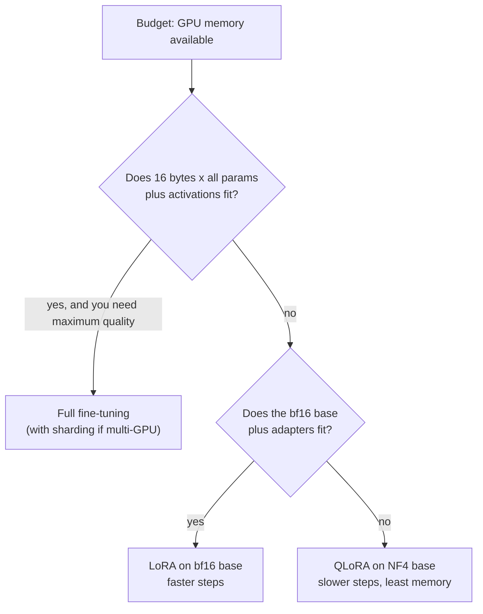
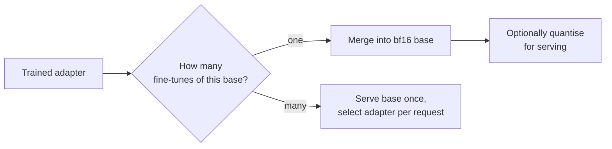

You have already seen how LoRA works inside a layer in [LoRA](/learn/hugging-face-ecosystem/lora) and how QLoRA stores the frozen base in 4-bit NF4 in [QLoRA](/learn/hugging-face-ecosystem/qlora). This lesson takes the engineering view. Before you launch a fine-tuning job you need to answer three questions: will it fit on the hardware you have, which LoRA settings should you start from, and what artefact will you ship at the end. All three come down to arithmetic and a few well-understood trade-offs.

## Where training memory goes

Training memory has four main consumers. For each **trainable** parameter you store the weight, its gradient and the optimiser's state; for each **frozen** parameter you store only the weight. Activations come on top and depend on batch size, sequence length and gradient checkpointing.

| Component | Full fine-tuning (mixed precision AdamW) | LoRA | QLoRA |
| --- | --- | --- | --- |
| Base weights | 2 bytes/param (bf16), trainable | 2 bytes/param (bf16), frozen | about 0.5 bytes/param (NF4), frozen |
| Gradients | 2 bytes/param | adapters only | adapters only |
| FP32 master copy | 4 bytes/param | adapters only | adapters only |
| Adam moments $m$ and $v$ | 8 bytes/param | adapters only | adapters only |
| **Per trainable param** | **16 bytes** | **16 bytes** | **16 bytes** |

The 16 bytes per trainable parameter is the expensive part, and it is why full fine-tuning needs roughly eight times the memory of simply holding the bf16 model. LoRA's win is that the trainable parameter count drops by two orders of magnitude; QLoRA's additional win is shrinking the frozen weights by about four.

## The memory budget in code

The script below computes the budget for two illustrative shapes: a 7B-class model with the Llama 2 7B dimensions, and a 70B-class model with grouped-query attention. LoRA is applied to every linear layer in the transformer blocks with rank 16.

```python
def model_params(layers, d, d_ff, kv_dim, vocab):
    attn = 2 * d * d + 2 * d * kv_dim          # q, o full width; k, v may be narrower (GQA)
    mlp = 3 * d * d_ff                         # gate, up, down projections
    linear = layers * (attn + mlp)
    other = 2 * vocab * d                      # input embeddings and output head
    return linear, other

def lora_params(layers, d, d_ff, kv_dim, r):
    shapes = [(d, d), (d, d), (d, kv_dim), (d, kv_dim), (d, d_ff), (d, d_ff), (d_ff, d)]
    return layers * sum(r * (a + b) for a, b in shapes)   # A is r x in, B is out x r

GB = 1e9
nf4_bytes = 0.5 + 0.127 / 8          # 4 bits + double-quantised constants per param

for name, shape in {"7B-class": (32, 4096, 11008, 4096, 32000),
                    "70B-class": (80, 8192, 28672, 1024, 32000)}.items():
    linear, other = model_params(*shape)
    n_lora = lora_params(*shape[:4], r=16)
    total = linear + other
    full = 16 * total
    lora = 2 * total + 16 * n_lora
    qlora = nf4_bytes * linear + 2 * other + 16 * n_lora
    print(f"{name}: {total / 1e9:.2f}B params, LoRA r=16 adds {n_lora / 1e6:.0f}M trainable")
    print(f"  full fine-tune: {full / GB:7.1f} GB")
    print(f"  LoRA (bf16):    {lora / GB:7.1f} GB")
    print(f"  QLoRA (NF4):    {qlora / GB:7.1f} GB")
```

```output
7B-class: 6.74B params, LoRA r=16 adds 40M trainable
  full fine-tune:   107.8 GB
  LoRA (bf16):       14.1 GB
  QLoRA (NF4):        4.5 GB
70B-class: 68.98B params, LoRA r=16 adds 207M trainable
  full fine-tune:  1103.6 GB
  LoRA (bf16):      141.3 GB
  QLoRA (NF4):       39.7 GB
```

These figures exclude activations and framework overhead, so real usage is higher; treat them as the floor. They explain the folk wisdom precisely. A 7B-class model cannot be fully fine-tuned on a single 80 GB GPU without tricks such as sharding optimiser state across GPUs or 8-bit optimisers; with LoRA it fits on one large GPU; with QLoRA it fits on a 24 GB consumer card with room for activations. A 70B-class model needs a multi-GPU node even for LoRA, but QLoRA brings it within reach of a single 80 GB GPU.

> [!TIP]
> Activations often decide whether a job fits once the weights do. Gradient checkpointing (recomputing activations in the backward pass instead of storing them) cuts activation memory substantially at the cost of extra compute, and shorter maximum sequence lengths help more than smaller batches because attention activations grow with length.

## Choosing between them



| | Full fine-tuning | LoRA | QLoRA |
| --- | --- | --- | --- |
| Memory | Highest | Moderate | Lowest |
| Step speed | Baseline | Similar or faster (fewer gradients) | Slower: weights are dequantised on every pass |
| Quality ceiling | Highest, most capacity | Close to full for most adaptation tasks | Close to LoRA in published comparisons |
| Forgetting risk | Highest | Lower | Lower |
| Output artefact | A full model copy | Small adapter file | Small adapter file |

For most product fine-tunes (format, style, a narrow task) LoRA reaches quality close to full fine-tuning. The gap tends to show on tasks that require learning a lot of genuinely new material, where full fine-tuning has more capacity.

## Rank, alpha and target modules

LoRA adds an update $\Delta W = \frac{\alpha}{r} B A$ to each targeted weight $W$, where $A \in \mathbb{R}^{r \times d_\text{in}}$, $B \in \mathbb{R}^{d_\text{out} \times r}$, $r$ is the rank and $\alpha$ is a scaling constant. The practical knobs:

| Setting | Common starting point | Effect of increasing |
| --- | --- | --- |
| `r` (rank) | 8 to 64; 16 is a typical default | More capacity and more parameters; diminishing returns for narrow tasks |
| `lora_alpha` | Equal to `r` or `2 * r` | Larger effective step size for the adapter, like a higher learning rate |
| `target_modules` | `"all-linear"` | Adapting the MLP as well as attention usually helps quality noticeably |
| `lora_dropout` | 0.0 to 0.1 | Regularisation on small datasets |

Because the update is scaled by $\alpha/r$, changing `r` while keeping `alpha` fixed also changes the effective learning rate. If you sweep rank, either scale `alpha` with it or enable `use_rslora=True` in PEFT, which uses $\alpha/\sqrt{r}$ to keep the update size more stable across ranks. Sweep the learning rate before the rank: it usually matters more.

```python
from peft import LoraConfig

lora_config = LoraConfig(
    r=16,
    lora_alpha=32,
    lora_dropout=0.05,
    target_modules="all-linear",   # every linear layer except the output head
    task_type="CAUSAL_LM",
)
```

## What to ship: merge or keep adapters separate

At the end of training you have a base model and an adapter of a few tens or hundreds of megabytes. There are two ways to deploy.

**Merge** the adapter into the weights, $W' = W + \frac{\alpha}{r} B A$, with PEFT's `merge_and_unload()`. The result is an ordinary model with no extra inference cost, which any serving stack can load and which you can then quantise for serving (see [Model quantization](/learn/advanced-llm-engineering/model-quantization)). For QLoRA, merge into a bf16 copy of the base, never into the 4-bit weights, then evaluate the merged artefact: the adapter learned to correct the 4-bit model, so the merged bf16 model behaves slightly differently.

**Keep adapters separate** when you have many fine-tunes of one base, for example one per customer or per task. Servers such as vLLM can load one base model and apply different LoRA adapters per request, so a hundred fine-tunes cost one copy of the base weights plus a hundred small adapters.



> [!KEY]
> Whatever you ship, evaluate that exact artefact. Merging, re-quantising and changing the serving dtype can each shift behaviour slightly, and the numbers from the training run were measured on something else.

## Exercises

**1.** Use the functions in this lesson to compute the LoRA trainable parameter count for the 7B-class shape at ranks 8, 16, 64 and 256. How does it scale with rank?

<details>
<summary>Show solution</summary>

```python
for r in [8, 16, 64, 256]:
    print(r, f"{lora_params(32, 4096, 11008, 4096, r) / 1e6:.0f}M")
```

```output
8 20M
16 40M
64 160M
256 640M
```

The count is exactly linear in `r`, because each adapter has `r * (d_in + d_out)` parameters. Even rank 256 is well under a tenth of the base model.

</details>

**2.** Estimate the QLoRA budget for the 7B-class model if LoRA targets only the four attention projections at rank 16.

<details>
<summary>Show solution</summary>

```python
attn_only = 32 * sum(16 * (a + b) for a, b in [(4096, 4096)] * 4)
linear, other = model_params(32, 4096, 11008, 4096, 32000)
qlora = nf4_bytes * linear + 2 * other + 16 * attn_only
print(f"{attn_only / 1e6:.1f}M trainable, {qlora / 1e9:.2f} GB")
```

```output
16.8M trainable, 4.13 GB
```

The total falls by under 0.4 GB, because the frozen base dominates. Attention-only adapters save little memory, which is why targeting all linear layers is the usual default.

</details>

**3.** You trained an adapter with QLoRA and need to serve one merged model in bf16. List the steps.

<details>
<summary>Show solution</summary>

Load the base model in bf16 (not 4-bit). Attach the adapter with `PeftModel.from_pretrained`. Call `merge_and_unload()` and save the result. Run your evaluation suite on the merged model, compare with the QLoRA model's scores, and only then deploy or quantise further.

</details>

```quiz
[
  {
    "q": "Under mixed-precision AdamW, roughly how many bytes does each trainable parameter cost, excluding activations?",
    "options": ["2", "4", "8", "16"],
    "answer": 3,
    "why": "bf16 weight (2) + bf16 gradient (2) + fp32 master copy (4) + two fp32 Adam moments (8) = 16 bytes."
  },
  {
    "q": "Why is QLoRA typically slower per training step than LoRA on a bf16 base?",
    "options": [
      "It trains more parameters",
      "The 4-bit weights must be dequantised for every forward and backward pass",
      "It cannot use a GPU",
      "It disables gradient checkpointing"
    ],
    "answer": 1,
    "why": "NF4 is a storage format. Each matrix multiply first dequantises the weights to bf16, which costs time."
  },
  {
    "q": "You double `r` and keep `lora_alpha` fixed. What else changes?",
    "options": [
      "Nothing else",
      "The base model's weights",
      "The effective scale of the update, because it is multiplied by alpha / r",
      "The number of frozen parameters"
    ],
    "answer": 2,
    "why": "The update is scaled by alpha / r, so doubling r halves the scale, which acts like a smaller learning rate for the adapter."
  },
  {
    "q": "When is keeping adapters separate better than merging?",
    "options": [
      "When you serve many fine-tunes of the same base model",
      "When you need the lowest possible single-request latency",
      "When you want to quantise the model to GGUF",
      "When the adapter has rank 8"
    ],
    "answer": 0,
    "why": "Serving one base plus many small adapters is far cheaper than many merged full copies."
  }
]
```
