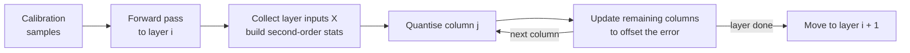
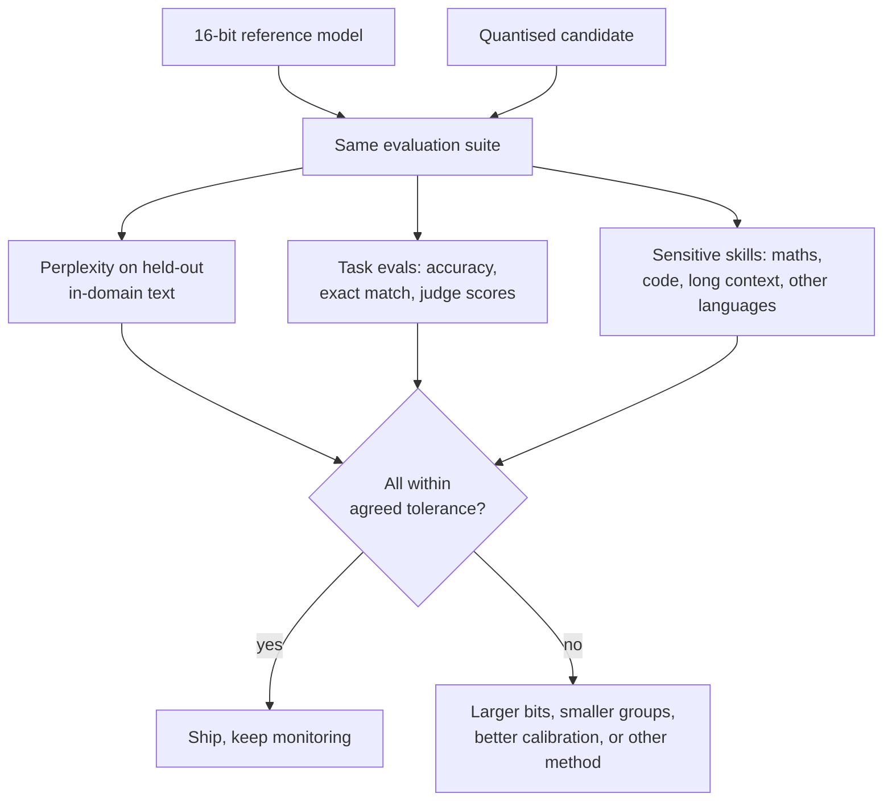

Quantisation stores a model's numbers in fewer bits, so it takes less memory and moves less data per token. You learned the mechanics (scales, zero points, integer grids, NF4) in [Quantization](/learn/hugging-face-ecosystem/quantization) and the serving trade-offs in [Quantization for production](/learn/production-ai-systems/quantization). This lesson is about the engineering decisions when you quantise an LLM yourself: what to quantise, which post-training method to use, which file format your inference stack needs, what calibration data to feed it, and how to prove the quantised model is still good enough to ship.

## What to quantise, and why it speeds up decoding

During token-by-token generation, each new token requires reading every weight from GPU memory once, while doing relatively little arithmetic per weight. Decoding is therefore usually limited by **memory bandwidth**, not compute. Halving the bytes per weight roughly halves the data that must be read per token, which is why weight quantisation speeds up generation as well as shrinking the model.

| Scheme | Weights | Activations | Main benefit | Typical use |
| --- | --- | --- | --- | --- |
| Weight-only INT8 (W8A16) | 8-bit | 16-bit | Half the memory, very small quality loss | Safe default when memory is tight |
| Weight-only INT4 (W4A16) | 4-bit | 16-bit | About a quarter of the memory, faster decoding | Fitting larger models on fewer GPUs, local inference |
| FP8 (W8A8) | 8-bit float | 8-bit float | Memory saving and faster matrix multiplies on hardware with FP8 support | High-throughput serving on recent data-centre GPUs |
| KV cache quantisation | unchanged | KV cache in 8-bit | More concurrent sequences or longer contexts | Long-context serving, see [KV caching](/learn/advanced-llm-engineering/kv-caching) |

Weight-only schemes dequantise weights to 16-bit inside the matrix-multiply kernel, so they help most when bandwidth is the bottleneck: small batches, interactive use. Quantising activations too (W8A8) also speeds up the arithmetic itself, which matters at large batch sizes where compute becomes the bottleneck.

## The baseline: round-to-nearest with groups

The simplest post-training quantisation (PTQ) rounds each weight to the nearest point on the integer grid, with a scale per group of weights. Smaller groups track local ranges better at the cost of storing more scales. Throughout this lesson we measure what actually matters: the error in the layer's **output** on realistic inputs, not the error in the weights. The inputs below have a few channels with much larger activations than the rest, a pattern commonly seen in LLM activations.

```python
import numpy as np

rng = np.random.default_rng(0)
d_in, d_out = 512, 256
W = rng.normal(0, 0.02, (d_out, d_in))           # one linear layer's weights
X = rng.normal(0, 1, (1024, d_in))               # calibration inputs
salient = rng.choice(d_in, 8, replace=False)
X[:, salient] *= 20                              # a few high-magnitude channels

def quantise_rtn(W, bits=4, group=128):
    qmax = 2 ** (bits - 1) - 1                   # symmetric INT4: -8..7
    Wq = np.empty_like(W)
    for g in range(0, W.shape[1], group):
        block = W[:, g:g + group]
        scale = np.abs(block).max(axis=1, keepdims=True) / qmax
        Wq[:, g:g + group] = np.clip(np.round(block / scale), -qmax - 1, qmax) * scale
    return Wq

def output_error(Wq):
    Y, Yq = X @ W.T, X @ Wq.T
    return np.linalg.norm(Y - Yq) / np.linalg.norm(Y)

for group in [512, 128, 32]:
    print(f"INT4, group size {group:3d}: relative output error {output_error(quantise_rtn(W, group=group)):.4f}")
```

```output
INT4, group size 512: relative output error 0.1365
INT4, group size 128: relative output error 0.1185
INT4, group size  32: relative output error 0.0966
```

Group size 128 is a common default for 4-bit LLM weights. But all of these treat every weight equally, even though errors on weights that multiply the large-activation channels do far more damage. The two widely used PTQ methods both fix this by using **calibration data**.

## GPTQ: compensate for rounding errors

**GPTQ** quantises one layer at a time. It runs calibration inputs through the model to collect the inputs $X$ that reach each layer, then quantises the layer's weight matrix column by column. After rounding a column, it adjusts the not-yet-quantised columns to cancel, as far as possible, the error that rounding introduced in the layer output. The adjustment uses second-order information from the calibration inputs (a matrix built from $X X^\top$), so weights interacting with large or correlated inputs are compensated most carefully.



GPTQ needs a GPU and some time per model (more for bigger models), and produces 3-, 4- or 8-bit weights with a scale per group.

## AWQ: protect the salient channels

**AWQ** (activation-aware weight quantisation) starts from the observation that a small fraction of input channels, those with large activations, matter most. Rather than keeping them in high precision (awkward for kernels), it multiplies those weight columns by a per-channel scale $s$ before quantising and divides the corresponding inputs by $s$, which leaves the layer's maths unchanged:

$$
W x = (W \operatorname{diag}(s)) \, (\operatorname{diag}(s)^{-1} x)
$$

Scaling a column up makes its quantisation error relatively smaller. The scale is derived from average activation magnitude per channel raised to a power $a$, with $a$ chosen by a small search that minimises output error on calibration data. Here is that search on our layer:

```python
act_mag = np.abs(X).mean(axis=0)                 # average |activation| per input channel

for a in [0.0, 0.25, 0.5, 0.75, 1.0]:
    s = act_mag ** a
    s = s / np.sqrt(s.max() * s.min())           # keep scales centred around 1
    Wq = quantise_rtn(W * s, group=128) / s      # quantise scaled weights, fold scale back
    print(f"a = {a:.2f}: relative output error {output_error(Wq):.4f}")
```

```output
a = 0.00: relative output error 0.1185
a = 0.25: relative output error 0.0722
a = 0.50: relative output error 0.0956
a = 0.75: relative output error 0.1763
a = 1.00: relative output error 0.2763
```

With $a = 0$ (no scaling) we recover the round-to-nearest result. A moderate exponent protects the salient channels and cuts the output error substantially, still at 4 bits with group size 128; too large an exponent squeezes the other channels' precision and the error rises again. That is why the exponent is searched rather than fixed. In the real algorithm the scaled weights are what get stored, and the inverse scale is folded into the preceding operation, so inference has no extra cost.

| | Round-to-nearest | GPTQ | AWQ |
| --- | --- | --- | --- |
| Needs calibration data | No | Yes | Yes |
| Core idea | Round each weight | Adjust remaining weights to cancel rounding error | Scale salient channels before rounding |
| Quantisation time | Seconds | Longer (layer-wise optimisation) | Moderate |
| Typical 4-bit quality | Weakest | Good | Good |

## File formats you will deploy

The method and the file format are separate choices: your inference engine dictates the format.

| Format | What it is | Runs on | Notes |
| --- | --- | --- | --- |
| GGUF | Single-file format of the llama.cpp ecosystem, with many quantisation types (for example `Q8_0`, `Q4_K_M`) | CPUs, Apple silicon, consumer GPUs; llama.cpp, Ollama, LM Studio | The usual choice for local and edge inference |
| GPTQ / AWQ checkpoints | Safetensors weights plus a quantisation config | GPU servers such as vLLM, TGI, Transformers | Load with the matching kernel support |
| FP8 | 8-bit floating point (E4M3 for weights and activations) | Recent data-centre GPUs with FP8 support | Often near-lossless; some engines can quantise to FP8 at load time |
| bitsandbytes NF4/INT8 | Quantised on load in Transformers | NVIDIA GPUs | Convenient for experiments and QLoRA, less optimised for high-throughput serving |

Typical commands, shown without output:

```bash
# GGUF with llama.cpp: convert the Hugging Face model, then quantise
python convert_hf_to_gguf.py ./my-merged-model --outfile model-f16.gguf --outtype f16
./llama-quantize model-f16.gguf model-q4_k_m.gguf Q4_K_M

# FP8 at load time in vLLM (requires a GPU with FP8 support)
vllm serve ./my-merged-model --quantization fp8
```

## Calibration data

GPTQ and AWQ choose their parameters to preserve the layer outputs on the calibration inputs, so those inputs define what "preserve" means. A few hundred sequences are typically enough; what matters is that they look like your production traffic.

- Use **in-domain text**: if the model serves code or a language other than English, calibrate on that, not only on generic web text.
- Format it as the model sees it in production, **with the chat template applied**.
- Include the sequence lengths you serve. Calibrating only on short snippets can hurt long-context behaviour.

> [!WARNING]
> Calibration data is training data in a weak sense. Do not calibrate on your evaluation set, or your quality check will look better than reality.

## Evaluating quality loss

A quantised model is a different model. Compare it with the 16-bit original on the same suite before shipping.



Perplexity is a fast, sensitive first check (a quantised model should rarely be much worse than the original), but small perplexity changes can hide large drops on specific skills. Arithmetic, code generation, long-context retrieval and low-resource languages tend to degrade first, so evaluate them explicitly. Compare generations side by side on a fixed prompt set too: some regressions, such as repetition loops, are obvious to a reader and invisible in averages.

> [!KEY]
> Choose the format your engine needs, use a calibration-based method for 4-bit, calibrate on production-like data, and judge the result by task evaluations on the exact artefact you deploy.

## Exercises

**1.** Compute the relative output error of 8-bit round-to-nearest with group size 128 on the same layer. How does it compare with 4-bit?

<details>
<summary>Show solution</summary>

```python
print(f"INT8: {output_error(quantise_rtn(W, bits=8, group=128)):.4f}")
```

```output
INT8: 0.0065
```

Each extra bit halves the grid spacing, so going from 4 to 8 bits shrinks the rounding error by roughly a factor of 16. That is why 8-bit weight quantisation is usually close to lossless and 4-bit is where careful methods matter.

</details>

**2.** Remove the salient channels (comment out `X[:, salient] *= 20`, rebuild `X`) and rerun the AWQ search. Predict what happens to the benefit of scaling.

<details>
<summary>Show solution</summary>

With all channels of similar magnitude, `act_mag` is nearly constant, so the scales are close to 1 for every exponent and the error barely changes with $a$. AWQ helps precisely because real LLM activations are uneven.

</details>

**3.** A model will serve customer emails in German. Your quantisation tool's default calibration set is English web text. What would you change and how would you check it mattered?

<details>
<summary>Show solution</summary>

Build a calibration set of a few hundred German emails (excluding anything in the evaluation set), formatted with the chat template and at realistic lengths. Quantise twice, once per calibration set, and compare both against the 16-bit model on a German task evaluation and German held-out perplexity.

</details>

```quiz
[
  {
    "q": "Why does weight-only 4-bit quantisation speed up single-user token generation?",
    "options": [
      "4-bit arithmetic is always faster than 16-bit",
      "Decoding is usually memory-bandwidth bound, and fewer bytes per weight means less data read per token",
      "It reduces the number of layers",
      "It shortens the prompt"
    ],
    "answer": 1,
    "why": "Each generated token requires reading all weights; shrinking them reduces that traffic. The arithmetic itself still runs in 16-bit."
  },
  {
    "q": "What does AWQ do to protect important weights?",
    "options": [
      "Keeps them in FP32",
      "Removes them from the model",
      "Scales weight channels with large activations up before quantising, and scales the inputs down to compensate",
      "Retrains them with LoRA"
    ],
    "answer": 2,
    "why": "Scaling salient channels reduces their relative rounding error while leaving the layer's output mathematically unchanged."
  },
  {
    "q": "You want to run a model on a laptop with llama.cpp. Which format do you need?",
    "options": [
      "GGUF",
      "FP8",
      "An AWQ safetensors checkpoint",
      "bitsandbytes NF4"
    ],
    "answer": 0,
    "why": "llama.cpp and tools built on it, such as Ollama, load GGUF files."
  },
  {
    "q": "Perplexity of the 4-bit model is only slightly worse than the original. What should you still check?",
    "options": [
      "Nothing; perplexity is sufficient",
      "Only the file size",
      "The tokenizer vocabulary size",
      "Task-specific evals, especially sensitive skills such as maths, code and long context"
    ],
    "answer": 3,
    "why": "Small average perplexity changes can hide large drops on particular skills that matter to your application."
  }
]
```
