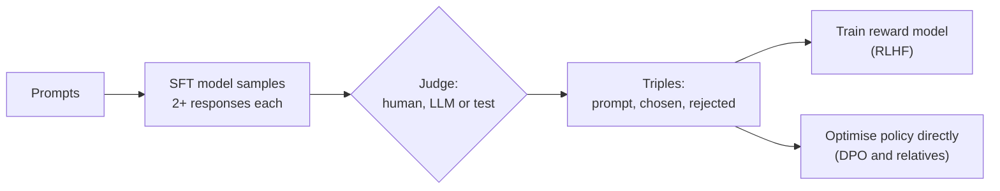

After [supervised fine-tuning](/learn/advanced-llm-engineering/supervised-fine-tuning-sft), a model imitates the demonstrations it was shown. Imitation has a ceiling: the model can only be as good as the examples, and many qualities you care about (helpfulness, honesty about uncertainty, appropriate length, safe refusals) are hard to demonstrate but easy to judge. **Preference optimisation** is the family of training methods that learn from judgements of the form "this response is better than that one". It is the stage that turned instruction-following models into the assistants you use, and it is a tool you can apply to your own models when SFT alone plateaus. This lesson sets out the data, the maths that connects comparisons to scores, and the map of methods; the next two lessons go deep on [RLHF](/learn/advanced-llm-engineering/rlhf-fundamentals) and [DPO](/learn/advanced-llm-engineering/dpo).

## Why comparisons instead of demonstrations

Writing an excellent answer to a hard question takes an expert a long time. Reading two answers and saying which is better takes much less, and people are more consistent at relative judgements than at absolute ratings on a 1-10 scale. Comparisons also capture things demonstrations cannot: a demonstration says "do this", while a rejected response says "and not this", which teaches the model about failure modes it would otherwise produce.

| Signal | What it teaches | Cost to collect | Typical use |
| --- | --- | --- | --- |
| Demonstrations (SFT) | What a good response looks like | High: someone must write it | Format, skills, initial behaviour |
| Pairwise preferences | Which of two responses is better | Lower: someone must judge | Quality, tone, safety, calibration |
| Absolute ratings | A score per response | Low, but noisy across raters | Monitoring; occasionally training |
| Binary good/bad labels | Whether a response is acceptable | Low | Methods built for unpaired data |

## Pairwise preference data

A preference dataset is a list of triples: a prompt, a **chosen** response and a **rejected** response. Libraries such as TRL expect exactly these field names:

```json
{"prompt": "Explain what a mutex is in one sentence.",
 "chosen": "A mutex is a lock that lets only one thread at a time access a shared resource.",
 "rejected": "A mutex is a kind of thread that runs faster than other threads."}
```

The usual way to build it: sample two or more responses per prompt from your current model (after SFT), then have a judge pick the better one. The judge can be:

- **Human annotators** following written guidelines. Highest trust for subjective qualities, slowest and most expensive.
- **An LLM judge** with a rubric, often called AI feedback. Cheap and scalable, but inherits the judge's biases; check its agreement with humans on a sample before trusting it, as in [LLM evaluation](/learn/working-with-llms/model-evaluation).
- **A programmatic check** where one exists: unit tests passing, a correct final answer, valid JSON.



Sampling the pairs from the model you are about to train matters. Preferences about responses the model would never produce teach it little; preferences between its own plausible outputs target exactly the decisions it is making.

## From comparisons to scores: the Bradley-Terry model

To learn from comparisons you need a model of how a hidden "quality score" produces observed preferences. The standard choice is the **Bradley-Terry model**. Give every response $y$ to a prompt $x$ a real-valued reward $r(x, y)$. The probability that $y_w$ (the winner) is preferred over $y_l$ (the loser) is

$$
P(y_w \succ y_l \mid x) = \sigma\big(r(x, y_w) - r(x, y_l)\big) = \frac{1}{1 + e^{-(r(x, y_w) - r(x, y_l))}}
$$

where $\sigma$ is the logistic sigmoid. Only the **difference** of rewards matters: adding the same constant to every reward changes nothing. Equal rewards give a 50% preference; a difference of 2 gives about 88%.

Fitting rewards to observed comparisons is maximum likelihood, as in [maximum likelihood estimation](/learn/essential-mathematics-for-machine-learning/maximum-likelihood-estimation). The negative log-likelihood of one comparison is

$$
\mathcal{L} = -\log \sigma\big(r(x, y_w) - r(x, y_l)\big)
$$

which is logistic regression on the reward difference. A **reward model** is a neural network $r_\theta(x, y)$, usually an LLM with its output head replaced by a single scalar, trained by minimising this loss averaged over a preference dataset.

Here is Bradley-Terry fitted directly, with one free score per response instead of a neural network. Four responses have hidden true scores; we simulate noisy pairwise judgements and recover the scores by gradient descent.

```python
import numpy as np

rng = np.random.default_rng(0)
true = np.array([2.0, 1.0, 0.5, -1.0])            # hidden quality of responses A-D
names = "ABCD"

def sigmoid(z):
    return 1 / (1 + np.exp(-z))

# Simulate 2,000 judgements on random pairs, following Bradley-Terry
pairs = []
for _ in range(2000):
    i, j = rng.choice(4, size=2, replace=False)
    winner_is_i = rng.random() < sigmoid(true[i] - true[j])
    pairs.append((i, j) if winner_is_i else (j, i))
w, l = np.array(pairs).T

# Fit scores by gradient descent on the mean negative log-likelihood
r = np.zeros(4)
for step in range(500):
    p = sigmoid(r[w] - r[l])                       # model's P(winner beats loser)
    grad = np.zeros(4)
    np.add.at(grad, w, -(1 - p))
    np.add.at(grad, l, (1 - p))
    r -= 0.5 * grad / len(w)

r -= r.mean()                                      # scores are only defined up to a constant
print("true (centred):", np.round(true - true.mean(), 2))
print("fitted:        ", np.round(r, 2))
print(f"P(A beats D): {sigmoid(r[0] - r[3]):.3f}")
print(f"training NLL: {-np.mean(np.log(sigmoid(r[w] - r[l]))):.3f}")
```

```output
true (centred): [ 1.38  0.38 -0.12 -1.62]
fitted:         [ 1.41  0.4  -0.13 -1.69]
P(A beats D): 0.957
training NLL: 0.446
```

The fitted scores match the hidden ones closely after centring, which is the point: from nothing but "which was better" judgements, Bradley-Terry recovers a consistent quality scale. A reward model does the same thing, except that it must generalise the scale to responses it has never seen.

> [!KEY]
> Bradley-Terry turns preferences into a classification problem on reward differences. Every method in this family, including DPO, is built on this one equation.

## The two families of methods

Once you have preference data there are two broad routes:

| | RLHF (reward model + RL) | Direct preference methods (DPO and relatives) |
| --- | --- | --- |
| Steps | Train a reward model, then optimise the policy against it with reinforcement learning | Optimise the policy directly on the preference pairs |
| Models in memory during training | Policy, reference, reward model, usually a value model | Policy and reference (some variants drop the reference) |
| Data | Can score fresh samples generated during training | Fixed offline dataset of pairs, unless you regenerate it |
| Engineering complexity | High: RL is sensitive to hyperparameters | Close to SFT: a supervised loss |
| Strength | Explores, and the reward model is reusable for ranking and evaluation | Simple, stable, cheap |

Both families share one safeguard: they keep the trained model close to a **reference model**, usually the SFT model, so that optimising for preferences does not wreck the language ability it started with. In RLHF this appears as an explicit KL penalty; in DPO it is built into the loss.

## What goes wrong with preference data

Preference learning amplifies whatever the judgements reward, including things you did not intend.

- **Length bias.** Human and LLM judges often prefer longer answers. A model trained on such data learns verbosity. Check whether chosen responses are systematically longer than rejected ones; if so, balance the data or control for length in evaluation.
- **Position bias.** LLM judges can favour whichever response appears first. Judge each pair in both orders and keep only consistent verdicts.
- **Disagreement.** Annotators disagree on genuinely subjective prompts. Measuring inter-annotator agreement tells you the ceiling on how well any reward model can predict preferences.
- **Easy pairs.** If the rejected response is obviously terrible, the model learns little. Pairs between two decent responses teach more.

A quick length check on a dataset of triples:

```python
data = [
    {"chosen": "A mutex is a lock that lets one thread at a time use a shared resource, "
               "preventing races.", "rejected": "A thread."},
    {"chosen": "Use a context manager so the file is always closed.",
     "rejected": "Call open, then read, then remember to call close yourself afterwards."},
    {"chosen": "Indexes speed up lookups at the cost of slower writes and extra storage, "
               "so add them for frequent queries.", "rejected": "Indexes make everything faster."},
]
longer = sum(len(d["chosen"].split()) > len(d["rejected"].split()) for d in data)
print(f"chosen is longer in {longer} of {len(data)} pairs")
```

```output
chosen is longer in 2 of 3 pairs
```

On a real dataset of thousands of pairs, a figure far above one half is a warning that length may be what the model learns.

## Exercises

**1.** Under Bradley-Terry, what reward difference gives a 75% preference probability?

<details>
<summary>Show solution</summary>

Solve $\sigma(\Delta) = 0.75$: $\Delta = \log\frac{0.75}{0.25} = \log 3$.

```python
print(round(np.log(0.75 / 0.25), 4))
```

```output
1.0986
```

</details>

**2.** Add a constant 10 to every fitted score `r` in the Bradley-Terry example and recompute `P(A beats D)` and the training NLL. What do you observe and why?

<details>
<summary>Show solution</summary>

```python
r_shifted = r + 10
print(f"{sigmoid(r_shifted[0] - r_shifted[3]):.3f}",
      f"{-np.mean(np.log(sigmoid(r_shifted[w] - r_shifted[l]))):.3f}")
```

```output
0.957 0.446
```

Nothing changes, because only differences of rewards enter the model. This is why reward models are often normalised after training: their absolute level is arbitrary.

</details>

**3.** An LLM judge picks the first response 70% of the time regardless of content. Describe a protocol that removes this bias from your preference dataset.

<details>
<summary>Show solution</summary>

Judge every pair twice, once in each order. Keep the pair only if the judge picks the same response both times; discard or send to a human the pairs where the verdict flips with the order. Report how many were discarded, since a high rate means the judge is unreliable for this task.

</details>

```quiz
[
  {
    "q": "In the Bradley-Terry model, what determines the probability that response A is preferred over B?",
    "options": [
      "The ratio of their lengths",
      "The sigmoid of the difference of their rewards",
      "The product of their rewards",
      "The absolute reward of A alone"
    ],
    "answer": 1,
    "why": "P(A > B) = sigmoid(r_A - r_B). Only the difference matters."
  },
  {
    "q": "What is the training loss of a reward model on one preference pair?",
    "options": [
      "`-log sigmoid(r_chosen - r_rejected)`",
      "`(r_chosen - r_rejected)^2`",
      "`r_rejected - r_chosen`",
      "Cross-entropy on the next token"
    ],
    "answer": 0,
    "why": "It is the negative log-likelihood of the observed preference under Bradley-Terry: logistic regression on the reward difference."
  },
  {
    "q": "Why are preference pairs usually sampled from the model being trained?",
    "options": [
      "It is the only legal source of data",
      "It avoids the need for a judge",
      "Comparisons between its own plausible outputs target the decisions it actually makes",
      "It makes the responses shorter"
    ],
    "answer": 2,
    "why": "Preferences about responses the model would never produce carry little signal about how to change its behaviour."
  },
  {
    "q": "In most of a preference dataset, the chosen response is longer than the rejected one. What is the risk?",
    "options": [
      "Training will be slower",
      "The reward model cannot be trained",
      "The tokenizer will truncate the data",
      "The model may learn that longer is better, regardless of quality"
    ],
    "answer": 3,
    "why": "Length bias in the judgements becomes verbosity in the trained model."
  }
]
```
