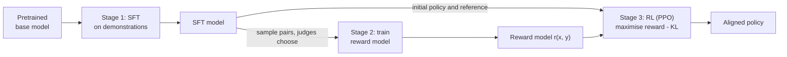
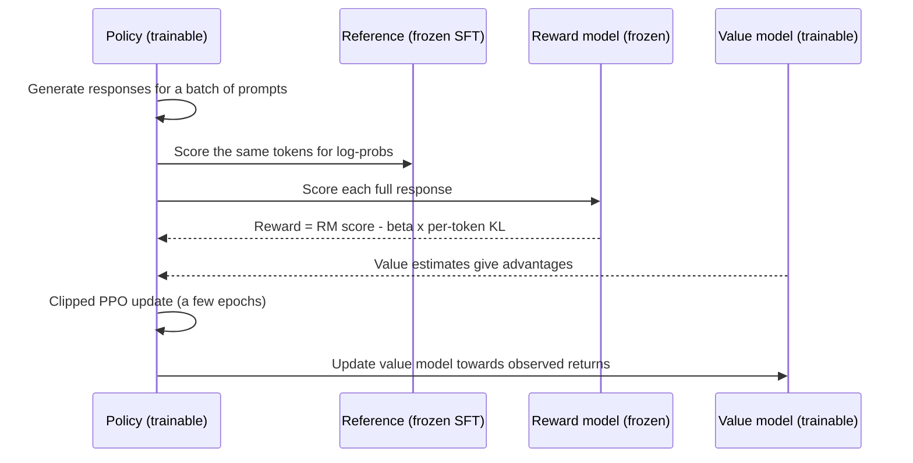

**Reinforcement learning from human feedback (RLHF)** is the training recipe that first made large language models into helpful assistants at scale. It turns the pairwise judgements from [preference optimisation](/learn/advanced-llm-engineering/preference-optimization) into a learned reward model, then uses reinforcement learning to push the language model towards responses that score highly, while a penalty keeps it from drifting too far from where it started. RLHF is heavy machinery and many teams now prefer simpler direct methods such as [DPO](/learn/advanced-llm-engineering/dpo), but the ideas it introduced (reward models, KL regularisation to a reference, reward hacking) run through all of modern post-training. You need them to understand why aligned models behave as they do and to debug any preference-tuning run.

## The three-stage pipeline



1. **Supervised fine-tuning** gives a model that already follows instructions reasonably well. It is both the starting point for RL and the **reference model** the RL stage is anchored to.
2. **Reward modelling** trains a network to score responses, using pairs sampled from the SFT model and judged by people (or an AI judge).
3. **RL optimisation** generates responses, scores them with the reward model, and updates the policy to raise the score, minus a penalty for moving away from the reference.

In RL vocabulary, the language model is the **policy** $\pi_\theta$, a prompt $x$ is the state, generating a response $y$ token by token is a sequence of actions, and the reward arrives at the end of the response.

## Stage 2: the reward model

The reward model $r_\phi(x, y)$ is usually initialised from the SFT model itself, with the language-model head replaced by a linear layer that outputs a single number, read at the final token of the response. It is trained on preference triples with the Bradley-Terry loss:

$$
\mathcal{L}_{\text{RM}}(\phi) = -\mathbb{E}_{(x, y_w, y_l)}\Big[\log \sigma\big(r_\phi(x, y_w) - r_\phi(x, y_l)\big)\Big]
$$

where $y_w$ is the chosen response, $y_l$ the rejected one and $\sigma$ the sigmoid. The key metric is **pairwise accuracy** on held-out pairs: how often the reward model scores the chosen response higher. Compare it with how often human annotators agree with each other on the same kind of data; a reward model cannot meaningfully exceed that agreement level, and one that claims to probably has leakage.

A reward model is a learned proxy, trained on a finite set of responses from one model. It is accurate near that data and unreliable far from it. Everything about the RL stage is designed around this weakness.

## Stage 3: the KL-regularised objective

The RL stage maximises expected reward, minus a penalty for diverging from the reference policy $\pi_{\text{ref}}$ (the frozen SFT model):

$$
\max_{\theta}\; \mathbb{E}_{x \sim \mathcal{D},\, y \sim \pi_\theta(\cdot \mid x)}\big[r_\phi(x, y)\big] \;-\; \beta\, \mathbb{D}_{\text{KL}}\big(\pi_\theta(\cdot \mid x) \,\|\, \pi_{\text{ref}}(\cdot \mid x)\big)
$$

Here $\beta > 0$ sets the strength of the penalty, and $\mathbb{D}_{\text{KL}}$ is the [KL divergence](/learn/essential-mathematics-for-machine-learning/kl-divergence). In implementations the KL term is estimated from the sampled tokens: for each generated token, the penalty is $\beta\,(\log \pi_\theta(y_t \mid \cdot) - \log \pi_{\text{ref}}(y_t \mid \cdot))$, and the reward model's score is added at the last token.

The KL penalty does two jobs. It keeps the policy in the region where the reward model is trustworthy, and it preserves the fluency and knowledge of the SFT model, which a pure reward maximiser would happily trade away.

## PPO in one picture

The RL algorithm used in the classic recipe is **Proximal Policy Optimization (PPO)**. Each iteration generates a batch of responses, scores them, estimates how much better each token was than expected (the **advantage**, using a learned **value model**), and takes a few gradient steps with an objective that refuses to move the policy too far in one update.



The clipped objective, with probability ratio $\rho_t = \pi_\theta(a_t \mid s_t) / \pi_{\theta_\text{old}}(a_t \mid s_t)$ and advantage estimate $\hat{A}_t$, is

$$
\mathcal{L}^{\text{CLIP}}(\theta) = \mathbb{E}_t\Big[\min\big(\rho_t \hat{A}_t,\; \text{clip}(\rho_t, 1-\epsilon, 1+\epsilon)\,\hat{A}_t\big)\Big]
$$

where $\epsilon$ is a small constant such as 0.2. Clipping removes the incentive to change any token's probability by more than a factor of about $1 \pm \epsilon$ in one update, which keeps training stable.

The engineering cost is visible in the diagram: four models of similar size, two of them trainable, plus generation inside the training loop. That is why RLHF needs substantially more memory and engineering than SFT. Some newer variants, such as GRPO, drop the value model and compute advantages by comparing several responses sampled for the same prompt, which reduces memory.

## Reward hacking

**Reward hacking** (also called reward over-optimisation) is the policy finding responses that score highly on the reward model without being genuinely better: excessive length, flattering openings, confident-sounding filler, or odd token patterns the reward model happens to like. As RL proceeds, the reward-model score keeps rising while true quality first rises and then falls.

For the KL-regularised objective over a fixed set of candidate responses, the optimal policy has a closed form, $\pi^*(y) \propto \pi_{\text{ref}}(y)\, e^{r(y)/\beta}$ (the next lesson derives it). That lets us watch reward hacking happen exactly. Below, five candidate responses have a true quality and a reward-model score; the reward model is right about four of them but badly overrates response E, a degenerate answer the reference rarely produces.

```python
import numpy as np

pi_ref = np.array([0.35, 0.30, 0.23, 0.10, 0.02])    # reference (SFT) probabilities
true_q = np.array([1.0, 2.0, 0.5, 0.0, -2.0])        # what people actually think
rm     = np.array([1.0, 2.0, 0.5, 0.0, 2.5])         # reward model: wrong about E

print(f"{'beta':>5} {'RM reward':>10} {'true quality':>13} {'KL':>6}  P(E)")
for beta in [5.0, 1.0, 0.5, 0.25, 0.1]:
    logits = np.log(pi_ref) + rm / beta
    pi = np.exp(logits - logits.max())
    pi /= pi.sum()
    kl = np.sum(pi * np.log(pi / pi_ref))
    print(f"{beta:5.2f} {pi @ rm:10.3f} {pi @ true_q:13.3f} {kl:6.3f}  {pi[4]:.3f}")
```

```output
 beta  RM reward  true quality     KL  P(E)
 5.00      1.214         1.096  0.010  0.026
 1.00      1.589         1.307  0.231  0.063
 0.50      1.901         1.312  0.682  0.131
 0.25      2.146         0.684  1.373  0.325
 0.10      2.454        -1.633  3.357  0.908
```

Reading down the table, weaker regularisation (smaller $\beta$) always raises the reward-model score and the KL from the reference. True quality improves at first, as probability moves to the genuinely good response B, then collapses once the policy concentrates on E, the response the reward model overrates. A real RL run traces the same curve over training steps.

> [!WARNING]
> A rising reward curve is not evidence that the model is improving. Always track an independent evaluation (held-out human or judge preferences, task metrics) alongside reward and KL, and stop or roll back when they diverge.

Practical defences:

| Defence | How it helps |
| --- | --- |
| KL penalty to the reference, tuned $\beta$ | Limits how far the policy can move into regions the reward model has not seen |
| Early stopping on independent evals | Catches the point where true quality peaks |
| Refresh the reward model on new policy samples | Fixes its errors on exactly the responses the policy now produces |
| Length penalties or length-controlled evaluation | Counters the most common exploit |
| Ensembles of reward models | An exploit must fool several models at once |

> [!KEY]
> RLHF optimises a proxy. The KL penalty, early stopping and independent evaluation exist because the proxy is wrong in places, and RL is very good at finding those places.

## Exercises

**1.** In the reward-hacking example, find the $\beta$ in the range 0.1 to 5 that maximises true quality, using a fine grid.

<details>
<summary>Show solution</summary>

```python
def stats(beta):
    logits = np.log(pi_ref) + rm / beta
    pi = np.exp(logits - logits.max())
    pi /= pi.sum()
    return pi @ true_q

betas = np.linspace(0.1, 5, 491)
best = betas[np.argmax([stats(b) for b in betas])]
print(f"best beta ~ {best:.2f}, true quality {stats(best):.3f}")
```

```output
best beta ~ 0.67, true quality 1.347
```

In practice you cannot compute this curve, because true quality is unknown; that is why $\beta$ and the stopping point are chosen using held-out evaluations.

</details>

**2.** Fix the reward model's mistake by setting `rm[4] = -2.0` and rerun the table. What happens to true quality as $\beta$ decreases now?

<details>
<summary>Show solution</summary>

With a correct reward model, true quality rises monotonically as $\beta$ falls, because reward and quality now agree; the policy concentrates on response B. The KL penalty then mainly protects properties the reward does not measure, such as fluency on other prompts.

</details>

**3.** List the models held in memory during PPO-based RLHF, and say which are updated.

<details>
<summary>Show solution</summary>

The policy (updated), the value model (updated), the reference model (frozen) and the reward model (frozen). The reference and policy usually share an architecture and size, so memory is several times that of SFT; LoRA can help by letting the reference be the base weights with the adapter disabled.

</details>

```quiz
[
  {
    "q": "What role does the reference model play in RLHF?",
    "options": [
      "It generates the preference pairs during RL",
      "It anchors the KL penalty, keeping the policy close to the SFT model",
      "It replaces the reward model at the end of training",
      "It estimates advantages for PPO"
    ],
    "answer": 1,
    "why": "The frozen SFT model is the reference; the KL term penalises the policy for drifting away from it."
  },
  {
    "q": "During RL training, reward-model scores keep rising but held-out human preference scores begin to fall. What is happening?",
    "options": [
      "The learning rate is too low",
      "The KL penalty is too strong",
      "Reward hacking: the policy is exploiting errors in the reward model",
      "The value model has converged"
    ],
    "answer": 2,
    "why": "The proxy reward and true quality have diverged, the signature of reward over-optimisation."
  },
  {
    "q": "What does clipping in PPO's objective achieve?",
    "options": [
      "It truncates long responses",
      "It clips the reward to the range 0-1",
      "It removes the need for a reward model",
      "It limits how much any update can change token probabilities, stabilising training"
    ],
    "answer": 3,
    "why": "Clipping the probability ratio to 1 +/- epsilon removes the incentive for large policy changes in one step."
  },
  {
    "q": "What is a sensible upper bound on a reward model's held-out pairwise accuracy?",
    "options": [
      "100%, given enough data",
      "50%",
      "Roughly the agreement rate between human annotators on similar data",
      "The SFT model's perplexity"
    ],
    "answer": 2,
    "why": "If humans only agree on, say, three quarters of pairs, the labels themselves are noisy and no model can predict them much better."
  }
]
```
