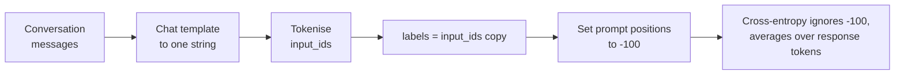

**Supervised fine-tuning (SFT)** trains a pretrained model on example conversations: a prompt, and the response you want the model to give. It is the same next-token prediction objective used in [pretraining](/learn/generative-ai-fundamentals/pretraining), applied to a small, curated dataset. SFT is how a base model becomes an instruction-following assistant, and it is the first training stage of almost every custom LLM project, including those that later add preference optimisation. This lesson covers the details that decide whether an SFT run works: how the data is formatted, which tokens the loss is computed on, how sequences are packed, and how to pick the learning rate and number of epochs.

## Chat-formatted data

Modern SFT data is stored as conversations, one JSON object per line, using the same role-based message format you used with chat APIs in [system and user instructions](/learn/working-with-llms/system-and-user-instructions):

```json
{"messages": [
  {"role": "system", "content": "You extract invoice fields as JSON."},
  {"role": "user", "content": "Invoice 2291 from Acme, total 340.00 EUR, due 2025-03-01."},
  {"role": "assistant", "content": "{\"number\": \"2291\", \"vendor\": \"Acme\", \"total\": 340.0, \"currency\": \"EUR\"}"}
]}
```

The model never sees JSON, though. Before training, each conversation is rendered into one string by the model's **chat template**, which inserts the special tokens that mark where each turn begins and ends, then tokenised. You met `apply_chat_template` in [Tokenizers](/learn/hugging-face-ecosystem/tokenizers). The exact markers differ by model family; a template might produce something shaped like this (illustrative):

```text
<|system|>You extract invoice fields as JSON.<|end|>
<|user|>Invoice 2291 from Acme, total 340.00 EUR, due 2025-03-01.<|end|>
<|assistant|>{"number": "2291", "vendor": "Acme", ...}<|end|>
```

> [!WARNING]
> Always fine-tune with the chat template of the model you start from, and serve with the same template. A model trained on one set of turn markers and prompted with another produces degraded or rambling output, and the bug is silent: nothing crashes.

The end-of-turn token at the end of the assistant reply matters: it is how the model learns to stop. If your rendering drops it, the fine-tuned model will keep generating past the end of its answer.

## Loss masking: train only on the response

The causal language-modelling loss is cross-entropy on every next-token prediction. If you compute it over the whole rendered conversation, the model also learns to predict the system prompt and the user's message. That wastes capacity on text you will always supply, and on datasets where prompts are long and responses short it can dominate the gradient. The usual practice is **loss masking**: compute the loss only on the assistant tokens.



In PyTorch the convention is to copy `input_ids` into `labels` and overwrite the positions you do not want to learn with `-100`, which is the default `ignore_index` of `torch.nn.functional.cross_entropy`. The shift by one position (logits at position $t$ predict the token at $t+1$) is done inside the loss computation, exactly as in the Hugging Face causal LM models.

```python
import torch
import torch.nn.functional as F

torch.manual_seed(0)
vocab_size = 20

# One rendered conversation: 6 prompt tokens, then 4 response tokens (last one is end-of-turn)
input_ids = torch.tensor([[1, 5, 7, 3, 9, 2, 11, 14, 12, 19]])
prompt_len = 6

labels = input_ids.clone()
labels[:, :prompt_len] = -100          # mask the prompt
print("labels:", labels.tolist())

logits = torch.randn(1, input_ids.shape[1], vocab_size)   # stand-in for model output

def causal_lm_loss(logits, labels):
    shift_logits = logits[:, :-1, :]   # position t predicts token t+1
    shift_labels = labels[:, 1:]
    return F.cross_entropy(shift_logits.reshape(-1, vocab_size),
                           shift_labels.reshape(-1), ignore_index=-100)

print("loss on all tokens:     ", round(causal_lm_loss(logits, input_ids).item(), 4))
print("loss on response tokens:", round(causal_lm_loss(logits, labels).item(), 4))
print("positions contributing: ", int((labels[:, 1:] != -100).sum()))
```

```output
labels: [[-100, -100, -100, -100, -100, -100, 11, 14, 12, 19]]
loss on all tokens:      3.0581
loss on response tokens: 2.987
positions contributing:  4
```

Only the 4 response tokens contribute, so the loss is the mean over those 4 predictions. The first of them is predicted from the last prompt position, which is why the prompt still matters: the model is conditioned on it, it just is not trained to produce it.

For multi-turn conversations, the same idea applies per turn: every assistant turn is unmasked and every system, user and tool turn is masked. Masking is computed from the token positions where each turn starts and ends, which is why libraries need to know the chat template's markers.

> [!NOTE]
> Masking the prompt is a strong default, not a law. Some studies and practitioners find training on the full sequence helps when prompts are short and diverse. Treat it as a hyperparameter you can test, but start with response-only loss.

## Packing short examples together

GPUs process fixed-shape batches. If one example is 120 tokens and another 1,900, padding the short one to the long one's length wastes compute on padding tokens. **Packing** concatenates several examples into one sequence of the maximum length, separated by end-of-sequence tokens, so almost every position is a real token.

```python
import random

random.seed(1)
lengths = [random.randint(50, 900) for _ in range(1000)]   # example lengths in tokens
max_len = 2048

padded_tokens = len(lengths) * max_len           # one example per row, padded
packed_rows, current = 0, 0
for n in sorted(lengths, reverse=True):           # greedy first-fit would be tighter
    if current + n > max_len:
        packed_rows, current = packed_rows + 1, 0
    current += n
packed_rows += 1

real = sum(lengths)
print(f"real tokens: {real}")
print(f"unpacked rows: {len(lengths)}, utilisation {real / padded_tokens:.1%}")
print(f"packed rows:   {packed_rows}, utilisation {real / (packed_rows * max_len):.1%}")
```

```output
real tokens: 481794
unpacked rows: 1000, utilisation 23.5%
packed rows:   279, utilisation 84.3%
```

Even this naive packer lifts utilisation from under a quarter to over 80%, which means several times fewer training steps for the same data. The catch is **cross-contamination**: in a packed row, tokens of the second example can attend to the first example unless the attention mask is reset at each boundary. Many implementations accept the contamination as a minor cost; more careful ones pass per-example position ids or use attention kernels that respect example boundaries. Check what your library does, especially for small datasets where every example counts.

## Learning rate, epochs and batch size

SFT moves a capable model a short distance, so it uses much smaller learning rates than training from scratch, and few passes over the data. The values below are common starting points, not rules:

| Setting | Full fine-tuning | LoRA | Why |
| --- | --- | --- | --- |
| Peak learning rate | around 1e-5 to 2e-5 | around 1e-4 to 2e-4 | LoRA updates few, freshly initialised parameters and tolerates larger steps |
| Schedule | Linear or cosine decay with a short warmup | Same | Warmup avoids early large updates while optimiser statistics settle |
| Epochs | 1 to 3 | 1 to 3 | More epochs on small data leads quickly to memorisation |
| Effective batch size | Tens of sequences | Tens of sequences | Use gradient accumulation to reach it on small GPUs |

The **effective batch size** is per-device batch size times gradient accumulation steps times number of GPUs. Watch two curves: training loss, and loss on a held-out set of conversations. When held-out loss starts rising while training loss keeps falling, the model is memorising; stop earlier or use fewer epochs. A training loss that drops to near zero within the first epoch on a few thousand examples is a red flag for duplicates or a data bug, not a triumph.

Loss is a proxy. Two checkpoints with similar held-out loss can behave very differently, so sample generations from each checkpoint on a fixed set of prompts and run your task evaluation, as set out in [LLM fine-tuning](/learn/advanced-llm-engineering/llm-fine-tuning).

## SFT with TRL

The TRL library (Transformer Reinforcement Learning) from Hugging Face wraps the `Trainer` with SFT-specific logic: applying the chat template, masking, and packing. A typical script looks like this; it needs a GPU and is shown without output. TRL's argument names have changed between releases, so check the [TRL documentation](https://huggingface.co/docs/trl/sft_trainer) for the version you install.

```python
from datasets import load_dataset
from peft import LoraConfig
from trl import SFTConfig, SFTTrainer

dataset = load_dataset("json", data_files={"train": "train.jsonl", "test": "eval.jsonl"})

config = SFTConfig(
    output_dir="invoice-sft",
    num_train_epochs=2,
    learning_rate=2e-4,
    lr_scheduler_type="cosine",
    warmup_ratio=0.03,
    per_device_train_batch_size=4,
    gradient_accumulation_steps=8,      # effective batch 32 per GPU
    max_length=2048,
    packing=True,
    assistant_only_loss=True,           # loss on assistant turns only
    bf16=True,
    eval_strategy="steps",
    eval_steps=100,
    logging_steps=10,
)

trainer = SFTTrainer(
    model="Qwen/Qwen2.5-0.5B-Instruct",
    args=config,
    train_dataset=dataset["train"],
    eval_dataset=dataset["test"],
    peft_config=LoraConfig(r=16, lora_alpha=32, target_modules="all-linear", task_type="CAUSAL_LM"),
)
trainer.train()
trainer.save_model()
```

Given a dataset with a `messages` column, `SFTTrainer` applies the model's chat template for you. The `assistant_only_loss` option relies on the chat template being able to mark which tokens belong to the assistant; if your model's template cannot, the trainer will tell you, and you can fall back to building `labels` yourself as in the masking example above.

> [!KEY]
> SFT is next-token prediction on curated conversations with the prompt masked out. Nearly every quality problem traces back to the data or the template, not to the trainer.

## Exercises

**1.** Modify the masking example for a two-turn conversation where positions 0-3 are the first user turn, 4-6 the first assistant reply, 7-9 the second user turn and 10-12 the second assistant reply. Build the `labels` tensor.

<details>
<summary>Show solution</summary>

```python
ids = torch.arange(100, 113).unsqueeze(0)    # 13 dummy token ids
labels = torch.full_like(ids, -100)
for start, end in [(4, 7), (10, 13)]:        # assistant spans, end exclusive
    labels[:, start:end] = ids[:, start:end]
print(labels.tolist())
```

```output
[[-100, -100, -100, -100, 104, 105, 106, -100, -100, -100, 110, 111, 112]]
```

</details>

**2.** In the packing example, how many training steps does packing save for one epoch with an effective batch of 32 rows?

<details>
<summary>Show solution</summary>

```python
import math
print(math.ceil(len(lengths) / 32), "steps unpacked vs", math.ceil(packed_rows / 32), "packed")
```

```output
32 steps unpacked vs 9 packed
```

</details>

**3.** After one epoch on 3,000 examples, training loss is 0.02 and held-out loss is 1.9 and rising. Give two likely causes and a fix for each.

<details>
<summary>Show solution</summary>

Memorisation from too many effective updates: lower the learning rate or stop earlier, and evaluate checkpoints by held-out loss and task metrics. Or duplicated or near-duplicated training data letting the model memorise fast: deduplicate. A third possibility is a masking or template bug where the model learns trivially predictable tokens; inspect a rendered, masked example.

</details>

```quiz
[
  {
    "q": "In PyTorch causal LM training, what does setting a label position to `-100` do?",
    "options": [
      "Marks the token as padding in the attention mask",
      "Excludes that position from the cross-entropy loss",
      "Replaces the token with an unknown token",
      "Gives that position a negative weight in the loss"
    ],
    "answer": 1,
    "why": "`-100` is the default `ignore_index` of `cross_entropy`, so those positions contribute nothing to the loss or the gradient."
  },
  {
    "q": "Why does the end-of-turn token at the end of each assistant reply need to be in the training labels?",
    "options": [
      "It reduces sequence length",
      "It is required by the tokenizer",
      "It teaches the model when to stop generating",
      "It prevents cross-contamination in packing"
    ],
    "answer": 2,
    "why": "If the model never learns to predict end-of-turn, it keeps generating past the end of its answer."
  },
  {
    "q": "What is the main risk of naive packing?",
    "options": [
      "It increases the number of padding tokens",
      "It changes the vocabulary",
      "It disables the learning-rate schedule",
      "Tokens from one example can attend to an unrelated earlier example in the same row"
    ],
    "answer": 3,
    "why": "Without resetting attention at example boundaries, packed examples can see each other. Careful implementations mask across boundaries."
  },
  {
    "q": "Which learning rate is a sensible starting point for LoRA SFT of an instruction model?",
    "options": [
      "1e-1",
      "1e-2",
      "2e-4",
      "1e-8"
    ],
    "answer": 2,
    "why": "LoRA commonly uses peak rates around 1e-4 to 2e-4; full fine-tuning uses roughly ten times smaller."
  }
]
```
