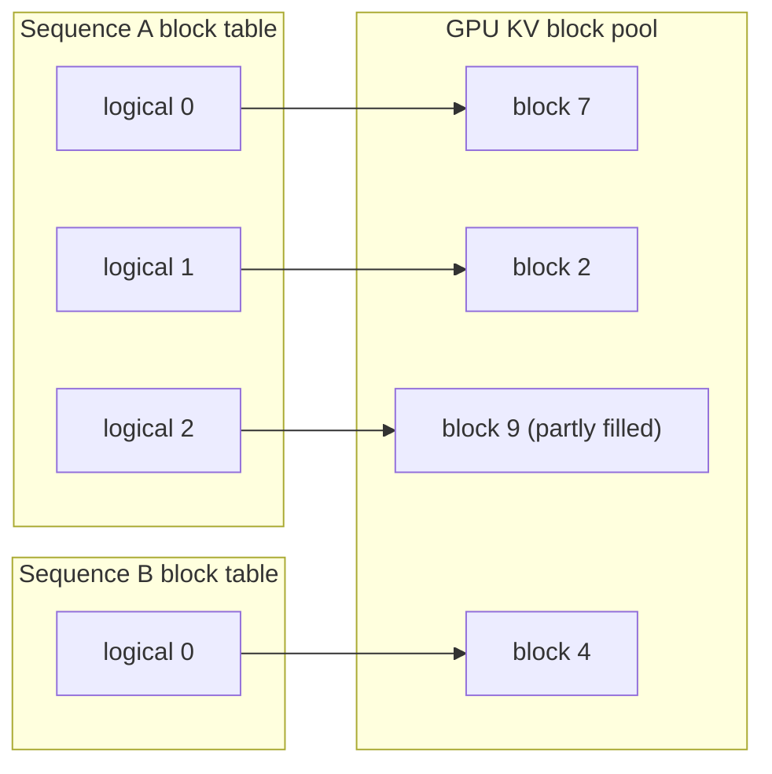
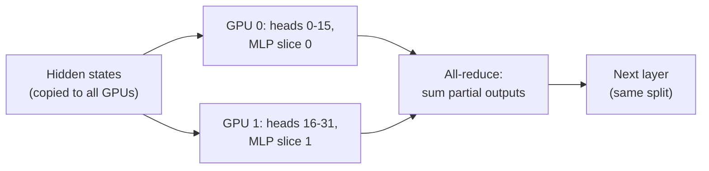

**vLLM** is an open-source inference engine for serving LLMs at high throughput. It is a common choice when teams self-host open-weight models, because it combines three ideas you will study in this module into one package: **PagedAttention** for memory-efficient [KV caching](/learn/advanced-llm-engineering/kv-caching), [continuous batching](/learn/advanced-llm-engineering/continuous-batching) for keeping the GPU busy, and an **OpenAI-compatible HTTP server** so existing client code works unchanged. You saw where an inference engine sits in a serving stack in [Model serving](/learn/production-ai-systems/model-serving). This lesson explains what vLLM does internally, how to use its offline and server interfaces, and how to split a model across several GPUs.

## The problem PagedAttention solves

When generating, every sequence keeps a **KV cache**: the attention keys and values of all its previous tokens, for every layer. It grows by one entry per generated token, and nobody knows in advance how long a response will be. Early serving systems reserved one contiguous chunk of GPU memory per request, sized for the maximum possible length. Most requests finish far shorter, so most of that reservation sat empty, and the number of requests that could run concurrently was limited by memory that was reserved but never used.

**PagedAttention** borrows the idea of virtual memory from operating systems. The KV cache is divided into fixed-size **blocks** (for example 16 tokens each). A sequence's cache is a list of blocks that can live anywhere in GPU memory, tracked by a per-sequence **block table**, just as a page table maps a process's virtual pages to physical frames. A new block is allocated only when the previous one is full.



The attention kernel follows the block table to gather keys and values, so blocks need not be adjacent. Waste is limited to the unfilled part of each sequence's last block. Blocks can also be **shared**: when several samples are generated from one prompt, or when many requests share a system prompt, they can point at the same physical blocks for the common prefix, copying a block only when one of them needs to write to it.

The effect on capacity is easy to simulate. Below, a fixed KV budget is shared between requests whose final lengths vary; we compare reserving the maximum length per request with allocating 16-token blocks on demand.

```python
import random

random.seed(0)
max_len, block = 4096, 16
budget_tokens = 200_000                     # KV slots that fit in GPU memory (illustrative)
lengths = [random.randint(200, 2000) for _ in range(500)]   # prompt + output per request

def fits(cost_per_request):
    used, n = 0, 0
    for length in lengths:
        cost = cost_per_request(length)
        if used + cost > budget_tokens:
            break
        used, n = used + cost, n + 1
    return n

reserved = fits(lambda L: max_len)                         # contiguous, sized for the worst case
paged = fits(lambda L: -(-L // block) * block)             # ceil to whole blocks
waste = sum(-(-L // block) * block - L for L in lengths) / sum(lengths)

print(f"concurrent requests, reserve max length: {reserved}")
print(f"concurrent requests, paged blocks:       {paged}")
print(f"paged waste (unfilled block slots):      {waste:.2%}")
```

```output
concurrent requests, reserve max length: 48
concurrent requests, paged blocks:       170
paged waste (unfilled block slots):      0.68%
```

More concurrent sequences means larger decode batches, and since decoding is bandwidth-bound, larger batches mean far more tokens per second from the same GPU. That is where vLLM's throughput comes from.

## Offline batch inference

For batch jobs such as labelling a dataset or generating synthetic data for [distillation](/learn/advanced-llm-engineering/distillation), use the Python API directly. vLLM schedules all prompts together, so passing the whole list at once is much faster than looping one prompt at a time. This needs a supported GPU and is shown without output.

```python
from vllm import LLM, SamplingParams

llm = LLM(
    model="Qwen/Qwen2.5-1.5B-Instruct",
    max_model_len=8192,              # cap context length to bound KV memory
    gpu_memory_utilization=0.90,     # fraction of GPU memory vLLM may use
)
params = SamplingParams(temperature=0.7, top_p=0.9, max_tokens=256)

prompts = [
    "Summarise the causes of the 1929 stock market crash in two sentences.",
    "Write a haiku about garbage collection.",
]
outputs = llm.generate(prompts, params)
for out in outputs:
    print(out.prompt[:40], "->", out.outputs[0].text.strip()[:80])

# Chat-formatted input: vLLM applies the model's chat template
messages = [{"role": "user", "content": "Explain a mutex in one sentence."}]
reply = llm.chat(messages, params)
print(reply[0].outputs[0].text)
```

`SamplingParams` carries the decoding settings you met in [top-k and top-p sampling](/learn/generative-ai-fundamentals/top-k-and-top-p-sampling): `temperature`, `top_p`, `top_k`, `max_tokens`, `stop` sequences, `n` samples per prompt and `seed`. Each item in `outputs` corresponds to one prompt, in order, and `outputs[0]` inside it is the first of its `n` completions.

## The OpenAI-compatible server

For online serving, start the server from the command line. It exposes `/v1/chat/completions`, `/v1/completions` and `/v1/models`, plus health and Prometheus metrics endpoints.

```bash
vllm serve Qwen/Qwen2.5-1.5B-Instruct \
  --max-model-len 8192 \
  --gpu-memory-utilization 0.90 \
  --enable-prefix-caching \
  --port 8000
```

Any OpenAI client can then talk to it by changing the base URL, as in [OpenAI API](/learn/working-with-llms/openai-api):

```python
from openai import OpenAI

client = OpenAI(base_url="http://localhost:8000/v1", api_key="not-needed-locally")
response = client.chat.completions.create(
    model="Qwen/Qwen2.5-1.5B-Instruct",
    messages=[{"role": "user", "content": "Give me three names for a cat."}],
    temperature=0.7,
    max_tokens=100,
)
print(response.choices[0].message.content)
```

The settings you will tune most often:

| Flag | What it controls | Trade-off |
| --- | --- | --- |
| `--gpu-memory-utilization` | Fraction of GPU memory vLLM claims; what remains after weights becomes KV cache | Higher means more KV blocks, but less headroom for other processes |
| `--max-model-len` | Maximum context length per request | Lower values reduce worst-case KV usage per sequence |
| `--max-num-seqs` | Maximum concurrent sequences in a batch | Higher raises throughput until latency per token suffers |
| `--enable-prefix-caching` | Reuse KV blocks for shared prompt prefixes | Big wins when many requests share a system prompt |
| `--quantization` | Load quantised weights (for example `awq`, `gptq`, `fp8`) | Less memory, some quality risk, see [Model quantization](/learn/advanced-llm-engineering/model-quantization) |
| `--tensor-parallel-size` | Number of GPUs to split each layer across | Fits larger models, adds communication |
| `--enable-lora` | Serve LoRA adapters on top of one base model | Many fine-tunes for the cost of one base |

> [!TIP]
> At start-up vLLM logs how much memory is available for the KV cache and how many tokens that corresponds to. Read that line: it tells you directly how many concurrent long requests the deployment can hold, and is the first thing to check when throughput is lower than expected.

## Tensor parallelism

When a model does not fit on one GPU, or you need lower latency per token, split it across several. **Tensor parallelism** splits each layer's weight matrices across GPUs, so every GPU holds a slice of every layer and they all work on each token at the same time. In the attention block, the heads are divided among GPUs; in the MLP, the first projection is split by columns and the second by rows. After each block the partial results are combined with an **all-reduce**, a collective operation where every GPU ends up with the sum.



Because there is an all-reduce in every layer, tensor parallelism needs a fast interconnect between GPUs and is normally used within a single server. Across servers, **pipeline parallelism** (`--pipeline-parallel-size`) assigns whole groups of layers to different machines, which communicates far less but adds pipeline latency. A common layout is tensor parallelism inside each node and pipeline parallelism across nodes. The tensor-parallel size must divide the number of attention heads evenly, which is why it is almost always a power of two.

Tensor parallelism also increases capacity in a less obvious way: with weights split across four GPUs, each GPU has more free memory for KV blocks, so the deployment can hold more concurrent sequences.

> [!KEY]
> vLLM's speed comes from memory management, not magic kernels alone: paged KV blocks let many more sequences share the GPU, and continuous batching keeps all of them moving.

## Exercises

**1.** In the simulation, change the block size to 256 tokens. How does the number of concurrent requests change, and why might an engine still prefer small blocks?

<details>
<summary>Show solution</summary>

```python
block = 256
paged_256 = fits(lambda L: -(-L // block) * block)
print(paged_256)
```

```output
154
```

Larger blocks waste more of each sequence's last block, so fewer requests fit. Small blocks keep waste low and make prefix sharing finer-grained; the cost is a longer block table and slightly more bookkeeping in the kernel.

</details>

**2.** You serve a 70B-class model in bf16 on GPUs with 80 GB each. Roughly how many GPUs must you use for tensor parallelism just to hold the weights, and why would you choose more than the minimum?

<details>
<summary>Show solution</summary>

About 140 GB of weights needs at least 2 GPUs, but that leaves almost no room for the KV cache, so 4 is a more realistic choice. A tensor-parallel size of 4 also divides the head count evenly and spreads the per-token work, lowering latency.

</details>

**3.** A client using the OpenAI Python SDK must switch from a hosted API to your vLLM server. What must change in the client code?

<details>
<summary>Show solution</summary>

The `base_url` (pointing at your server's `/v1`), the API key (whatever your server or gateway expects), and the `model` name, which must match the model the vLLM server is serving. The request and response formats stay the same.

</details>

```quiz
[
  {
    "q": "What problem does PagedAttention primarily solve?",
    "options": [
      "Slow tokenisation",
      "Wasted GPU memory from reserving contiguous KV cache space for the maximum length of every request",
      "Inaccurate attention scores",
      "The need for a chat template"
    ],
    "answer": 1,
    "why": "Allocating KV cache in small blocks on demand removes most reservation waste, so more sequences fit concurrently."
  },
  {
    "q": "In vLLM's offline API, which object holds `temperature`, `top_p` and `max_tokens`?",
    "options": [
      "`LLM`",
      "`SamplingParams`",
      "`RequestOutput`",
      "`EngineArgs`"
    ],
    "answer": 1,
    "why": "`SamplingParams` carries decoding settings and is passed to `llm.generate` or `llm.chat`."
  },
  {
    "q": "Why is tensor parallelism usually kept within one server?",
    "options": [
      "It requires an all-reduce between GPUs in every layer, which needs a fast interconnect",
      "It only works with one GPU",
      "It does not support quantised models",
      "It requires a different tokenizer per GPU"
    ],
    "answer": 0,
    "why": "Frequent collective communication makes tensor parallelism sensitive to bandwidth and latency between GPUs."
  },
  {
    "q": "Which flag most directly increases the number of KV cache blocks vLLM can allocate on a single GPU?",
    "options": [
      "`--port`",
      "`--enable-lora`",
      "`--served-model-name`",
      "`--gpu-memory-utilization`"
    ],
    "answer": 3,
    "why": "Memory left after loading the weights, within the utilisation fraction, is given to the KV cache."
  }
]
```
