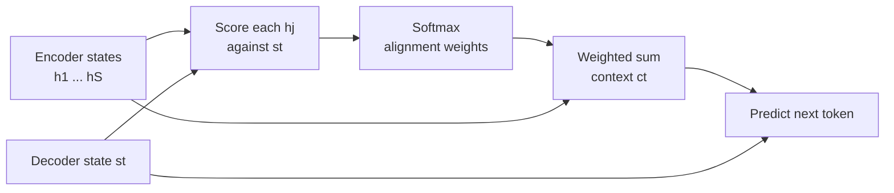

When a human translates "the black cat sleeps" into French, they do not memorise the sentence and then write "le chat noir dort" from memory. They look back at the source: at "cat" while writing "chat", at "black" while writing "noir". **Attention** gives a seq2seq model the same ability. At every output step the decoder computes a fresh, weighted summary of the entire source, focused on the parts that matter now. This lesson looks at attention from the NLP angle: as a learned, soft **alignment** between two sequences, how it connects the decoder to the encoder (**cross-attention**), and how to read alignment maps without over-reading them.

[Module 21](/learn/sequence-models/attention-mechanisms) introduced attention for RNNs. [Module 24](/learn/generative-ai-fundamentals/self-attention) covers self-attention and multi-head attention in depth for large language models. Here the focus is the source-target relationship that machine translation made famous.

## Attention as soft alignment

Classical statistical translation systems learned explicit **word alignments**: which source word each target word came from. Real alignments are messy: word order changes ("black cat" becomes "chat noir"), one word can map to several ("don't" to "ne ... pas"), and some words have no counterpart.

Attention replaces the hard alignment table with a **probability distribution over source positions**, computed afresh for every target position. Instead of saying "chat comes from cat", the model says "while producing chat, put 73% of my focus on cat, 18% on black, and a little on the rest". Because the distribution is produced by differentiable operations, it is learned end to end from translation pairs, with no alignment labels at all.

## The mechanism, step by step

Let $h_1, \dots, h_S$ be the encoder states, one vector per source token, and $s_t$ the decoder state at target step $t$. Attention has three steps:

$$
e_{t,j} = \text{score}(s_t, h_j), \qquad
\alpha_{t,j} = \frac{\exp(e_{t,j})}{\sum_{k=1}^{S} \exp(e_{t,k})}, \qquad
c_t = \sum_{j=1}^{S} \alpha_{t,j}\, h_j
$$

1. **Score** each source position $j$ for relevance to the current decoder state, giving $e_{t,j}$.
2. **Normalise** the scores with a softmax into weights $\alpha_{t,j}$ that are positive and sum to 1. These are the alignment weights.
3. **Combine**: the context vector $c_t$ is the weighted average of encoder states.

The decoder then uses $c_t$ together with $s_t$ to predict the next token. Since $c_t$ is recomputed at every step, the bottleneck from the [previous lesson](/learn/advanced-nlp/sequence-to-sequence-models) disappears.



### Score functions

The choice of score function distinguishes the classic variants.

| Name | Score $e_{t,j}$ | Notes |
| --- | --- | --- |
| Additive (Bahdanau) | $v^\top \tanh(W_1 s_t + W_2 h_j)$ | A small feed-forward network. Works when $s_t$ and $h_j$ have different sizes |
| Dot (Luong) | $s_t^\top h_j$ | No parameters. Requires equal sizes |
| General (Luong) | $s_t^\top W h_j$ | A learned bilinear form |
| Scaled dot-product (Transformer) | $q_t^\top k_j / \sqrt{d_k}$ | Queries and keys are learned projections. Fast as matrix products |

Here $W$, $W_1$, $W_2$ and $v$ are learned parameters, and $d_k$ is the dimension of the key vectors. Dividing by $\sqrt{d_k}$ stops dot products from growing with dimension and saturating the softmax.

## Queries, keys and values: cross-attention

The Transformer generalised the mechanism with three roles. The **query** is what is looking (the decoder position). **Keys** are what each candidate position advertises for matching. **Values** are what each position contributes if selected. In the RNN version, $h_j$ served as both key and value.

When queries come from one sequence and keys and values from another, the operation is called **cross-attention**. Encoder-decoder Transformers use it in every decoder block: queries from the target side, keys and values from the encoder output. When queries, keys and values all come from the same sequence, it is **self-attention**.

| | Queries from | Keys and values from | Used in |
| --- | --- | --- | --- |
| Cross-attention | Decoder (target) | Encoder output (source) | Translation, summarisation, T5, BART |
| Encoder self-attention | Source | Source | BERT, every encoder |
| Decoder self-attention (masked) | Target prefix | Target prefix | GPT, every decoder |

In matrix form, with $Q$ holding one query per target position and $K$, $V$ one row per source position:

$$
\text{Attention}(Q, K, V) = \text{softmax}\!\left(\frac{Q K^\top}{\sqrt{d_k}}\right) V
$$

The softmax is applied row by row, so row $t$ of the softmax output is exactly the alignment distribution for target position $t$.

## Computing an alignment matrix

Here is the whole computation for all four target positions at once, in NumPy. The encoder and decoder states are hand-made 4-dimensional vectors (a real model learns them), designed so that each French word resembles its English counterpart. The French word order differs from the English, which is what makes alignment interesting.

```python
import numpy as np

src = ["the", "black", "cat", "sleeps"]
tgt = ["le", "chat", "noir", "dort"]

H = np.array([                 # encoder states, one row per source token
    [1.0, 0.1, 0.0, 0.2],      # the
    [0.0, 1.0, 0.3, 0.0],      # black
    [0.1, 0.2, 1.0, 0.0],      # cat
    [0.0, 0.0, 0.2, 1.0],      # sleeps
])
S = np.array([                 # decoder states, one row per target position
    [0.9, 0.0, 0.2, 0.1],      # le
    [0.1, 0.3, 1.0, 0.0],      # chat
    [0.0, 1.0, 0.2, 0.1],      # noir
    [0.1, 0.0, 0.1, 0.9],      # dort
])

def softmax(z):
    z = z - z.max(axis=-1, keepdims=True)    # for numerical stability
    e = np.exp(z)
    return e / e.sum(axis=-1, keepdims=True)

scale = 3.0                    # sharpens this toy example, like 1/sqrt(d_k) in reverse
A = softmax(scale * S @ H.T)   # shape (target, source)
print(A.round(2))
print("row sums:", A.sum(axis=1).round(6))
```

```output
[[0.76 0.06 0.11 0.07]
 [0.04 0.18 0.73 0.05]
 [0.05 0.79 0.11 0.05]
 [0.11 0.05 0.07 0.77]]
row sums: [1. 1. 1. 1.]
```

Row 2 ("chat") puts most of its weight on column 3 ("cat"), and row 3 ("noir") on column 2 ("black"): the matrix has learned the swap. Step through the computation for the single row "chat":

```trace
{
  "title": "one row of cross-attention",
  "code": [
    "q = S[1]                    # decoder state for 'chat'",
    "scores = scale * (H @ q)    # one score per source token",
    "weights = softmax(scores)   # alignment distribution",
    "context = weights @ H       # weighted average of encoder states",
    "print(weights.round(2))"
  ],
  "steps": [
    { "line": 1, "vars": { "q": "[0.1, 0.3, 1.0, 0.0]" }, "note": "The query is the decoder state while producing 'chat'." },
    { "line": 2, "vars": { "q": "[0.1, 0.3, 1.0, 0.0]", "scores": "[0.39, 1.8, 3.21, 0.6]" }, "note": "Dot products with each encoder state. 'cat' scores highest, 'black' second because the vectors share some direction." },
    { "line": 3, "vars": { "scores": "[0.39, 1.8, 3.21, 0.6]", "weights": "[0.04, 0.18, 0.73, 0.05]" }, "note": "Softmax turns scores into positive weights summing to 1. The exponential exaggerates the gap between scores." },
    { "line": 4, "vars": { "weights": "[0.04, 0.18, 0.73, 0.05]", "context": "[0.12, 0.33, 0.79, 0.06]" }, "note": "The context vector is mostly the 'cat' state, with a little of 'black' mixed in." },
    { "line": 5, "vars": { "context": "[0.12, 0.33, 0.79, 0.06]" }, "out": ["[0.04 0.18 0.73 0.05]"], "note": "This row is row 2 of the alignment matrix above." }
  ]
}
```

## Visualising alignments

Alignment matrices are traditionally drawn as heat maps with source tokens along the top and target tokens down the side. Even without a plotting library you can render one as text:

```python
shades = " .:-=+*%@"
print("        " + " ".join(f"{w:>6}" for w in src))
for word, row in zip(tgt, A):
    cells = " ".join(f"{shades[int(a * (len(shades) - 1))] * 3:>6}" for a in row)
    print(f"{word:>6}  {cells}")
```

```output
           the  black    cat sleeps
    le     ***                     
  chat            ...    +++       
  noir            ***              
  dort                          ***
```

A roughly diagonal map means the languages share word order. Off-diagonal blocks reveal reordering, and a target row spread over several columns shows one word drawing on several source words.

With a real encoder-decoder model in Hugging Face `transformers`, pass `output_attentions=True` to the forward call. Seq2seq model outputs then include a `cross_attentions` tuple, one tensor per decoder layer, each of shape (batch, heads, target length, source length). This needs PyTorch and a model download, so no output is shown:

```python
import torch
from transformers import AutoTokenizer, AutoModelForSeq2SeqLM

name = "Helsinki-NLP/opus-mt-en-fr"
tok = AutoTokenizer.from_pretrained(name)
model = AutoModelForSeq2SeqLM.from_pretrained(name)

enc = tok("The black cat sleeps.", return_tensors="pt")
dec = tok(text_target="Le chat noir dort.", return_tensors="pt")
with torch.no_grad():
    out = model(**enc, labels=dec["input_ids"], output_attentions=True)

last_layer = out.cross_attentions[-1][0]     # (heads, target_len, source_len)
alignment = last_layer.mean(dim=0)           # average over heads
```

## Pitfalls when reading attention

> [!WARNING]
> Attention weights are not a faithful explanation of a model's decision. A model has many layers and heads, and information also flows through residual connections that attention maps do not show. Researchers have found cases where very different attention patterns give the same prediction. Treat alignment maps as a useful diagnostic, not as proof of why the model said something.

- **Heads disagree.** Different heads learn different patterns: some align words, some attend to punctuation or the end token. Averaging heads blurs this; look at individual heads too.
- **Subword tokens.** Real models attend over subword pieces ("sle", "eps"), so word-level maps require summing weights over a word's pieces.
- **Padding must be masked.** In a batch, short sources are padded. Their padding positions must get a score of $-\infty$ before the softmax, otherwise the decoder attends to filler. The [Transformer lesson](/learn/advanced-nlp/transformer-architecture) implements this mask.

## Exercises

**1.** Change `scale` from 3.0 to 10.0 and then to 0.5 and recompute `A`. What happens to the rows, and what does this tell you about the role of $1/\sqrt{d_k}$?

<details>
<summary>Show solution</summary>

```python
for sc in (10.0, 0.5):
    print(sc, softmax(sc * S @ H.T)[1].round(2))
```

```output
10.0 [0.   0.01 0.99 0.  ]
0.5 [0.2  0.26 0.33 0.21]
```

A larger scale makes the softmax sharper, approaching a hard one-hot alignment. A smaller scale flattens it towards uniform. Raw dot products grow with dimension, which would make softmax very sharp and its gradients tiny; dividing by $\sqrt{d_k}$ keeps the scores in a well-behaved range.

</details>

**2.** A batch holds two source sentences of lengths 4 and 2, padded to 4. Write the mask you would add to the scores of the second sentence before the softmax.

<details>
<summary>Show solution</summary>

Add 0 to real positions and $-\infty$ (in practice a very large negative number) to padding positions: `np.array([0, 0, -np.inf, -np.inf])`. After the softmax, the padded positions receive weight exactly 0.

</details>

```quiz
[
  {
    "q": "In cross-attention inside an encoder-decoder Transformer, where do the queries come from?",
    "options": [
      "The encoder output",
      "The decoder (target side)",
      "A fixed learned vector",
      "The positional encodings"
    ],
    "answer": 1,
    "why": "Queries come from the decoder; keys and values come from the encoder output, so each target position looks at the source."
  },
  {
    "q": "What does row t of an alignment matrix represent?",
    "options": [
      "How much each target token attends to source token t",
      "The embedding of target token t",
      "A probability distribution over source positions used when producing target token t",
      "The gradient of the loss with respect to source token t"
    ],
    "answer": 2,
    "why": "Rows are target positions, columns are source positions, and each row is a softmax distribution summing to 1."
  },
  {
    "q": "Why is attention described as a soft alignment?",
    "options": [
      "Each target position spreads a weight distribution over all source positions instead of picking exactly one",
      "It only aligns words that look similar",
      "It is trained on hand-labelled alignments",
      "It uses a soft-margin loss"
    ],
    "answer": 0,
    "why": "The weights are continuous and sum to 1, which makes alignment differentiable and learnable without labels."
  },
  {
    "q": "Which statement about attention maps is most accurate?",
    "options": [
      "They prove exactly why the model produced each word",
      "All heads in a layer always learn the same pattern",
      "They are only defined for RNNs",
      "They are a helpful diagnostic but not a faithful explanation of the model's decision"
    ],
    "answer": 3,
    "why": "Residual paths, many heads and many layers mean attention weights alone do not explain a prediction."
  }
]
```
