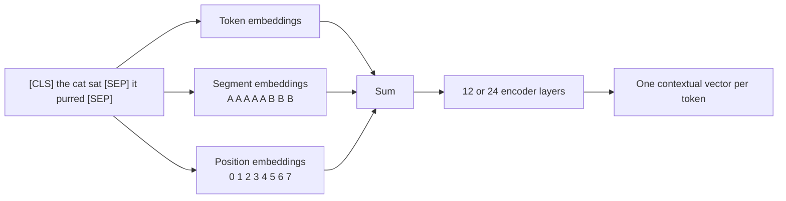
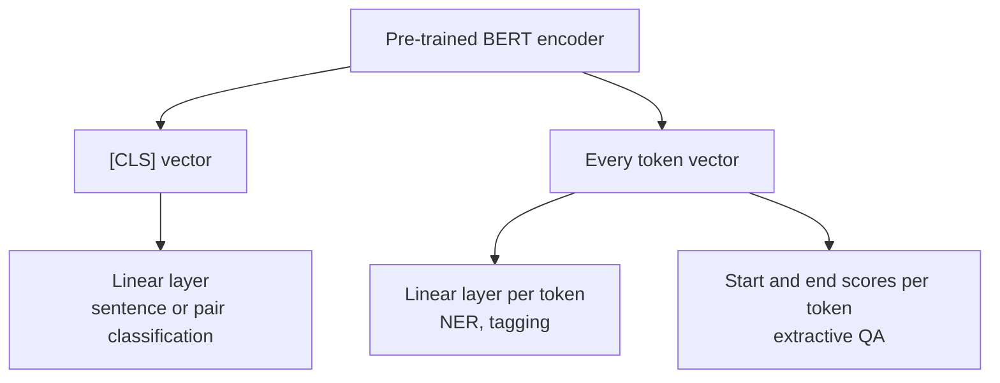

**BERT** (Bidirectional Encoder Representations from Transformers, Google, 2018) changed how NLP was done in practice. Before it, most teams trained a task-specific model from scratch, perhaps on top of static [word embeddings](/learn/nlp-fundamentals/word-embeddings). After it, the standard recipe became: take a large encoder pre-trained on unlabelled text, add a tiny task-specific layer, and fine-tune the whole thing on a few thousand labelled examples. BERT and its descendants still power a great deal of production NLP, because for classification, tagging, extractive question answering and embeddings, a compact encoder is often faster and cheaper than a generative LLM and just as accurate.

## Encoder-only and bidirectional

BERT is the [Transformer encoder](/learn/advanced-nlp/transformer-architecture) stack with no decoder. Every token attends to every other token in both directions, so each output vector is a **contextual embedding**: the vector for "bank" differs between "river bank" and "bank account". Compare [word2vec](/learn/nlp-fundamentals/word2vec), which gives "bank" one vector regardless of context.

| | BERT-base | BERT-large |
| --- | --- | --- |
| Encoder layers | 12 | 24 |
| Hidden size $d$ | 768 | 1024 |
| Attention heads | 12 | 16 |
| Maximum input length | 512 tokens | 512 tokens |

Text is split with a **WordPiece** subword tokenizer of around 30,000 pieces, so rare words become several pieces ("flooding" might become "flood" and "##ing", where `##` marks a continuation).

### The input representation

Each input vector is the sum of three learned embeddings: the **token** embedding, a **segment** embedding saying whether the token belongs to sentence A or sentence B, and a **position** embedding. Special tokens frame the input:

| Token | Purpose |
| --- | --- |
| `[CLS]` | Always first. Its final vector is used as a summary of the whole input for classification |
| `[SEP]` | Separates sentence A from sentence B, and ends the input |
| `[MASK]` | Replaces tokens the model must predict during pre-training |
| `[PAD]` | Fills short inputs up to the batch length; masked out of attention |



## Pre-training objective 1: masked language modelling

A standard left-to-right language model cannot be bidirectional: if a token could see the words after it, predicting the next word would be trivial. BERT's solution is the **masked language model** (MLM), a fill-in-the-blanks task. About 15% of the tokens are selected, the model sees a corrupted input, and it must predict the original tokens at the selected positions. The loss is computed only at those positions.

Of the selected tokens, 80% are replaced with `[MASK]`, 10% with a random token and 10% are left unchanged. The mix exists because `[MASK]` never appears during fine-tuning; if the model only ever had to predict at `[MASK]` positions, it would learn little about representing ordinary tokens. Keeping some tokens unchanged and corrupting others forces it to build a good representation of *every* position, since it cannot tell which ones will be tested.

```python
import random

def mask_for_mlm(tokens, vocab, rng, select_prob=0.15):
    inputs, labels = list(tokens), [None] * len(tokens)
    for i, tok in enumerate(tokens):
        if tok in ("[CLS]", "[SEP]") or rng.random() >= select_prob:
            continue                       # not selected: no loss at this position
        labels[i] = tok                    # the model must recover the original
        r = rng.random()
        if r < 0.8:
            inputs[i] = "[MASK]"
        elif r < 0.9:
            inputs[i] = rng.choice(vocab)  # random replacement
        # else: keep the original token unchanged
    return inputs, labels

sentence = ("[CLS] the river bank flooded after the storm so the town "
            "closed the bridge and opened a shelter near the station [SEP]").split()
vocab = ["apple", "run", "blue", "ocean", "quickly", "table"]
rng = random.Random(1)
inputs, labels = mask_for_mlm(sentence, vocab, rng)
print(" ".join(inputs))
for tok, inp, lab in zip(sentence, inputs, labels):
    if lab is not None:
        print(f"{tok:>8} -> input {inp:<8} label {lab}")
```

```output
[CLS] apple river bank flooded after the [MASK] so the town [MASK] the bridge and opened [MASK] shelter near the station [SEP]
     the -> input apple    label the
   storm -> input [MASK]   label storm
  closed -> input [MASK]   label closed
       a -> input [MASK]   label a
```

The model must predict "the" even though the input shows "apple". Over many random draws the proportions settle at the intended rates:

```python
from collections import Counter

counts, n_tokens = Counter(), 0
for _ in range(2000):
    inp, lab = mask_for_mlm(sentence, vocab, rng)
    for orig, i, l in zip(sentence, inp, lab):
        if orig in ("[CLS]", "[SEP]"):
            continue
        n_tokens += 1
        if l is not None:
            counts["mask" if i == "[MASK]" else "same" if i == orig else "random"] += 1

selected = sum(counts.values())
print(f"selected: {selected / n_tokens:.3f}")
for kind in ("mask", "random", "same"):
    print(f"{kind:>7}: {counts[kind] / selected:.3f}")
```

```output
selected: 0.150
   mask: 0.800
 random: 0.099
   same: 0.101
```

## Pre-training objective 2: next sentence prediction, and why it was dropped

BERT was also trained on **next sentence prediction** (NSP). Each input was a pair of segments; half the time B really followed A in the corpus, half the time B was a random segment from elsewhere. A classifier on the `[CLS]` vector predicted which. The motivation was that tasks such as question answering and natural language inference reason about relationships between two pieces of text.

Later work questioned it. The RoBERTa study (Facebook AI, 2019) trained without NSP, on longer contiguous text, and found downstream results matched or improved. The usual explanation is that NSP is too easy: a random segment usually comes from a different document about a different topic, so the model can solve the task by detecting topic shift instead of learning coherence. ALBERT replaced it with **sentence order prediction** (are these two consecutive segments in the right order?), which cannot be solved by topic alone. Most later encoders keep MLM, or a variant of it, and drop NSP.

> [!NOTE]
> RoBERTa's other changes, including more data, larger batches, longer training and choosing new masks dynamically each epoch rather than once in preprocessing, mattered as much as dropping NSP. The lesson that pre-training *recipe* matters as much as architecture applies to every model in this module.

## Fine-tuning: one encoder, many heads

To adapt BERT to a task, you add a small output layer (a **head**) and train everything end to end with a small learning rate for a few epochs.



| Task | Input format | Head |
| --- | --- | --- |
| Sentiment, topic, spam | `[CLS] text [SEP]` | Linear on `[CLS]` vector, softmax over classes |
| Natural language inference, paraphrase | `[CLS] A [SEP] B [SEP]` | Linear on `[CLS]` vector |
| Named entity recognition | `[CLS] text [SEP]` | Linear on every token vector, one label each |
| Extractive question answering | `[CLS] question [SEP] passage [SEP]` | Two scores per token: answer start and answer end |

With Hugging Face `transformers` (code only: it downloads model weights):

```python
from transformers import pipeline, AutoTokenizer, AutoModelForSequenceClassification

# MLM in action: predict the masked word
fill = pipeline("fill-mask", model="google-bert/bert-base-uncased")
for pred in fill("The river [MASK] flooded after the storm."):
    print(pred["token_str"], round(pred["score"], 3))

# a classification head on top of the encoder, ready to fine-tune
tokenizer = AutoTokenizer.from_pretrained("google-bert/bert-base-uncased")
model = AutoModelForSequenceClassification.from_pretrained(
    "google-bert/bert-base-uncased", num_labels=3)
batch = tokenizer(["Great service.", "Never again."], padding=True, return_tensors="pt")
logits = model(**batch).logits        # shape (2, 3); the head is randomly initialised
```

Loading a sequence-classification model prints a warning that some weights are newly initialised. That is expected: the head is new and must be trained. The [Hugging Face module](/learn/hugging-face-ecosystem/fine-tuning-models) covers the full fine-tuning loop.

> [!TIP]
> Fine-tuning is sensitive to the learning rate. The original paper searched small values around 2e-5 to 5e-5 with only a few epochs. Too high a rate can wreck the pre-trained knowledge (**catastrophic forgetting**) and leave the model predicting one class.

### Pitfalls

- **Raw `[CLS]` vectors make poor sentence embeddings.** Without fine-tuning, cosine similarity between `[CLS]` vectors is unreliable. For search and clustering use models trained for embeddings (sentence-transformers), as in the [RAG modules](/learn/rag-fundamentals/embedding-generation).
- **The 512-token limit.** Longer documents must be truncated or split into overlapping windows.
- **Labels and subwords.** For NER, a word split into several pieces needs a policy: label only the first piece, or all of them.

## Exercises

**1.** A batch has 32 sequences of 128 tokens each, two of which in every sequence are `[CLS]` and `[SEP]`. Roughly how many positions contribute to the MLM loss, and how many of those show `[MASK]` in the input?

<details>
<summary>Show solution</summary>

$32 \times 126 = 4032$ eligible tokens; 15% gives about 605 positions in the loss. About 80% of those, roughly 484, are shown as `[MASK]`; about 60 are random tokens and about 60 are unchanged.

</details>

**2.** Why would a model pre-trained with 100% `[MASK]` replacement transfer less well to fine-tuning?

<details>
<summary>Show solution</summary>

`[MASK]` never appears in fine-tuning or real inputs. If the loss only ever came from `[MASK]` positions, the model could put its effort into those positions and give less informative representations to ordinary tokens, which are exactly what fine-tuning uses. Random and unchanged replacements make every position a possible test.

</details>

**3.** Choose the input format and head for: detecting whether two support tickets describe the same problem.

<details>
<summary>Show solution</summary>

A sentence-pair classification: `[CLS] ticket A [SEP] ticket B [SEP]` with segment embeddings A and B, and a linear layer with two outputs on the `[CLS]` vector.

</details>

```quiz
[
  {
    "q": "What makes BERT bidirectional?",
    "options": [
      "It runs one LSTM forwards and one backwards",
      "It is an encoder with no causal mask, trained with masked language modelling so seeing both sides is not cheating",
      "It reads the text twice",
      "It uses next sentence prediction"
    ],
    "answer": 1,
    "why": "MLM hides the tokens to be predicted, so full self-attention over both sides of each position is allowed."
  },
  {
    "q": "Why did later models such as RoBERTa drop next sentence prediction?",
    "options": [
      "It was found unhelpful: removing it matched or improved downstream results, likely because it can be solved by spotting topic changes",
      "It made the model too large",
      "It required labelled data",
      "It only worked for English"
    ],
    "answer": 0,
    "why": "Random negative segments usually differ in topic, so NSP is an easy task that teaches little about coherence."
  },
  {
    "q": "For named entity recognition with BERT, where does the classification head attach?",
    "options": [
      "Only to the `[CLS]` vector",
      "To the `[SEP]` vector",
      "To the attention weights",
      "To every token's output vector"
    ],
    "answer": 3,
    "why": "NER needs one label per token, so a linear layer is applied to each token's contextual vector."
  },
  {
    "q": "Of the tokens selected for MLM, what fraction are replaced with `[MASK]`?",
    "options": [
      "15%",
      "50%",
      "80%",
      "100%"
    ],
    "answer": 2,
    "why": "About 15% of tokens are selected; of those, 80% become `[MASK]`, 10% a random token and 10% stay unchanged."
  }
]
```
