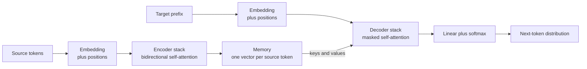
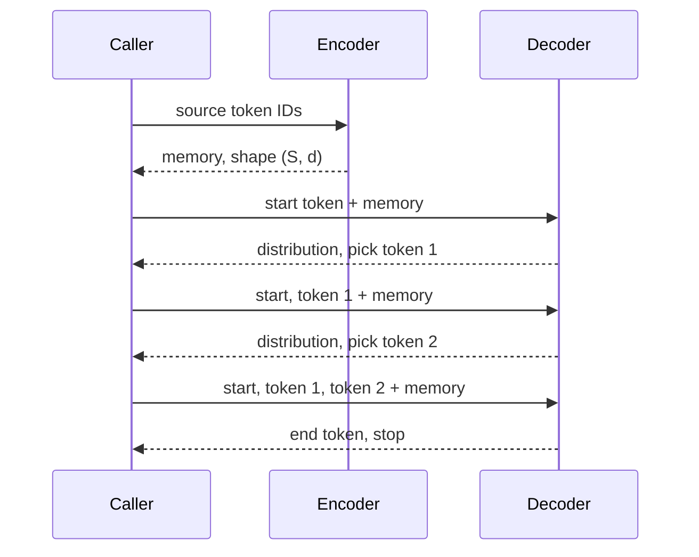

The **encoder-decoder** architecture splits a sequence-to-sequence model into two specialists. The encoder *reads*: it turns the input into a rich set of vectors, one per token, each informed by the whole input. The decoder *writes*: it produces the output one token at a time, consulting the encoder's vectors as it goes. This division appears everywhere in AI engineering, from translation and summarisation to speech recognition (audio encoder, text decoder) and image captioning (image encoder, text decoder). Knowing how the two halves connect, what flows between them and in what shape, is essential for using, fine-tuning and debugging models such as T5, BART and Whisper.

## The division of labour

The two halves have different jobs and therefore different constraints.

| | Encoder | Decoder |
| --- | --- | --- |
| Input | The full source sequence | The target tokens generated so far |
| Can see | Every source token, in both directions | Only earlier target positions, plus the entire encoder output |
| Runs | Once per input | Once per generated token at inference |
| Output | One vector per source token (the **memory**) | A distribution over the vocabulary for the next token |

The encoder is **bidirectional**: the vector for "bank" in "the river bank flooded" can draw on "river" and "flooded". The decoder is **causal**: when predicting position $t$ it may not look at positions after $t$, because at inference those do not exist yet. The bridge between them is **cross-attention**, covered in the [previous lesson](/learn/advanced-nlp/attention-mechanisms): every decoder layer queries the encoder memory.



In the RNN era, the "memory" was either a single vector (no attention) or the sequence of RNN hidden states (with attention). In a Transformer, it is the output of the last encoder layer, and the same memory is fed to every decoder layer.

## Following the shapes

Most bugs in encoder-decoder code are shape bugs, so trace a batch through the model. Let $B$ be the batch size, $S$ the source length, $T$ the target length, $d$ the model dimension and $V$ the vocabulary size.

| Stage | Tensor | Shape |
| --- | --- | --- |
| Source token IDs | `input_ids` | $(B, S)$ |
| Source embeddings | after embedding and positions | $(B, S, d)$ |
| Encoder memory | last encoder layer output | $(B, S, d)$ |
| Decoder input IDs | target shifted right | $(B, T)$ |
| Decoder hidden states | last decoder layer output | $(B, T, d)$ |
| Logits | after the output projection | $(B, T, V)$ |

Two things to notice. The memory keeps the source length $S$: nothing is compressed into one vector. And the logits have one row per target position, which is what allows the whole target to be trained in parallel.

## Training: shifting the target right

During training the decoder sees the reference target, offset by one position, and must predict the next token at every position. The decoder input is the target **shifted right** with a start token in front; the labels are the target itself.

```python
START, EOS = 0, 2
target = [17, 45, 9, EOS]                 # token IDs for "le chat dort </s>"

def shift_right(labels, start_id):
    return [start_id] + labels[:-1]

decoder_input = shift_right(target, START)
for t, (inp, lab) in enumerate(zip(decoder_input, target)):
    print(f"position {t}: decoder sees ...{inp:>3}  must predict {lab:>3}")
```

```output
position 0: decoder sees ...  0  must predict  17
position 1: decoder sees ... 17  must predict  45
position 2: decoder sees ... 45  must predict   9
position 3: decoder sees ...  9  must predict   2
```

A causal mask inside the decoder ensures that position 2 cannot peek at positions 3 onwards, so this single forward pass is equivalent to four separate prediction problems. Hugging Face seq2seq models do this shift for you when you pass `labels`: they build `decoder_input_ids` internally.

> [!WARNING]
> A common fine-tuning bug is shifting the labels yourself *and* letting the library shift them again. The model then learns to predict the token two positions ahead, and the loss looks reasonable while generation is garbage. Pass the unshifted target as `labels` and let the model handle it.

## Inference: encode once, decode many times

At inference the asymmetry between the halves becomes a performance feature. The encoder runs **once** over the source. The decoder then runs once per output token, each time reusing the same memory.



Implementations also cache the cross-attention keys and values computed from the memory (they never change during generation) and the self-attention keys and values of earlier target positions, so each step only processes the newest token. This is the [KV cache](/learn/advanced-llm-engineering/kv-caching) you will meet again in the LLM modules.

## Three architecture families

Removing one half gives the other two families of Transformer language models.

| Family | Halves used | Pre-training objective (typical) | Examples | Natural tasks |
| --- | --- | --- | --- | --- |
| Encoder-only | Encoder | Masked language modelling | BERT, RoBERTa | Classification, NER, extractive QA, embeddings |
| Decoder-only | Decoder without cross-attention | Next-token prediction | GPT family, most modern chat LLMs | Open-ended generation, anything phrased as text continuation |
| Encoder-decoder | Both | Denoising or span corruption | T5, BART, Marian translation models | Translation, summarisation, structured rewriting |

The [BERT](/learn/advanced-nlp/bert), [GPT](/learn/advanced-nlp/gpt-architecture) and [T5](/learn/advanced-nlp/t5) lessons take one representative each.

### When an encoder-decoder is a good choice

- **The input and output are clearly different things**: an article and its summary, an English sentence and its German translation, an audio clip and its transcript.
- **The input is long and the output short.** The source gets full bidirectional processing once; the decoder only needs to be as deep as the output requires.
- **You are fine-tuning a smaller model for one task.** Mid-sized encoder-decoder models fine-tune efficiently for translation and summarisation.

Decoder-only models handle the same tasks by concatenating source and target into one sequence ("Translate to German: ... German:"). Their simplicity, and how well they scale with one uniform objective, is why general-purpose LLMs mostly use that design.

## The architecture in PyTorch

PyTorch ships a complete encoder-decoder Transformer as `nn.Transformer`. This sketch shows how the pieces and masks fit together (it needs PyTorch, so no output is shown; the comments give the shapes):

```python
import torch
import torch.nn as nn

B, S, T, d, V = 2, 7, 5, 512, 1000
embed = nn.Embedding(V, d)
model = nn.Transformer(d_model=d, nhead=8, num_encoder_layers=6,
                       num_decoder_layers=6, dim_feedforward=2048, batch_first=True)
to_vocab = nn.Linear(d, V)

src_ids = torch.randint(0, V, (B, S))
tgt_ids = torch.randint(0, V, (B, T))                 # already shifted right
causal = nn.Transformer.generate_square_subsequent_mask(T)    # (T, T)

memory = model.encoder(embed(src_ids))                # (B, S, d)
hidden = model.decoder(embed(tgt_ids), memory, tgt_mask=causal)   # (B, T, d)
logits = to_vocab(hidden)                             # (B, T, V)
```

A real model also adds positional encodings to the embeddings and passes padding masks (`src_key_padding_mask` and `memory_key_padding_mask`) so that neither the encoder nor the cross-attention attends to padding. Calling `model.encoder` and `model.decoder` separately, as here, is exactly the "encode once, decode many times" split you need for generation.

> [!TIP]
> When debugging, print the shape of the memory and the logits first. If the memory's second dimension is not the source length, or the logits' second dimension is not the target length, the bug is in how you batched or masked the inputs.

## Exercises

**1.** A batch of 8 articles, padded to 512 tokens, is summarised with a model of dimension 768 and a vocabulary of 32,000. The summaries are padded to 64 tokens. Give the shapes of the encoder memory and the logits.

<details>
<summary>Show solution</summary>

Memory: $(8, 512, 768)$, one vector per source token. Logits: $(8, 64, 32000)$, one vocabulary distribution per target position.

</details>

**2.** Write `make_decoder_inputs(batch, start_id)` that applies `shift_right` to every target in a list of equal-length lists, and test it on `[[5, 6, 2], [7, 2, 1]]` with start ID 0 (here 1 is padding).

<details>
<summary>Show solution</summary>

```python
def make_decoder_inputs(batch, start_id):
    return [shift_right(labels, start_id) for labels in batch]

print(make_decoder_inputs([[5, 6, 2], [7, 2, 1]], 0))
```

```output
[[0, 5, 6], [0, 7, 2]]
```

In real training the padding positions in `labels` are also replaced by an ignore value (`-100` in Hugging Face and PyTorch's `CrossEntropyLoss` default) so they do not contribute to the loss.

</details>

**3.** For each task, choose encoder-only, decoder-only or encoder-decoder, and justify: (a) tagging product names in support tickets; (b) translating product manuals with a small, specialised model; (c) a general chat assistant.

<details>
<summary>Show solution</summary>

(a) Encoder-only: it is token classification, and bidirectional context helps decide each label. (b) Encoder-decoder: a clear source-to-target mapping, and a compact model fine-tuned for one language pair works well. (c) Decoder-only: open-ended generation of many kinds, framed as continuing a conversation, is what decoder-only LLMs are built for.

</details>

```quiz
[
  {
    "q": "Which part of an encoder-decoder Transformer may attend to all positions of its input in both directions?",
    "options": [
      "The decoder's self-attention",
      "The output projection",
      "The encoder's self-attention",
      "None of them"
    ],
    "answer": 2,
    "why": "The encoder is bidirectional because the whole source is available. The decoder's self-attention is causally masked."
  },
  {
    "q": "What is the shape of the encoder memory for a batch of B sources of length S with model dimension d?",
    "options": [
      "(B, S, d)",
      "(B, d)",
      "(S, S)",
      "(B, S, V)"
    ],
    "answer": 0,
    "why": "The Transformer keeps one vector per source token. There is no single-vector bottleneck."
  },
  {
    "q": "During generation, how often does the encoder run?",
    "options": [
      "Once per generated token",
      "Once per beam per token",
      "Twice: once forwards and once backwards",
      "Once per input, with its memory reused at every decoding step"
    ],
    "answer": 3,
    "why": "The source does not change while decoding, so the memory is computed once and reused."
  },
  {
    "q": "You pass already shifted labels to a Hugging Face seq2seq model as `labels`. What is the likely result?",
    "options": [
      "Training fails with a shape error",
      "The model learns to predict two positions ahead because the targets are shifted twice",
      "Nothing changes; shifting is idempotent",
      "The encoder ignores the source"
    ],
    "answer": 1,
    "why": "The model shifts `labels` internally to build decoder inputs, so a manual shift misaligns inputs and targets by an extra position."
  }
]
```
