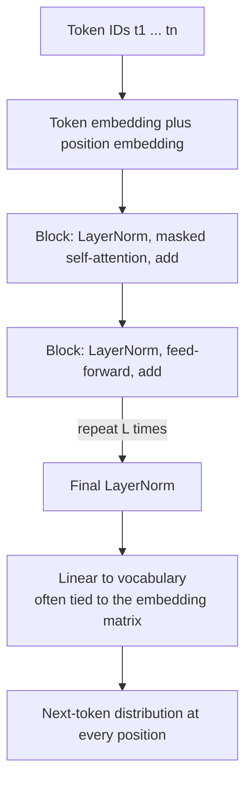
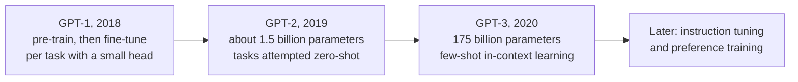

**GPT** (Generative Pre-trained Transformer, OpenAI, from 2018) took the opposite path from BERT. Instead of an encoder that sees everything and fills in blanks, it is a **decoder-only** Transformer that reads left to right and is trained on one deceptively simple task: predict the next token. That objective turned out to scale remarkably well. As models and datasets grew, next-token predictors became able to translate, summarise, answer questions and write code from instructions alone, and the decoder-only design became the template for most modern large language models. This lesson covers the architecture, the causal language-modelling objective, the generation loop and the scaling story. [Module 24](/learn/generative-ai-fundamentals/llm-fundamentals) builds on it for LLMs in general.

## Decoder-only: a Transformer with one half removed

Take the [Transformer](/learn/advanced-nlp/transformer-architecture) decoder and delete its cross-attention sub-layer, since there is no encoder to attend to. What is left is a stack of identical blocks, each with **masked self-attention** and a **feed-forward network**, each wrapped in a residual connection and layer normalisation.



Key details of the GPT family:

| Choice | GPT approach | Why |
| --- | --- | --- |
| Attention mask | Causal everywhere | Each position may only see itself and earlier positions |
| Normalisation | Pre-LN from GPT-2 onwards, plus a final layer norm | More stable training of deep stacks |
| Positions | Learned position embeddings in GPT-1 to 3; many later LLMs use rotary embeddings | The model needs order information |
| Tokenizer | Byte-level BPE | Any string can be encoded, with no unknown tokens |
| Output layer | Often tied to the input embedding | Saves parameters, and in practice works well |

## The causal language-modelling objective

Given a sequence of tokens $t_1, \dots, t_n$, the model is trained to maximise the probability of each token given all previous ones:

$$
\mathcal{L} = -\frac{1}{n-1} \sum_{i=2}^{n} \log P_\theta(t_i \mid t_1, \dots, t_{i-1})
$$

where $\theta$ are the model's parameters. Compare it with the [seq2seq objective](/learn/advanced-nlp/sequence-to-sequence-models): it is the same chain rule with no separate source, because the "source" is simply the beginning of the sequence.

Thanks to the causal mask, one forward pass over a sequence of length $n$ produces predictions at every position at once, so each training sequence yields $n - 1$ prediction problems. The labels are the input shifted left by one. Here is that loss in NumPy, with random logits standing in for a model's output:

```python
import numpy as np

rng = np.random.default_rng(0)
V = 6                                    # vocabulary size
tokens = np.array([0, 3, 1, 4, 2])       # one training sequence
logits = rng.normal(size=(len(tokens), V))    # model output: one row per position

inputs_logits = logits[:-1]              # positions 1..n-1 predict ...
targets = tokens[1:]                     # ... the next token

log_probs = inputs_logits - np.log(np.exp(inputs_logits).sum(axis=1, keepdims=True))
per_position = -log_probs[np.arange(len(targets)), targets]
print("loss per position:", per_position.round(3))
print("mean loss:", per_position.mean().round(3))
print("uniform guess:    ", np.log(V).round(3))
```

```output
loss per position: [1.847 1.207 1.636 2.534]
mean loss: 1.806
uniform guess:     1.792
```

An untrained model scores roughly like a uniform guess, $\log V$. Training drives the loss down. The exponential of the loss is the **perplexity**, a common way to report language-model quality: the effective number of tokens the model is choosing between.

> [!KEY]
> GPT's whole training signal is "predict the next token" on huge amounts of raw text. No labels are needed, which is why the data can be scaled to a large share of the public web, books and code.

## Generation: one token at a time

At inference the model is run in a loop. Feed the prompt, take the distribution at the *last* position, choose a token (greedily or by sampling), append it, and repeat until an end token or a length limit.

```trace
{
  "title": "the autoregressive generation loop (greedy)",
  "code": [
    "tokens = prompt_tokens",
    "while len(tokens) < max_len:",
    "    probs = model(tokens)[-1]     # distribution at the last position",
    "    nxt = argmax(probs)",
    "    tokens.append(nxt)",
    "    if nxt == EOS: break",
    "print(decode(tokens))"
  ],
  "steps": [
    { "line": 1, "vars": { "tokens": "[The, cat]" }, "note": "Start from the prompt. There is no separate encoder: the prompt is just the beginning of the sequence." },
    { "line": 3, "vars": { "tokens": "[The, cat]", "probs": "sat 0.41, is 0.22, ..." }, "note": "One forward pass. Only the last position's distribution is needed to extend the text." },
    { "line": 5, "vars": { "tokens": "[The, cat, sat]", "nxt": "sat" }, "note": "Greedy choice appended. The sequence is now one token longer." },
    { "line": 3, "vars": { "tokens": "[The, cat, sat]", "probs": "on 0.63, down 0.18, ..." }, "note": "The model runs again on the longer sequence. With a KV cache, only the new token is actually processed." },
    { "line": 5, "vars": { "tokens": "[The, cat, sat, on]", "nxt": "on" }, "note": "Appended again." },
    { "line": 6, "vars": { "tokens": "[The, cat, sat, on, EOS]", "nxt": "EOS" }, "note": "After further steps the model emits the end token and the loop stops." },
    { "line": 7, "vars": { "tokens": "[The, cat, sat, on, EOS]" }, "out": ["The cat sat on"], "note": "Decoded output. The probabilities here are illustrative." }
  ]
}
```

Recomputing attention over the whole sequence at every step would be wasteful, so implementations store each layer's keys and values for earlier positions: the [KV cache](/learn/advanced-llm-engineering/kv-caching). Choosing tokens by sampling rather than argmax is covered in [temperature](/learn/generative-ai-fundamentals/temperature) and [top-k and top-p sampling](/learn/generative-ai-fundamentals/top-k-and-top-p-sampling).

With Hugging Face `transformers` (code only: it downloads the small original GPT-2):

```python
from transformers import pipeline

generator = pipeline("text-generation", model="openai-community/gpt2")
result = generator("The Transformer architecture", max_new_tokens=30, do_sample=False)
print(result[0]["generated_text"])
```

## Every task is a continuation

A decoder-only model has no task-specific heads. Tasks are expressed in the text itself, and the model continues it.

| Task | Prompt the model continues |
| --- | --- |
| Translation | `English: The cat sleeps.` then `French:` |
| Summarisation | An article, then `TL;DR:` |
| Classification | `Review: Great service. Sentiment:` |
| Question answering | A passage, then `Q: ...` and `A:` |

This framing is why one pre-trained model can do many tasks. It is also why prompt design matters so much, the subject of [Module 26](/learn/prompt-engineering/zero-shot-prompting).

## From GPT-1 to GPT-3: the scaling story

The three original papers changed one thing at a time, mostly scale, and each revealed a new behaviour.



- **GPT-1** showed that generative pre-training followed by supervised fine-tuning beat many task-specific models, the same recipe BERT used with an encoder.
- **GPT-2** was trained on a larger, more diverse web corpus and showed that a sufficiently large language model could attempt tasks with no fine-tuning at all, just from a suitable prompt.
- **GPT-3** showed **in-context learning**: given a few worked examples in the prompt, the model performs the task, with no weight updates.

Modern assistants add instruction tuning and preference optimisation on top of this base, covered in [Module 43](/learn/advanced-llm-engineering/supervised-fine-tuning-sft).

### Scaling laws

Studies of language-model scaling found that the test loss falls smoothly and predictably, roughly as a power law, as you increase parameters, training tokens and compute, provided none of the three is the bottleneck. Later work on compute-optimal training (often called the "Chinchilla" result) concluded that many large models had been trained on too few tokens for their size, and that parameters and data should grow together.

A widely used rule of thumb estimates training compute as about $6ND$ floating-point operations, where $N$ is the number of parameters and $D$ the number of training tokens (roughly 2 for the forward pass and 4 for the backward pass, per parameter per token):

```python
def training_flops(n_params, n_tokens):
    return 6 * n_params * n_tokens

for n_params, n_tokens in [(125e6, 2.5e9), (1e9, 20e9), (7e9, 1e12)]:
    print(f"N={n_params:.3g}  D={n_tokens:.3g}  ->  {training_flops(n_params, n_tokens):.2e} FLOPs")
```

```output
N=1.25e+08  D=2.5e+09  ->  1.88e+18 FLOPs
N=1e+09  D=2e+10  ->  1.20e+20 FLOPs
N=7e+09  D=1e+12  ->  4.20e+22 FLOPs
```

The configurations are illustrative, but the arithmetic shows why training frontier models needs very large GPU clusters, and why inference cost, which grows with $N$ for every generated token, drives so much engineering.

> [!WARNING]
> A low pre-training loss does not mean the model is truthful. It means the model is good at predicting text that resembles its training data, which includes confident errors. Grounding and evaluation, covered in the RAG and safety modules, address this.

## Exercises

**1.** A batch has 16 sequences of 1,024 tokens. How many next-token predictions contribute to the loss in one training step?

<details>
<summary>Show solution</summary>

Each sequence of length 1,024 gives 1,023 predictions (the first token has nothing before it), so $16 \times 1023 = 16{,}368$ predictions.

</details>

**2.** Using `per_position` from the lesson, compute the perplexity of the random model and compare it with $V$.

<details>
<summary>Show solution</summary>

```python
print(np.exp(per_position.mean()).round(2), V)
```

```output
6.08 6
```

The untrained model is "choosing between" a number of tokens of the same order as the vocabulary size. A uniform guess would give exactly $V = 6$.

</details>

**3.** Why does a decoder-only model not need cross-attention to translate?

<details>
<summary>Show solution</summary>

The source sentence is placed at the start of the sequence and the translation is generated after it. Causal self-attention lets every target token attend to all the source tokens, because they come earlier in the same sequence. Self-attention over the concatenation plays the role cross-attention plays in an encoder-decoder.

</details>

```quiz
[
  {
    "q": "Which sub-layer does a GPT block lack compared with an original Transformer decoder block?",
    "options": [
      "The feed-forward network",
      "Layer normalisation",
      "Cross-attention",
      "Masked self-attention"
    ],
    "answer": 2,
    "why": "There is no encoder, so there is nothing to cross-attend to. Blocks keep masked self-attention and the FFN."
  },
  {
    "q": "How many next-token prediction problems does one sequence of n tokens provide in causal LM training?",
    "options": [
      "1",
      "n - 1",
      "n squared",
      "15% of n"
    ],
    "answer": 1,
    "why": "Every position except the first has a previous context and a next token to predict, and the causal mask lets all be computed in one pass."
  },
  {
    "q": "What did GPT-3 demonstrate most prominently?",
    "options": [
      "In-context learning: performing a task from a few examples in the prompt without weight updates",
      "That NSP is necessary",
      "That encoders outperform decoders on generation",
      "That fine-tuning is required for every task"
    ],
    "answer": 0,
    "why": "Few-shot prompting at scale was the headline result of GPT-3."
  },
  {
    "q": "According to the 6ND rule of thumb, what happens to training compute if you double both parameters and tokens?",
    "options": [
      "It doubles",
      "It stays the same",
      "It grows eightfold",
      "It quadruples"
    ],
    "answer": 3,
    "why": "Compute is proportional to N times D, so doubling each multiplies compute by 4."
  }
]
```
