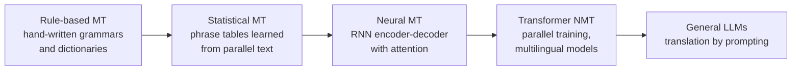

Machine translation (MT) is the task that shaped modern NLP. Sequence-to-sequence models, attention and the Transformer were all invented to translate better, and MT remains one of the most widely used AI applications: localising products, supporting customers in their own language, making documents searchable across languages. This lesson covers how neural translation systems are built and trained, the practical issues that still trip them up, and how translation quality is measured with **BLEU** and **chrF**, including why you should not take either number at face value.

## From rules to neural networks



**Rule-based** systems encoded grammar and vocabulary by hand: precise in narrow domains, brittle elsewhere. **Statistical MT** learned word alignments and phrase translation probabilities from **parallel corpora** (the same text in two languages) and combined them with a language model of the target language. **Neural MT** (NMT) replaced the pipeline of separately trained components with one network trained end to end, first [RNNs with attention](/learn/advanced-nlp/attention-mechanisms), then the [Transformer](/learn/advanced-nlp/transformer-architecture), which was introduced in a translation paper. Today, dedicated NMT models and general-purpose LLMs both translate well; dedicated models are smaller, faster and more predictable, while LLMs handle instructions about tone, terminology and format.

## Anatomy of a neural translation system


| Component | Role in translation |
| --- | --- |
| Subword tokenizer | BPE or SentencePiece splits words into pieces, so rare words, names and inflected forms can be produced from a fixed vocabulary. A vocabulary shared across both languages lets names and numbers be copied easily |
| Encoder-decoder | The standard [encoder-decoder](/learn/advanced-nlp/encoder-decoder-architecture) setup: the encoder reads the whole source, the decoder writes the target with cross-attention |
| Beam search | Translation has one intended meaning, so [beam search](/learn/advanced-nlp/sequence-to-sequence-models) with a small beam usually beats sampling |
| Language control | Multilingual models handle many language pairs in one network; a special token or a forced first decoder token tells the model which language to produce |

With Hugging Face `transformers` (code only: it downloads a model), a small dedicated translation model for one language pair:

```python
from transformers import pipeline

translator = pipeline("translation", model="Helsinki-NLP/opus-mt-en-de")
result = translator("The meeting has been moved to Thursday.", num_beams=4)
print(result[0]["translation_text"])
```

The `Helsinki-NLP/opus-mt-*` family covers many language pairs with one compact model each; multilingual models cover many pairs in a single, larger model.

## Training data and back-translation

NMT quality depends heavily on the amount and quality of parallel text. For major language pairs there is a lot of it (parliamentary proceedings, subtitles, web crawls); for **low-resource** languages there may be little.

**Back-translation** is the standard way to use plentiful *monolingual* text in the target language. Train a reverse model (target to source), use it to translate target-language sentences into synthetic sources, and add these synthetic pairs to the training data. The target side is genuine, fluent text, so the forward model learns to produce good output even though its inputs are a little noisy.

> [!TIP]
> Most translation errors in production are domain errors: product names translated when they should be kept, inconsistent terminology, the wrong level of formality. A glossary (enforced through a prompt for an LLM, or by fine-tuning on in-domain text) and a do-not-translate list often help more than switching models.

## Measuring quality with BLEU

**BLEU** (Bilingual Evaluation Understudy) compares a system's translations with human reference translations across a whole test set. For each $n$ from 1 to 4 it computes a **modified n-gram precision** $p_n$: the fraction of the system's n-grams that appear in the reference, with each n-gram's count clipped to its count in the reference so that repeating "the the the" earns nothing. It combines them with a geometric mean and multiplies by a **brevity penalty** (BP) so that very short outputs cannot score well by being precise:

$$
\text{BLEU} = \text{BP} \cdot \exp\!\left(\frac{1}{4}\sum_{n=1}^{4} \log p_n\right),
\qquad
\text{BP} = \begin{cases} 1 & c > r \\ e^{\,1 - r/c} & c \le r \end{cases}
$$

where $c$ is the total length of the system output and $r$ the total reference length. Scores are usually reported from 0 to 100. Here is a from-scratch corpus BLEU, applied to three systems:

```python
import math
from collections import Counter

def ngrams(seq, n):
    return Counter(tuple(seq[i:i + n]) for i in range(len(seq) - n + 1))

def corpus_bleu(hypotheses, references, max_n=4):
    matches, totals = [0] * max_n, [0] * max_n
    hyp_len = ref_len = 0
    for hyp, ref in zip(hypotheses, references):
        h, r = hyp.split(), ref.split()
        hyp_len, ref_len = hyp_len + len(h), ref_len + len(r)
        for n in range(1, max_n + 1):
            matches[n - 1] += sum((ngrams(h, n) & ngrams(r, n)).values())   # clipped
            totals[n - 1] += max(len(h) - n + 1, 0)
    precisions = [m / t if t else 0.0 for m, t in zip(matches, totals)]
    if min(precisions) == 0:
        return 0.0, precisions, 1.0
    geo_mean = math.exp(sum(math.log(p) for p in precisions) / max_n)
    bp = 1.0 if hyp_len > ref_len else math.exp(1 - ref_len / hyp_len)
    return 100 * bp * geo_mean, precisions, bp

refs = ["the cat is sitting on the mat",
        "he did not go to work today because he was ill"]
systems = {
    "A (near copy)":    ["the cat is sitting on the mat",
                         "he did not go to work today because he was sick"],
    "B (paraphrase)":   ["the cat sits on the mat",
                         "he stayed home from work today as he was ill"],
    "C (incomplete)":   ["the cat is on the mat",
                         "he did not go to work"],
}
for name, hyps in systems.items():
    score, p, bp = corpus_bleu(hyps, refs)
    print(f"{name:15} BLEU={score:5.1f}  p1-p4={[round(x, 2) for x in p]}  BP={bp:.3f}")
```

```output
A (near copy)   BLEU= 93.2  p1-p4=[0.94, 0.94, 0.93, 0.92]  BP=1.000
B (paraphrase)  BLEU=  0.0  p1-p4=[0.69, 0.43, 0.17, 0.0]  BP=1.000
C (incomplete)  BLEU= 46.2  p1-p4=[1.0, 0.9, 0.75, 0.5]  BP=0.607
```

System B is a correct, natural translation and scores zero, because it shares no 4-gram with the reference and one zero precision zeroes the geometric mean. System C drops "because he was ill" entirely, and the brevity penalty reduces its score but it still beats B by a wide margin.

### The limits of BLEU

- **One reference, many valid translations.** BLEU rewards matching the reference's wording, not being correct. More references help, but test sets usually have one.
- **Meaning-blind.** Dropping "not" changes the meaning completely and costs only a few n-grams.
- **Unreliable for single sentences.** BLEU was designed for corpus-level comparison; sentence-level scores are noisy and often zero without smoothing.
- **Tokenisation-dependent.** Scores change with how text is split into words, so numbers from different tools are not comparable. Use **sacreBLEU**, which fixes the tokenisation and reports a signature describing the settings.
- **Not comparable across languages or test sets.** A BLEU score is meaningful only relative to another system on the same data.

## chrF: character n-gram F-score

**chrF** compares **character** n-grams (typically up to length 6) instead of words, and combines precision and recall with an F-score that weights recall more heavily ($\beta = 2$):

$$
\text{chrF}_\beta = (1 + \beta^2)\,\frac{\text{chrP} \cdot \text{chrR}}{\beta^2 \cdot \text{chrP} + \text{chrR}}
$$

where chrP and chrR are character n-gram precision and recall averaged over n-gram lengths. Working at character level gives partial credit for inflected forms ("Katze" against "Katzen"), which matters for morphologically rich languages such as German, Finnish or Turkish. A simplified version:

```python
def chrf(hyp, ref, max_n=6, beta=2.0):
    h, r = hyp.replace(" ", ""), ref.replace(" ", "")
    precs, recs = [], []
    for n in range(1, max_n + 1):
        hn, rn = ngrams(h, n), ngrams(r, n)
        m = sum((hn & rn).values())
        precs.append(m / max(sum(hn.values()), 1))
        recs.append(m / max(sum(rn.values()), 1))
    p, rc = sum(precs) / max_n, sum(recs) / max_n
    if p + rc == 0:
        return 0.0
    return 100 * (1 + beta**2) * p * rc / (beta**2 * p + rc)

ref = "die Katzen schlafen im Haus"            # the cats sleep in the house
for hyp in ["die Katze schläft im Haus",       # the cat sleeps in the house
            "die Hunde bellen im Garten"]:     # the dogs bark in the garden
    print(f"{hyp:28} BLEU={corpus_bleu([hyp], [ref])[0]:5.1f}  chrF={chrf(hyp, ref):5.1f}")
```

```output
die Katze schläft im Haus    BLEU=  0.0  chrF= 52.1
die Hunde bellen im Garten   BLEU=  0.0  chrF= 18.1
```

Word-level BLEU gives both zero. chrF correctly ranks the near-miss (singular instead of plural) well above the unrelated sentence.

In practice, compute both with the `sacrebleu` package rather than your own code (not installed here, so no output is shown):

```python
import sacrebleu

hyps = ["the cat sits on the mat"]
refs = [["the cat is sitting on the mat"]]     # one list per reference set
print(sacrebleu.corpus_bleu(hyps, refs).score)
print(sacrebleu.corpus_chrf(hyps, refs).score)
```

> [!KEY]
> BLEU and chrF measure surface overlap with a reference. They are cheap and good for tracking a system over time on a fixed test set, but they cannot judge meaning. For decisions that matter, add a learned metric (such as COMET, which compares embeddings of source, output and reference) and human evaluation of a sample.

## Exercises

**1.** Explain why system C, which omits a whole clause, outscores system B, which is a complete and correct paraphrase.

<details>
<summary>Show solution</summary>

C's output is a near-subsequence of the reference, so its n-gram precisions are high at every order, and only the brevity penalty (0.607) reduces it. B shares no 4-gram with the reference, so $p_4 = 0$ and the geometric mean, hence BLEU, is 0. BLEU rewards matching wording, not completeness of meaning.

</details>

**2.** You must translate product pages into Finnish and compare two systems. Which automatic metric would you prefer, and what else would you do?

<details>
<summary>Show solution</summary>

chrF, or a learned metric such as COMET, rather than BLEU alone. Finnish is highly inflected, so word-level matching unfairly penalises correct forms. Also have native speakers rate a sample, and check product names and glossary terms specifically, since metrics barely notice them.

</details>

```quiz
[
  {
    "q": "What is the purpose of BLEU's brevity penalty?",
    "options": [
      "To penalise outputs that are longer than the reference",
      "To prevent short, highly precise outputs from scoring well",
      "To normalise scores across languages",
      "To give credit for synonyms"
    ],
    "answer": 1,
    "why": "BLEU is precision-based, so without the penalty a system could output only a few safe words and score highly."
  },
  {
    "q": "Why does back-translation help neural machine translation?",
    "options": [
      "It turns monolingual target-language text into synthetic parallel data with genuine, fluent targets",
      "It checks translations by translating them back",
      "It removes the need for a tokenizer",
      "It doubles the size of the model"
    ],
    "answer": 0,
    "why": "A reverse model creates synthetic sources for real target sentences, giving more training pairs."
  },
  {
    "q": "Which statement about BLEU is correct?",
    "options": [
      "It detects when a translation reverses the meaning",
      "Scores are directly comparable across different test sets and languages",
      "It is most reliable on single sentences",
      "Scores depend on tokenisation, which is why sacreBLEU standardises it"
    ],
    "answer": 3,
    "why": "Different word splitting changes n-gram matches. sacreBLEU fixes the settings and reports them in a signature."
  },
  {
    "q": "Why is chrF often preferred for morphologically rich languages?",
    "options": [
      "It ignores word order entirely",
      "It uses a neural network",
      "Character n-grams give partial credit to correctly stemmed but differently inflected words",
      "It weights precision more than recall"
    ],
    "answer": 2,
    "why": "Matching character sequences rewards near-misses such as Katze for Katzen. chrF actually weights recall more (beta = 2)."
  }
]
```
