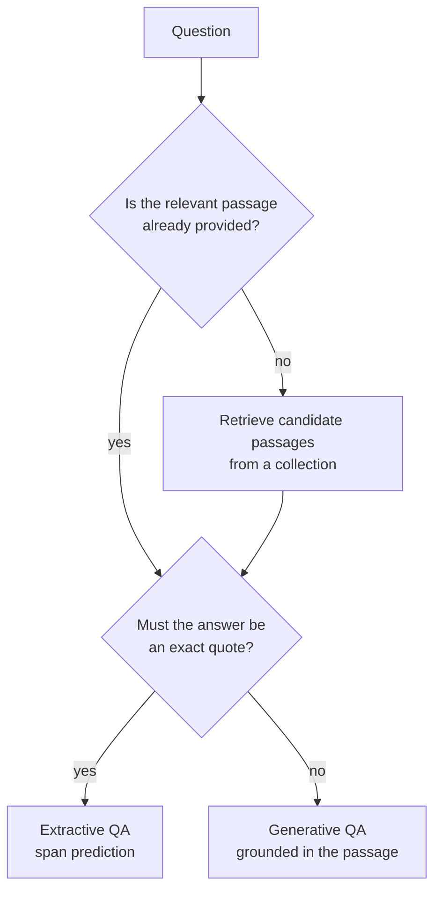
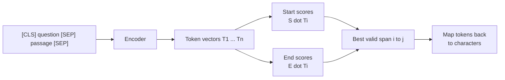
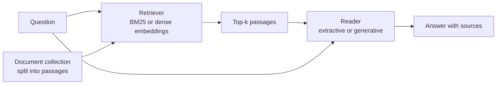

Question answering (QA) systems take a question in natural language and return an answer, rather than a list of documents to read. They sit behind help-centre assistants, internal knowledge tools, search engines' direct answers and most "chat with your documents" products. This lesson works through the main forms of QA in the order they developed: **extractive** QA, where a model points at the answer inside a given passage; **generative** QA, where a model writes the answer; and **open-domain** QA, where the system must first find the relevant passages. That last form leads directly to retrieval-augmented generation, the subject of [Module 28](/learn/rag-fundamentals/what-is-rag).

## Kinds of question answering

| Type | Given | Output | Typical model |
| --- | --- | --- | --- |
| Extractive (reading comprehension) | Question and one passage | A span copied from the passage | BERT-style encoder with a span head |
| Generative, open-book | Question and passages | Free text grounded in the passages | Seq2seq model or LLM |
| Generative, closed-book | Question only | Free text from the model's parameters | Large LLM |
| Open-domain | Question and a large collection | Retrieve passages, then extract or generate | Retriever plus reader |



## SQuAD-style data

The Stanford Question Answering Dataset (SQuAD) popularised extractive QA. Each example is a passage, a question and the answer given as text plus its **character offset** in the passage:

```json
{
  "context": "The bridge opened in June 1998 after two years of work.",
  "question": "When did the bridge open?",
  "answers": {"text": ["June 1998"], "answer_start": [21]}
}
```

SQuAD 2.0 added questions that **cannot** be answered from the passage, so a model must also learn to abstain rather than always pointing at something plausible. That ability matters in production: a confident wrong answer is usually worse than "I could not find that".

## Extractive QA as span prediction

With a [BERT](/learn/advanced-nlp/bert)-style encoder, the question and passage are packed into one input, `[CLS] question [SEP] passage [SEP]`. The QA head is tiny: two learned vectors, $S$ (start) and $E$ (end), each of size $d$. For every token $i$ with final hidden vector $T_i$, the model computes a start score $s_i = S^\top T_i$ and an end score $e_i = E^\top T_i$. Softmaxes over positions give start and end distributions, and training minimises the cross-entropy of the true start and end positions.

At inference, the answer is the span $(i, j)$ that maximises

$$
\text{score}(i, j) = s_i + e_j \quad \text{subject to } i \le j,\; j - i < L_{\max},\; i, j \text{ inside the passage}
$$

where $L_{\max}$ caps the answer length. Choosing the best start and the best end independently can produce an end before the start, or a span covering the question, so the search must respect these constraints.



Here is the span search over hand-written scores of the kind a fine-tuned model would produce:

```python
import numpy as np

tokens = ["[CLS]", "when", "did", "the", "bridge", "open", "?", "[SEP]",
          "the", "bridge", "opened", "in", "june", "1998", "after",
          "two", "years", "of", "work", ".", "[SEP]"]
context_start, context_end = 8, 19          # passage tokens are positions 8..19

start_logits = np.array([1.0, -2, -2, -2, -2, -2, -2, -3, -1.0, -0.5, 0.2,
                         1.5, 3.1, 2.0, -1.0, 1.8, 0.0, -1.0, -1.5, -3, -3])
end_logits = np.array([1.2, -2, -2, -2, -2, -2, -2, -3, -1.5, -1.0, -0.2,
                       -0.5, 1.0, 3.4, -1.0, 0.1, 2.5, -1.0, 0.5, -3, -3])

def best_span(start_logits, end_logits, lo, hi, max_len=5):
    best, best_score = None, -np.inf
    for i in range(lo, hi + 1):
        for j in range(i, min(i + max_len, hi + 1)):
            score = start_logits[i] + end_logits[j]
            if score > best_score:
                best, best_score = (i, j), score
    return best, best_score

(i, j), score = best_span(start_logits, end_logits, context_start, context_end)
null_score = start_logits[0] + end_logits[0]          # the "no answer" option
print("answer:", " ".join(tokens[i:j + 1]))
print(f"span score {score:.1f}, no-answer score {null_score:.1f}")
```

```output
answer: june 1998
span score 6.5, no-answer score 2.2
```

"two years" is a competing candidate (start 1.8, end 2.5), but "june 1998" wins. For SQuAD 2.0-style models, the span `[CLS]`-to-`[CLS]` represents "no answer": if its score beats the best real span by more than a threshold tuned on validation data, the system abstains.

### Practical details

- **Long passages.** Encoders have a length limit (often 512 tokens), so long documents are split into overlapping windows (a **stride**), each window is scored, and the best span across windows wins.
- **Offsets.** The tokenizer's offset mapping converts token positions back to character positions, so the answer is returned exactly as written in the original text.

With Hugging Face `transformers` the whole procedure is one pipeline (code only: it downloads a model fine-tuned on SQuAD):

```python
from transformers import pipeline

qa = pipeline("question-answering", model="distilbert/distilbert-base-cased-distilled-squad")
result = qa(question="When did the bridge open?",
            context="The bridge opened in June 1998 after two years of work.")
print(result)        # a dict with 'answer', 'score', 'start' and 'end'
```

## Evaluating extractive QA: exact match and F1

SQuAD-style evaluation compares the predicted answer with the reference answers after **normalisation**: lowercase, remove punctuation and the articles "a", "an" and "the", and collapse whitespace.

- **Exact match (EM)**: 1 if the normalised strings are identical, else 0.
- **F1**: token overlap between prediction and reference, as precision and recall over words. It gives partial credit.

When several reference answers exist, the best score over references is taken.

```python
import re
import string
from collections import Counter

def normalise(text):
    text = text.lower()
    text = "".join(ch for ch in text if ch not in string.punctuation)
    text = re.sub(r"\b(a|an|the)\b", " ", text)
    return " ".join(text.split())

def exact_match(pred, refs):
    return max(float(normalise(pred) == normalise(r)) for r in refs)

def f1(pred, refs):
    def single(p, r):
        p, r = normalise(p).split(), normalise(r).split()
        common = sum((Counter(p) & Counter(r)).values())
        if common == 0:
            return 0.0
        precision, recall = common / len(p), common / len(r)
        return 2 * precision * recall / (precision + recall)
    return max(single(pred, r) for r in refs)

refs = ["June 1998", "in June 1998"]
for pred in ["june 1998", "The bridge opened in June 1998.", "1998", "two years"]:
    print(f"{pred!r:35} EM={exact_match(pred, refs):.0f}  F1={f1(pred, refs):.2f}")
```

```output
'june 1998'                         EM=1  F1=1.00
'The bridge opened in June 1998.'   EM=0  F1=0.75
'1998'                              EM=0  F1=0.67
'two years'                         EM=0  F1=0.00
```

These metrics suit short factual answers. For generative QA, where a correct answer can be phrased many ways, they undercount badly, and evaluation moves towards human judgement, LLM judges and grounding checks, as covered in [RAG evaluation](/learn/rag-fundamentals/rag-evaluation).

## Generative QA

A generative model, such as a [T5](/learn/advanced-nlp/t5)-style seq2seq model or a [decoder-only LLM](/learn/advanced-nlp/gpt-architecture), *writes* the answer. That allows answers no single span contains: combining facts from two sentences, answering yes or no, explaining. It also reintroduces the risk seen in [summarisation](/learn/advanced-nlp/text-summarization): the answer can include claims the passage does not support.

**Closed-book** QA asks the model to answer from what it memorised during pre-training. Large LLMs answer many general questions this way, but their knowledge is frozen at training time, cannot see your private documents, and comes with no source to check. **Open-book** QA supplies the relevant text in the prompt and instructs the model to answer from it, which is far more reliable and auditable.

> [!WARNING]
> Closed-book answers can be fluent, specific and wrong. For anything factual that users will rely on, give the model the source text and ask it to cite or quote it, so a human or a checker can verify the answer.

## Open-domain QA: retrieve, then read

When the answer may be anywhere in thousands of documents, a **retriever-reader** system splits the job:



The **retriever** finds a handful of candidate passages quickly, originally with keyword scoring such as BM25, later with dense embeddings in which questions and passages that match lie close together. The **reader** is one of the QA models above, applied to those passages. Replace the reader with an LLM that generates an answer grounded in the retrieved text and you have **retrieval-augmented generation** (RAG). Every component of this diagram, from chunking to retrieval, ranking and evaluation, gets its own lesson in [RAG Fundamentals](/learn/rag-fundamentals/what-is-rag).

> [!KEY]
> Open-domain QA is only as good as its retriever: if the passage containing the answer is not retrieved, the best reader cannot recover it. Measure retrieval quality separately from answer quality.

## Exercises

**1.** Change `max_len` in `best_span` to 1. What answer is returned now, and why?

<details>
<summary>Show solution</summary>

```python
(i, j), score = best_span(start_logits, end_logits, context_start, context_end, max_len=1)
print(" ".join(tokens[i:j + 1]), round(score, 1))
```

```output
1998 5.4
```

Only single-token spans are allowed. Scoring each token as both start and end, "1998" wins with $2.0 + 3.4 = 5.4$. The length cap is a useful guard against runaway spans, but set too low it truncates real answers.

</details>

**2.** An internal help bot answers questions about company policy using a large LLM with no documents in the prompt. List two problems and the architectural fix.

<details>
<summary>Show solution</summary>

The model has never seen the internal policies, and even for public information its knowledge is frozen at training time and cannot be traced to a source, so it may answer confidently and wrongly. The fix is open-domain QA with retrieval: index the policy documents, retrieve relevant passages for each question, and have the model answer from them with citations, which is RAG.

</details>

```quiz
[
  {
    "q": "In BERT-style extractive QA, what does the model predict?",
    "options": [
      "The answer text, one token at a time",
      "A start position and an end position of the answer span within the passage",
      "Which of four given options is correct",
      "A yes or no label only"
    ],
    "answer": 1,
    "why": "Two learned vectors score each token as a possible start and end; the best valid span is the answer."
  },
  {
    "q": "What did SQuAD 2.0 add compared with SQuAD 1.1?",
    "options": [
      "Questions that cannot be answered from the passage, so models must learn to abstain",
      "Multiple-choice answers",
      "Questions in many languages",
      "Answers that are generated rather than extracted"
    ],
    "answer": 0,
    "why": "Unanswerable questions force a no-answer option, typically scored using the `[CLS]` position."
  },
  {
    "q": "Under SQuAD normalisation, what is the exact match score of prediction `The June 1998.` against reference `June 1998`?",
    "options": [
      "0, because of the extra word",
      "0.5",
      "It cannot be computed",
      "1, because lowercasing and removing punctuation and articles makes them identical"
    ],
    "answer": 3,
    "why": "Normalisation lowercases, strips punctuation and removes a, an and the, leaving `june 1998` in both."
  },
  {
    "q": "In a retriever-reader open-domain QA system, what happens if the retriever misses the passage containing the answer?",
    "options": [
      "The reader corrects it by searching the full collection",
      "The system automatically switches to closed-book mode",
      "The reader cannot find the correct answer from the given passages",
      "Nothing, because readers do not use retrieved passages"
    ],
    "answer": 2,
    "why": "The reader only sees what the retriever returns, so retrieval recall caps the system's accuracy."
  }
]
```
