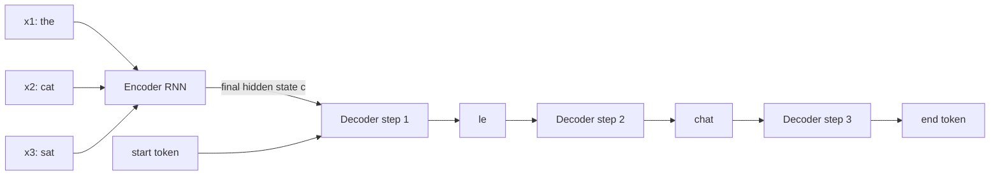

Many of the most useful language tasks take a sequence in and produce a different sequence out: an English sentence becomes a French one, a long article becomes three sentences, a question becomes an answer, a SQL request in plain words becomes a query. The input and output have different lengths, and there is no one-to-one correspondence between their positions. **Sequence-to-sequence** (seq2seq) models are the general framework for these problems. Every model in this module, from the original RNN translators to T5 and GPT, is a way of filling in the same probabilistic recipe, so it is worth understanding that recipe precisely before looking at architectures.

## From classification to generation

In [text classification](/learn/nlp-fundamentals/text-classification) the output is a single label from a fixed set. In [named entity recognition](/learn/nlp-fundamentals/named-entity-recognition) there is one label per input token, so input and output lengths match. Seq2seq removes both constraints.

| Task shape | Example | Output length |
| --- | --- | --- |
| Sequence to label | Sentiment analysis | 1 |
| Sequence to aligned labels | NER, part-of-speech tagging | Same as input |
| Sequence to sequence | Translation, summarisation, generative QA | Anything, decided by the model |

The key difficulty is the last column. The model must decide *how long* the output is, and it must produce tokens that depend on each other: the third word of a translation depends on which words came first.

## The probabilistic recipe

Let $x = (x_1, \dots, x_S)$ be the source tokens and $y = (y_1, \dots, y_T)$ the target tokens. A seq2seq model defines the conditional probability of the whole output by the chain rule of probability:

$$
P(y \mid x) = \prod_{t=1}^{T} P(y_t \mid y_{\lt t}, x)
$$

where $y_{\lt t}$ means all target tokens before position $t$. The model never predicts a whole sentence at once. It predicts a probability distribution over the vocabulary for the **next** token, given the source and the target tokens produced so far. Two special tokens make this work:

- A **start token** (often written `<bos>` or `<s>`) is fed in as the "previous token" at the first step.
- An **end token** (`<eos>` or `</s>`) is part of the vocabulary. When the model generates it, the output is finished. This is how the model chooses the output length.

> [!KEY]
> Every seq2seq model, whether RNN or Transformer, is a next-token predictor conditioned on the source. Architectures differ only in how they compute $P(y_t \mid y_{\lt t}, x)$.

## The classic RNN encoder-decoder

[Module 21](/learn/sequence-models/sequence-modeling) built the first neural version: an **encoder** RNN reads the source and compresses it into its final hidden state, and a **decoder** RNN, initialised from that state, generates the target one token at a time.



This design has one famous weakness: the **bottleneck**. Everything the decoder knows about a 50-word source sentence has to squeeze through one fixed-size vector $c$. Quality drops noticeably as sentences grow longer. The fix, attention, is the subject of the [next lesson](/learn/advanced-nlp/attention-mechanisms), and it led directly to the Transformer.

## Training with teacher forcing

Training maximises the log-probability of the reference output, which is the same as minimising the cross-entropy loss summed over target positions:

$$
\mathcal{L} = -\sum_{t=1}^{T} \log P(y_t^\ast \mid y_{\lt t}^\ast, x)
$$

where $y^\ast$ is the reference (ground-truth) target. Notice that the condition uses $y_{\lt t}^\ast$, the *reference* prefix, not what the model itself generated. This is **teacher forcing**: during training the decoder is always fed the correct previous token. It makes training stable and, for Transformers, lets all target positions be computed in parallel.

The cost is **exposure bias**. At inference time there is no reference, so the decoder consumes its own predictions. It has never seen its own mistakes during training, so one wrong token can push it into territory it handles badly. In practice, large models and good decoding make this manageable, but it explains why outputs sometimes drift or repeat.

## Decoding: greedy search and beam search

At inference you need the most probable output, $\arg\max_y P(y \mid x)$. Searching every possible sequence is impossible (the vocabulary might have 30,000 tokens, and the output dozens of positions), so you approximate.

**Greedy decoding** takes the single most likely token at each step. **Beam search** keeps the $k$ most probable partial sequences (the *beam*) at every step, extends each by every token, and keeps the best $k$ again. Greedy is beam search with $k = 1$.

Here is a toy "model": a table giving the next-token distribution for each prefix. It is small enough to see why greedy can be wrong.

```python
import math

# next-token probabilities for each prefix (a hand-made toy model)
model = {
    ():               {"the": 0.5, "a": 0.4, "<eos>": 0.1},
    ("the",):         {"cat": 0.35, "dog": 0.35, "<eos>": 0.3},
    ("a",):           {"cat": 0.9, "dog": 0.05, "<eos>": 0.05},
    ("the", "cat"):   {"<eos>": 1.0},
    ("the", "dog"):   {"<eos>": 1.0},
    ("a", "cat"):     {"<eos>": 1.0},
    ("a", "dog"):     {"<eos>": 1.0},
}

def greedy(model):
    seq, logp = (), 0.0
    while True:
        tok, p = max(model[seq].items(), key=lambda kv: kv[1])
        logp += math.log(p)
        if tok == "<eos>":
            return seq, round(math.exp(logp), 3)
        seq += (tok,)

def beam_search(model, k):
    beams = [((), 0.0)]              # (prefix, log-probability)
    finished = []
    while beams:
        candidates = []
        for seq, logp in beams:
            for tok, p in model[seq].items():
                new = (seq, logp + math.log(p)) if tok == "<eos>" else (seq + (tok,), logp + math.log(p))
                (finished if tok == "<eos>" else candidates).append(new)
        beams = sorted(candidates, key=lambda c: c[1], reverse=True)[:k]
    best = max(finished, key=lambda c: c[1])
    return best[0], round(math.exp(best[1]), 3)

print("greedy:", greedy(model))
print("beam 2:", beam_search(model, k=2))
```

```output
greedy: (('the', 'cat'), 0.175)
beam 2: (('a', 'cat'), 0.36)
```

Greedy commits to "the" because it is locally best (0.5 against 0.4), but every continuation of "the" is uncertain. Beam search keeps "a" alive and finds that "a cat" has a much higher total probability.

### Practical details of beam search

| Issue | What happens | Common fix |
| --- | --- | --- |
| Short-output bias | Every extra token multiplies in a probability below 1, so short outputs score higher | Divide the log-probability by length raised to a power (**length penalty**) |
| Repetition | Loops such as "the the the" | Block repeated n-grams, add a repetition penalty |
| Cost | $k$ times more decoder work than greedy | Small beams (4 to 5) are typical for translation and summarisation |
| Bland outputs | The most probable text is often generic | For open-ended generation, use **sampling** instead (covered in [Module 24](/learn/generative-ai-fundamentals/top-k-and-top-p-sampling)) |

> [!TIP]
> Use beam search for tasks with one "right" output, such as translation and summarisation. Use sampling for creative or conversational text, where diversity matters more than the single most likely string.

## Seq2seq in practice today

The recipe has outlived the RNN. Modern encoder-decoder Transformers such as BART and T5 are seq2seq models with attention instead of recurrence, and decoder-only models such as GPT treat the source as the first part of one long sequence. With the Hugging Face `transformers` library, a pre-trained seq2seq model and beam search take a few lines (this needs the library and a model download, so no output is shown):

```python
from transformers import AutoTokenizer, AutoModelForSeq2SeqLM

name = "Helsinki-NLP/opus-mt-en-de"           # an English-to-German translator
tokenizer = AutoTokenizer.from_pretrained(name)
model = AutoModelForSeq2SeqLM.from_pretrained(name)

inputs = tokenizer("The cat sat on the mat.", return_tensors="pt")
output_ids = model.generate(**inputs, num_beams=4, max_new_tokens=40)
print(tokenizer.decode(output_ids[0], skip_special_tokens=True))
```

`generate` runs the decoding loop for you: it feeds the start token, repeatedly computes the next-token distribution, maintains the beam, and stops at the end token or the length limit.

## Exercises

**1.** Using the toy `model` above, what does beam search with `k=1` return? Explain why without running it.

<details>
<summary>Show solution</summary>

Beam search with a beam of one keeps only the single best prefix at every step, which is exactly greedy decoding. It returns `('the', 'cat')` with probability 0.175. (The tie between "cat" and "dog" after "the" is broken by order: `sorted` is stable and "cat" comes first.)

</details>

**2.** Add a length penalty to `beam_search`: rank finished hypotheses by $\log P / L^{\alpha}$, where $L$ is the number of tokens including `<eos>`. Why does a larger $\alpha$ favour longer outputs?

<details>
<summary>Show solution</summary>

Change the final selection line:

```python
alpha = 1.0
best = max(finished, key=lambda c: c[1] / (len(c[0]) + 1) ** alpha)
```

Log-probabilities are negative. Dividing a negative number by a larger length brings it closer to zero, so long hypotheses are penalised less for having multiplied in more probabilities. Larger $\alpha$ strengthens that effect.

</details>

**3.** A colleague's summarisation model works well during training (low loss) but at inference sometimes repeats a phrase over and over. Name two likely contributing causes from this lesson and one fix for each.

<details>
<summary>Show solution</summary>

Exposure bias: the model was trained with teacher forcing and never learned to recover from its own errors, so once it repeats it keeps going. Decoding: greedy or beam search can lock into high-probability loops. Fixes include blocking repeated n-grams during beam search (for example `no_repeat_ngram_size` in `generate`), a repetition penalty, and more or better-matched training data.

</details>

```quiz
[
  {
    "q": "How does a seq2seq model decide how long its output is?",
    "options": [
      "The output length is fixed to the input length",
      "A separate regression head predicts the length first",
      "It generates an end-of-sequence token, which stops decoding",
      "The user must always supply the exact length"
    ],
    "answer": 2,
    "why": "The end token is part of the vocabulary. Generating it ends the sequence, so length is chosen token by token."
  },
  {
    "q": "What is teacher forcing?",
    "options": [
      "Feeding the decoder the reference previous token during training instead of its own prediction",
      "Training a small student model from a large teacher",
      "Forcing the decoder to copy the source",
      "Clipping gradients when they become too large"
    ],
    "answer": 0,
    "why": "Teacher forcing conditions each step on the ground-truth prefix. It stabilises and parallelises training but causes exposure bias."
  },
  {
    "q": "Why can beam search find a better sequence than greedy decoding?",
    "options": [
      "It uses a larger vocabulary",
      "It keeps several partial hypotheses, so a locally weaker first token can still win overall",
      "It retrains the model during decoding",
      "It always produces longer outputs"
    ],
    "answer": 1,
    "why": "Greedy commits to the best token at each step. Beam search keeps k candidates and compares total sequence probability."
  },
  {
    "q": "What was the main weakness of the original RNN encoder-decoder?",
    "options": [
      "It could not be trained with backpropagation",
      "It required labelled alignments between words",
      "It could only output one token",
      "The whole source had to pass through one fixed-size vector, which hurt long inputs"
    ],
    "answer": 3,
    "why": "The final encoder state is a bottleneck. Attention removed it by letting the decoder look at every encoder state."
  }
]
```
