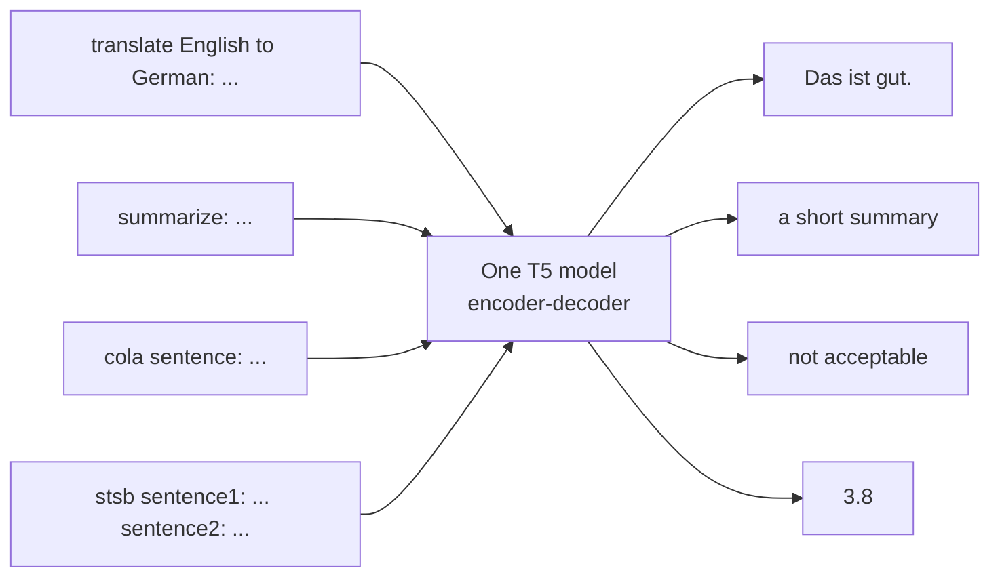
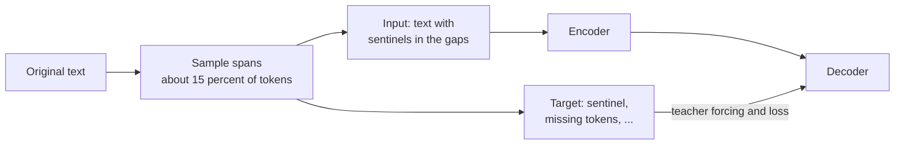

BERT needs a different head for every task, and GPT needs each task phrased as a continuation. **T5** (Text-to-Text Transfer Transformer, Google, introduced in the 2019 paper "Exploring the Limits of Transfer Learning with a Unified Text-to-Text Transformer") takes a third route: *every* task is text in, text out. Translation, summarisation, classification, even regression on similarity scores, all use the same encoder-decoder model, the same loss and the same decoding procedure. The only thing that changes is the text. For an AI engineer, T5 matters for two reasons: its family (including the instruction-tuned Flan-T5) remains a practical choice for compact, fine-tunable seq2seq models, and the text-to-text idea itself is how you should think about framing tasks for any generative model.

## The text-to-text framework

T5 marks the task with a short **prefix** in the input and expects the answer as output text. Some formats from the paper:

| Task | Input text | Target text |
| --- | --- | --- |
| Translation | `translate English to German: That is good.` | `Das ist gut.` |
| Summarisation | `summarize: state authorities dispatched emergency crews ...` | A short summary |
| Grammatical acceptability (CoLA) | `cola sentence: The course is jumping well.` | `not acceptable` |
| Sentence similarity (STS-B), a regression task | `stsb sentence1: ... sentence2: ...` | `3.8` |

Classification labels become words, and even the regression target is a number written as a string (the paper rounded scores to increments of 0.2 so that they form a small set of strings). One model can be trained on a mixture of all these tasks at once.



> [!KEY]
> In text-to-text, the task definition lives in the data, not in the architecture. Adding a new task means formatting new input and target strings; the model, loss and decoding stay the same.

## Architecture

T5 is an [encoder-decoder Transformer](/learn/advanced-nlp/encoder-decoder-architecture) very close to the original design, with a few changes that later models widely adopted:

- **Relative position bias** instead of absolute position embeddings. Each attention head adds a learned scalar to the attention score depending on the (bucketed) distance between query and key. Nearby distances get their own buckets; long distances share buckets that grow logarithmically.
- **Simplified layer normalisation**: activations are only rescaled, with no mean subtraction or additive bias, applied before each sub-layer (pre-LN).
- **Shared embeddings** between encoder input, decoder input and output layer, and a **SentencePiece** subword vocabulary shared across the languages it was trained on.

The paper released several sizes, from "small" through "base" and "large" to multi-billion-parameter versions, so the same recipe can be studied at different scales.

## Pre-training: span corruption

T5 was pre-trained on **C4** (the Colossal Clean Crawled Corpus), a large web crawl heavily filtered for English prose. The objective is **span corruption**, a denoising task suited to an encoder-decoder:

1. Choose about 15% of the tokens, grouped into contiguous spans (average length 3).
2. Replace each span in the input with a unique **sentinel token**: `<extra_id_0>`, `<extra_id_1>`, and so on.
3. The target lists each sentinel followed by the tokens it replaced, and ends with one final sentinel.

The paper's own example, implemented in a few lines:

```python
def span_corrupt(words, spans):
    """spans: list of (start, length) pairs, sorted and non-overlapping."""
    inputs, targets, pos = [], [], 0
    for k, (start, length) in enumerate(spans):
        sentinel = f"<extra_id_{k}>"
        inputs += words[pos:start] + [sentinel]
        targets += [sentinel] + words[start:start + length]
        pos = start + length
    inputs += words[pos:]
    targets.append(f"<extra_id_{len(spans)}>")      # final sentinel ends the target
    return " ".join(inputs), " ".join(targets)

words = "Thank you for inviting me to your party last week .".split()
inp, tgt = span_corrupt(words, [(2, 2), (8, 1)])
print("input: ", inp)
print("target:", tgt)
```

```output
input:  Thank you <extra_id_0> me to your party <extra_id_1> week .
target: <extra_id_0> for inviting <extra_id_1> last <extra_id_2>
```

The encoder sees the corrupted text with both left and right context, like BERT. The decoder generates only the missing pieces, labelled by sentinel so it knows which gap each belongs to.



### Why spans, and why not reconstruct everything?

Compare the alternatives on a 512-token input:

```python
n, rate, mean_span = 512, 0.15, 3
noise = round(n * rate)                      # corrupted tokens
n_spans = round(noise / mean_span)
target_len = noise + n_spans + 1             # tokens + one sentinel per span + final sentinel
input_len = n - noise + n_spans              # kept tokens + one sentinel per span

print(f"span corruption: input {input_len} tokens, target {target_len} tokens")
print(f"full reconstruction (BART-style): input {n} tokens, target {n} tokens")
```

```output
span corruption: input 461 tokens, target 104 tokens
full reconstruction (BART-style): input 512 tokens, target 512 tokens
```

The decoder is the expensive half during training, because its loss is computed per target token. Predicting roughly a fifth of the tokens instead of all of them makes pre-training markedly cheaper, and the paper found that it performed as well as or better than the alternatives it compared. Masking whole spans also forces the model to predict multi-token phrases, not just isolated words that are easy to guess from neighbours.

| Objective | Model | Input | Target |
| --- | --- | --- | --- |
| Masked LM | BERT (encoder) | Tokens replaced by `[MASK]` | Original tokens at masked positions only (via a classifier) |
| Causal LM | GPT (decoder) | Text | The same text shifted by one |
| Denoising reconstruction | BART (encoder-decoder) | Corrupted text | The full original text |
| Span corruption | T5 (encoder-decoder) | Text with sentinels | Only the missing spans |

The T5 paper is also known for its systematic comparison of architectures, objectives, datasets and transfer strategies within one framework. Its broad conclusions were that an encoder-decoder trained with a denoising objective worked best in its setting, that clean and large pre-training data matters, and that scaling up model size and training helps steadily.

## Using T5 and Flan-T5

With Hugging Face `transformers` (code only: it downloads model weights). The original checkpoints expect the task prefixes they were trained with:

```python
from transformers import AutoTokenizer, T5ForConditionalGeneration

tok = AutoTokenizer.from_pretrained("google-t5/t5-small")
model = T5ForConditionalGeneration.from_pretrained("google-t5/t5-small")

text = "translate English to German: The house is wonderful."
ids = tok(text, return_tensors="pt").input_ids
out = model.generate(ids, max_new_tokens=40, num_beams=4)
print(tok.decode(out[0], skip_special_tokens=True))
```

**Flan-T5** is T5 further fine-tuned on a large collection of tasks phrased as natural-language instructions. It responds to plain instructions such as "Summarise this review in one sentence:" rather than fixed prefixes, and is a reasonable small baseline before reaching for a large LLM. Swap the checkpoint for `google/flan-t5-base` to try it. Related variants include **mT5** (multilingual) and **ByT5** (operates on raw bytes, with no tokenizer vocabulary).

### Fine-tuning on your own task

Because everything is text, preparing data is just writing pairs of strings:

```python
examples = [
    {"input": "classify ticket: My card was charged twice.", "target": "billing"},
    {"input": "classify ticket: The app crashes on login.", "target": "technical"},
]
batch = tok([e["input"] for e in examples], text_target=[e["target"] for e in examples],
            padding=True, return_tensors="pt")
loss = model(**batch).loss          # labels are in batch["labels"]; the model shifts them
```

When padding targets for real training, replace pad token IDs in the labels with `-100` so the loss ignores them (Hugging Face's `DataCollatorForSeq2Seq` does this for you).

> [!WARNING]
> A text-to-text classifier can generate a string that is not one of your labels, such as "billing issue" instead of "billing". Map outputs back to the label set (exact match, then a fallback), or score each candidate label's probability and pick the best, rather than trusting the raw string. Separately, some T5 checkpoints are known to overflow in float16; prefer bfloat16 or float32 if you see NaN losses.

## Exercises

**1.** Apply `span_corrupt` to "the quick brown fox jumps over the lazy dog" with spans `[(1, 2), (6, 1)]`. Write down the input and target before running it.

<details>
<summary>Show solution</summary>

```python
print(span_corrupt("the quick brown fox jumps over the lazy dog".split(), [(1, 2), (6, 1)]))
```

```output
('the <extra_id_0> fox jumps over <extra_id_1> lazy dog', '<extra_id_0> quick brown <extra_id_1> the <extra_id_2>')
```

</details>

**2.** Design text-to-text input and target formats for named entity recognition on "Ada Lovelace worked in London.", extracting people and locations.

<details>
<summary>Show solution</summary>

One workable format: input `extract entities: Ada Lovelace worked in London.`, target `person: Ada Lovelace; location: London`. The target must be easy to parse back into structured data, consistent across examples, and should have an explicit empty form (such as `none`) when there are no entities.

</details>

**3.** Why did T5 write the STS-B similarity score as a string rounded to 0.2 instead of adding a regression head?

<details>
<summary>Show solution</summary>

To keep the framework uniform: the same model, cross-entropy loss and decoding apply to every task. Rounding turns the continuous target into a small set of strings the decoder can learn to generate; the cost is a little precision.

</details>

```quiz
[
  {
    "q": "In T5's text-to-text framework, how is a classification task such as acceptability judgement handled?",
    "options": [
      "A linear classification head is added on the encoder",
      "The model generates the label as text, for example `not acceptable`",
      "The task is skipped because T5 only generates",
      "A separate model is trained per label"
    ],
    "answer": 1,
    "why": "Labels are strings in the target. The same seq2seq model and loss handle every task."
  },
  {
    "q": "In span corruption, what does the target contain?",
    "options": [
      "The full original text",
      "The input shifted by one token",
      "Only a binary label",
      "Each sentinel followed by the tokens it replaced, plus a final sentinel"
    ],
    "answer": 3,
    "why": "Only the missing spans are generated, which keeps targets short and training cheaper."
  },
  {
    "q": "How does T5 represent token positions?",
    "options": [
      "Fixed sinusoidal encodings added to embeddings",
      "It has no position information",
      "A learned relative position bias added to attention scores, by bucketed distance",
      "Learned absolute position embeddings up to 512"
    ],
    "answer": 2,
    "why": "Each head adds a learned scalar depending on the query-key distance bucket."
  },
  {
    "q": "A fine-tuned T5 classifier outputs `billing issue` when the label set is billing and technical. What is a sound fix?",
    "options": [
      "Map generated text back to the label set, or score each candidate label and pick the most probable",
      "Switch to greedy decoding, which can only produce valid labels",
      "Increase max_new_tokens",
      "Remove the task prefix"
    ],
    "answer": 0,
    "why": "Free generation can drift from the label vocabulary; constraining or scoring candidates guarantees a valid label."
  }
]
```
