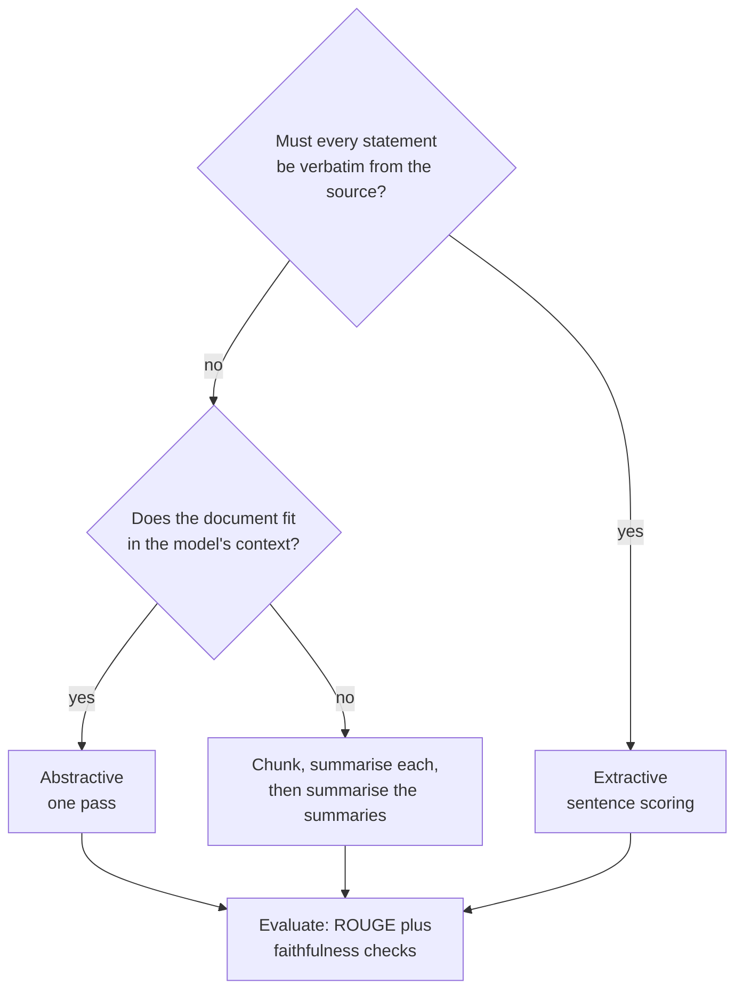
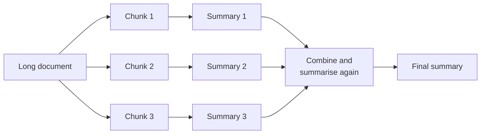

Summarisation turns a long text into a short one that keeps what matters: a meeting transcript into action items, a support thread into a two-line handover, a 40-page report into an executive summary. It is one of the most requested features in AI products, and one of the easiest to get subtly wrong, because a fluent summary can still leave out the key point or state something the source never said. This lesson covers the two families of methods, extractive and abstractive, how to handle documents longer than a model's context, and how to evaluate summaries with ROUGE while understanding exactly what ROUGE cannot tell you.

## Extractive versus abstractive

| | Extractive | Abstractive |
| --- | --- | --- |
| Output | Sentences copied from the source | Newly generated text |
| Typical method | Score sentences, pick the best | Seq2seq model or LLM |
| Fluency | Can be choppy; pronouns may lose their referents | Usually fluent |
| Faithfulness | Every sentence exists in the source | Can **hallucinate** facts not in the source |
| Compression | Limited: whole sentences only | Can merge and rephrase |
| Cost | Very cheap, no GPU needed | Model inference |

Extractive methods are a strong, safe baseline and remain useful where verbatim wording matters (legal and medical text, quotes). Abstractive methods produce the summaries people actually want to read, at the price of a faithfulness risk you must evaluate.



## An extractive summariser in a few lines

A classic approach scores each sentence by how central it is to the document. Represent sentences as [TF-IDF](/learn/nlp-fundamentals/tf-idf) vectors, compute the document's average vector (its centroid), and keep the sentences most similar to it.

```python
import numpy as np
from sklearn.feature_extraction.text import TfidfVectorizer

article = """The city council approved a new budget for public transport on Monday.
The plan adds forty electric buses and extends night services on three routes.
Council members debated the cost for more than four hours.
Supporters said the electric buses would cut emissions and noise in the city centre.
Critics argued that fares should be frozen before new services are added.
The first electric buses are expected to enter service next spring.
A local bakery also celebrated its fiftieth anniversary on Monday."""

sentences = [s.strip() for s in article.split("\n") if s.strip()]

def extractive_summary(sentences, k=2):
    tfidf = TfidfVectorizer(stop_words="english").fit_transform(sentences)
    centroid = np.asarray(tfidf.mean(axis=0))         # the "average" sentence
    scores = (tfidf @ centroid.T).ravel()             # similarity to the centre
    top = sorted(np.argsort(scores)[::-1][:k])        # best k, in original order
    return [sentences[i] for i in top], scores

summary, scores = extractive_summary(sentences, k=2)
for s, sc in zip(sentences, scores):
    print(f"{sc:.3f}  {s[:55]}")
print()
print(" ".join(summary))
```

```output
0.205  The city council approved a new budget for public trans
0.203  The plan adds forty electric buses and extends night se
0.160  Council members debated the cost for more than four hou
0.200  Supporters said the electric buses would cut emissions 
0.173  Critics argued that fares should be frozen before new s
0.191  The first electric buses are expected to enter service 
0.159  A local bakery also celebrated its fiftieth anniversary

The city council approved a new budget for public transport on Monday. The plan adds forty electric buses and extends night services on three routes.
```

The off-topic bakery sentence scores lowest, and the two sentences carrying the main news win. Keeping the selected sentences in their original order makes the summary read more naturally. Other extractive methods include graph-based ranking (TextRank, which runs PageRank over a sentence-similarity graph) and fine-tuned BERT-style classifiers that label each sentence "keep" or "drop". For news, simply taking the first three sentences (the **lead-3** baseline) is surprisingly hard to beat, because journalists put the key facts first.

## Abstractive summarisation with seq2seq models

Abstractive summarisation is a [sequence-to-sequence](/learn/advanced-nlp/sequence-to-sequence-models) task: the article is the source, the summary is the target. Encoder-decoder models such as BART and [T5](/learn/advanced-nlp/t5), fine-tuned on article-summary pairs, were the standard approach before large instruction-following LLMs, and they remain cheap, fast options. With Hugging Face `transformers` (code only: it downloads a large model):

```python
from transformers import pipeline

summarizer = pipeline("summarization", model="facebook/bart-large-cnn")
result = summarizer(article, max_length=60, min_length=15, do_sample=False)
print(result[0]["summary_text"])
```

The `max_length` and `min_length` arguments are in tokens and bound the generated summary. A model fine-tuned on news, like this one, writes news-style summaries; for meeting notes or code reviews, fine-tune on your own domain or use an instruction-following LLM with a prompt that specifies length, audience and format ("Summarise for an on-call engineer in at most three bullet points").

## Documents longer than the context window

Encoder-decoder summarisers often accept only around 512 to 1,024 input tokens, and even LLMs with long context windows cost more and can miss details buried in the middle. The standard workaround is **map-reduce** summarisation:



Split at natural boundaries (sections, paragraphs), summarise each chunk independently (the *map* step, which can run in parallel), then summarise the concatenated summaries (the *reduce* step), repeating if they are still too long. An alternative is **refine**: summarise chunk 1, then repeatedly update the running summary with each next chunk. Refine preserves narrative flow but is sequential and lets early content dominate. Chunking strategies are covered in depth in the [RAG module](/learn/rag-fundamentals/chunking-strategies).

## Evaluating with ROUGE

**ROUGE** (Recall-Oriented Understudy for Gisting Evaluation) compares a candidate summary with one or more human-written reference summaries by counting overlapping units:

- **ROUGE-N**: overlap of n-grams. ROUGE-1 uses single words, ROUGE-2 word pairs.
- **ROUGE-L**: based on the **longest common subsequence** (LCS), words appearing in the same order but not necessarily adjacent.

For ROUGE-N, with $C$ the candidate's n-grams, $R$ the reference's, and matches clipped so each n-gram counts at most as often as it appears in both:

$$
\text{recall} = \frac{\text{matches}}{|R|}, \qquad
\text{precision} = \frac{\text{matches}}{|C|}, \qquad
F_1 = \frac{2 \cdot \text{precision} \cdot \text{recall}}{\text{precision} + \text{recall}}
$$

Here is a from-scratch implementation applied to four candidates:

```python
from collections import Counter

def tokens(text):
    return text.lower().replace(".", "").replace(",", "").split()

def ngrams(toks, n):
    return Counter(tuple(toks[i:i + n]) for i in range(len(toks) - n + 1))

def rouge_n(candidate, reference, n=1):
    c, r = ngrams(tokens(candidate), n), ngrams(tokens(reference), n)
    overlap = sum((c & r).values())                    # clipped matches
    if overlap == 0:
        return 0.0
    p, rec = overlap / sum(c.values()), overlap / sum(r.values())
    return 2 * p * rec / (p + rec)

def lcs_length(a, b):
    table = [[0] * (len(b) + 1) for _ in range(len(a) + 1)]
    for i in range(len(a)):
        for j in range(len(b)):
            table[i + 1][j + 1] = (table[i][j] + 1 if a[i] == b[j]
                                   else max(table[i][j + 1], table[i + 1][j]))
    return table[-1][-1]

def rouge_l(candidate, reference):
    c, r = tokens(candidate), tokens(reference)
    lcs = lcs_length(c, r)
    if lcs == 0:
        return 0.0
    p, rec = lcs / len(c), lcs / len(r)
    return 2 * p * rec / (p + rec)

reference = "The council approved forty electric buses and longer night services."
candidates = {
    "close copy": "The council approved forty electric buses and night services.",
    "paraphrase": "Councillors voted for 40 battery-powered buses and later evening routes.",
    "off-topic":  "A bakery celebrated fifty years of business.",
    "wrong fact": "The council rejected forty electric buses and longer night services.",
}
print(f"{'':11} {'R-1':>6} {'R-2':>6} {'R-L':>6}")
for name, cand in candidates.items():
    print(f"{name:11} {rouge_n(cand, reference, 1):6.3f} "
          f"{rouge_n(cand, reference, 2):6.3f} {rouge_l(cand, reference):6.3f}")
```

```output
               R-1    R-2    R-L
close copy   0.947  0.824  0.947
paraphrase   0.200  0.111  0.200
off-topic    0.000  0.000  0.000
wrong fact   0.900  0.778  0.900
```

Look at the paraphrase and the wrong fact. The paraphrase is a perfectly good summary and scores poorly, because it shares few exact words with the reference. The "wrong fact" candidate reverses the meaning ("rejected" instead of "approved") and scores almost as well as the close copy.

> [!WARNING]
> ROUGE measures word overlap with a reference, not correctness or quality. It penalises valid paraphrases and barely notices a negated or invented fact. Use it to compare systems on the same data and to catch regressions, never as the sole evidence that summaries are good.

In practice, use a maintained implementation such as the `rouge-score` package (`rouge_scorer.RougeScorer(["rouge1", "rouge2", "rougeL"], use_stemmer=True)`), which handles tokenisation and stemming consistently, so your numbers are comparable with others'.

### Beyond ROUGE: faithfulness

The failure that matters most for abstractive summaries is **unfaithfulness**: statements not supported by the source. Ways to check it:

| Method | Idea |
| --- | --- |
| Human review | Annotators mark unsupported claims. The gold standard, but slow |
| Entailment-based checks | A natural language inference model tests whether the source entails each summary sentence |
| Question-based checks | Generate questions from the summary, answer them from the source, compare |
| LLM as judge | Ask a strong LLM to list claims not supported by the source; validate the judge against human labels first ([model evaluation](/learn/working-with-llms/model-evaluation)) |

## Exercises

**1.** Change `k` in `extractive_summary` to 3. Which sentence is added, and is it a good addition?

<details>
<summary>Show solution</summary>

```python
print(" ".join(extractive_summary(sentences, k=3)[0]))
```

```output
The city council approved a new budget for public transport on Monday. The plan adds forty electric buses and extends night services on three routes. Supporters said the electric buses would cut emissions and noise in the city centre.
```

The sentence about emissions and noise is added (score 0.200). It is relevant supporting detail, though one could argue the start date ("next spring") is more useful to a reader. Centrality is not the same as importance.

</details>

**2.** A product team reports that their new summariser improved ROUGE-L and asks to ship it. What would you check first?

<details>
<summary>Show solution</summary>

Faithfulness and usefulness on real inputs: sample outputs and check them against the sources for unsupported or reversed claims, and confirm that key facts (owners, dates, numbers) are kept. Also check that the ROUGE gain is not just from longer outputs, since longer summaries tend to raise recall.

</details>

```quiz
[
  {
    "q": "What is the main risk of abstractive summarisation that extractive summarisation avoids?",
    "options": [
      "Summaries that are too short",
      "High computational cost during evaluation",
      "Generating statements not supported by the source",
      "Inability to handle English text"
    ],
    "answer": 2,
    "why": "Extractive methods copy source sentences, so every statement exists in the source; abstractive models can hallucinate."
  },
  {
    "q": "What does ROUGE-L measure?",
    "options": [
      "Overlap based on the longest common subsequence of words between candidate and reference",
      "The length of the summary",
      "Whether the summary is grammatical",
      "The number of named entities kept"
    ],
    "answer": 0,
    "why": "ROUGE-L uses the LCS: shared words in the same order, not necessarily contiguous."
  },
  {
    "q": "A summary that negates the key fact of the reference but otherwise copies its words would typically get what ROUGE score?",
    "options": [
      "Zero",
      "A score close to that of a correct summary",
      "A negative score",
      "An error, because ROUGE detects contradictions"
    ],
    "answer": 1,
    "why": "ROUGE counts word overlap; changing one word barely moves the score, which is why faithfulness needs separate checks."
  },
  {
    "q": "How does map-reduce summarisation handle a document too long for the model?",
    "options": [
      "It truncates the document to the first chunk",
      "It switches to extractive summarisation",
      "It increases the model's context window",
      "It summarises chunks independently, then summarises the combined summaries"
    ],
    "answer": 3,
    "why": "The map step summarises each chunk (in parallel), the reduce step summarises those summaries."
  }
]
```
