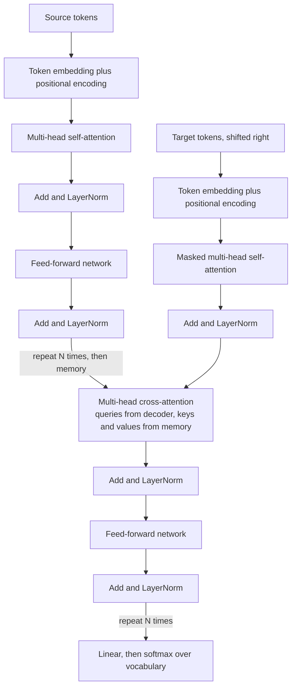

In 2017 the paper "Attention Is All You Need" (Vaswani and colleagues) proposed a translation model with no recurrence and no convolutions, built from attention, small feed-forward networks, residual connections and layer normalisation. That architecture, the **Transformer**, is now the backbone of BERT, GPT, T5, vision Transformers and essentially every large language model. This lesson takes the original encoder-decoder design apart block by block: what each component does, why it is there, how masking works, and how to count the parameters. [Computer Vision](/learn/computer-vision/vision-transformers) applied the encoder to images; [Module 24](/learn/generative-ai-fundamentals/transformer-architecture) revisits the architecture from the LLM side. Here you study it as the NLP model it was designed to be.

## The design at a glance

The original Transformer is an [encoder-decoder](/learn/advanced-nlp/encoder-decoder-architecture). Both halves are stacks of $N$ identical blocks (the base model used $N = 6$), and every block keeps the same width $d_{\text{model}}$ (512 in the base model) from input to output, so blocks can be stacked freely.



An **encoder block** has two sub-layers: self-attention and a feed-forward network. A **decoder block** has three: masked self-attention, cross-attention to the encoder memory, and a feed-forward network. Every sub-layer is wrapped in the same pattern: a residual connection followed by layer normalisation.

## Inputs: embeddings and positions

Tokens become vectors through an embedding table of shape $(V, d_{\text{model}})$, where $V$ is the vocabulary size. Attention by itself treats its input as a set: shuffle the tokens and each output is shuffled the same way, with no other change. So the model must be told the order explicitly. The original paper added fixed sinusoidal **positional encodings** to the embeddings; later models use learned position embeddings, relative position biases (T5) or rotary embeddings. [Module 24](/learn/generative-ai-fundamentals/positional-encoding) covers these in detail. The paper also shared one weight matrix between the source embedding, target embedding and the final output projection, which saves a large share of parameters.

## Multi-head attention

Each attention sub-layer runs $h$ attention **heads** in parallel (8 in the base model), each in a smaller space of size $d_k = d_{\text{model}} / h$:

$$
\text{head}_i = \text{softmax}\!\left(\frac{Q W_i^Q (K W_i^K)^\top}{\sqrt{d_k}}\right) V W_i^V,
\qquad
\text{MHA}(Q, K, V) = [\text{head}_1; \dots; \text{head}_h]\, W^O
$$

Here $W_i^Q, W_i^K, W_i^V$ are the per-head projections, $[\cdot\,;\cdot]$ is concatenation, and $W^O$ mixes the heads back to $d_{\text{model}}$. Different heads can specialise: one tracking the previous word, another a verb's subject. The three uses differ only in where $Q$, $K$ and $V$ come from: all from the same sequence for self-attention, and from decoder and encoder respectively for cross-attention. The mechanics of heads are taught in [Module 24](/learn/generative-ai-fundamentals/multi-head-attention).

## Residual connections and layer normalisation

Every sub-layer is wrapped as:

$$
x \leftarrow \text{LayerNorm}\big(x + \text{Sublayer}(x)\big)
$$

The **residual connection** $x + \text{Sublayer}(x)$ means each sub-layer only has to learn a *change* to its input, and gives gradients a direct path through a deep stack, just as in ResNets. **Layer normalisation** rescales each token's vector to zero mean and unit variance across its $d$ features, then applies a learned scale $\gamma$ and shift $\beta$:

$$
\text{LayerNorm}(x) = \gamma \odot \frac{x - \mu}{\sqrt{\sigma^2 + \epsilon}} + \beta
$$

where $\mu$ and $\sigma^2$ are the mean and variance of that one vector's features and $\epsilon$ is a small constant. Unlike [batch normalisation](/learn/neural-network-fundamentals/batch-normalization), it does not depend on other examples in the batch, which suits variable-length sequences.

The original paper normalised *after* the residual addition (**post-LN**). Most later models normalise *before* the sub-layer, $x \leftarrow x + \text{Sublayer}(\text{LayerNorm}(x))$ (**pre-LN**), which trains more stably in deep stacks and needs less careful learning-rate warm-up.

## The position-wise feed-forward network

After attention has mixed information *between* positions, the feed-forward network (FFN) processes each position *independently* with the same two-layer MLP:

$$
\text{FFN}(x) = \max(0,\, x W_1 + b_1)\, W_2 + b_2
$$

with $W_1$ of shape $(d_{\text{model}}, d_{\text{ff}})$ and $W_2$ of shape $(d_{\text{ff}}, d_{\text{model}})$. The inner width $d_{\text{ff}}$ was 2048, four times $d_{\text{model}}$. A useful mental model: attention decides *which* information to gather, the FFN decides *what to do* with it. Later models often replace ReLU with GELU or gated variants.

## Masking

Attention scores are computed for every query-key pair, so masks remove the pairs that must not interact. Two kinds are needed:

- A **padding mask** blocks attention *to* padding tokens added to make a batch rectangular. It is used in the encoder, the decoder and cross-attention.
- A **causal mask** (look-ahead mask) blocks each decoder position from attending to later positions, which is what makes training with the whole target in parallel legitimate.

Masks are applied by setting disallowed scores to $-\infty$ before the softmax, so they receive weight exactly 0.

```python
import numpy as np

def causal_allowed(T):
    return np.tril(np.ones((T, T), dtype=bool))          # query i may see keys 0..i

def padding_allowed(length, T):
    return np.arange(T) < length                          # True for real tokens

def masked_softmax(scores, allowed):
    scores = np.where(allowed, scores, -np.inf)
    scores = scores - scores.max(axis=-1, keepdims=True)
    e = np.exp(scores)
    return e / e.sum(axis=-1, keepdims=True)

T = 4
allowed = causal_allowed(T) & padding_allowed(3, T)       # target of 3 real tokens + 1 pad
print(allowed.astype(int))
print(masked_softmax(np.zeros((T, T)), allowed).round(2))
```

```output
[[1 0 0 0]
 [1 1 0 0]
 [1 1 1 0]
 [1 1 1 0]]
[[1.   0.   0.   0.  ]
 [0.5  0.5  0.   0.  ]
 [0.33 0.33 0.33 0.  ]
 [0.33 0.33 0.33 0.  ]]
```

With all scores equal, each row spreads its weight evenly over the positions it is allowed to see: one, then two, then three. The last row is a padding query; its output is ignored by the loss anyway.

> [!WARNING]
> Forgetting the causal mask is a classic silent bug. Training loss drops spectacularly because each position can read the answer from the next one, and then generation produces nonsense because at inference the future is not there.

## Counting parameters

Parameter counts follow directly from the block structure. With biases included, one multi-head attention sub-layer has four $d \times d$ projections ($Q$, $K$, $V$, $O$), the FFN has two weight matrices, and each layer norm has $2d$ parameters.

```python
def transformer_params(d=512, d_ff=2048, n_layers=6, vocab=37000):
    attn = 4 * (d * d + d)
    ffn = (d * d_ff + d_ff) + (d_ff * d + d)
    ln = 2 * d
    encoder_layer = attn + ffn + 2 * ln
    decoder_layer = 2 * attn + ffn + 3 * ln      # self-attention plus cross-attention
    embeddings = vocab * d                       # shared by source, target and output
    parts = {
        "encoder": n_layers * encoder_layer,
        "decoder": n_layers * decoder_layer,
        "embeddings": embeddings,
    }
    parts["total"] = sum(parts.values())
    return parts

for name, n in transformer_params().items():
    print(f"{name:>10}: {n:>12,}")
```

```output
   encoder:   18,914,304
   decoder:   25,224,192
embeddings:   18,944,000
     total:   63,082,496
```

This lands close to the roughly 65 million the paper reported for its base model; the exact figure depends on the vocabulary size and small details. Three lessons generalise. The FFN holds about two thirds of each encoder layer's parameters. The number of heads does not change the count, because heads split $d$ rather than add to it. And per-layer parameters grow with $d^2$, so doubling the width roughly quadruples them.

## Why it replaced RNNs

| Property | RNN encoder-decoder | Transformer |
| --- | --- | --- |
| Computation across positions | Sequential, step by step | Parallel across all positions in training |
| Path between two distant tokens | Grows with distance | One attention step |
| Cost of one layer, length $n$ | Grows linearly with $n$ | Grows with $n^2$, because every pair is scored |
| Scales to large data and hardware | Poorly | Very well, the main reason for its dominance |

The quadratic cost in sequence length is the main weakness, and much later work on long contexts tries to reduce it.

> [!KEY]
> A Transformer block is attention (mix information across positions) plus a feed-forward network (transform each position), each wrapped in a residual connection and layer normalisation. Masks control which positions may see which, and that is the only difference between an encoder's and a decoder's self-attention.

## Exercises

**1.** Use `transformer_params` to count the "big" configuration from the paper: $d = 1024$, $d_{\text{ff}} = 4096$, six layers, the same vocabulary. Roughly how does it compare with the base model, and why?

<details>
<summary>Show solution</summary>

```python
print(f"{transformer_params(d=1024, d_ff=4096)['total']:,}")
```

```output
214,245,376
```

Around 3.4 times larger. Layer parameters grow with $d^2$ (four times), but the embeddings only grow linearly with $d$ (two times), so the total grows by somewhat less than four.

</details>

**2.** Build the `allowed` matrix for an *encoder* processing a source of 2 real tokens padded to length 4. How does it differ from the decoder mask above?

<details>
<summary>Show solution</summary>

```python
enc_allowed = np.ones((4, 4), dtype=bool) & padding_allowed(2, 4)
print(enc_allowed.astype(int))
```

```output
[[1 1 0 0]
 [1 1 0 0]
 [1 1 0 0]
 [1 1 0 0]]
```

There is no causal triangle: every query may see every real key in both directions. Only the padding columns are blocked.

</details>

**3.** Explain why the number of heads $h$ does not appear in `transformer_params`.

<details>
<summary>Show solution</summary>

Each head works in $d_k = d / h$ dimensions, so the $h$ per-head projections of size $d \times d_k$ together form one $d \times d$ matrix. Changing $h$ re-partitions the same matrix rather than adding parameters.

</details>

```quiz
[
  {
    "q": "Which sub-layers does a decoder block in the original Transformer contain?",
    "options": [
      "Self-attention and a feed-forward network",
      "Masked self-attention, cross-attention and a feed-forward network",
      "Cross-attention only",
      "An LSTM layer and an attention layer"
    ],
    "answer": 1,
    "why": "The decoder adds cross-attention to the encoder memory between its masked self-attention and its feed-forward network."
  },
  {
    "q": "What does the causal mask prevent?",
    "options": [
      "Attention to padding tokens in the encoder",
      "Exploding gradients",
      "A decoder position attending to later target positions",
      "Cross-attention from seeing the source"
    ],
    "answer": 2,
    "why": "Without it, each position could read the token it is supposed to predict, and training would not match inference."
  },
  {
    "q": "In a standard Transformer layer with d_ff = 4d, which component holds the most parameters?",
    "options": [
      "The feed-forward network",
      "The layer normalisation",
      "The positional encoding",
      "The softmax"
    ],
    "answer": 0,
    "why": "The FFN has about 8d^2 parameters against about 4d^2 for an attention sub-layer; layer norms have only 2d."
  },
  {
    "q": "Why is layer normalisation preferred over batch normalisation in Transformers?",
    "options": [
      "It has no learnable parameters",
      "It is applied only once at the end of the model",
      "It removes the need for residual connections",
      "It normalises each token's vector independently of the batch, which suits variable-length sequences"
    ],
    "answer": 3,
    "why": "Statistics are computed over a single vector's features, so they do not depend on other examples or on padding."
  }
]
```
