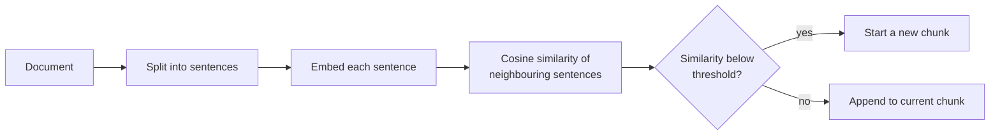
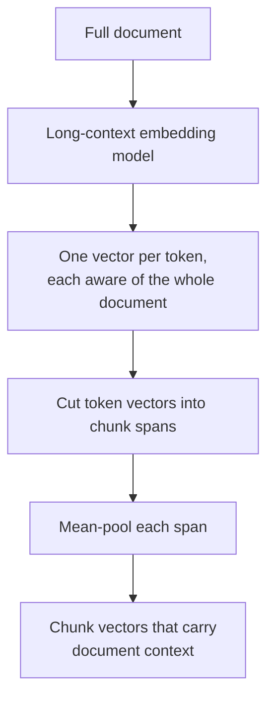

In [Chunking strategies](/learn/rag-fundamentals/chunking-strategies) you split documents into fixed-size or recursive chunks and saw how size and overlap trade precision against context. Those strategies work, but they cut text by counting characters, not by understanding it. When a RAG system answers badly, the chunk boundaries are one of the first places to look: a retriever can only return what a chunk contains, and a chunk that splits an idea in half, or mixes two unrelated ideas, is hard to find and hard to use.

This lesson covers the chunking techniques that respect meaning and structure: semantic chunking, structure- and layout-aware chunking, propositions, late chunking and small-to-big. For each one you will see the failure it fixes, what it costs and when the simple splitter is still the better choice.

## The failure modes of naive chunking

Fixed-size chunking makes three kinds of mistake.

| Failure | What happens | Symptom in answers |
| --- | --- | --- |
| **Split idea** | A definition and its exception land in different chunks | The answer states the rule and misses the exception |
| **Mixed topics** | One chunk holds the end of "Refunds" and the start of "Shipping" | Its embedding is a blur of both, so it ranks highly for neither |
| **Lost context** | The chunk says "this limit applies to all plans" without naming the limit or product | The chunk is retrieved but the model cannot tell what it refers to |

Every technique below targets one or more of these rows. None of them is free: each adds processing time at indexing, extra components to maintain, or both.

## Semantic chunking

**Semantic chunking** places boundaries where the topic changes. The recipe:

1. Split the document into sentences.
2. Embed each sentence.
3. Compute the similarity between each sentence and the next.
4. Start a new chunk wherever the similarity drops below a threshold (often a low percentile of all the gaps, so the rule adapts to each document).



Real systems use a sentence-embedding model. Here TF-IDF stands in for it so the code runs anywhere; the logic is identical.

```python
import numpy as np
from sklearn.feature_extraction.text import TfidfVectorizer

sentences = [
    "Refunds go back to the original payment method.",
    "Refunds take five working days to reach that payment method.",
    "Refunds are not offered for gift cards.",
    "Orders ship from our warehouse in Leeds.",
    "Standard orders ship within three days.",
    "Shipping is free on orders over fifty pounds.",
]

vec = TfidfVectorizer(stop_words="english").fit(sentences)
E = vec.transform(sentences).toarray()
E = E / np.linalg.norm(E, axis=1, keepdims=True)

gaps = [float(E[i] @ E[i + 1]) for i in range(len(E) - 1)]
print([round(g, 2) for g in gaps])
```

```output
[0.51, 0.12, 0.0, 0.39, 0.15]
```

The similarity between sentence 3 and sentence 4 is the lowest: that is where refunds end and shipping begins. Turning gaps into chunks takes a few lines:

```python
def semantic_chunks(sentences, gaps, threshold):
    chunks, current = [], [sentences[0]]
    for sentence, gap in zip(sentences[1:], gaps):
        if gap < threshold:
            chunks.append(" ".join(current))
            current = []
        current.append(sentence)
    chunks.append(" ".join(current))
    return chunks

for c in semantic_chunks(sentences, gaps, threshold=0.1):
    print("-", c)
```

```output
- Refunds go back to the original payment method. Refunds take five working days to reach that payment method. Refunds are not offered for gift cards.
- Orders ship from our warehouse in Leeds. Standard orders ship within three days. Shipping is free on orders over fifty pounds.
```

With real embeddings, the threshold is usually set as a percentile of the gaps (for example, split at the lowest tenth) and combined with a maximum chunk size, because a long document on one topic would otherwise become one enormous chunk.

> [!WARNING]
> Semantic chunking is only as good as the sentence splitter and the embeddings. Sentence-level embeddings are noisy: a short sentence such as "See below." has little meaning on its own and can create a false boundary. Evaluate it against your recursive splitter on your own retrieval set before adopting it; on many corpora the gain is small.

## Structure-aware and layout-aware chunking

Most business documents already announce their topic boundaries: headings, list items, table rows, slide titles, function definitions in code. **Structure-aware chunking** splits on these boundaries first and only falls back to size-based splitting inside a section that is too long. It is cheap, deterministic and often beats semantic chunking for well-formatted sources.

The second half of the trick is to carry the **heading path** into every chunk, which fixes the lost-context failure:

```python
doc = """# Employee Handbook
## Leave
### Annual leave
Full-time staff receive 25 days per year.
### Sick leave
Self-certify for up to 7 days.
## Expenses
### Travel
Book economy class for flights under 6 hours."""

def markdown_chunks(text):
    path, chunks, body = [], [], []
    def flush():
        if body:
            chunks.append(" > ".join(path) + "\n" + " ".join(body))
            body.clear()
    for line in text.splitlines():
        if line.startswith("#"):
            flush()
            level = len(line) - len(line.lstrip("#"))
            path[:] = path[: level - 1] + [line.lstrip("# ").strip()]
        elif line.strip():
            body.append(line.strip())
    flush()
    return chunks

for c in markdown_chunks(doc):
    print(c, end="\n\n")
```

```output
Employee Handbook > Leave > Annual leave
Full-time staff receive 25 days per year.

Employee Handbook > Leave > Sick leave
Self-certify for up to 7 days.

Employee Handbook > Expenses > Travel
Book economy class for flights under 6 hours.
```

The chunk "Self-certify for up to 7 days." is useless on its own. With the breadcrumb `Employee Handbook > Leave > Sick leave` it matches a query about sick leave for both keyword and embedding search.

**Layout-aware chunking** applies the same idea to PDFs, slides and scans, where the structure is visual. A layout parser (the kind you met in [Document parsing](/learn/rag-fundamentals/document-parsing)) detects titles, paragraphs, multi-column reading order, tables, figures and page headers or footers. The chunker then keeps each table whole (or splits it by rows while repeating the header row), drops repeated page furniture, and attaches figure captions to their figures. Treat a table as its own chunk type: you will see in [Multimodal RAG](/learn/advanced-rag/multimodal-rag) how to index it.

## Propositions

A **proposition** is a short, self-contained statement of one fact, with pronouns resolved and context filled in. Proposition-based indexing asks an LLM to rewrite each passage into a list of such statements and indexes those instead of (or alongside) the original text.

```python
PROMPT = """Rewrite the passage as a list of simple, self-contained facts.
Resolve pronouns and include the subject in every fact. One fact per line.

Passage: {passage}"""

def to_propositions(passage, llm):
    reply = llm(PROMPT.format(passage=passage))
    return [line.strip("- ").strip() for line in reply.splitlines() if line.strip()]

# A stub stands in for the model; a real call returns similar text.
def fake_llm(prompt):
    return ("- The Model X router supports Wi-Fi 6.\n"
            "- The Model X router was released in 2022.\n"
            "- The Model X router costs less than the Model Y router.")

passage = "The Model X router supports Wi-Fi 6. It came out in 2022 and is cheaper than the Model Y."
print(to_propositions(passage, fake_llm))
```

```output
['The Model X router supports Wi-Fi 6.', 'The Model X router was released in 2022.', 'The Model X router costs less than the Model Y router.']
```

Propositions give very precise matches for factoid questions, because each indexed unit is exactly one fact. The costs are real: one LLM call per passage at indexing, many more vectors to store, the risk that the rewrite drops or distorts a fact, and the loss of surrounding reasoning that longer questions need. A common compromise is to retrieve by proposition but return the source passage, which is the small-to-big pattern below.

## Late chunking

Chunking before embedding has a hidden cost: each chunk is embedded in isolation, so a chunk that says "its battery lasts ten hours" never sees the product name two sentences earlier. **Late chunking** reverses the order.

1. Run the **whole document** (or as much as fits) through a long-context embedding model, which produces one contextual vector per token.
2. Only then split the token vectors into chunk spans.
3. Mean-pool the token vectors inside each span to get one vector per chunk.



Because attention has already mixed information across the document, the pooled vector for "its battery lasts ten hours" carries some signal about the product. Late chunking needs an embedding model that exposes token-level outputs and supports long inputs, and it does not help BM25 at all, since keyword indexes see only the chunk's text. [Contextual retrieval](/learn/advanced-rag/contextual-retrieval) solves the same problem by adding text instead, which helps both kinds of index.

## Small-to-big

Small chunks retrieve precisely; large chunks give the model enough to answer. **Small-to-big** retrieval stops forcing one size to do both jobs: index small units (sentences, propositions, child chunks) and, after retrieval, expand each hit to a bigger unit (its paragraph, section, or a window of neighbouring sentences) before building the prompt. It gets its own lesson, [Parent-child retrieval](/learn/advanced-rag/parent-child-retrieval).

## Choosing a strategy

| Technique | Fixes | Indexing cost | Use when | Skip when |
| --- | --- | --- | --- | --- |
| Recursive, fixed size | Baseline | Very low | Always start here | Never skip the baseline |
| Structure-aware | Split ideas, lost context | Low | Markdown, HTML, docs with headings, code | Unstructured plain text |
| Layout-aware | Tables and columns mangled | Medium (parser) | PDFs, slides, scans | Clean digital text |
| Semantic | Mixed topics | Medium (embed every sentence) | Long unstructured text with topic shifts | Short or well-structured documents |
| Propositions | Imprecise matches | High (LLM per passage) | Fact-dense reference material | Narrative or reasoning-heavy text |
| Late chunking | Lost context in vectors | Medium (long-context model) | Many cross-referencing pronouns | You rely mostly on BM25 |

> [!KEY]
> Chunking is a retrieval decision, so judge it by retrieval metrics. Change one chunker at a time and compare recall@k on a fixed question set, as described in [RAG evaluation](/learn/advanced-rag/rag-evaluation). Chunking changes also force a full re-index, so settle them before you tune anything downstream.

## Exercises

**1.** Change `semantic_chunks` so that it also starts a new chunk when the current chunk would exceed a maximum number of characters, and test it with `max_chars=120`.

<details>
<summary>Show solution</summary>

```python
def semantic_chunks_capped(sentences, gaps, threshold, max_chars):
    chunks, current = [], [sentences[0]]
    for sentence, gap in zip(sentences[1:], gaps):
        too_long = len(" ".join(current + [sentence])) > max_chars
        if gap < threshold or too_long:
            chunks.append(" ".join(current))
            current = []
        current.append(sentence)
    chunks.append(" ".join(current))
    return chunks

for c in semantic_chunks_capped(sentences, gaps, 0.1, max_chars=120):
    print(len(c), c[:50])
```

```output
108 Refunds go back to the original payment method. Re
39 Refunds are not offered for gift cards.
80 Orders ship from our warehouse in Leeds. Standard 
45 Shipping is free on orders over fifty pounds.
```

Every chunk now respects the cap, and the refunds/shipping boundary is still honoured.

</details>

**2.** In `markdown_chunks`, a section with no body text (such as `## Leave`, which only contains subsections) produces no chunk. Is that the right behaviour? What would go wrong if it produced a chunk containing only the heading?

<details>
<summary>Show solution</summary>

Yes. A chunk with only a heading has almost no content, yet it matches any query that mentions the heading word ("leave"), so it would crowd genuine answers out of the top-k results. The heading is not lost: it appears in the breadcrumb of every child section.

</details>

**3.** A support team indexes chat transcripts: informal, no headings, frequent topic switches. Which chunking technique from the table would you try first after the baseline, and why not propositions?

<details>
<summary>Show solution</summary>

Semantic chunking: transcripts have no structure to exploit and do shift topic, which is exactly what similarity gaps detect. Propositions would cost an LLM call per passage across a large, low-value corpus, and the rewrite would strip the conversational context (who said what, in which order) that support questions often depend on.

</details>

```quiz
[
  {
    "q": "In semantic chunking, where are chunk boundaries placed?",
    "options": [
      "Where the similarity between neighbouring sentences drops",
      "Every fixed number of tokens",
      "At every full stop",
      "Wherever the LLM decides a fact ends"
    ],
    "answer": 0,
    "why": "A drop in similarity between adjacent sentence embeddings signals a topic change, which is where a boundary belongs."
  },
  {
    "q": "Why does structure-aware chunking prepend the heading path to each chunk?",
    "options": [
      "To make chunks longer so they rank higher",
      "To satisfy the vector database schema",
      "So that chunks which do not name their subject still match relevant queries",
      "To reduce the number of chunks"
    ],
    "answer": 2,
    "why": "Text such as 'Self-certify for up to 7 days' only becomes findable for a sick-leave query when the breadcrumb supplies the missing context."
  },
  {
    "q": "What distinguishes late chunking from ordinary chunking?",
    "options": [
      "Chunks are created after the user's query arrives",
      "Chunks are re-split at query time based on the answer",
      "An LLM writes a summary for each chunk",
      "The document is embedded as a whole and token vectors are pooled into chunks afterwards"
    ],
    "answer": 3,
    "why": "Embedding first lets every token vector absorb document-wide context before it is pooled into a chunk vector."
  },
  {
    "q": "Which is a real drawback of proposition-based indexing?",
    "options": [
      "It cannot be used with vector databases",
      "It needs an LLM call per passage and can drop or distort facts",
      "It requires a BM25 index",
      "It only works on tables"
    ],
    "answer": 1,
    "why": "Rewriting passages into propositions is expensive at indexing time and is itself an error-prone generation step."
  }
]
```
