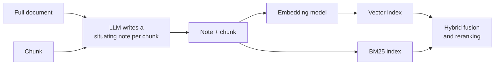

Chunking cuts text out of its document, and with it goes the information that made the text meaningful. A chunk that reads "Revenue grew 3% over the previous quarter" does not say which company, which quarter, or which report it came from. Embedded on its own, it is nearly identical to the same sentence from every other quarterly report in your corpus, so the retriever has no way to tell them apart. The answer is retrieved by luck or not at all.

**Contextual retrieval** fixes this at indexing time. For each chunk, an LLM reads the whole document and writes a short note situating the chunk within it, such as "From Acme Robotics' Q2 2024 quarterly report, financial results section." The note is prepended to the chunk before it is embedded **and** before it is added to the keyword index. Nothing changes at query time.

## The failure, reproduced

Three quarterly reports, each split into chunks. Each chunk is accurate, but none names its company or quarter.

```python
import numpy as np
from sklearn.feature_extraction.text import TfidfVectorizer

documents = {
    "acme-q2": {"title": "Acme Robotics quarterly report, Q2 2024", "chunks": [
        "Revenue grew 3% over the previous quarter, driven by warehouse robot sales.",
        "Operating costs rose because of a new factory in Ohio.",
        "The board approved a dividend of 10 cents per share."]},
    "borealis-q2": {"title": "Borealis Energy quarterly report, Q2 2024", "chunks": [
        "Revenue grew 8% over the previous quarter as wind farm output increased.",
        "Operating costs fell after two gas plants were closed.",
        "No dividend was declared this quarter."]},
    "acme-q1": {"title": "Acme Robotics quarterly report, Q1 2024", "chunks": [
        "Revenue fell 2% over the previous quarter after a product recall.",
        "Operating costs were flat.",
        "The board approved a dividend of 8 cents per share."]},
}
rows = [(doc_id, i, chunk) for doc_id, doc in documents.items()
        for i, chunk in enumerate(doc["chunks"])]

def search(texts, query, k=3):
    vec = TfidfVectorizer(stop_words="english").fit(texts)
    scores = (vec.transform(texts) @ vec.transform([query]).T).toarray().ravel()
    return [(rows[i][0], rows[i][1], round(float(scores[i]), 3))
            for i in np.argsort(-scores, kind="stable")[:k]]

question = "How much did Acme Robotics revenue grow in Q2 2024?"
print(search([chunk for _, _, chunk in rows], question))
```

```output
[('acme-q1', 0, 0.358), ('acme-q2', 0, 0.295), ('borealis-q2', 0, 0.295)]
```

The top hit is the **Q1** revenue chunk, which would lead the generator to answer "revenue fell 2%". The correct chunk ties with Borealis's. Neither "Acme" nor "Q2" appears in any chunk, so the retriever is matching on "revenue" alone. Dense retrievers suffer the same way: the three revenue sentences have nearly identical embeddings.

## Generating the context

The context-generation prompt shows the model the whole document and one chunk, and asks for a short situating note. The wording below follows the approach Anthropic described when it introduced the technique.

```python
CONTEXT_PROMPT = """<document>
{document}
</document>

Here is the chunk we want to situate within the whole document:
<chunk>
{chunk}
</chunk>

Give a short, succinct context to situate this chunk within the overall document
for the purposes of improving search retrieval of the chunk.
Answer only with the succinct context and nothing else."""

def situate(document_text, chunk, llm):
    return llm(CONTEXT_PROMPT.format(document=document_text, chunk=chunk)).strip()
```

The angle brackets here are plain text inside a prompt, used to delimit the document and chunk for the model. A real model writes something like the note below; a stub builds that note from the document title so the code runs without an API.

```python
def stub_llm_for(doc_id):
    title = documents[doc_id]["title"]
    return lambda prompt: f"From the {title}, financial results section."

contextual_texts = []
for doc_id, i, chunk in rows:
    full_doc = " ".join(documents[doc_id]["chunks"])
    note = situate(full_doc, chunk, stub_llm_for(doc_id))
    contextual_texts.append(note + " " + chunk)

print(contextual_texts[0])
print(search(contextual_texts, question))
```

```output
From the Acme Robotics quarterly report, Q2 2024, financial results section. Revenue grew 3% over the previous quarter, driven by warehouse robot sales.
[('acme-q2', 0, 0.435), ('acme-q1', 0, 0.404), ('acme-q2', 2, 0.317)]
```

With the context prepended, the Acme Q2 revenue chunk ranks first: the note supplies "Acme", "Robotics" and "Q2" that the question uses.



Two implementation details matter:

- **Index the note in both retrievers.** The keyword index benefits at least as much as the vector index, because the note adds exact names and dates that BM25 can match. Contextual embeddings plus contextual BM25, fused and then reranked, is the full recipe.
- **Store the original chunk too.** The note was written for search, not for the reader. You can show the generator either the original chunk or note plus chunk; keep both so you can choose, and so you can regenerate notes without re-chunking.

## The cost, and how caching cuts it

Contextual retrieval adds no work at query time, but at indexing time it makes **one LLM call per chunk, each containing the whole document**. A document of $L$ tokens split into $n$ chunks sends roughly $n \times L$ input tokens: a 50-chunk document is read 50 times.

**Prompt caching** is what makes this affordable. Providers that support it store the processed form of a prompt prefix and charge much less to reuse it. Put the document first and the chunk last, so every call for that document shares an identical prefix, and process a document's chunks one after another while the cache is still warm.

The calculation below uses **illustrative relative prices**, not any provider's real rates: ordinary input tokens cost 1 unit each, writing a prefix to the cache costs a premium, and reading it costs a small fraction. Check your provider's current pricing and minimum cacheable length.

```python
doc_tokens, chunk_tokens, instruction_tokens, note_tokens = 8_000, 400, 100, 60
n_chunks = doc_tokens // chunk_tokens

INPUT, CACHE_WRITE, CACHE_READ, OUTPUT = 1.0, 1.25, 0.1, 5.0   # illustrative units per token

per_call_tail = chunk_tokens + instruction_tokens   # the part that differs per call
output_cost = n_chunks * note_tokens * OUTPUT

no_cache = n_chunks * (doc_tokens + per_call_tail) * INPUT + output_cost
with_cache = (doc_tokens * CACHE_WRITE                       # first call writes the prefix
              + (n_chunks - 1) * doc_tokens * CACHE_READ     # later calls read it
              + n_chunks * per_call_tail * INPUT
              + output_cost)

print(f"chunks: {n_chunks}")
print(f"without caching: {no_cache:,.0f} units")
print(f"with caching:    {with_cache:,.0f} units  ({no_cache / with_cache:.1f}x cheaper)")
```

```output
chunks: 20
without caching: 176,000 units
with caching:    41,200 units  (4.3x cheaper)
```

Under these assumptions, caching cuts the indexing cost by a factor of about four, and the saving grows with the number of chunks per document. Batch APIs, where your provider offers them, can reduce it further for one-off indexing jobs that do not need immediate results. A small, fast model is usually good enough for writing notes; you do not need your strongest model.

> [!WARNING]
> Very long documents may not fit in the context window, and even when they do, the cost scales with $n \times L$. For a 500-page manual, pass the chunk's **section** (or the table of contents plus the section) rather than the whole document. The note only needs enough context to name what the chunk is about.

## Trade-offs

| Aspect | Effect |
| --- | --- |
| Query latency | None: notes are created at indexing time |
| Indexing cost | One LLM call per chunk; manageable with caching and a small model |
| Index size | Each chunk grows by the note, typically a few dozen tokens |
| Re-indexing | Editing a document means regenerating notes for its chunks |
| Risk | A wrong note (wrong quarter, wrong product) misleads both retrievers; spot-check samples |

Compared with the other fixes for lost context: heading breadcrumbs (from [Advanced chunking](/learn/advanced-rag/advanced-chunking)) are free but only carry what the headings say; [late chunking](/learn/advanced-rag/advanced-chunking) helps embeddings but not BM25; [parent-child retrieval](/learn/advanced-rag/parent-child-retrieval) adds context to what the generator **reads** but not to what the retriever **searches**. Contextual retrieval changes the searchable text itself.

## When not to use it

- Chunks are already self-contained: FAQ entries, product cards, tickets, or documents with strong heading breadcrumbs that already name the subject.
- The corpus changes constantly, so regenerating notes for every edit is costly.
- Retrieval already reaches high recall on your evaluation set. As always, measure first; it is easy to spend an indexing budget on a problem you do not have.

> [!KEY]
> Contextual retrieval moves cost from query time to indexing time. You pay once per chunk, on a cheap model with caching, and every future query benefits at no extra latency. That trade is usually attractive for large, stable corpora of long documents where chunks refer back to their surroundings.

## Exercises

**1.** A cheap alternative to LLM-written notes is to prepend the document title to every chunk. Implement it and compare the ranking with the LLM-note version on `question`. What would a title prefix miss in a real corpus?

<details>
<summary>Show solution</summary>

```python
title_texts = [documents[d]["title"] + ". " + chunk for d, _, chunk in rows]
print(search(title_texts, question))
```

```output
[('acme-q2', 0, 0.448), ('acme-q1', 0, 0.419), ('acme-q2', 2, 0.329)]
```

Here the title carries the company and quarter, so it works as well as the note (unsurprisingly, since this lesson's stub built its notes from the title). Real titles are often uninformative ("Report_final_v3.pdf"), and a title cannot say which section a chunk is from or resolve references such as "the product mentioned above". Titles are a strong free baseline; LLM notes add what titles miss.

</details>

**2.** Using the cost code, compute the "x cheaper" factor for documents of 2,000 and 40,000 tokens with the same chunk size. Explain the trend.

<details>
<summary>Show solution</summary>

```python
def savings(doc_tokens, chunk_tokens=400, instruction_tokens=100, note_tokens=60):
    n = doc_tokens // chunk_tokens
    tail = chunk_tokens + instruction_tokens
    out = n * note_tokens * OUTPUT
    no_cache = n * (doc_tokens + tail) * INPUT + out
    cached = doc_tokens * CACHE_WRITE + (n - 1) * doc_tokens * CACHE_READ + n * tail * INPUT + out
    return round(no_cache / cached, 1)

print(savings(2_000), savings(40_000))
```

```output
1.9 7.8
```

Longer documents have more chunks, and every extra chunk re-reads the whole document. Without caching, cost grows with the square of document length; with caching, most of those re-reads are billed at the cheap rate, so the savings factor grows.

</details>

**3.** A legal team wants contextual retrieval over contracts that are amended weekly. What would you check before agreeing?

<details>
<summary>Show solution</summary>

How many chunks change per amendment, since only affected documents need new notes, but an amended clause can change the meaning of others, so whole-document regeneration may be needed. Whether contracts fit in the context window, or whether section-level context is enough. Whether notes can be cached per contract version for audit. And whether a cheaper fix, such as clause numbers and contract names in breadcrumbs, already solves the retrieval misses on a labelled set.

</details>

```quiz
[
  {
    "q": "What does contextual retrieval add to each chunk before indexing?",
    "options": [
      "The embedding of the whole document",
      "The neighbouring chunks",
      "The user's most common questions",
      "A short LLM-written note situating the chunk within its document"
    ],
    "answer": 3,
    "why": "The note restores the context lost by chunking, such as which company, product or section the chunk belongs to."
  },
  {
    "q": "Why should the situating note be added to the BM25 index as well as the vector index?",
    "options": [
      "BM25 cannot index chunks without a note",
      "Notes add exact names and dates that keyword matching can use",
      "It halves the index size",
      "Vector indexes ignore prepended text"
    ],
    "answer": 1,
    "why": "Identifiers like company names and quarters are exactly what BM25 matches well, and they are often missing from bare chunks."
  },
  {
    "q": "How does prompt caching reduce the cost of generating notes?",
    "options": [
      "The shared document prefix is processed once and reused at a reduced price for each chunk",
      "It shortens each chunk",
      "It caches the LLM's notes so they are never regenerated",
      "It skips chunks that look similar"
    ],
    "answer": 0,
    "why": "Every call for one document starts with the same document text, so placing it first lets later calls read it from the cache cheaply."
  },
  {
    "q": "What is the query-time latency cost of contextual retrieval?",
    "options": [
      "One extra LLM call per query",
      "One extra LLM call per retrieved chunk",
      "A second embedding of the query",
      "Essentially none: all the work happens at indexing time"
    ],
    "answer": 3,
    "why": "Notes are generated once during indexing; queries search the enriched index exactly as before."
  }
]
```
