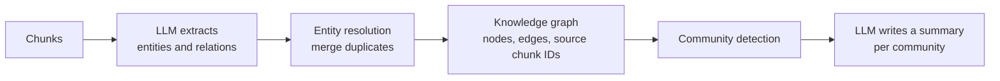

Every technique so far in this module still retrieves **chunks that look like the question**. Two kinds of question break that assumption. A **multi-hop** question ("Where is the battery supplier of the company Alice Chen advises based?") needs a chain of facts spread across documents, and the last link in the chain shares no words with the question. A **global** question ("What are the main themes across all 2,000 incident reports?") has no single relevant chunk at all: the answer is a property of the whole corpus, and top-k retrieval sees only a handful of reports.

**Graph RAG** adds structure to the corpus. An LLM extracts the entities (people, companies, products, places) and the relations between them into a **knowledge graph**; retrieval then follows edges rather than similarity, and summaries of graph regions answer questions about the corpus as a whole. This lesson covers how the graph is built, the two query modes it enables, and the honest question of when it is worth the considerable cost.

## The failure, reproduced

```python
import numpy as np
from sklearn.feature_extraction.text import TfidfVectorizer

chunks = {
    "c1": "Alice Chen sits on the advisory board of Helix Motors.",
    "c2": "Helix Motors buys its battery cells from Voltaic Cells Ltd.",
    "c3": "Voltaic Cells Ltd runs its main plant in Gdansk, Poland.",
    "c4": "Helix Motors reported record sales of electric vans.",
    "c5": "Orchid Foods sources olive oil from Quinta Verde.",
    "c6": "Quinta Verde is a family farm near Evora, Portugal.",
    "c7": "Bruno Diaz is the chief executive of Orchid Foods.",
    "c8": "Many battery suppliers advise customers on cell chemistry.",
}
ids = list(chunks)
vec = TfidfVectorizer(stop_words="english").fit(chunks.values())
M = vec.transform(chunks.values())

question = "Where is the battery supplier of the company Alice Chen advises based?"
scores = (M @ vec.transform([question]).T).toarray().ravel()
print([(ids[i], round(float(scores[i]), 3)) for i in np.argsort(-scores, kind="stable")[:4]])
```

```output
[('c1', 0.495), ('c8', 0.179), ('c2', 0.171), ('c3', 0.0)]
```

Retrieval finds the first hop (c1) and a distractor about battery suppliers in general (c8), ranks the second hop (c2) third, and scores the chunk with the actual answer, c3, at **zero**: it mentions Voltaic Cells and Gdansk, neither of which appears in the question. No amount of reranking can recover a chunk that was never a candidate. [Query decomposition](/learn/advanced-rag/query-transformation) can solve this with sequential retrieval steps; a graph solves it by making the links explicit.

## Building the graph



**Extraction.** An LLM reads each chunk and returns structured triples of the form (subject, relation, object), ideally as JSON validated against a schema (see [Structured outputs](/learn/working-with-llms/structured-outputs)). Each triple keeps the ID of the chunk it came from, so every edge can be traced back to evidence.

```python
EXTRACT_PROMPT = """Extract entities and relationships from the text.
Return JSON: a list of [subject, relation, object] triples. Use the full
canonical name for each entity. Relations are short verbs in snake_case.

Text: {chunk}"""

# Stubbed extraction output: what a model typically returns for these chunks.
extracted = {
    "c1": [["Alice Chen", "advises", "Helix Motors"]],
    "c2": [["Helix Motors", "buys_cells_from", "Voltaic Cells Ltd"]],
    "c3": [["Voltaic Cells Ltd", "has_plant_in", "Gdansk"], ["Gdansk", "located_in", "Poland"]],
    "c4": [["Helix Motors", "sells", "electric vans"]],
    "c5": [["Orchid Foods", "sources_from", "Quinta Verde"]],
    "c6": [["Quinta Verde", "located_near", "Evora"], ["Evora", "located_in", "Portugal"]],
    "c7": [["Bruno Diaz", "ceo_of", "Orchid Foods"]],
    "c8": [],
}

graph = {}   # node -> list of (relation, neighbour, source chunk)
for chunk_id, triples in extracted.items():
    for subj, rel, obj in triples:
        graph.setdefault(subj, []).append((rel, obj, chunk_id))
        graph.setdefault(obj, []).append((f"inverse_{rel}", subj, chunk_id))

print(len(graph), "nodes")
print(graph["Helix Motors"])
```

```output
11 nodes
[('inverse_advises', 'Alice Chen', 'c1'), ('buys_cells_from', 'Voltaic Cells Ltd', 'c2'), ('sells', 'electric vans', 'c4')]
```

Edges are stored in both directions so traversal can follow "Helix Motors is advised by Alice Chen" as easily as the forward relation. Chunk c8 produced no triples: it mentions no specific entities, which is itself a useful filter.

**Entity resolution** is the step that quietly decides graph quality. The same company appears as "Voltaic", "Voltaic Cells" and "Voltaic Cells Ltd"; unless these are merged into one node, the chain breaks. Resolution combines normalisation (case, punctuation, legal suffixes), embedding similarity between names and descriptions, and sometimes an LLM judging candidate pairs.

> [!WARNING]
> Extraction errors compound. A missed relation removes an edge, a mis-resolved entity merges two different companies, and a hallucinated triple invents a link that the generator will then state with confidence. Keep the source chunk for every edge and pass that text, not just the triple, to the generator so it can verify.

## Local search: following edges

A **local** question is about specific entities. The query is linked to graph nodes (by string matching or by embedding entity names), and the retriever explores the neighbourhood with a breadth-first search, collecting the facts and their source chunks.

```python
from collections import deque

def find_path(graph, start, is_goal, max_hops=4):
    queue, seen = deque([(start, [])]), {start}
    while queue:
        node, path = queue.popleft()
        if is_goal(node) and path:
            return path
        if len(path) == max_hops:
            continue
        for rel, nbr, chunk_id in graph.get(node, []):
            if nbr not in seen:
                seen.add(nbr)
                queue.append((nbr, path + [(node, rel, nbr, chunk_id)]))
    return None

countries = {"Poland", "Portugal"}
path = find_path(graph, "Alice Chen", lambda n: n in countries)
for subj, rel, obj, chunk_id in path:
    print(f"{subj} --{rel}--> {obj}   [{chunk_id}]")
print("chunks for the prompt:", sorted({p[3] for p in path}))
```

```output
Alice Chen --advises--> Helix Motors   [c1]
Helix Motors --buys_cells_from--> Voltaic Cells Ltd   [c2]
Voltaic Cells Ltd --has_plant_in--> Gdansk   [c3]
Gdansk --located_in--> Poland   [c3]
chunks for the prompt: ['c1', 'c2', 'c3']
```

The traversal walks from Alice Chen to Poland in four hops and returns exactly the chunks that justify each hop, including c3, which similarity search scored at zero. In real systems the goal test is rarely hand-written: the retriever expands one or two hops around every entity linked from the question, ranks the collected facts (by relation type, by similarity to the question, or with a reranker) and lets the LLM reason over them.

## Global search: community summaries

A **global** question, such as "What kinds of supply relationships appear in these documents?", is not about any entity. The approach popularised by Microsoft's GraphRAG work is:

1. **Detect communities**: groups of nodes more densely connected to each other than to the rest of the graph. Production systems use algorithms such as Leiden, often hierarchically, giving communities at several levels of detail.
2. **Summarise each community** with an LLM at indexing time, from its entities, relations and source chunks.
3. **Answer by map-reduce**: ask the question of every community summary (map), then combine the partial answers (reduce).

On this toy graph the two clusters are not connected at all, so connected components are enough to find them.

```python
from scipy.sparse import lil_matrix
from scipy.sparse.csgraph import connected_components

nodes = sorted(graph)
index = {n: i for i, n in enumerate(nodes)}
A = lil_matrix((len(nodes), len(nodes)))
for node, edges in graph.items():
    for _, nbr, _ in edges:
        A[index[node], index[nbr]] = 1

n_comm, labels = connected_components(A, directed=False)
communities = [[n for n in nodes if labels[index[n]] == c] for c in range(n_comm)]
for c in communities:
    print(c)
```

```output
['Alice Chen', 'Gdansk', 'Helix Motors', 'Poland', 'Voltaic Cells Ltd', 'electric vans']
['Bruno Diaz', 'Evora', 'Orchid Foods', 'Portugal', 'Quinta Verde']
```

Each community then gets a summary, written once at indexing time. The map-reduce answer below uses stubbed LLM outputs to show the flow.

```python
community_summaries = [
    "Alice Chen advises Helix Motors, an electric van maker that buys battery cells "
    "from Voltaic Cells Ltd, whose main plant is in Gdansk, Poland.",
    "Orchid Foods, led by Bruno Diaz, sources olive oil from Quinta Verde, "
    "a family farm near Evora, Portugal.",
]

def map_step(question, summary):          # stub for one LLM call per summary
    return "Manufacturer buying components from a foreign supplier." if "battery" in summary \
        else "Food company buying raw ingredients from a farm."

def reduce_step(question, partials):      # stub for the final LLM call
    return "Two kinds of supply relationship: " + " / ".join(partials)

q = "What kinds of supply relationships appear in these documents?"
print(reduce_step(q, [map_step(q, s) for s in community_summaries]))
```

```output
Two kinds of supply relationship: Manufacturer buying components from a foreign supplier. / Food company buying raw ingredients from a farm.
```

Vector search would have retrieved the few chunks that happen to resemble the question, most likely the generic one about battery suppliers, and missed the rest. The community summaries cover the whole corpus by construction, which is what global questions need.

## Local versus global at a glance

| | Local search | Global search |
| --- | --- | --- |
| Question type | About specific entities, often multi-hop | About themes or patterns across the corpus |
| Entry point | Entities linked from the question | Every community summary at a chosen level |
| Retrieved context | Neighbourhood facts plus source chunks | Community summaries |
| Query cost | Low to moderate | High: one LLM call per community, plus a reduce step |

## When graphs help, and when they are overkill

Building a graph means running an LLM over **every chunk** for extraction, plus summary calls for every community, and repeating parts of that whenever documents change. That cost is justified only by questions that need it.

| Graph RAG tends to help | Graph RAG tends to be overkill |
| --- | --- |
| Many multi-hop questions over linked entities: supply chains, organisations, investigations, biomedical relations | Questions answered by one passage: policies, FAQs, product documentation |
| Users ask "what are the themes / patterns / main actors?" across large collections | Corpora with few named entities or weak links between documents |
| Corpus is relatively stable, so indexing cost is amortised | Content changes constantly |
| You need explainable chains of evidence | Latency budgets that cannot afford traversal and extra LLM calls |

> [!TIP]
> Start without a graph. If error analysis (see [RAG evaluation](/learn/advanced-rag/rag-evaluation)) shows that a meaningful share of failures are multi-hop or global questions, try the cheaper fixes first: query decomposition with sequential retrieval for multi-hop, and precomputed document or section summaries for global questions. Reach for a graph when those fall short.

> [!KEY]
> A knowledge graph turns implicit links (the same entity named in two documents) into explicit edges you can traverse, and community summaries turn "the whole corpus" into a manageable set of retrievable units. Both are built by LLM calls at indexing time, so their quality and cost scale with your corpus.

## Exercises

**1.** Write `neighbourhood(graph, entity, hops)` that returns the set of source chunk IDs reachable within the given number of hops. What does it return for "Alice Chen" with 1, 2 and 3 hops?

<details>
<summary>Show solution</summary>

```python
def neighbourhood(graph, entity, hops):
    frontier, seen, found = {entity}, {entity}, set()
    for _ in range(hops):
        nxt = set()
        for node in frontier:
            for _, nbr, chunk_id in graph.get(node, []):
                found.add(chunk_id)
                if nbr not in seen:
                    seen.add(nbr)
                    nxt.add(nbr)
        frontier = nxt
    return sorted(found)

for h in (1, 2, 3):
    print(h, neighbourhood(graph, "Alice Chen", h))
```

```output
1 ['c1']
2 ['c1', 'c2', 'c4']
3 ['c1', 'c2', 'c3', 'c4']
```

The context grows quickly with each hop. In large graphs, popular entities have hundreds of neighbours, so real systems cap the number of neighbours per hop and rank them before expanding.

</details>

**2.** Suppose extraction for c2 had produced `["Helix", "buys_cells_from", "Voltaic Cells"]`. Explain what happens to the path query, and sketch a simple normalisation that would fix this case.

<details>
<summary>Show solution</summary>

"Helix" and "Voltaic Cells" become separate nodes from "Helix Motors" and "Voltaic Cells Ltd", so no path connects Alice Chen to Poland and the query fails. A simple fix maps each name to a canonical form, for example by lower-casing, stripping suffixes such as "Ltd" or "GmbH", and matching a new name to an existing node when one is a prefix of the other. Prefix rules alone are risky ("Apple" versus "Apple Records"), so production resolution adds embedding similarity and human-reviewed alias lists.

</details>

**3.** A team proposes Graph RAG for an internal HR policy assistant. Most questions are like "How many days of parental leave do I get?" What would you recommend?

<details>
<summary>Show solution</summary>

Do not build a graph. These are single-passage, local lookups over a small, well-structured corpus, which structure-aware chunking, hybrid retrieval and a reranker handle well. A graph would add an expensive extraction pipeline and a new class of extraction errors for no benefit. Revisit only if error analysis shows many multi-hop or corpus-wide questions.

</details>

```quiz
[
  {
    "q": "Why does vector search often miss the final hop of a multi-hop question?",
    "options": [
      "The final chunk is usually too long to embed",
      "Embeddings cannot represent place names",
      "Vector databases limit results to two",
      "The chunk containing the answer may share no words or meaning with the question itself"
    ],
    "answer": 3,
    "why": "The answer chunk mentions intermediate entities the user never named, so it is not similar to the question."
  },
  {
    "q": "What is entity resolution in Graph RAG?",
    "options": [
      "Choosing which entity answers the question",
      "Increasing the resolution of the embedding model",
      "Merging different names for the same real-world entity into one node",
      "Removing entities with few edges"
    ],
    "answer": 2,
    "why": "Without merging aliases such as 'Voltaic' and 'Voltaic Cells Ltd', paths through the graph break."
  },
  {
    "q": "Which question is best served by global search over community summaries?",
    "options": [
      "Who is the CEO of Orchid Foods?",
      "What are the recurring themes across all incident reports?",
      "Where is Voltaic Cells Ltd's main plant?",
      "Which company does Alice Chen advise?"
    ],
    "answer": 1,
    "why": "Theme questions concern the whole corpus; community summaries cover all of it, unlike top-k chunks."
  },
  {
    "q": "Which is the strongest reason not to build a knowledge graph for a corpus?",
    "options": [
      "The corpus contains named entities",
      "Users need explainable answers",
      "The corpus is stable",
      "Questions are almost all single-passage lookups and the content changes often"
    ],
    "answer": 3,
    "why": "Graphs cost an LLM pass over every chunk and must be maintained; that only pays off for multi-hop or global questions."
  }
]
```
