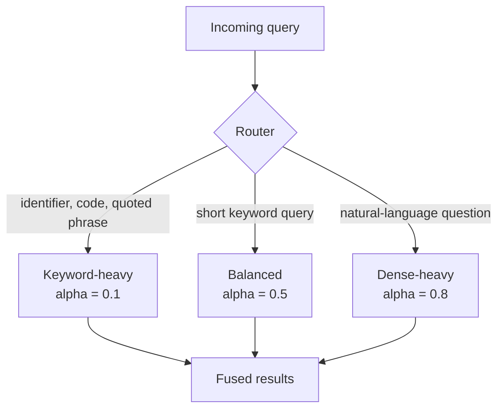

[Hybrid search](/learn/vector-databases/hybrid-search) introduced the idea of running a keyword search and a vector search together and merging the results. This lesson goes into the part that decides whether hybrid retrieval actually helps: **how** the two result lists are fused, how much weight each gets, how to tune that weight on data, and how to route each query to the mix that suits it.

The motivation is that each retriever fails where the other succeeds. Dense embeddings understand that "my package is running behind schedule" is about late deliveries, but treat an identifier such as `E1043` as noise. BM25 matches `E1043` perfectly but scores the paraphrase at zero because it shares no words with any document. A RAG system that serves both kinds of question needs both signals.

## Two retrievers to fuse

The keyword side is BM25, written out in full so you can see every term (the formula is explained in the hybrid search lesson). The dense side is a deliberately tiny stand-in for an embedding model: each word maps to one of eight meaning dimensions, so it knows that "refused" and "declined" mean the same thing, and, like real embedding models, it has no useful representation for unseen identifiers.

```python
import re
import numpy as np

docs = [
    "Card payment error: payments can fail when the bank declines the transaction.",
    "Declined card payment: ask the customer to contact their bank.",
    "Refunds for card payments return to the customer's bank account in five days.",
    "Error E1043: the payment gateway rejected the card token.",
    "Shipping labels print from the orders page on a thermal printer.",
    "Printer offline error: check the printer cable and restart the printer.",
    "Error E2210: the shipping label failed to print.",
    "Late delivery: track the parcel with the courier tracking number.",
    "Courier delays during holidays can make a delivery late by two days.",
]
STOP = {"the", "a", "to", "can", "when", "their", "on", "with", "from", "by", "for",
        "and", "in", "my", "is", "of", "s", "was", "our", "has", "this"}

def tokens(text):
    return [w for w in re.findall(r"[a-z0-9]+", text.lower()) if w not in STOP]

doc_tokens = [tokens(d) for d in docs]

def bm25(query, k1=1.5, b=0.75):
    N = len(doc_tokens)
    avgdl = np.mean([len(t) for t in doc_tokens])
    scores = np.zeros(N)
    for w in set(tokens(query)):
        df = sum(w in t for t in doc_tokens)
        if df == 0:
            continue
        idf = np.log(1 + (N - df + 0.5) / (df + 0.5))
        for i, t in enumerate(doc_tokens):
            f = t.count(w)
            scores[i] += idf * f * (k1 + 1) / (f + k1 * (1 - b + b * len(t) / avgdl))
    return scores

CONCEPT_WORDS = {
    "payment": "card payment payments transaction purchase gateway token",
    "failure": "fail failed declines declined rejected refused offline",
    "bank": "bank account issuer",
    "refund": "refunds money back return",
    "shipping": "shipping delivery parcel package courier orders label labels",
    "printing": "print printer thermal cable",
    "delay": "late delays behind schedule overdue",
    "error": "error problem",
}
CONCEPTS = list(CONCEPT_WORDS)
WORD_TO_CONCEPT = {w: c for c, ws in CONCEPT_WORDS.items() for w in ws.split()}

def embed(text):
    v = np.zeros(len(CONCEPTS))
    for w in tokens(text):
        if w in WORD_TO_CONCEPT:
            v[CONCEPTS.index(WORD_TO_CONCEPT[w])] += 1
    n = np.linalg.norm(v)
    return v / n if n else v

DOC_VECS = np.array([embed(d) for d in docs])

def dense(query):
    return DOC_VECS @ embed(query)     # cosine similarity

def rank(scores):
    return [int(i) for i in np.argsort(-scores, kind="stable")]
```

A small development set pairs each query with its relevant document. Mean reciprocal rank (MRR) scores a ranking function: 1 if the relevant document is first, 1/2 if second, and so on, averaged over queries.

```python
dev = [("error E1043", 3), ("E2210", 6), ("bank refused the purchase", 1),
       ("package running behind schedule", 8), ("printer offline", 5),
       ("money back to my account", 2)]

def mrr(score_fn):
    return float(np.mean([1 / (rank(score_fn(q)).index(rel) + 1) for q, rel in dev]))

for q, rel in dev:
    print(f"{q:34} relevant={rel}  bm25 top={rank(bm25(q))[0]}  dense top={rank(dense(q))[0]}")
print("MRR  bm25:", round(mrr(bm25), 3), " dense:", round(mrr(dense), 3))
```

```output
error E1043                        relevant=3  bm25 top=3  dense top=6
E2210                              relevant=6  bm25 top=6  dense top=0
bank refused the purchase          relevant=1  bm25 top=1  dense top=1
package running behind schedule    relevant=8  bm25 top=0  dense top=8
printer offline                    relevant=5  bm25 top=5  dense top=5
money back to my account           relevant=2  bm25 top=2  dense top=2
MRR  bm25: 0.852  dense: 0.774
```

BM25 misses the paraphrase; the dense stand-in misses both identifier queries. Neither is good enough alone.

## Fusion strategy 1: normalise, then combine scores

You cannot simply add the scores. BM25 scores are unbounded and depend on the query's length and term rarity; cosine similarities sit between -1 and 1.

```python
q = "printer offline"
print("bm25: ", np.round(bm25(q), 2))
print("dense:", np.round(dense(q), 2))
```

```output
bm25:  [0.   0.   0.   0.   1.43 4.13 0.   0.   0.  ]
dense: [0.3  0.29 0.   0.17 0.5  0.83 0.53 0.   0.  ]
```

A raw sum would let BM25 decide almost every ranking, with the dense score acting as a tie-breaker. The fix is to **normalise** each list onto a common scale and then take a **convex combination**:

$$
s_{\text{hybrid}}(d) = \alpha \, \tilde{s}_{\text{dense}}(d) + (1 - \alpha)\, \tilde{s}_{\text{sparse}}(d)
$$

where $\tilde{s}$ is a normalised score and $\alpha \in [0, 1]$ is the weight on the dense retriever ($\alpha = 1$ is pure vector search, $\alpha = 0$ pure keyword search).

| Normalisation | Formula | Notes |
| --- | --- | --- |
| Min-max | $(s - s_{\min}) / (s_{\max} - s_{\min})$ | Simple; the top result always becomes 1, even if it is a poor match |
| Z-score | $(s - \mu) / \sigma$ | Less sensitive to one extreme score; needs enough candidates for a stable $\mu$ and $\sigma$ |
| Theoretical bounds | e.g. cosine mapped from $[-1, 1]$ to $[0, 1]$ | Preserves absolute quality, but BM25 has no fixed upper bound |

Here $s_{\min}$, $s_{\max}$, $\mu$ and $\sigma$ are the minimum, maximum, mean and standard deviation of one retriever's scores for the current query's candidates.

```python
def minmax(s):
    lo, hi = s.min(), s.max()
    return (s - lo) / (hi - lo) if hi > lo else np.zeros_like(s)

def convex(alpha):
    return lambda q: alpha * minmax(dense(q)) + (1 - alpha) * minmax(bm25(q))

for alpha in [0.0, 0.25, 0.5, 0.75, 1.0]:
    print(f"alpha={alpha:.2f}  MRR={mrr(convex(alpha)):.3f}")
```

```output
alpha=0.00  MRR=0.852
alpha=0.25  MRR=1.000
alpha=0.50  MRR=1.000
alpha=0.75  MRR=0.917
alpha=1.00  MRR=0.774
```

Every interior value beats both retrievers alone, and a range of $\alpha$ is perfect on this set. This sweep is exactly how you tune $\alpha$ in practice: on a labelled set of real queries, never on intuition.

## Fusion strategy 2: reciprocal rank fusion

**Reciprocal rank fusion (RRF)** ignores scores entirely and uses ranks:

$$
\text{RRF}(d) = \sum_{r \in \mathcal{R}} \frac{w_r}{k + \text{rank}_r(d)}
$$

where $\mathcal{R}$ is the set of retrievers, $\text{rank}_r(d)$ is the 1-based position of document $d$ in retriever $r$'s list (documents missing from a list contribute nothing), $k$ is a smoothing constant (60 is the conventional default) and $w_r$ is an optional per-retriever weight (1 in plain RRF).

```python
def rrf(score_lists, weights=None, k=60):
    weights = weights or [1.0] * len(score_lists)
    fused = np.zeros(len(docs))
    for scores, w in zip(score_lists, weights):
        for position, i in enumerate(rank(scores), start=1):
            if scores[i] > 0:            # only documents the retriever actually returned
                fused[i] += w / (k + position)
    return fused

print("RRF MRR:", round(mrr(lambda q: rrf([bm25(q), dense(q)])), 3))
```

```output
RRF MRR: 1.0
```

> [!WARNING]
> Only fuse documents a retriever genuinely returned. A real BM25 index returns nothing for a query with no matching terms; if you instead rank all documents by a score of zero, arbitrary ordering hands out RRF points and pollutes the fused list. The `if scores[i] > 0` line above is doing important work.

## Choosing between score fusion and RRF

| | Convex combination | RRF |
| --- | --- | --- |
| Uses | Normalised scores | Ranks only |
| Needs tuning | $\alpha$, and a normalisation choice | Usually none ($k = 60$); optional weights |
| Keeps "how much better" information | Yes | No: a near-tie and a landslide look the same |
| Robust to score scale changes (new embedding model, new index) | No, retune after changes | Yes |
| Fuses more than two lists easily | Awkward | Trivially |

A reasonable default is RRF when you have no labelled data, and a tuned convex combination once you do. Most vector databases offer one or both built in: Weaviate exposes an `alpha` weight for hybrid queries, and several others, including Qdrant and Elasticsearch, offer RRF.

## Query routing

A single global $\alpha$ is a compromise. The best weight depends on the query: an error code wants almost pure keyword search, while a vague natural-language complaint wants mostly dense. **Query routing** chooses the retrieval strategy per query.



Routers range from regular expressions to a small trained classifier to an LLM call. Start with rules; they are free and explainable.

```python
IDENTIFIER = re.compile(r"\b[A-Z]{1,4}[-_]?\d{3,}\b|\"[^\"]+\"")

def route(query):
    if IDENTIFIER.search(query):
        return 0.1
    return 0.5 if len(query.split()) <= 3 else 0.8

def routed(q):
    return convex(route(q))(q)

for q, _ in dev:
    print(f"{q:34} alpha={route(q)}")
print("routed MRR:", round(mrr(routed), 3))
```

```output
error E1043                        alpha=0.1
E2210                              alpha=0.1
bank refused the purchase          alpha=0.8
package running behind schedule    alpha=0.8
printer offline                    alpha=0.5
money back to my account           alpha=0.8
routed MRR: 1.0
```

On this tiny set the router only matches the best fixed $\alpha$; its value shows on real traffic, where query types are far more varied. Routing can also send a query to a different index, to a SQL database for numeric questions, or skip retrieval for greetings.

> [!TIP]
> Log the router's decision with every request. When an answer is wrong, the first question in error analysis is "which path did this query take?", and you want that answer in your traces rather than reconstructed later.

## Costs and when not to go hybrid

Hybrid retrieval doubles the retrieval calls (run in parallel, so latency rises only to the slower one), adds a second index to keep in sync, and adds parameters to tune. Skip it when:

- your queries are almost all natural language over prose with few identifiers, and a dense retriever already reaches high recall on your evaluation set;
- your corpus is mostly codes, part numbers or log lines, where keyword search alone does well;
- you cannot evaluate the change, because an untuned fusion can be worse than the better single retriever.

> [!KEY]
> Fusion is only as good as its candidates. If neither retriever finds the relevant chunk anywhere in its top results, no weighting can recover it. Measure recall of each retriever separately before tuning the fusion, and fix candidate generation first.

## Exercises

**1.** Implement z-score normalisation and use it in place of min-max in `convex`. Sweep the same $\alpha$ values. Do the results change?

<details>
<summary>Show solution</summary>

```python
def zscore(s):
    sd = s.std()
    return (s - s.mean()) / sd if sd > 0 else np.zeros_like(s)

def convex_z(alpha):
    return lambda q: alpha * zscore(dense(q)) + (1 - alpha) * zscore(bm25(q))

for alpha in [0.0, 0.25, 0.5, 0.75, 1.0]:
    print(f"alpha={alpha:.2f}  MRR={mrr(convex_z(alpha)):.3f}")
```

The endpoints are unchanged, since a single retriever's ranking does not depend on how it is normalised. Interior values can differ, because z-scores weight a standout top result more heavily than min-max does. With only nine documents, both are noisy; on real data, compare them on a few hundred queries.

</details>

**2.** Use weighted RRF with weights `[2.0, 1.0]` (favouring BM25) and `[1.0, 2.0]`. Compute MRR for each. Why might RRF weights be less sensitive than $\alpha$?

<details>
<summary>Show solution</summary>

```python
for w in ([2.0, 1.0], [1.0, 2.0]):
    print(w, round(mrr(lambda q: rrf([bm25(q), dense(q)], weights=w)), 3))
```

```output
[2.0, 1.0] 1.0
[1.0, 2.0] 0.917
```

Favouring BM25 keeps every query correct. Favouring dense lets the dense retriever's wrong top result for "error E1043" (the other error-code document) overtake the right one. With $k = 60$, rank positions contribute similar amounts (1/61 versus 1/62), so the weights decide close contests; they still need tuning on data, just less delicately than $\alpha$.

</details>

```quiz
[
  {
    "q": "Why should BM25 and cosine similarity scores not simply be added together?",
    "options": [
      "BM25 scores are always negative",
      "Cosine similarity cannot be added to anything",
      "Adding scores is too slow for production",
      "They are on different scales, so one retriever dominates the sum"
    ],
    "answer": 3,
    "why": "BM25 scores are unbounded while cosine similarity lies in [-1, 1], so an unnormalised sum is mostly decided by BM25."
  },
  {
    "q": "In the convex combination with weight `alpha` on the dense score, what does `alpha = 0` mean?",
    "options": [
      "Pure keyword search",
      "Equal weighting",
      "Pure vector search",
      "No results are returned"
    ],
    "answer": 0,
    "why": "With alpha = 0 the dense term vanishes and only the normalised sparse score remains."
  },
  {
    "q": "What information does reciprocal rank fusion discard?",
    "options": [
      "The order of documents in each list",
      "Which retriever returned a document",
      "How far ahead one document's score was of the next",
      "Documents that appear in more than one list"
    ],
    "answer": 2,
    "why": "RRF uses only positions, so a narrow win and a huge win at rank 1 contribute the same amount."
  },
  {
    "q": "A query is `ERR_CERT_DATE_INVALID`. What should a hybrid query router do?",
    "options": [
      "Send it to dense retrieval only",
      "Weight keyword retrieval heavily",
      "Use a high alpha so semantics dominate",
      "Rewrite it with an LLM first"
    ],
    "answer": 1,
    "why": "Identifiers are matched best by exact keyword search; embeddings represent them poorly."
  }
]
```
