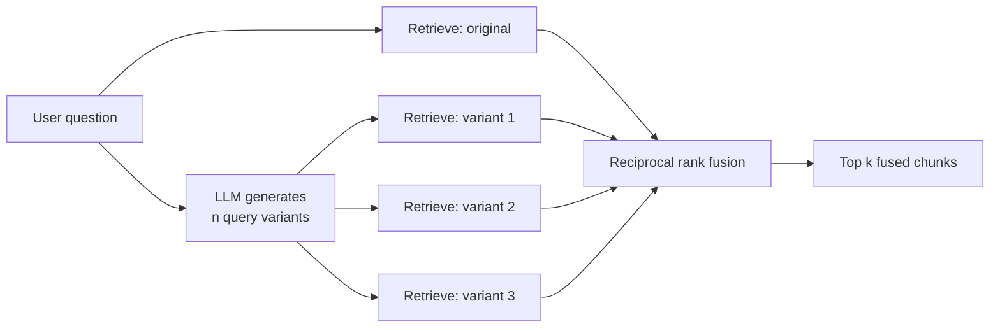

A single query vector is a single point of view. When a user asks "How do I stop my model from overfitting?", the relevant documents talk about dropout, weight penalties, early stopping and data augmentation, and few of them use the word "overfitting". One embedding of the question lands in one spot in vector space and retrieves whatever happens to be nearest: possibly generic pages about models, possibly one of the four techniques, rarely all of them.

**Multi-query retrieval** asks an LLM to rewrite the question several ways, runs a retrieval for each version, and fuses the result lists into one ranking with reciprocal rank fusion (RRF). When the fusion step is RRF, the pattern is often called **RAG-Fusion**. It trades extra retrieval calls for higher recall on broad, ambiguous or under-specified questions.

## The pattern



The retrievals are independent, so they run in parallel; the added latency is roughly one LLM call plus the slowest retrieval, not n times the retrieval time.

## How it differs from its neighbours

Three techniques from this module all involve "more than one query", and they solve different problems.

| Technique | Queries | Retrievals | Solves |
| --- | --- | --- | --- |
| [Query expansion](/learn/advanced-rag/query-expansion) | One query with extra terms | 1 | Vocabulary mismatch |
| Decomposition, from [query transformation](/learn/advanced-rag/query-transformation) | Sub-questions, each covering a **different part** | One per part | Multi-part and comparison questions |
| Multi-query | Paraphrases of the **same** question from different angles | One per variant, then fused | One phrasing missing relevant evidence |

The key distinction from expansion is that each variant gets its own ranked list. A variant that matches a small cluster of documents strongly can push them to the top of its list, instead of having its terms averaged into one blended query.

## The failure, reproduced

```python
import numpy as np
from sklearn.feature_extraction.text import TfidfVectorizer

docs = {
    "dropout": "Dropout randomly zeroes activations during training, which acts as a regulariser for neural networks.",
    "early-stop": "Early stopping halts training when the validation loss stops improving.",
    "l2": "L2 regularisation adds a penalty on large weights to the loss function.",
    "augment": "Data augmentation creates new training examples with flips, crops and noise.",
    "model-fit": "To fit a model, call fit with the training data and labels.",
    "deploy": "Deploy the model behind an API and monitor its latency.",
    "overfit-def": "A model that memorises the training data performs well on it but poorly on new data.",
    "lr": "The learning rate controls the size of each gradient step during training.",
}
ids = list(docs)
vec = TfidfVectorizer(stop_words="english").fit(docs.values())
D = vec.transform(docs.values())

def search(query, k=3):
    scores = (D @ vec.transform([query]).T).toarray().ravel()
    order = [i for i in np.argsort(-scores, kind="stable") if scores[i] > 0]
    return [ids[i] for i in order[:k]]

question = "How do I stop my model from overfitting?"
print(search(question))
```

```output
['deploy', 'model-fit', 'overfit-def']
```

The single query matches "model" and "stop" and retrieves a deployment page, a page about calling `fit`, and a definition of overfitting. None of the techniques that answer the question appear.

## Generating the variants

The prompt asks for **diverse** rewrites. Without that instruction, models tend to return near-duplicates that retrieve the same documents and waste the extra calls.

```python
MULTI_QUERY_PROMPT = """You help search a machine learning knowledge base.
Write {n} different search queries for the question below. Each query should
approach it from a different angle or use different terminology.
Return one query per line, with no numbering.

Question: {question}"""

def fake_llm(prompt):
    # Stub for a model call; a real model returns similar lines.
    return ("regularisation methods such as dropout and weight penalties\n"
            "halt training early when validation loss stops improving\n"
            "regularise neural network training with dropout, data augmentation or early stopping")

def generate_queries(question, llm, n=3):
    reply = llm(MULTI_QUERY_PROMPT.format(n=n, question=question))
    variants = [line.strip() for line in reply.splitlines() if line.strip()]
    return [question] + variants[:n]          # keep the original as one of the queries

queries = generate_queries(question, fake_llm)
for q in queries:
    print(q)
    print("   ", search(q))
```

```output
How do I stop my model from overfitting?
    ['deploy', 'model-fit', 'overfit-def']
regularisation methods such as dropout and weight penalties
    ['l2', 'dropout']
halt training early when validation loss stops improving
    ['early-stop', 'l2', 'lr']
regularise neural network training with dropout, data augmentation or early stopping
    ['early-stop', 'dropout', 'augment']
```

Keeping the original question in the set is a cheap safeguard: if the LLM's variants drift away from the user's intent, the original's results still take part in the fusion.

## Fusing with reciprocal rank fusion

Each list is ranked by its own query, and scores from different queries are not comparable (a long variant produces different score magnitudes from a short one). RRF sidesteps this by using only ranks:

$$
\text{RRF}(d) = \sum_{q \in Q} \frac{1}{k + \text{rank}_q(d)}
$$

where $Q$ is the set of queries, $\text{rank}_q(d)$ is the 1-based position of document $d$ in the list for query $q$ (a document absent from a list contributes nothing for that query), and $k$ is a constant, conventionally 60, that stops the very top positions from dominating.

Step through RRF on three small result lists to see how documents that appear in several lists rise.

```trace
{
  "title": "reciprocal rank fusion with k = 60",
  "code": [
    "lists = [[\"A\", \"B\", \"C\"], [\"B\", \"D\"], [\"B\", \"A\"]]",
    "scores = {}",
    "for results in lists:",
    "    for rank, doc in enumerate(results, start=1):",
    "        scores[doc] = scores.get(doc, 0) + 1 / (60 + rank)",
    "print(sorted(scores, key=scores.get, reverse=True))"
  ],
  "steps": [
    { "line": 2, "vars": { "scores": "{}" }, "note": "Three queries produced three ranked lists. Scores start empty." },
    { "line": 5, "vars": { "results": "['A', 'B', 'C']", "scores": "{A: 0.0164, B: 0.0161, C: 0.0159}" }, "note": "First list: rank 1 earns 1/61, rank 2 earns 1/62, rank 3 earns 1/63. The differences between positions are small." },
    { "line": 5, "vars": { "results": "['B', 'D']", "scores": "{A: 0.0164, B: 0.0325, C: 0.0159, D: 0.0161}" }, "note": "Second list: B is first again and adds 1/61. D appears for the first time." },
    { "line": 5, "vars": { "results": "['B', 'A']", "scores": "{A: 0.0325, B: 0.0489, C: 0.0159, D: 0.0161}" }, "note": "Third list: B adds another 1/61 and A adds 1/62. Appearing in many lists matters far more than exact position." },
    { "line": 6, "vars": { "scores": "{A: 0.0325, B: 0.0489, C: 0.0159, D: 0.0161}" }, "out": ["['B', 'A', 'D', 'C']"], "note": "B, found by all three queries, wins. A, found by two, is second. D and C were each found once; D's rank 2 beats C's rank 3." }
  ]
}
```

Now apply it to the four retrievals:

```python
def rrf(result_lists, k=60):
    scores = {}
    for results in result_lists:
        for rank, doc in enumerate(results, start=1):
            scores[doc] = scores.get(doc, 0.0) + 1.0 / (k + rank)
    return sorted(scores.items(), key=lambda item: -item[1])

fused = rrf([search(q) for q in queries])
for doc, score in fused[:5]:
    print(f"{doc:12} {score:.4f}")
```

```output
early-stop   0.0328
l2           0.0325
dropout      0.0323
deploy       0.0164
model-fit    0.0161
```

The top three are now remedies that two variants each agreed on: early stopping, L2 regularisation and dropout. The generic pages from the original query are pushed down. Data augmentation, found by only one variant at rank 3, ends up level with or below those generic pages; that is the limit of rank fusion on its own, and a reranker scoring candidates against the question would separate them.

> [!KEY]
> RRF rewards **agreement across queries**. A chunk that several phrasings find is likely to be central to the question; a chunk found by a single odd phrasing is likely to be noise. That makes multi-query retrieval with RRF robust to one bad variant.

## Practical details

**How many variants?** Three to five is typical. Each extra variant adds a retrieval and more candidates to dedupe and rerank, and the gains flatten quickly once the main angles are covered.

**Retrieve more per query, then cut.** Fetch, say, 10 to 20 results per variant and keep the fused top 5 to 10. A larger per-query depth gives RRF more evidence of agreement.

**Deduplicate before the prompt.** The same chunk will appear under several queries; RRF merges them by ID, which is one reason every chunk needs a stable identifier.

**Rerank after fusing.** RRF knows nothing about the actual question, only about ranks. A cross-encoder over the fused candidates, scored against the **original** question, restores precision (see [Reranking models](/learn/advanced-rag/reranking-models)).

> [!WARNING]
> Variant generation can drift. An LLM asked for "different angles" on "Python memory leaks" may produce a query about snakes or about Java garbage collection. Give the prompt a one-line description of the corpus, keep the original query in the fused set, and watch for off-topic chunks in your traces.

## Costs and when not to use it

| Cost | Size | Mitigation |
| --- | --- | --- |
| Latency | One LLM call before retrieval can start | Small fast model, short outputs, cache variants for repeated questions |
| Retrieval load | n + 1 searches per question | Run in parallel; usually cheap compared with the LLM |
| Tokens | More candidate chunks to rerank or include | Fuse, dedupe and rerank before building the prompt |

Skip multi-query retrieval when:

- questions are precise lookups ("What is the notice period in contract 4471?"), where paraphrases add nothing but latency;
- your evaluation shows single-query recall at your chosen k is already high;
- latency is critical, in which case expansion (one retrieval) or HyDE may be cheaper alternatives.

## Exercises

**1.** Modify `rrf` to accept a list of weights, one per query, and give the original question weight 2 and each variant weight 1. Does the fused top four change for this example?

<details>
<summary>Show solution</summary>

```python
def weighted_rrf(result_lists, weights, k=60):
    scores = {}
    for results, w in zip(result_lists, weights):
        for rank, doc in enumerate(results, start=1):
            scores[doc] = scores.get(doc, 0.0) + w / (k + rank)
    return sorted(scores.items(), key=lambda item: -item[1])

fused_w = weighted_rrf([search(q) for q in queries], [2, 1, 1, 1])
print([doc for doc, _ in fused_w[:4]])
```

```output
['deploy', 'early-stop', 'l2', 'model-fit']
```

Yes: doubling the original question's weight puts the deployment page first and brings the `fit` page back into the top four, displacing dropout. Weight the original more only when your variants are unreliable, and check the effect on an evaluation set.

</details>

**2.** Write a function that measures how diverse a set of variants is: the fraction of all retrieved document IDs that are unique. Compute it for `queries`.

<details>
<summary>Show solution</summary>

```python
def retrieval_diversity(queries, k=3):
    found = [doc for q in queries for doc in search(q, k)]
    return len(set(found)) / len(found)

print(round(retrieval_diversity(queries), 2))
```

```output
0.73
```

A value near the minimum (every query finding the same documents) means the variants are near-duplicates and the extra retrievals are wasted. Tracking this across real traffic tells you whether your generation prompt produces useful diversity.

</details>

**3.** A colleague proposes running multi-query retrieval with 10 variants for every question to "maximise recall". Give two arguments against.

<details>
<summary>Show solution</summary>

More variants means more retrieval load and more candidates to rerank, raising cost and latency for diminishing returns, since most relevant chunks are found by the first few angles. More variants also means more chance of drifted, off-topic queries whose results enter the fused list; and for precise lookup questions, any variants at all only add noise. Selective use, routed by question type, is better.

</details>

```quiz
[
  {
    "q": "What distinguishes multi-query retrieval from query expansion?",
    "options": [
      "Multi-query retrieval uses BM25, expansion uses vectors",
      "Each variant gets its own retrieval and ranked list, which are then fused",
      "Expansion requires an LLM and multi-query does not",
      "Multi-query retrieval only works for comparison questions"
    ],
    "answer": 1,
    "why": "Expansion adds terms to one query and retrieves once; multi-query runs separate retrievals and fuses the rankings."
  },
  {
    "q": "In RRF with k = 60, which document scores highest?",
    "options": [
      "A document ranked 2nd in each of three lists",
      "A document ranked 3rd in one list only",
      "A document ranked 1st in one list only",
      "A document ranked 1st in a list with the highest raw similarity score"
    ],
    "answer": 0,
    "why": "Three contributions of 1/62 sum to about 0.048, far more than a single 1/61 of about 0.016. Raw scores are ignored."
  },
  {
    "q": "Why is the user's original question usually kept among the queries?",
    "options": [
      "RRF requires at least four lists",
      "The original always retrieves the best documents",
      "It makes the LLM call cheaper",
      "It guards against generated variants that drift from the user's intent"
    ],
    "answer": 3,
    "why": "If the variants go off-topic, the original query's results still participate in the fusion."
  },
  {
    "q": "Which question benefits least from multi-query retrieval?",
    "options": [
      "How can I make my web app faster?",
      "What are the risks of deploying LLMs in healthcare?",
      "What is the notice period in contract 4471?",
      "How do I stop my model from overfitting?"
    ],
    "answer": 2,
    "why": "A precise lookup has one correct phrasing and one target; paraphrases only add latency and possible noise."
  }
]
```
