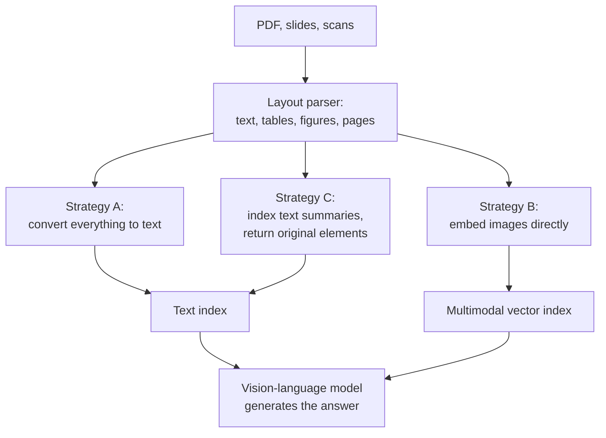

Real document collections are not plain text. Annual reports put their key numbers in tables, engineering manuals explain procedures with diagrams, slide decks carry their message in charts, and older archives are scanned images with no text layer at all. A naive pipeline that extracts text and chunks it loses all of this: tables become jumbled runs of numbers, charts and diagrams vanish, and scanned pages produce nothing or OCR noise. Ask "what does the revenue chart on slide 12 show?" and the system cannot even find slide 12.

**Multimodal RAG** retrieves from, and generates with, content that is not only text. This lesson focuses on the document-centric case an AI engineer meets first: PDFs, slides and scans with tables, charts and figures. The later lesson [Multimodal RAG](/learn/multimodal-ai/multimodal-rag) in the Multimodal AI module goes deeper into the models, and into audio and video.

## What naive parsing loses

| Element | What text extraction produces | What a question needs |
| --- | --- | --- |
| Table | Cells flattened in reading order, header relationships lost | "What was gross margin in 2023?" needs row and column together |
| Chart | Axis labels and a title at best; the data is in pixels | Trends, comparisons, approximate values |
| Diagram or photo | Nothing, or a caption if there is one | What the figure depicts |
| Scanned page | Nothing without OCR; with OCR, errors and broken layout | Everything on the page |
| Slide | Fragments of text boxes, out of order | The slide's message, which is often visual |

[Document parsing](/learn/rag-fundamentals/document-parsing) introduced layout-aware parsers that detect these elements. Multimodal RAG decides what to do with each one once detected.

## Three strategies



**Strategy A: convert to text.** Run OCR on scans, serialise tables to Markdown or HTML, and ask a vision-language model (VLM, see [Vision-language models](/learn/multimodal-ai/vision-language-models)) to write a detailed caption for each chart and figure. Everything then flows through the ordinary text pipeline: chunking, hybrid search, reranking. This is the most compatible approach and usually the first one to try.

**Strategy B: embed images directly.** A multimodal embedding model maps images and text into one shared vector space (the CLIP family is the classic example; see [Multimodal embeddings](/learn/multimodal-ai/multimodal-embeddings)), so a text query can retrieve an image by similarity without any caption. A newer variant embeds **whole page screenshots** with a vision-language retriever, of which ColPali is a well-known example using ColBERT-style late interaction over image patches (the MaxSim idea from [Reranking models](/learn/advanced-rag/reranking-models)). This skips OCR and layout parsing entirely.

**Strategy C: index a summary, return the original.** Index a text description of each element for retrieval, but store the original table or image and pass **that** to a VLM at generation time. This is the parent-child idea from [Parent-child retrieval](/learn/advanced-rag/parent-child-retrieval) applied across modalities: search the unit that matches well, read the unit that answers well.

## Captioning versus vision-language embeddings

| | Captioning (A or C) | Vision-language embeddings (B) |
| --- | --- | --- |
| Indexing cost | One VLM call per figure or page | One embedding pass per image; usually cheaper |
| Works with BM25 and existing text tools | Yes | No, needs a multimodal vector index |
| Captures fine detail (exact numbers in a chart) | Only what the caption mentions | Depends on the model; small text in images is hard |
| Inspectable and debuggable | Yes: you can read the caption | Harder: you only have a vector |
| Risk | Caption hallucinations become "facts" in the index | Weak matches for abstract or numeric queries |

In practice many systems combine them: captions and OCR text in a hybrid text index, page-image embeddings as an extra retriever, fused with RRF.

## Tables: serialise for search, keep structure for answers

A table needs two representations. For **generation**, keep it whole with its header, as Markdown or HTML, so the model can read across rows and columns. For **retrieval**, a whole table is a weak chunk (one vector for dozens of numbers); describing each row as a sentence, with the column names repeated, gives precise matches for questions about specific cells.

```python
import numpy as np
import pandas as pd
from sklearn.feature_extraction.text import TfidfVectorizer

table = pd.DataFrame({
    "year": [2022, 2023, 2024],
    "revenue_musd": [410, 455, 470],
    "gross_margin_pct": [38.5, 41.2, 40.1],
    "employees": [1200, 1350, 1310],
})
caption = "Table 4: Financial summary 2022 to 2024, Helix Motors"

def to_markdown(df):
    header = "| " + " | ".join(df.columns) + " |"
    rule = "| " + " | ".join("---" for _ in df.columns) + " |"
    rows = ["| " + " | ".join(str(v) for v in row) + " |" for row in df.itertuples(index=False)]
    return "\n".join([header, rule] + rows)

def row_sentences(df, caption, key="year"):
    out = []
    for row in df.to_dict("records"):
        parts = [f"{col.replace('_', ' ')} is {row[col]}" for col in df.columns if col != key]
        out.append(f"{caption}. For {key} {row[key]}: " + ", ".join(parts) + ".")
    return out

print(to_markdown(table))
print(row_sentences(table, caption)[1])
```

```output
| year | revenue_musd | gross_margin_pct | employees |
| --- | --- | --- | --- |
| 2022 | 410 | 38.5 | 1200 |
| 2023 | 455 | 41.2 | 1350 |
| 2024 | 470 | 40.1 | 1310 |
Table 4: Financial summary 2022 to 2024, Helix Motors. For year 2023: revenue musd is 455, gross margin pct is 41.2, employees is 1350.
```

The row sentence repeats the caption and the column names, so it can match "gross margin in 2023" on its own. Each sentence points back to the full table, which is what the generator receives.

## A multi-vector index across element types

Below, every element (a text chunk, the table's row sentences, a chart, a scanned page) gets a text representation for search and a pointer to the original for generation. The chart and page descriptions are the kind of text a VLM caption or OCR pass produces; here they are written by hand.

```python
elements = [
    {"id": "p3-text", "type": "text", "original": "p3.txt",
     "search_text": "Helix Motors expanded its van range and opened a second assembly line in 2023."},
    {"id": "fig-2", "type": "chart", "original": "figures/fig2.png",
     "search_text": "Bar chart of quarterly van deliveries for 2023: deliveries rise each quarter, "
                    "with the largest increase in Q4."},
    {"id": "scan-7", "type": "scanned page", "original": "scans/page7.png",
     "search_text": "Scanned safety certificate for the Gdansk battery plant, signed by the inspector."},
]
for i, sentence in enumerate(row_sentences(table, caption)):
    elements.append({"id": f"table-4-row{i}", "type": "table", "original": "tables/table4.md",
                     "search_text": sentence})

vec = TfidfVectorizer(stop_words="english").fit([e["search_text"] for e in elements])
E = vec.transform([e["search_text"] for e in elements])

def retrieve(query, k=2):
    scores = (E @ vec.transform([query]).T).toarray().ravel()
    hits, seen = [], set()
    for i in np.argsort(-scores, kind="stable"):
        e = elements[i]
        if scores[i] > 0 and e["original"] not in seen:     # one entry per original element
            seen.add(e["original"])
            hits.append((e["type"], e["original"], round(float(scores[i]), 3)))
    return hits[:k]

for q in ["What was gross margin in 2023?",
          "How did van deliveries change during 2023?",
          "Is there a safety certificate for the battery plant?"]:
    print(q, "->", retrieve(q))
```

```output
What was gross margin in 2023? -> [('table', 'tables/table4.md', 0.38), ('text', 'p3.txt', 0.143)]
How did van deliveries change during 2023? -> [('chart', 'figures/fig2.png', 0.592), ('text', 'p3.txt', 0.28)]
Is there a safety certificate for the battery plant? -> [('scanned page', 'scans/page7.png', 0.707)]
```

Each question reaches a different modality through the same text index, and the result is the **original** element: the full table, the chart image, the page scan. Deduplicating by original stops three row sentences from filling the results with copies of one table.

## Generating with images

At generation time, the retrieved originals go into a single request to a vision-capable model: text chunks and tables as text, charts and scans as images. Most chat APIs accept a list of content parts per message, mixing text with images supplied as URLs or base64 data. The sketch below shows the shape; the exact field names differ between providers, so follow your provider's documentation.

```python
def build_multimodal_message(question, hits, load_text, load_image_b64):
    parts = [{"type": "text", "text": f"Answer using only the material below.\nQuestion: {question}"}]
    for kind, original, _ in hits:
        if kind in ("chart", "scanned page"):
            parts.append({"type": "image", "data": load_image_b64(original)})   # provider-specific shape
        else:
            parts.append({"type": "text", "text": load_text(original)})
    return [{"role": "user", "content": parts}]
```

> [!WARNING]
> Images are expensive context. Each image costs a substantial number of input tokens, often far more than a paragraph of text, and models read small chart labels less reliably than text. Send the few images that matter, at a sensible resolution, and prefer the table's text over a screenshot of the table.

## Scanned documents

Scans add an extraction problem before retrieval can start. Classical OCR engines handle clean printed pages well but struggle with complex layouts, handwriting, stamps and poor scans. VLMs can transcribe pages and describe their layout, at a much higher cost per page. Whichever you use:

- keep the page image alongside the extracted text, so a VLM can check the original at answer time;
- store OCR confidence where available, and route low-confidence pages to a stronger model or to review;
- remember that OCR errors break keyword search for exactly the identifiers (invoice numbers, names) that users query most.

> [!TIP]
> Evaluate per modality. Build part of your golden set from questions whose answers live only in tables, only in charts and only in scans, and report retrieval recall separately for each. Averages hide the fact that a system can be excellent on text and blind to charts.

## When not to go multimodal

If almost every question is answered by the text, a good layout parser plus table serialisation (strategy A, minus the captioning) captures most of the value at little extra cost. Add VLM captioning when error analysis shows misses on figures; add image embeddings or page-image retrieval when captions are not enough or when scanned and visually complex pages dominate the corpus.

> [!KEY]
> Separate what you search from what you show. Text summaries, captions and row sentences make non-text content findable with the tools you already have; the original table or image, passed to a vision-language model, makes it answerable.

## Exercises

**1.** Modify `row_sentences` to also produce one sentence per **column**, summarising the column across years (for example "gross margin pct by year: 2022: 38.5, 2023: 41.2, 2024: 40.1."). Which kind of question does that help?

<details>
<summary>Show solution</summary>

```python
def column_sentences(df, caption, key="year"):
    out = []
    for col in df.columns:
        if col == key:
            continue
        values = ", ".join(f"{k}: {v}" for k, v in zip(df[key], df[col]))
        out.append(f"{caption}. {col.replace('_', ' ')} by {key}: {values}.")
    return out

print(column_sentences(table, caption)[1])
```

```output
Table 4: Financial summary 2022 to 2024, Helix Motors. gross margin pct by year: 2022: 38.5, 2023: 41.2, 2024: 40.1.
```

Column sentences match trend questions ("how has gross margin changed?"), which no single row answers.

</details>

**2.** A chart's caption says "Figure 2: Deliveries". A user asks how deliveries changed in the fourth quarter. Why might retrieval fail even though the chart is indexed, and how would you fix it?

<details>
<summary>Show solution</summary>

The indexed text is only the original caption, which says nothing about quarters, trends or values, so the question has little to match. Generate a richer description with a VLM at indexing time (chart type, axes, period, the main trend and notable values), index that, and keep the image for generation. Alternatively, add an image-embedding retriever, though fine-grained questions about values are better served by descriptive text.

</details>

**3.** You are designing RAG over 50,000 scanned insurance claim forms. Outline the pipeline in four or five steps.

<details>
<summary>Show solution</summary>

1. OCR each page, keeping the page image and per-field confidence; route low-confidence pages to a VLM transcription pass.
2. Because forms share a layout, extract fields (claim number, date, policy, amounts) into structured metadata rather than relying only on free text.
3. Index the OCR text in a hybrid index, with claim and policy numbers as exact-match fields.
4. At query time, filter by metadata where possible, retrieve, and pass the page images of the top hits with the text to a VLM.
5. Evaluate per field type, especially identifiers, where OCR errors do most damage.

</details>

```quiz
[
  {
    "q": "Why is a whole table a weak retrieval unit?",
    "options": [
      "Tables cannot be embedded",
      "Tables are always images",
      "One vector must represent dozens of values, so specific cell questions match weakly",
      "BM25 ignores numbers"
    ],
    "answer": 2,
    "why": "Pooling many rows into one representation dilutes each fact, just as with long text chunks."
  },
  {
    "q": "What does strategy C (index a summary, return the original) have in common with parent-child retrieval?",
    "options": [
      "Both require a knowledge graph",
      "Both search one unit and pass a different, richer unit to the generator",
      "Both only work for scanned pages",
      "Both avoid using a vector index"
    ],
    "answer": 1,
    "why": "Each separates the representation used for matching from the content used for answering."
  },
  {
    "q": "Which is an advantage of VLM captioning over vision-language embeddings?",
    "options": [
      "The caption is readable text that works with BM25 and can be inspected",
      "It is always cheaper at indexing time",
      "It needs no model calls",
      "It captures every number in a chart"
    ],
    "answer": 0,
    "why": "Captions are plain text, so they fit existing hybrid pipelines and can be checked by a human."
  },
  {
    "q": "Why should retrieval recall be reported separately for tables, charts and scans?",
    "options": [
      "Evaluation tools require it",
      "Charts cannot be evaluated",
      "An overall average can hide that one modality is almost never retrieved",
      "It reduces evaluation cost"
    ],
    "answer": 2,
    "why": "If most questions are about text, failures on a minority modality barely move the average."
  }
]
```
