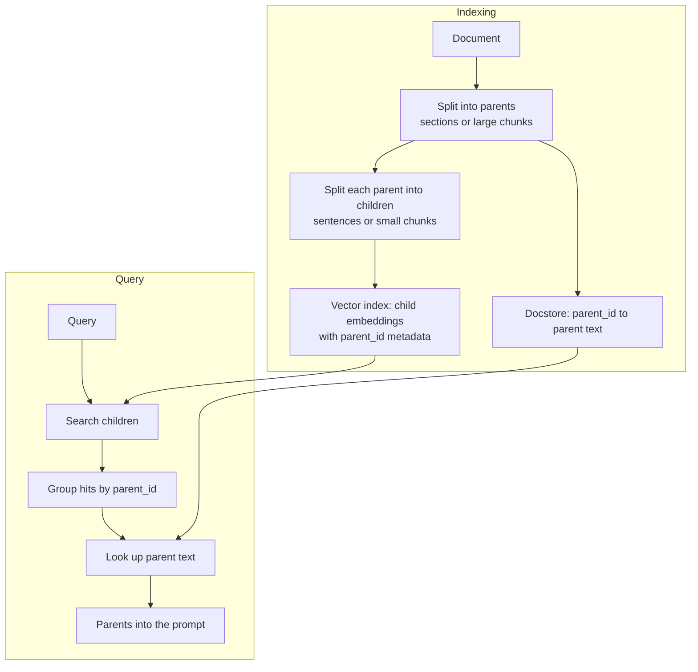

Every chunking decision in naive RAG fights a tug of war. Small chunks give sharp embeddings that match specific questions precisely, but a single sentence rarely carries enough context for the model to answer well. Large chunks carry the context, but their embeddings average many ideas together, so they match specific questions weakly and lose to more focused chunks. [Chunking strategies](/learn/rag-fundamentals/chunking-strategies) treated this as one dial to set. **Parent-child retrieval** removes the dilemma by using two sizes for two different jobs: small **child** chunks for searching, and the larger **parent** chunks they came from for reading.

## The failure it fixes

Consider a handbook section on leave:

> Full-time staff receive 25 days of annual leave. Leave requests go to your line manager. Unused leave of up to 5 days carries over to the next year. You can self-certify sickness for up to 7 days. After that, a doctor's note is required.

A user asks "How long can I self-certify sickness, and what happens after that?"

- Index **sentences**, and the best match is "You can self-certify sickness for up to 7 days." The answer to the second half, the doctor's note, is in the next sentence, which was not retrieved.
- Index **whole sections**, and the section's embedding is mostly about annual leave. It still matches, but more weakly, and in a corpus of thousands of sections a weak match is easily outranked.

Parent-child retrieval searches the sentences and returns the section.

## The architecture



Two stores are involved. The **vector index** holds only children, each tagged with its parent's ID as metadata. A separate **docstore** (any key-value store: a database table, Redis, even a dictionary for small corpora) maps parent IDs to parent text. Parents are never embedded.

## Building it

```python
import re
import numpy as np
from sklearn.feature_extraction.text import TfidfVectorizer

parents = {
    "leave": ("Full-time staff receive 25 days of annual leave. Leave requests go to your line manager. "
              "Unused leave of up to 5 days carries over to the next year. "
              "You can self-certify sickness for up to 7 days. After that, a doctor's note is required."),
    "expenses": ("Claim expenses within 30 days of purchase. Receipts are required for every claim. "
                 "Book economy class for flights under 6 hours. Hotel costs are capped per night by city."),
    "it": ("Laptops are replaced every 4 years. Report a lost laptop to IT security within 24 hours. "
           "Personal devices need the security app before they can access email."),
    "wellbeing": ("The wellbeing programme offers free counselling sessions. "
                  "Staff can take a paid wellbeing day each year. "
                  "Sickness absence is reviewed after three periods in a year."),
}

def split_sentences(text):
    return [s.strip() for s in re.split(r"(?<=[.!?])\s+", text) if s.strip()]

# Each child records its parent and its position within the parent.
children = [(pid, i, s) for pid, text in parents.items()
            for i, s in enumerate(split_sentences(text))]

vec = TfidfVectorizer(stop_words="english").fit([c[2] for c in children])
child_vecs = vec.transform([c[2] for c in children])
parent_vecs = vec.transform(list(parents.values()))   # only for comparison below

question = "How long can I self-certify sickness, and what happens after that?"
q = vec.transform([question])

child_scores = (child_vecs @ q.T).toarray().ravel()
best = int(np.argmax(child_scores))
print("best child: ", round(float(child_scores[best]), 3), children[best][2])
print("its parent: ", round(float((parent_vecs @ q.T).toarray().ravel()[0]), 3))
```

```output
best child:  0.921 You can self-certify sickness for up to 7 days.
its parent:  0.327
```

The child matches far more strongly than its parent does, because the parent's vector is spread across annual leave, carry-over and requests. Searching children gives the precise match; the next step returns the parent.

## Retrieving parents

Several children of one parent often match the same query. The retriever must **group hits by parent**, score each parent (the maximum child score is the usual choice), and return each parent once.

```python
def retrieve_parents(question, k_children=5, k_parents=2):
    scores = (child_vecs @ vec.transform([question]).T).toarray().ravel()
    best_per_parent = {}
    for i in np.argsort(-scores)[:k_children]:
        if scores[i] <= 0:
            continue
        pid = children[i][0]
        best_per_parent[pid] = max(best_per_parent.get(pid, 0.0), float(scores[i]))
    ranked = sorted(best_per_parent.items(), key=lambda kv: -kv[1])[:k_parents]
    return [(pid, round(score, 3)) for pid, score in ranked]

for pid, score in retrieve_parents(question):
    print(pid, score)
    print("   ", parents[pid])
```

```output
leave 0.921
    Full-time staff receive 25 days of annual leave. Leave requests go to your line manager. Unused leave of up to 5 days carries over to the next year. You can self-certify sickness for up to 7 days. After that, a doctor's note is required.
wellbeing 0.218
    The wellbeing programme offers free counselling sessions. Staff can take a paid wellbeing day each year. Sickness absence is reviewed after three periods in a year.
```

The prompt now contains the full leave section, including the doctor's note rule. The wellbeing section comes second through its sentence about sickness absence; whether it belongs in the prompt is a job for a score threshold or a reranker.

> [!TIP]
> Fetch more children than you need parents. If you retrieve only five children and all five come from one long parent, you end up with one parent. Retrieving 20 to 50 children before grouping gives you enough distinct parents to choose from.

## Variants: sentence windows and auto-merging

**Sentence-window retrieval** is parent-child without fixed parents. Each child stores its position, and at query time the retriever returns the child plus a window of neighbouring sentences. The window is centred on the hit, so it never cuts the context off just before the matching sentence.

```python
def sentence_window(question, window=1):
    scores = (child_vecs @ vec.transform([question]).T).toarray().ravel()
    pid, pos, _ = children[int(np.argmax(scores))]
    sentences = split_sentences(parents[pid])
    return " ".join(sentences[max(0, pos - window): pos + window + 1])

print(sentence_window(question))
```

```output
Unused leave of up to 5 days carries over to the next year. You can self-certify sickness for up to 7 days. After that, a doctor's note is required.
```

**Auto-merging** builds a hierarchy (for example 128-token leaves inside 512-token chunks inside 2,048-token sections) and decides how much to return per query: if enough of a node's children are retrieved, they are replaced by the node itself. A narrow question gets a few leaves; a broad one gets the whole section.

| Variant | Returned unit | Strength | Weakness |
| --- | --- | --- | --- |
| Parent-child | The child's fixed parent (section or large chunk) | Simple, respects document structure | Parents can be very long |
| Sentence window | Child plus n neighbours | Centred context, tunable size | Ignores section boundaries |
| Auto-merging | Children, or their parent when many match | Adapts size to the question | More complex indexing and logic |
| Propositions plus source | Source passage of a matching proposition | Very precise matching | LLM cost at indexing (see [Advanced chunking](/learn/advanced-rag/advanced-chunking)) |

## Choosing the sizes

- **Children** should be small enough to express one idea: a sentence, a proposition, or a chunk of roughly 100 to 200 tokens. Very short children ("See above.") are noise; merge them with a neighbour.
- **Parents** should be the unit a reader needs to act on: a section, a FAQ entry, a function with its docstring. Use the document's own structure where it exists.
- **Budget**: the prompt now holds parents, not chunks. With k parents of size P tokens, you spend roughly k × P tokens of context. Cap parent length (split very long sections into several parents) so a single giant section cannot fill the window.

> [!WARNING]
> Parent-child retrieval multiplies the tokens you send to the generator. Returning three 2,000-token sections where three 200-token chunks would do costs roughly ten times the input tokens and adds latency, and burying the answer in more text can make the model miss it. Measure answer quality and cost together, not retrieval recall alone.

## When not to use it

- Your documents are already short and self-contained (product cards, FAQ entries, tickets). The chunk is the parent; there is nothing to expand.
- Your questions need a single fact and your chunks already carry their context, perhaps through [contextual retrieval](/learn/advanced-rag/contextual-retrieval) or heading breadcrumbs.
- Your token budget is tight, for example many retrieved items for a multi-document comparison. Prefer small windows over whole parents there.

> [!KEY]
> Separate the unit you **search** from the unit you **read**. Once you see retrieval this way, many designs open up: search summaries and return tables, search captions and return images, search propositions and return passages. You will meet the first two again in [Multimodal RAG](/learn/advanced-rag/multimodal-rag).

## Exercises

**1.** Change `retrieve_parents` to score each parent by the **sum** of its retrieved children's scores instead of the maximum. Run it on "How many days of leave do I get and how many carry over?" and compare with the maximum. Which aggregation favours long parents?

<details>
<summary>Show solution</summary>

```python
def retrieve_parents_sum(question, k_children=5, k_parents=2):
    scores = (child_vecs @ vec.transform([question]).T).toarray().ravel()
    totals = {}
    for i in np.argsort(-scores)[:k_children]:
        if scores[i] > 0:
            pid = children[i][0]
            totals[pid] = totals.get(pid, 0.0) + float(scores[i])
    return sorted(((p, round(s, 3)) for p, s in totals.items()), key=lambda kv: -kv[1])[:k_parents]

q2 = "How many days of leave do I get and how many carry over?"
print(retrieve_parents(q2))
print(retrieve_parents_sum(q2))
```

```output
[('leave', 0.544), ('expenses', 0.229)]
[('leave', 1.541), ('expenses', 0.229)]
```

The order is the same here, but the leave section's lead grows because several of its sentences matched. The sum rewards parents with many matching children, so long parents that mention a topic often are favoured, even if no single sentence answers well. The maximum rewards the single best match. Sum is useful when a question needs several facts from one section; maximum is the safer default.

</details>

**2.** Extend `sentence_window` so that it never crosses into another parent, and returns the window size actually used. Why might the effective window be smaller than requested?

<details>
<summary>Show solution</summary>

The existing function already stays within one parent because it slices only that parent's sentences. Return the size too:

```python
def sentence_window_sized(question, window=1):
    scores = (child_vecs @ vec.transform([question]).T).toarray().ravel()
    pid, pos, _ = children[int(np.argmax(scores))]
    sentences = split_sentences(parents[pid])
    picked = sentences[max(0, pos - window): pos + window + 1]
    return " ".join(picked), len(picked)

print(sentence_window_sized("When are laptops replaced?", window=2))
```

```output
('Laptops are replaced every 4 years. Report a lost laptop to IT security within 24 hours. Personal devices need the security app before they can access email.', 3)
```

A window of 2 asks for five sentences, but only three come back: the hit is the first sentence of a three-sentence parent, so there is nothing before it and only two sentences after it.

</details>

**3.** A team indexes product FAQ entries, each 2 to 4 sentences long, and asks whether to add parent-child retrieval. What do you advise?

<details>
<summary>Show solution</summary>

Probably not. Each FAQ entry is already a natural, short, self-contained unit, so indexing the entry is both the precise search unit and the right reading unit. Parent-child would add a docstore and grouping logic for little gain. Check retrieval metrics first; if specific questions are missed, adding the entry's question text to each chunk is a cheaper fix.

</details>

```quiz
[
  {
    "q": "In parent-child retrieval, what is stored in the vector index?",
    "options": [
      "Parent chunks only",
      "Both parents and children with equal weight",
      "Child chunks, each with its parent's ID",
      "Only document titles"
    ],
    "answer": 2,
    "why": "Children are embedded and searched; parents live in a docstore and are fetched by ID after the search."
  },
  {
    "q": "Why does a whole-section embedding match a specific question weakly?",
    "options": [
      "Sections exceed the embedding model's dimension",
      "Vector databases cannot store long text",
      "Sections are never normalised",
      "Its vector averages many ideas, so the matching idea is diluted"
    ],
    "answer": 3,
    "why": "A single vector for many sentences represents their blend; one specific sentence's meaning contributes only a fraction."
  },
  {
    "q": "Four of the top five child hits come from the same parent. What should the retriever do?",
    "options": [
      "Return that parent four times",
      "Return the parent once, scored by its best child, and fill the remaining slots from other parents",
      "Discard the parent as over-represented",
      "Return only the four child sentences"
    ],
    "answer": 1,
    "why": "Grouping by parent ID avoids duplicating text in the prompt while preserving the strong evidence."
  },
  {
    "q": "What is the main cost of returning parents instead of chunks?",
    "options": [
      "Embeddings must be recomputed per query",
      "Slower vector search",
      "More tokens in the prompt, raising cost and latency",
      "It prevents using metadata filters"
    ],
    "answer": 2,
    "why": "Parents are larger than chunks, so the same k fills more of the context window and costs more per call."
  }
]
```
