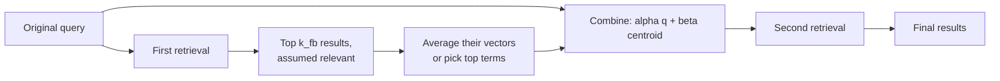

A user types "laptop won't turn on". Your support documents say "notebook will not power up". Both sentences mean the same thing and share no content words, so a keyword retriever scores the right document at zero and returns a page about laptop bags instead. This is the **vocabulary mismatch problem**, and it is the oldest problem in information retrieval. Dense embeddings soften it but do not remove it: product names, internal jargon and rare terms still trip them up.

**Query expansion** attacks the mismatch by adding terms to the query, so that it matches documents written in other words. Where [query transformation](/learn/advanced-rag/query-transformation) replaces the query, expansion **keeps the original and adds to it**. This lesson covers the three families: synonym (thesaurus) expansion, pseudo-relevance feedback and LLM-generated expansion.

## The failure, reproduced

```python
import numpy as np
from sklearn.feature_extraction.text import TfidfVectorizer

docs = [
    "Notebook will not power up: hold the power button for 30 seconds to reset the battery controller.",
    "If the notebook screen stays black after power up, connect an external monitor to test the display.",
    "Laptop bags and sleeves are available in three sizes.",
    "Battery controller reset: unplug the charger, hold the power button, then reconnect the charger.",
    "Turn on automatic updates in the settings menu.",
    "Desktop towers ship with a wired keyboard and mouse.",
]
vec = TfidfVectorizer(stop_words="english")
D = vec.fit_transform(docs)          # rows are L2-normalised, so D @ q is cosine similarity
terms = vec.get_feature_names_out()

def scores_for(qvec, k=3):
    s = D @ qvec
    top = np.argsort(-s)[:k]
    return [(int(i), round(float(s[i]), 2)) for i in top]

def search(query, k=3):
    return scores_for(vec.transform([query]).toarray().ravel(), k)

print(search("laptop won't turn on"))
```

```output
[(2, 0.32), (4, 0.32), (0, 0.0)]
```

The two relevant documents are 0 and 3. The query retrieves the bag catalogue (document 2) and the software-update page (document 4) on surface words, and document 0 scores exactly zero.

## Synonym expansion

The oldest fix is a **thesaurus**: a mapping from terms to equivalents that you append to the query. For a domain corpus, the useful thesaurus is not a general dictionary but a list built from your own data: product aliases, abbreviations, old and new names, and the phrases users type next to the phrases writers use.

```python
SYNONYMS = {
    "laptop": ["notebook"],
    "turn on": ["power up"],
    "won't": ["will not"],
}

def expand_synonyms(query):
    extra = [alt for term, alts in SYNONYMS.items() if term in query.lower() for alt in alts]
    return query + " " + " ".join(extra)

expanded = expand_synonyms("laptop won't turn on")
print(expanded)
print(search(expanded))
```

```output
laptop won't turn on notebook power up will not
[(0, 0.33), (2, 0.25), (4, 0.25)]
```

Document 0 now ranks first. Document 3, the battery-controller reset, is still missing: the only word it shares with the expanded query is "power".

Good sources for a domain thesaurus are search logs (queries that were reformulated within a session), the corpus's own glossary, and product catalogues. Most search engines, including Elasticsearch and OpenSearch, support synonym lists at query time, so you can apply them without touching the index.

## Pseudo-relevance feedback

**Relevance feedback** improves a query using documents a person has marked as relevant. **Pseudo-relevance feedback (PRF)** skips the person: it assumes the top few results of a first search are relevant, and moves the query towards them. The classic formula is **Rocchio's**:

$$
\mathbf{q}' = \alpha\,\mathbf{q} + \frac{\beta}{|R|}\sum_{\mathbf{d} \in R} \mathbf{d}
$$

Here $\mathbf{q}$ is the original query vector, $R$ is the set of top-ranked documents assumed relevant, $|R|$ is how many there are, $\mathbf{d}$ is a document vector, and $\alpha$ and $\beta$ weight the original query against the feedback. (The full Rocchio formula also subtracts non-relevant documents, but PRF has no reliable negatives, so that term is usually dropped.)



```python
def rocchio(query, k_fb=1, alpha=1.0, beta=0.75):
    q = vec.transform([query]).toarray().ravel()
    feedback = np.argsort(-(D @ q))[:k_fb]
    centroid = D[feedback].toarray().mean(axis=0)
    q_new = alpha * q + beta * centroid
    return q_new / np.linalg.norm(q_new)

q_prf = rocchio(expanded)
print(scores_for(q_prf))
q_before = vec.transform([expanded]).toarray().ravel()
added = [terms[i] for i in np.argsort(-q_prf) if q_prf[i] > 0 and q_before[i] == 0]
print("terms added by feedback:", added)
```

```output
[(0, 0.75), (3, 0.32), (1, 0.25)]
terms added by feedback: ['seconds', '30', 'button', 'controller', 'battery', 'hold', 'reset']
```

The feedback document contributed new terms, including "button", "battery", "controller" and "reset", which pulled document 3 into second place. PRF discovered vocabulary that neither the user nor the thesaurus supplied.

### Query drift

PRF has a well-known failure: if the first retrieval is wrong, feedback makes it more wrong. This is **query drift**.

```python
print(scores_for(rocchio("laptop won't turn on")))
```

```output
[(2, 0.75), (4, 0.22), (0, 0.0)]
```

Run on the unexpanded query, the top result was the bag catalogue, so the feedback added "bags" and "sleeves" and the relevant documents stayed out of sight. Keep $k_{fb}$ small, keep $\alpha$ larger than $\beta$, and apply PRF only when the first retrieval looks confident (for example, when the top score clears a threshold).

## LLM-based expansion

An LLM knows many synonyms, related terms and likely answer phrases without you building a thesaurus. Ask it for keywords, or for a short pseudo-answer (as in HyDE), and append the result to the original query. Repeating the original query a few times before the generated text is a common trick to stop the expansion swamping it.

```python
EXPAND_PROMPT = """List search keywords and phrases that documents answering this
question are likely to contain. Include synonyms and technical terms.
One line, comma-separated, no explanations.

Question: {q}"""

def llm(prompt):
    # Stub standing in for a model call; a real model returns something similar.
    return "notebook, power up, no power, power button, battery reset, charger"

def expand_llm(query, repeat=2):
    keywords = llm(EXPAND_PROMPT.format(q=query)).replace(",", " ")
    return " ".join([query] * repeat + [keywords])

print(search(expand_llm("laptop won't turn on")))
```

```output
[(0, 0.49), (3, 0.43), (2, 0.22)]
```

Both relevant documents are now in the top two. LLM expansion is particularly effective for **keyword (BM25) retrieval**, where the mismatch hurts most. For dense retrieval it helps less, because the embedding model already places "laptop" near "notebook".

## Comparing the three approaches

| Method | Extra cost per query | Strengths | Weaknesses |
| --- | --- | --- | --- |
| Synonym lists | Negligible | Predictable, auditable, fast | Must be built and maintained; misses unseen terms |
| Pseudo-relevance feedback | A second retrieval | No external knowledge needed; adapts to the corpus | Query drift when the first results are poor |
| LLM expansion | One LLM call | Broad vocabulary, no maintenance | Latency, cost, may add off-domain or invented terms |

> [!WARNING]
> Expansion trades precision for recall. Every added term is another way for an irrelevant document to match. Watch precision-oriented metrics such as MRR alongside recall when you evaluate it, and be especially careful with ambiguous terms: expanding "Java" with "coffee" will hurt a programming corpus.

## When not to expand

- **Exact-identifier queries.** Error codes, SKUs and names should be matched as typed.
- **Dense-only retrieval with a strong embedding model.** The model already handles common synonyms; measure before adding the latency.
- **When a reranker follows.** Expansion widens the candidate pool; a reranker (see [Reranking models](/learn/advanced-rag/reranking-models)) restores precision. That combination works well, but expansion without a reranker can leave the top results noisier.

> [!KEY]
> Expansion and transformation are not rivals. A typical production stack condenses the conversation, expands the query for the keyword index, searches the vector index with the condensed query, and fuses the two result lists, which is the subject of [Hybrid retrieval](/learn/advanced-rag/hybrid-retrieval).

## Exercises

**1.** Run `rocchio(expanded, k_fb=2)` and compare the ranking with `k_fb=1`. Explain what changed.

<details>
<summary>Show solution</summary>

```python
print(scores_for(rocchio(expanded, k_fb=2)))
```

```output
[(0, 0.54), (2, 0.48), (1, 0.22)]
```

With two feedback documents, the centroid averages document 0 with the second result of the first pass, the bag catalogue (tied with the update page). Its terms dilute the useful "battery controller" signal: document 3 drops out of the top three and the bag catalogue climbs to second, a small case of query drift. With a tiny corpus, only the very top result is trustworthy; on large corpora, values of 3 to 10 are common.

</details>

**2.** Write `expand_synonyms_bidirectional` so that a query containing "notebook" is also expanded with "laptop". Why does this matter?

<details>
<summary>Show solution</summary>

```python
def expand_synonyms_bidirectional(query):
    pairs = [(t, a) for t, alts in SYNONYMS.items() for a in alts]
    table = {}
    for a, b in pairs:
        table.setdefault(a, []).append(b)
        table.setdefault(b, []).append(a)
    extra = [alt for term, alts in table.items() if term in query.lower() for alt in alts]
    return query + " " + " ".join(extra)

print(expand_synonyms_bidirectional("notebook screen black"))
```

Users and writers each use both terms. A one-way list only helps users whose words appear on the left-hand side.

</details>

**3.** Your PRF system works well on average but some queries return worse results after feedback. Suggest two safeguards.

<details>
<summary>Show solution</summary>

Apply feedback only when the first retrieval looks confident, for example when the top score is above a threshold or clearly ahead of the second. And limit the influence of feedback: use a small number of feedback documents, add only the top few new terms rather than the whole centroid, and keep $\alpha$ larger than $\beta$. You can also fuse the original and expanded result lists instead of replacing one with the other.

</details>

```quiz
[
  {
    "q": "What problem does query expansion primarily address?",
    "options": [
      "Slow vector search",
      "Context windows that are too small",
      "Vocabulary mismatch between queries and documents",
      "Hallucination in the generator"
    ],
    "answer": 2,
    "why": "Expansion adds alternative terms so that documents written in different words can still match."
  },
  {
    "q": "In pseudo-relevance feedback, which documents are treated as relevant?",
    "options": [
      "The top-ranked results of a first retrieval",
      "Documents labelled in a golden set",
      "Documents a user has clicked",
      "Randomly sampled documents"
    ],
    "answer": 0,
    "why": "PRF assumes the first search's top results are relevant and moves the query towards them, with no human input."
  },
  {
    "q": "What is query drift?",
    "options": [
      "The latency added by a second retrieval",
      "Users changing their questions over time",
      "Embedding models changing between versions",
      "Feedback from wrong top results pulling the query further away from the user's intent"
    ],
    "answer": 3,
    "why": "If the first results are off-topic, their terms dominate the expanded query and push retrieval further off-topic."
  },
  {
    "q": "Why repeat the original query when appending LLM-generated keywords?",
    "options": [
      "To make the query long enough for the embedding model",
      "To stop the generated terms from overwhelming the user's own words",
      "Because BM25 ignores single occurrences",
      "To trigger the provider's prompt cache"
    ],
    "answer": 1,
    "why": "Repetition up-weights the original terms so the expansion supplements rather than replaces them."
  }
]
```
