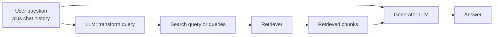

Naive RAG embeds the user's question exactly as typed and searches with it. That assumes the question is a good search query, and it often is not. Users write follow-ups full of pronouns ("what about its battery?"), describe symptoms rather than the terms the documents use, ask very specific questions whose answer lives in a general policy, or pack two questions into one sentence. In each case the retriever does exactly what it was asked and returns the wrong chunks.

**Query transformation** puts a step between the user and the retriever: an LLM rewrites the question into one or more queries that are better at finding the evidence. This lesson covers the five transformations you will use most: conversational condensation, rewriting, HyDE, step-back prompting and decomposition.

## Where transformation fits



Note the two arrows leaving the user's question. The transformed query is used **only for retrieval**. The generator still sees the user's original words, so a rewrite that slightly shifts the meaning cannot change what is being answered.

## A test corpus

To see each failure and fix, you need a retriever. TF-IDF stands in for an embedding model here (you built TF-IDF in [TF-IDF](/learn/nlp-fundamentals/tf-idf)); its failures are more extreme than a dense model's, which makes them easier to see, but dense retrievers fail in the same directions.

```python
import numpy as np
from sklearn.feature_extraction.text import TfidfVectorizer

docs = {
    "aurora-battery": "Aurora X2 laptop: the battery lasts up to 14 hours of video playback.",
    "aurora-warranty": "Aurora X2 laptop warranty: two years, covering parts and labour.",
    "nimbus-battery": "Nimbus 7 tablet: battery life is about 10 hours; the battery charges fully in 2 hours.",
    "nimbus-warranty": "Nimbus 7 tablet warranty: one year, extendable to three years.",
    "heat": "Lithium-ion cells produce heat during fast charging because of internal resistance; warm devices are normal while charging.",
    "airline": "Airline rules for lithium batteries: spare batteries and power banks must go in cabin baggage, and those above 100 Wh need airline approval.",
    "returns": "Returns are accepted within 30 days if the device is undamaged.",
    "battery-care": "To extend battery lifespan, avoid storing devices fully charged in hot places.",
}
ids = list(docs)
vec = TfidfVectorizer(stop_words="english").fit(docs.values())
D = vec.transform(docs.values())

def search(query, k=2):
    scores = (D @ vec.transform([query]).T).toarray().ravel()
    top = np.argsort(-scores)[:k]
    return [(ids[i], round(float(scores[i]), 2)) for i in top]
```

The LLM calls are replaced by a stub that returns what a capable model typically writes for each prompt. In production you would call your provider's chat API, as in [OpenAI API](/learn/working-with-llms/openai-api).

```python
CANNED = {
    "condense": "How long does the Aurora X2 laptop battery last?",
    "hyde": "Lithium-ion batteries heat up during charging because of internal "
            "resistance, so a warm phone is usually normal.",
    "step_back": "What are the airline rules for carrying lithium batteries?",
    "decompose": "Aurora X2 warranty\nNimbus 7 warranty\nAurora X2 battery life\nNimbus 7 battery life",
}

def llm(task, prompt):
    return CANNED[task]   # stub: a real implementation sends `prompt` to a model
```

## Conversational query condensation

In a chat, the latest message is rarely a complete question. "How long does its battery last?" means nothing without the previous turn.

```python
history = [("user", "Tell me about the Aurora X2 laptop."),
           ("assistant", "The Aurora X2 is a 14-inch laptop with a two-year warranty.")]
follow_up = "How long does its battery last?"

CONDENSE_PROMPT = """Given the conversation and a follow-up message, rewrite the
follow-up as a standalone question that names everything it refers to.
Return only the question.

Conversation:
{history}
Follow-up: {question}"""

prompt = CONDENSE_PROMPT.format(
    history="\n".join(f"{r}: {t}" for r, t in history), question=follow_up)
standalone = llm("condense", prompt)

print("raw:      ", search(follow_up))
print("condensed:", search(standalone))
```

```output
raw:       [('nimbus-battery', 0.46), ('aurora-battery', 0.27)]
condensed: [('aurora-battery', 0.6), ('aurora-warranty', 0.51)]
```

The raw follow-up retrieves the **Nimbus** battery document first, a confident, wrong answer in the making. The condensed question names the product and retrieves the right chunk. Condensation is the one transformation almost every conversational RAG system needs; without it, multi-turn retrieval quietly breaks.

## Query rewriting

Plain **rewriting** cleans up a single question: fixes typos, expands abbreviations the corpus does not use, removes chit-chat ("hi, quick one, my boss wants to know..."), and turns the question into the register of the documents. A rewriting prompt usually includes a short description of the corpus ("internal IT documentation for a hospital") so the model knows which vocabulary to target. It is cheap and safe, and it is often merged with condensation into one call.

## HyDE: search with a hypothetical answer

Questions and answers look different. A question uses the asker's words ("phone", "hot", "plug in"); the answer document uses the author's ("lithium-ion", "heat", "charging"). **HyDE** (Hypothetical Document Embeddings) asks the LLM to write a plausible answer first, then searches with that text, because an answer resembles other answers more than a question does.

```python
question = "Why does my phone get hot when I plug it in?"
hypothetical = llm("hyde", f"Write a short passage that answers: {question}")

print("question:", search(question))
print("HyDE:    ", search(hypothetical))
```

```output
question: [('battery-care', 0.33), ('aurora-battery', 0.0)]
HyDE:     [('heat', 0.78), ('airline', 0.21)]
```

The raw question matches the battery-care chunk only through the word "hot". The hypothetical answer shares "lithium", "heat", "charging" and "resistance" with the right document.

> [!WARNING]
> The hypothetical answer may be factually wrong. That is acceptable, because it is only used to search and is never shown to the user, but it means HyDE can lead retrieval towards a confidently wrong neighbourhood when the model knows nothing about your domain. It also adds a full generation step to every query, which is the slowest call in the pipeline.

## Step-back prompting

Some questions are too specific to match anything. No document mentions a 27,000 mAh power bank on a flight to Rome; the answer lives in a general rule. **Step-back prompting** asks the LLM for the more general question behind the specific one, retrieves with that, and gives the generator both the general rule and the original question so it can apply one to the other.

```python
specific = "Can I take my 27,000 mAh power bank on a flight to Rome?"
general = llm("step_back", f"What general question must be answered first? {specific}")

print("specific: ", search(specific))
print("step-back:", search(general))
```

```output
specific:  [('airline', 0.23), ('aurora-battery', 0.0)]
step-back: [('airline', 0.69), ('heat', 0.1)]
```

Both find the airline rules, but the step-back query does so with a far higher score, which matters when hundreds of other chunks are competing. Many systems search with **both** queries and merge the results, so the specific details are not lost.

## Decomposition

A comparison or multi-part question needs evidence from several places. One embedding of the whole question lands somewhere in the middle and retrieves a mixture that may miss a part entirely.

```python
compound = "Should I buy the Aurora X2 or the Nimbus 7 if I care about warranty and battery life?"
print("compound:", search(compound, k=3))

sub_questions = llm("decompose", f"Split into independent search queries: {compound}").splitlines()
found = {search(q, k=1)[0][0] for q in sub_questions}
print("decomposed:", sorted(found))
```

```output
compound: [('nimbus-battery', 0.42), ('aurora-warranty', 0.4), ('aurora-battery', 0.34)]
decomposed: ['aurora-battery', 'aurora-warranty', 'nimbus-battery', 'nimbus-warranty']
```

With three slots, the compound query misses the Nimbus warranty. The four sub-queries each retrieve one precise chunk. For questions whose later parts depend on earlier answers ("who founded the company that makes the Aurora, and where were they born?"), decompose **sequentially**: answer the first sub-question, then use the answer to write the next query. That is the start of agentic retrieval, which a later phase builds on.

## Trade-offs and when not to transform

| Transformation | Fixes | Extra LLM calls | Main risk |
| --- | --- | --- | --- |
| Condensation | Pronouns and ellipsis in chat | 1 (only after the first turn) | Pulling in stale context from old turns |
| Rewriting | Typos, chit-chat, jargon mismatch | 1 | Changing the meaning of a precise query |
| HyDE | Question/answer vocabulary gap | 1 (long output) | Hallucinated answer steers retrieval |
| Step-back | Over-specific questions | 1 | Losing the specific detail |
| Decomposition | Multi-part and comparison questions | 1, plus one retrieval per part | Over-splitting simple questions |

Every transformation adds a sequential LLM call before retrieval can start, so it adds latency to every request. Use a small, fast model for it, keep the outputs short, and consider **routing**: a cheap classifier (or a rule such as "first turn and under ten words") decides whether a query needs transforming at all.

> [!TIP]
> Do not rewrite exact-match queries. Error codes, part numbers, names and quoted phrases are already perfect keyword queries; an LLM "improving" `ERR_CERT_DATE_INVALID` into prose makes retrieval worse. Detect them with a regular expression and pass them through untouched.

> [!KEY]
> Measure each transformation on your own evaluation set, by question type. A technique that helps conversational and comparison questions can hurt simple factoid lookups, so the best systems apply transformations selectively rather than to everything.

## Exercises

**1.** Write a function `needs_condensing(history, question)` that returns `True` when a follow-up probably needs condensation: there is history and the question contains a pronoun such as "it", "its", "they", "that" or "this". Test it on the follow-up from this lesson and on "What is the Nimbus 7 warranty?".

<details>
<summary>Show solution</summary>

```python
import re

PRONOUNS = {"it", "its", "they", "them", "their", "that", "this", "those", "these"}

def needs_condensing(history, question):
    words = set(re.findall(r"[a-z']+", question.lower()))
    return bool(history) and bool(words & PRONOUNS)

print(needs_condensing(history, "How long does its battery last?"))
print(needs_condensing(history, "What is the Nimbus 7 warranty?"))
```

```output
True
False
```

A rule like this saves an LLM call on self-contained follow-ups. It misses ellipsis ("And the tablet?"), so production systems often condense every follow-up and accept the cost.

</details>

**2.** Run `search` with both the specific and the step-back queries and merge the two result lists, keeping each document's best score. Which documents does the merged list contain?

<details>
<summary>Show solution</summary>

```python
merged = {}
for q in [specific, general]:
    for doc_id, score in search(q):
        merged[doc_id] = max(score, merged.get(doc_id, 0))
print(sorted(merged.items(), key=lambda x: -x[1]))
```

The airline rules come first with the step-back score. Merging by maximum score is simple; [Multi-query retrieval](/learn/advanced-rag/multi-query-retrieval) shows why rank-based fusion is usually more robust.

</details>

**3.** A user asks: "What does clause 14.2(b) say?" Which transformations would you apply, and why?

<details>
<summary>Show solution</summary>

None, or at most condensation if it is a follow-up. The clause number is an exact identifier that a keyword index will match directly; HyDE, step-back or rewriting would replace it with prose and lose the precise match. This is a case for routing the query to keyword search, covered in [Hybrid retrieval](/learn/advanced-rag/hybrid-retrieval).

</details>

```quiz
[
  {
    "q": "Why does the generator usually receive the user's original question rather than the transformed query?",
    "options": [
      "The transformed query is too long for the context window",
      "So that a rewrite which shifts the meaning cannot change what gets answered",
      "Generators cannot read rewritten text",
      "To save tokens"
    ],
    "answer": 1,
    "why": "Transformations are a retrieval aid. Answering the user's actual words protects against rewrites that drift from the intent."
  },
  {
    "q": "What does HyDE search with?",
    "options": [
      "An LLM-written hypothetical answer to the question",
      "A summary of the whole corpus",
      "The question's keywords only",
      "The previous turn of the conversation"
    ],
    "answer": 0,
    "why": "A hypothetical answer uses the vocabulary of answer documents, so it lands closer to them in embedding or keyword space."
  },
  {
    "q": "A user asks whether a specific 27,000 mAh power bank is allowed on a flight. Which transformation targets the general rule that answers it?",
    "options": [
      "Spelling correction",
      "Conversational condensation",
      "Decomposition",
      "Step-back prompting"
    ],
    "answer": 3,
    "why": "Step-back prompting generalises an over-specific question so it matches the policy document that contains the rule."
  },
  {
    "q": "Which query should normally bypass LLM rewriting?",
    "options": [
      "What is your returns policy for laptops?",
      "how do i fix wifi it keeps dropping",
      "ERR_CERT_DATE_INVALID",
      "And what about the tablet?"
    ],
    "answer": 2,
    "why": "Exact identifiers are already ideal keyword queries; rewriting them into prose loses the exact match."
  }
]
```
