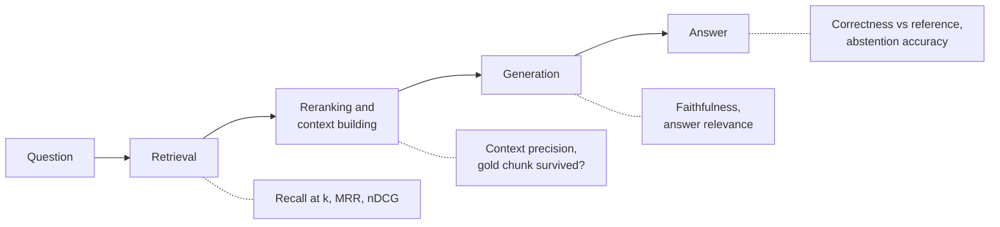
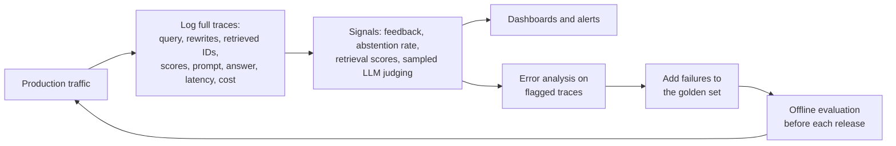

Every lesson in this module ended with the same advice: measure it on your own data. This lesson is about how. [RAG evaluation](/learn/rag-fundamentals/rag-evaluation) in RAG Fundamentals introduced the core metrics; here you will build the full practice around them: a golden set worth trusting, metrics for each component as well as the whole pipeline, an LLM judge you have checked against humans, a taxonomy that turns failures into fixes, and monitoring that keeps the system honest after launch.

The failure this fixes is the most common one in RAG work: changes made on gut feeling. Someone tries ten questions, swaps in semantic chunking, tries the same ten questions, and declares victory. Meanwhile recall on table questions has collapsed and nobody notices until users do.

## Building a golden set

A **golden set** (or evaluation set) is a fixed collection of questions with known good outcomes, run after every change. Each item should record more than a question and an answer:

```json
{
  "id": "q-0142",
  "question": "How long can I self-certify sickness?",
  "reference_answer": "Up to 7 days; after that a doctor's note is required.",
  "relevant_chunk_ids": ["handbook-leave-3", "handbook-leave-4"],
  "tags": {"type": "factoid", "source": "real-log", "modality": "text"},
  "answerable": true
}
```

The `relevant_chunk_ids` enable retrieval metrics; the `reference_answer` enables correctness checks; the tags let you slice results. Labelling chunk IDs ties the set to one chunking scheme, so many teams label relevant **documents** or **passages by text span** instead, and map them to chunk IDs when the chunker changes.

| Source | Strength | Weakness |
| --- | --- | --- |
| Real user queries from logs | Realistic wording and distribution | Need labelling; may contain personal data to scrub |
| Subject-matter experts | High-quality, hard, important questions | Slow and expensive |
| LLM-generated from chunks | Fast, large, labels come free (the source chunk) | Too easy: questions copy the chunk's wording |
| Adversarial and unanswerable | Tests abstention and robustness | Must be written deliberately |

> [!WARNING]
> Synthetic questions generated from a chunk tend to reuse its exact words, so they flatter keyword search and overstate recall. Ask the generator to paraphrase, filter out questions with high word overlap with their source, and always mix in real queries. A few hundred well-chosen questions, stratified by type, beat thousands of easy ones.

Include **unanswerable** questions (the corpus does not contain the answer) so you can measure whether the system abstains instead of inventing an answer, and **multi-part, multi-hop, table and follow-up** questions in proportion to how often users ask them.

## Component versus end-to-end evaluation



**End-to-end** metrics (is the final answer correct?) tell you whether the system works. **Component** metrics tell you **where** it fails. You need both: an end-to-end drop says something broke, and component metrics say whether to fix the chunker, the retriever, the reranker or the prompt. Component metrics are also cheaper and more deterministic, so you can run them on every change.

### Retrieval metrics

For a query with relevant set $R$ and ranked results $d_1, d_2, \dots$:

- **Recall@k** $= |R \cap \{d_1,\dots,d_k\}| \,/\, |R|$: the fraction of relevant chunks found in the top $k$.
- **MRR**: the mean over queries of $1/\text{rank}$ of the first relevant result (0 if none).
- **nDCG@k** rewards relevant results more the higher they appear:

$$
\text{DCG@}k = \sum_{i=1}^{k} \frac{\text{rel}_i}{\log_2(i + 1)}, \qquad \text{nDCG@}k = \frac{\text{DCG@}k}{\text{IDCG@}k}
$$

where $\text{rel}_i$ is the relevance of the result at position $i$ (1 or 0 here) and $\text{IDCG@}k$ is the DCG of the ideal ordering, so a perfect ranking scores 1.

```python
import numpy as np

def recall_at_k(ranked, relevant, k):
    return len(set(ranked[:k]) & relevant) / len(relevant)

def reciprocal_rank(ranked, relevant):
    for i, doc in enumerate(ranked, start=1):
        if doc in relevant:
            return 1 / i
    return 0.0

def ndcg_at_k(ranked, relevant, k):
    dcg = sum(1 / np.log2(i + 2) for i, d in enumerate(ranked[:k]) if d in relevant)
    ideal = sum(1 / np.log2(i + 2) for i in range(min(len(relevant), k)))
    return dcg / ideal

runs = {   # query id: (ranked chunk IDs from the retriever, relevant chunk IDs)
    "q1": (["a", "b", "c", "d", "e"], {"a", "c"}),
    "q2": (["f", "g", "h", "i", "j"], {"h"}),
    "q3": (["k", "l", "m", "n", "o"], {"z"}),
}
for qid, (ranked, rel) in runs.items():
    print(qid, f"recall@5={recall_at_k(ranked, rel, 5):.2f}",
          f"RR={reciprocal_rank(ranked, rel):.2f}", f"nDCG@5={ndcg_at_k(ranked, rel, 5):.2f}")
print("MRR:", round(np.mean([reciprocal_rank(r, rel) for r, rel in runs.values()]), 3))
```

```output
q1 recall@5=1.00 RR=1.00 nDCG@5=0.92
q2 recall@5=1.00 RR=0.33 nDCG@5=0.50
q3 recall@5=0.00 RR=0.00 nDCG@5=0.00
MRR: 0.444
```

Query q3 is a **retrieval miss**: no amount of prompt engineering can fix it. That is exactly the kind of fact component metrics surface.

## LLM-as-judge for faithfulness

**Faithfulness** (or groundedness) asks whether every claim in the answer is supported by the retrieved context. It is the metric that catches hallucination, and it needs no reference answer, so it works on production traffic too. The reliable recipe splits the judgement into small steps:

1. Ask an LLM to break the answer into atomic **claims**.
2. For each claim, ask whether the context **supports**, **contradicts** or **does not mention** it, with a short justification.
3. Faithfulness = supported claims / total claims.

```python
CLAIMS_PROMPT = "List every factual claim in the answer, one per line.\n\nAnswer: {answer}"
VERIFY_PROMPT = """Context:
{context}

Claim: {claim}

Does the context support the claim? Reply with one word: SUPPORTED, CONTRADICTED
or NOT_MENTIONED, then a one-sentence reason."""

def faithfulness(answer, context, llm):
    claims = [c.strip() for c in llm(CLAIMS_PROMPT.format(answer=answer)).splitlines() if c.strip()]
    verdicts = [llm(VERIFY_PROMPT.format(context=context, claim=c)).split()[0] for c in claims]
    return sum(v == "SUPPORTED" for v in verdicts) / len(claims), list(zip(claims, verdicts))

# Stubbed judge: returns what a capable model would say for this example.
def stub_llm(prompt):
    if prompt.startswith("List every factual claim"):
        return "Staff can self-certify sickness for up to 7 days.\nA doctor's note is required after that.\nSick pay is 80% of salary."
    claim = prompt.split("Claim: ")[1].split("\n")[0]
    return "NOT_MENTIONED The context says nothing about pay." if "pay" in claim \
        else "SUPPORTED The context states this directly."

context = "You can self-certify sickness for up to 7 days. After that, a doctor's note is required."
answer = "You can self-certify for up to 7 days, then you need a doctor's note. Sick pay is 80% of salary."
score, detail = faithfulness(answer, context, stub_llm)
print(round(score, 2))
for claim, verdict in detail:
    print(f"  {verdict:14} {claim}")
```

```output
0.67
  SUPPORTED      Staff can self-certify sickness for up to 7 days.
  SUPPORTED      A doctor's note is required after that.
  NOT_MENTIONED  Sick pay is 80% of salary.
```

The sick-pay claim might even be true, but it is not in the context, so the answer is not grounded. Faithfulness and correctness are different questions: a faithful answer can be wrong (bad context), and an unfaithful one can be right (model knowledge).

### Trust the judge only after checking it

An LLM judge is a model with its own errors and biases: it can favour longer answers, answers from its own model family, or the first of two options. Before relying on it, have humans label a sample (100 to 200 items is a reasonable start) and measure agreement. Cohen's kappa corrects raw agreement for chance:

```python
from sklearn.metrics import cohen_kappa_score

human = [1, 1, 0, 1, 0, 1, 1, 0, 1, 1, 0, 1]   # 1 = faithful, 0 = not, from human review
judge = [1, 1, 0, 1, 1, 1, 1, 0, 1, 0, 0, 1]   # the LLM judge on the same items

agreement = np.mean(np.array(human) == np.array(judge))
print(f"raw agreement: {agreement:.2f}   kappa: {cohen_kappa_score(human, judge):.2f}")
```

```output
raw agreement: 0.83   kappa: 0.62
```

If agreement is weak, improve the judge prompt (clearer definitions, examples, a rubric), use a stronger judge model, or narrow the task until it is. Re-check whenever you change the judge model or prompt.

## Error analysis: a taxonomy of failures

Metrics say how often the system fails; error analysis says **why**. Read failed traces and assign each one a cause, following the pipeline from start to end. Stop at the first stage that went wrong.

| Failure category | How to recognise it in a trace | Typical fixes |
| --- | --- | --- |
| Missing content | The answer is not in the corpus at all | Add content; make the system abstain |
| Query misunderstood | Transformed query drifted from the intent | Fix condensation or rewriting; route identifiers past it |
| Retrieval miss | Gold chunk not in the candidate set | Hybrid retrieval, expansion, contextual retrieval, chunking |
| Ranking miss | Gold chunk retrieved, but cut before the prompt | Reranker, larger k, better fusion weights |
| Context assembly | Gold chunk in prompt but truncated or buried | Context ordering, parent-child sizing, token budget |
| Not used | Gold chunk in prompt; answer ignores it | Prompt instructions, stronger model, less noise in context |
| Unfaithful | Answer adds unsupported claims | Grounding instructions, citations, faithfulness checks |
| Incomplete or wrong format | Partially right, or ignores the requested format | Prompt and output constraints |
| Wrong abstention | Refuses when the answer was available, or answers when it was not | Calibrated thresholds, abstention instructions |

The first few categories can be assigned automatically from logged traces:

```python
from collections import Counter

def classify(trace):
    gold = set(trace["gold"])
    if not gold:
        return "missing content"
    if not gold & set(trace["candidates"]):
        return "retrieval miss"
    if not gold & set(trace["in_prompt"]):
        return "ranking miss"
    if trace["faithfulness"] < 1.0:
        return "unfaithful"
    return "ok" if trace["correct"] else "not used / other"

traces = [
    {"gold": ["a"], "candidates": ["a", "b"], "in_prompt": ["a"], "faithfulness": 1.0, "correct": True},
    {"gold": ["c"], "candidates": ["x", "y"], "in_prompt": ["x"], "faithfulness": 1.0, "correct": False},
    {"gold": ["d"], "candidates": ["e", "d"], "in_prompt": ["e"], "faithfulness": 1.0, "correct": False},
    {"gold": ["f"], "candidates": ["f"], "in_prompt": ["f"], "faithfulness": 0.5, "correct": False},
    {"gold": [], "candidates": ["g"], "in_prompt": ["g"], "faithfulness": 1.0, "correct": False},
    {"gold": ["h"], "candidates": ["q", "r"], "in_prompt": ["q"], "faithfulness": 1.0, "correct": False},
    {"gold": ["i"], "candidates": ["i"], "in_prompt": ["i"], "faithfulness": 1.0, "correct": False},
]
print(Counter(classify(t) for t in traces).most_common())
```

```output
[('retrieval miss', 2), ('ok', 1), ('ranking miss', 1), ('unfaithful', 1), ('missing content', 1), ('not used / other', 1)]
```

A breakdown like this decides what to work on next. If retrieval misses dominate, a better prompt is wasted effort; if most failures are "not used", a better retriever is.

> [!TIP]
> Do the first round of error analysis by hand. Reading 50 to 100 failed traces yourself, writing a one-line note on each, then grouping the notes, often reveals causes no predefined taxonomy anticipated, such as a parser that drops every footnote.

## Online monitoring and feedback

Offline evaluation tests the questions you thought of. Production shows you the ones you did not, and the corpus, the users and the models all change over time.



| Signal | What it can reveal |
| --- | --- |
| Explicit feedback (thumbs, ratings, comments) | Direct dissatisfaction; sparse and biased towards strong reactions |
| Implicit feedback (rephrased follow-ups, citation clicks, copy events) | Rephrasing straight after an answer often signals failure |
| Abstention or "I don't know" rate | Rising rates suggest missing content or retrieval regressions |
| Top retrieval and reranker score distributions | Drift when new kinds of questions arrive or the index changes |
| Faithfulness of a sampled slice, judged offline | Hallucination trends without labelling everything |
| Latency and cost per query, per stage | Which advanced technique is spending your budget |

Close the loop: every confirmed production failure becomes a new golden-set item, so the same failure can never silently return.

> [!KEY]
> Evaluate each stage, not just the answer. Retrieval metrics on a golden set guide changes to chunking and retrieval; a calibrated LLM judge tracks faithfulness; a failure taxonomy turns bad answers into a prioritised work list; monitoring feeds new failures back into the set.

## Exercises

**1.** Compute precision@3 for the three runs above (the fraction of the top 3 results that are relevant). Why is precision@k often less informative than recall@k for RAG retrieval?

<details>
<summary>Show solution</summary>

```python
def precision_at_k(ranked, relevant, k):
    return len(set(ranked[:k]) & relevant) / k

for qid, (ranked, rel) in runs.items():
    print(qid, round(precision_at_k(ranked, rel, 3), 2))
```

```output
q1 0.67
q2 0.33
q3 0.0
```

When a query has only one or two relevant chunks, precision@k is capped well below 1 even for perfect retrieval (q2 can never exceed 0.33 at k = 3). Recall@k answers the question that matters most for RAG, whether the needed evidence reached the candidate set, while a reranker handles precision.

</details>

**2.** Extend `classify` so that a trace with no gold chunks where the system **answered** (rather than abstained) is labelled "should have abstained". Assume each trace has a boolean `abstained`.

<details>
<summary>Show solution</summary>

```python
def classify_v2(trace):
    gold = set(trace["gold"])
    if not gold:
        return "missing content (abstained correctly)" if trace.get("abstained") \
            else "should have abstained"
    return classify(trace)

print(classify_v2({**traces[4], "abstained": False}))
```

```output
should have abstained
```

Unanswerable questions are only failures when the system answers them; separating the two cases tells you whether to add content or fix abstention.

</details>

**3.** Your LLM judge says faithfulness rose after a prompt change, but user thumbs-down rates also rose. List two possible explanations and how you would check each.

<details>
<summary>Show solution</summary>

The new prompt may make answers more cautious and shorter: more faithful but less helpful or less complete. Check answer relevance and completeness on the golden set, and read a sample of thumbs-down traces. Alternatively the judge may be biased by a stylistic change (for example, answers that quote the context look grounded even when the quoted text is irrelevant). Re-check judge agreement against fresh human labels on post-change answers.

</details>

```quiz
[
  {
    "q": "Why are LLM-generated golden-set questions risky on their own?",
    "options": [
      "They cannot be labelled",
      "They are always unanswerable",
      "They tend to reuse the source chunk's wording, so they overstate retrieval quality",
      "They require human reference answers"
    ],
    "answer": 2,
    "why": "Questions copied from chunk wording are easy lexical matches, flattering keyword search compared with real user queries."
  },
  {
    "q": "A gold chunk is in the retriever's top 50 but not in the 5 chunks placed in the prompt. Which failure category is this?",
    "options": [
      "Retrieval miss",
      "Ranking miss",
      "Missing content",
      "Unfaithful generation"
    ],
    "answer": 1,
    "why": "The evidence was found but cut before reaching the generator, which points to reranking or the choice of k."
  },
  {
    "q": "What does a faithfulness score measure?",
    "options": [
      "Whether the answer matches the reference answer",
      "Whether the user was satisfied",
      "How quickly the model answers",
      "The fraction of the answer's claims supported by the retrieved context"
    ],
    "answer": 3,
    "why": "Faithfulness checks grounding in the context, not truth in the world; it needs no reference answer."
  },
  {
    "q": "Why compute Cohen's kappa between an LLM judge and human labels?",
    "options": [
      "To measure agreement corrected for chance before trusting the judge",
      "To speed up the judge",
      "To convert scores into probabilities",
      "To choose the embedding model"
    ],
    "answer": 0,
    "why": "Raw agreement can look high by chance when one label dominates; kappa corrects for that."
  }
]
```
