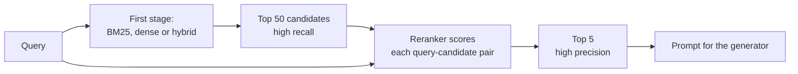

[Reranking](/learn/vector-databases/reranking) introduced the two-stage pattern: a fast retriever fetches a generous set of candidates, then a slower, more accurate model reorders them. This lesson looks inside the second stage. You will see why first-stage retrievers misorder results, how cross-encoders, late-interaction models and LLM rerankers each fix that at a different price, and how to turn reranker scores into numbers you can safely threshold.

## Why first-stage ranking is imprecise

A dense retriever is a **bi-encoder**: it encodes the query and each document separately into single vectors, and compares them with a dot product. Documents are encoded at indexing time, long before any query exists, so each document vector has to summarise everything the document might be asked about. Fine details, such as negation, which entity a number belongs to, or whether a passage answers the question or merely mentions its words, get averaged away.

The symptom in RAG is familiar: the relevant chunk is somewhere in the top 50, but not in the top 5 you put in the prompt. Retrieval recall at 50 is good; precision at 5 is poor. A reranker targets exactly that gap.



## Cross-encoders

A **cross-encoder** feeds the query and one candidate **together** into a transformer (`[CLS] query [SEP] document [SEP]`, using the [BERT](/learn/advanced-nlp/bert) input format) and outputs one relevance score. Because every query token can attend to every document token, the model can check whether the passage actually answers the question rather than just sharing topic words.

```python
from sentence_transformers import CrossEncoder

model = CrossEncoder("cross-encoder/ms-marco-MiniLM-L-6-v2")

query = "How long does the Aurora X2 battery last?"
candidates = [
    "The Aurora X2 ships with a 65 W USB-C charger.",
    "Aurora X2: up to 14 hours of video playback on one charge.",
    "Battery life on the Nimbus 7 is around 10 hours.",
]
scores = model.predict([(query, c) for c in candidates])
reranked = sorted(zip(scores, candidates), reverse=True)
```

A model like this would be expected to put the second candidate first: it is the only one that answers the question about this product. The price is that nothing can be precomputed. Every query requires a full transformer pass over every candidate, so cost and latency grow linearly with the number of candidates. That is why cross-encoders rerank tens of documents, never the whole corpus.

## Late interaction: the ColBERT idea

Between the cheap bi-encoder and the expensive cross-encoder sits **late interaction**, introduced by ColBERT. The model encodes queries and documents separately (so documents can still be precomputed), but keeps **one vector per token** instead of pooling into one. At query time it scores with **MaxSim**:

$$
s(q, d) = \sum_{i=1}^{|q|} \max_{j=1,\dots,|d|} \mathbf{q}_i^\top \mathbf{d}_j
$$

where $\mathbf{q}_i$ is the embedding of the $i$-th query token, $\mathbf{d}_j$ the embedding of the $j$-th document token, and $|q|$ and $|d|$ the token counts. Each query token finds its best-matching document token, and those best matches are summed.

The toy below uses four-dimensional token vectors whose dimensions loosely mean battery, price, laptop and phone. It compares MaxSim with the single-vector approach of averaging the token vectors first.

```python
import numpy as np

V = {
    "battery": [1, 0, 0, 0.1], "life": [0.8, 0, 0, 0], "hours": [0.7, 0, 0, 0],
    "price": [0, 1, 0, 0], "cost": [0, 0.9, 0.1, 0], "cheap": [0, 0.8, 0, 0],
    "laptop": [0, 0, 1, 0], "phone": [0, 0, 0, 1], "screen": [0, 0, 0.5, 0.5],
    "charger": [0.5, 0, 0, 0.5],
}

def token_vectors(text):
    M = np.array([V[w] for w in text.split()], dtype=float)
    return M / np.linalg.norm(M, axis=1, keepdims=True)

def maxsim(q, d):
    sim = token_vectors(q) @ token_vectors(d).T   # every query token vs every doc token
    return float(sim.max(axis=1).sum())

def pooled_cosine(q, d):
    a, b = token_vectors(q).mean(axis=0), token_vectors(d).mean(axis=0)
    return float(a @ b / (np.linalg.norm(a) * np.linalg.norm(b)))

query = "laptop battery life"
for doc in ["phone battery charger", "laptop price cost cheap screen battery"]:
    print(f"{doc:40} pooled={pooled_cosine(query, doc):.3f}  maxsim={maxsim(query, doc):.3f}")
```

```output
phone battery charger                    pooled=0.645  maxsim=1.995
laptop price cost cheap screen battery   pooled=0.466  maxsim=2.995
```

The laptop specification sheet mentions the battery, but its pooled vector is dominated by price words, so single-vector scoring prefers the phone document. MaxSim lets "laptop" and "battery" in the query each find their exact match, and the laptop document wins. That is the dilution problem of single vectors, and late interaction avoids most of it.

The cost is storage: one vector per token instead of one per chunk, typically compressed heavily in practice. ColBERT-style models can be used as a first-stage retriever with a special index, or, more simply, as a reranker over candidates.

## LLM rerankers

A general-purpose LLM can also judge relevance, and it brings instruction following: you can tell it what "relevant" means for your application ("prefer the most recent policy", "the passage must name the product"). Three formats are common.

| Format | How it works | Calls for n candidates | Main weakness |
| --- | --- | --- | --- |
| Pointwise | Score each candidate alone, for example 0 to 10 or yes/no | n (parallel) | Scores drift between calls, ties are common |
| Pairwise | Ask which of two candidates is more relevant | Up to n(n-1)/2 | Expensive |
| Listwise | Show all candidates, ask for an ordering | 1 (or a few sliding windows) | Position bias, long prompts |

```python
LISTWISE_PROMPT = """Rank the passages by how well they answer the question.
Return only the passage numbers, most relevant first, comma-separated.

Question: {question}

{passages}"""

def llm_rerank(question, candidates, llm):
    passages = "\n".join(f"[{i}] {c}" for i, c in enumerate(candidates))
    reply = llm(LISTWISE_PROMPT.format(question=question, passages=passages))
    order = [int(x) for x in reply.replace(" ", "").split(",") if x.isdigit()]
    seen = [i for i in dict.fromkeys(order) if i < len(candidates)]
    missing = [i for i in range(len(candidates)) if i not in seen]
    return [candidates[i] for i in seen + missing]   # never silently drop a candidate

candidates = [
    "The Aurora X2 ships with a 65 W USB-C charger.",
    "Aurora X2: up to 14 hours of video playback on one charge.",
    "Battery life on the Nimbus 7 is around 10 hours.",
]
fake_llm = lambda prompt: "1, 1, 7"     # stub: a repeated and an out-of-range number
for c in llm_rerank("How long does the Aurora X2 battery last?", candidates, fake_llm):
    print(c)
```

```output
Aurora X2: up to 14 hours of video playback on one charge.
The Aurora X2 ships with a 65 W USB-C charger.
Battery life on the Nimbus 7 is around 10 hours.
```

The parsing code matters as much as the prompt: models sometimes repeat numbers, skip some or invent out-of-range ones, and a reranker must never lose a candidate because of a formatting slip.

> [!WARNING]
> Listwise LLM rerankers show **position bias**: candidates near the start of the list tend to be ranked higher. Shuffle candidates before reranking, or rerank twice with different orders and combine, and always evaluate against a dedicated cross-encoder. An LLM reranker is usually far slower and more expensive per query, so it must earn its place with measured gains.

## Score calibration

Rerankers are often used for a second job: deciding whether **any** candidate is good enough. If nothing clears a threshold, the system says "I could not find that" instead of answering from weak context. That requires scores you can interpret.

Raw reranker outputs are not probabilities. Depending on the model and library, you get unbounded logits or numbers squashed into 0 to 1, and in either case a score of 0.9 does not mean "relevant 90% of the time", and the same number means different things for different models. **Calibration** maps scores to probabilities using labelled data. **Platt scaling** fits a logistic regression on the raw score:

$$
P(\text{relevant} \mid s) = \frac{1}{1 + e^{-(a s + b)}}
$$

where $s$ is the reranker's raw score and $a$ and $b$ are fitted on query-passage pairs labelled relevant or not. Here simulated logits stand in for a real reranker run over a labelled set.

```python
from sklearn.linear_model import LogisticRegression

rng = np.random.default_rng(0)
relevant = rng.normal(6.0, 2.0, 300)      # logits for pairs labelled relevant
irrelevant = rng.normal(1.5, 2.0, 700)    # logits for pairs labelled not relevant
s = np.concatenate([relevant, irrelevant]).reshape(-1, 1)
y = np.array([1] * 300 + [0] * 700)

platt = LogisticRegression().fit(s, y)
print(f"a={platt.coef_[0, 0]:.2f}  b={platt.intercept_[0]:.2f}")

for logit in [0.0, 2.0, 4.0, 6.0]:
    raw = 1 / (1 + np.exp(-logit))
    cal = platt.predict_proba([[logit]])[0, 1]
    print(f"logit={logit:3.1f}  naive sigmoid={raw:.2f}  calibrated={cal:.2f}")
```

```output
a=1.20  b=-5.19
logit=0.0  naive sigmoid=0.50  calibrated=0.01
logit=2.0  naive sigmoid=0.88  calibrated=0.06
logit=4.0  naive sigmoid=0.98  calibrated=0.40
logit=6.0  naive sigmoid=1.00  calibrated=0.88
```

Applying a plain sigmoid to this model's logits would call a score of 2.0 "88% relevant"; on the labelled data, pairs with that score are relevant only about 6% of the time. Fit the calibration on data from your own domain, refit whenever you change the reranker, and pick the threshold by looking at the precision and recall you get at each value, as you did with classifiers in [Precision](/learn/model-evaluation/precision).

> [!TIP]
> Even uncalibrated scores are fine for **ordering** within one query. Calibration only matters when you compare scores against a fixed threshold or across queries, for example to decide whether to answer at all.

## Trade-offs and when not to rerank

| Approach | Precompute documents? | Query-time cost | Typical role |
| --- | --- | --- | --- |
| Bi-encoder | Yes, one vector each | One query embedding plus vector search | First stage |
| Late interaction | Yes, one vector per token | MaxSim over candidates' tokens | First stage or light reranker |
| Cross-encoder | No | One transformer pass per candidate | Reranker for tens of candidates |
| LLM reranker | No | One or more LLM calls with long prompts | Reranker when instructions matter |

Reranking is usually the single most reliable upgrade to a RAG pipeline, but skip or limit it when:

- the latency budget is tight (autocomplete, voice), since a cross-encoder adds a model call on the critical path;
- first-stage precision at k is already high on your evaluation set, which happens with small, clean corpora;
- the reranker was trained on a very different domain or language, so it may reorder worse than your retriever. Always measure.

> [!KEY]
> Tune the two stages together. The reranker can only promote what the first stage retrieved, so increase the candidate count until recall at that depth is high, then set the reranker's output size by the precision at k you need and the latency you can afford.

## Exercises

**1.** Print the full query-by-document similarity matrix for `maxsim("laptop battery life", "laptop price cost cheap screen battery")`. Which document token does each query token match?

<details>
<summary>Show solution</summary>

```python
q, d = "laptop battery life", "laptop price cost cheap screen battery"
sim = token_vectors(q) @ token_vectors(d).T
print(np.round(sim, 2))
for i, w in enumerate(q.split()):
    print(w, "->", d.split()[sim[i].argmax()])
```

"laptop" matches "laptop", and both "battery" and "life" match "battery". The price words never win a maximum, so they cannot dilute the score.

</details>

**2.** Using the fitted `platt` model, find the smallest logit (to one decimal place) whose calibrated probability is at least 0.5.

<details>
<summary>Show solution</summary>

```python
grid = np.arange(0, 10, 0.1)
probs = platt.predict_proba(grid.reshape(-1, 1))[:, 1]
print(round(float(grid[probs >= 0.5][0]), 1))
```

```output
4.4
```

Analytically, the probability is 0.5 where $a s + b = 0$, so $s = -b/a \approx 5.19 / 1.20 \approx 4.3$. The crossing falls between 4.3 and 4.4, so 4.4 is the first grid point above it.

</details>

**3.** Your listwise LLM reranker receives 40 candidates and is slow. Suggest two ways to cut its cost without dropping it entirely.

<details>
<summary>Show solution</summary>

Put a cheap cross-encoder in front of it to cut 40 candidates to 10, so the LLM sees only the hard cases. Or use a sliding window: rerank overlapping windows of, say, 10 candidates from the bottom up so the best rise to the top, which keeps each prompt short and lets windows run on a smaller, faster model. Truncating each passage to its most relevant part also shortens the prompt.

</details>

```quiz
[
  {
    "q": "Why can a cross-encoder judge relevance more accurately than a bi-encoder?",
    "options": [
      "Query and document tokens attend to each other in one forward pass",
      "It uses a larger vocabulary",
      "It stores more vectors per document",
      "It is trained with more data"
    ],
    "answer": 0,
    "why": "Joint encoding lets the model check how the passage relates to this specific question, which separate encodings cannot do."
  },
  {
    "q": "In ColBERT-style MaxSim, what is summed?",
    "options": [
      "The similarity of the pooled query and document vectors",
      "All pairwise token similarities",
      "For each query token, its highest similarity to any document token",
      "The document's token count"
    ],
    "answer": 2,
    "why": "Each query token contributes its single best match in the document; those maxima are summed."
  },
  {
    "q": "A reranker returns raw score 2.0. What does that tell you about the probability the passage is relevant?",
    "options": [
      "It is sigmoid(2.0), about 0.88",
      "Nothing reliable until the scores are calibrated on labelled data",
      "It is 2%",
      "It is relevant, because the score is positive"
    ],
    "answer": 1,
    "why": "Raw reranker scores are not calibrated probabilities; their meaning must be learned from labelled pairs, for example with Platt scaling."
  },
  {
    "q": "Which is a known weakness of listwise LLM reranking?",
    "options": [
      "Position bias towards candidates early in the list",
      "It cannot follow instructions",
      "It needs one vector per token",
      "It only works with BM25 candidates"
    ],
    "answer": 0,
    "why": "LLMs tend to favour passages that appear early in the prompt, so order must be controlled or randomised."
  }
]
```
