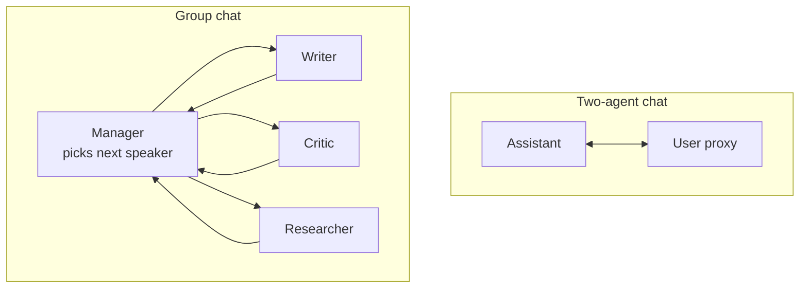
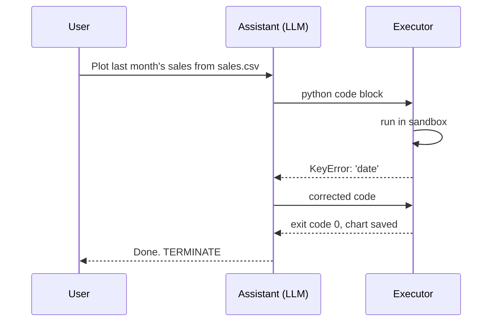

LangChain and LangGraph model an agent as a loop or a graph around one model. **AutoGen**, which came out of Microsoft Research, took a different starting point: what if the main programming abstraction were a **conversation between several agents**? A "writer" agent drafts, a "critic" agent reviews, a "coder" writes a script and an "executor" runs it and reports the output, and the application is the chat they have with one another. That idea has been hugely influential, and it is the reason this lesson is about concepts rather than code: the ideas are durable, while AutoGen's own API has been rebuilt more than once.

> [!WARNING]
> **Check which AutoGen you have.** The original API (the v0.2 line) centred on `ConversableAgent`, `AssistantAgent`, `UserProxyAgent` and `GroupChat`. The project was then redesigned from the ground up (v0.4 onwards) into layers: an event-driven core, a high-level "AgentChat" API and extensions. Some of the original authors continue the v0.2-style API in a separate project called **AG2**, and package names on PyPI do not all point to the same project. Microsoft has since announced a successor, the **Microsoft Agent Framework**, that combines ideas from AutoGen and Semantic Kernel. Before following any AutoGen tutorial, check the project README and the version it targets. This lesson does not rely on any of those APIs.

## The core idea: conversable agents

In AutoGen's model, an agent is anything that can **receive a message and send a reply**. What happens inside is up to the agent: it might call an LLM, call tools, run code, ask a human, or start a conversation with other agents of its own. Because every agent has the same interface, they can be wired together freely.

| First principle (Module 31) | AutoGen's framing |
| --- | --- |
| The agent loop | A conversation: agents take turns replying until a termination condition holds |
| Short-term memory | The shared chat transcript every participant can read |
| Tools | Functions an agent may call, or a separate agent that executes them |
| Planning | Often delegated to a "planner" or "manager" agent in the conversation |
| [Reflection](/learn/ai-agent-fundamentals/reflection) | A second agent whose role is to criticise the first one's output |
| Human-in-the-loop | A human is just another participant (a "user proxy") in the chat |
| Stopping | Termination conditions: a keyword such as `TERMINATE`, a maximum number of turns or messages |

The last row is easy to overlook and matters most. Two LLMs talking to each other have no natural reason to stop; they will happily thank each other forever. Every multi-agent conversation needs explicit termination rules, both a "success" signal and a hard cap.

## A conversation in plain Python

You can capture the whole idea in a few lines of plain Python. Below, the agents' reply functions are scripted so the output is reproducible; in AutoGen each would call an LLM with the agent's system prompt and the transcript.

```python
class Agent:
    """A conversable agent: it reads the shared transcript and replies."""
    def __init__(self, name, reply_fn):
        self.name = name
        self.reply_fn = reply_fn          # in AutoGen this would call an LLM

    def reply(self, transcript):
        return self.reply_fn(transcript)

def writer(transcript):
    drafts = sum(1 for who, _ in transcript if who == "writer")
    return ["Tagline: Ride more.", "Tagline: Ride more, worry less."][min(drafts, 1)]

def critic(transcript):
    last = transcript[-1][1]
    return "APPROVED" if "worry" in last else "Too vague. Mention safety."

def round_robin_chat(agents, task, max_turns=6, stop_word="APPROVED"):
    transcript = [("user", task)]
    for turn in range(max_turns):
        speaker = agents[turn % len(agents)]      # speaker selection
        message = speaker.reply(transcript)
        transcript.append((speaker.name, message))
        print(f"{speaker.name:>6}: {message}")
        if stop_word in message:                  # termination condition
            break
    return transcript

log = round_robin_chat([Agent("writer", writer), Agent("critic", critic)],
                       "Write a tagline for a bike helmet.")
print(len(log), "messages")
```

```output
writer: Tagline: Ride more.
critic: Too vague. Mention safety.
writer: Tagline: Ride more, worry less.
critic: APPROVED
5 messages
```

Everything AutoGen adds is a richer version of one of these pieces: agents with LLM-backed replies and tools, smarter **speaker selection**, more **termination conditions**, and infrastructure for running agents asynchronously or across processes.

## Conversation patterns



| Pattern | How it works | Good for |
| --- | --- | --- |
| **Two-agent chat** | An assistant and a user proxy (human or code executor) alternate | Coding tasks, Q&A with tool execution |
| **Sequential chats** | The summary of one conversation becomes the start of the next | Multi-stage pipelines (research, then write, then edit) |
| **Group chat, round robin** | Speakers take fixed turns | Predictable review cycles |
| **Group chat, selector** | A manager (often an LLM) reads the transcript and picks who speaks next | Open-ended collaboration among specialists |
| **Nested chats** | An agent answers by running a private conversation among sub-agents | Hiding complexity behind one agent's interface |

LLM-based speaker selection is powerful and also the most fragile part of the design: the manager can pick the same agent repeatedly, skip the critic or end the conversation early. Many production systems constrain it with allowed transitions ("after the coder, always the executor") or replace it with the fixed control flow of a graph, which is one reason LangGraph-style orchestration became popular.

## Code execution: the killer feature and the danger

AutoGen's best-known demonstration is an assistant that writes Python, an executor agent that runs it and replies with the output or the error, and a loop that continues until the code works. It is the [reflection](/learn/ai-agent-fundamentals/reflection) pattern with real feedback from an interpreter, and it is effective for data analysis and scripting tasks.



It also means a language model is writing programs that run on a computer you care about. The model can make mistakes (deleting files while "cleaning up"), and it can be manipulated: a document or web page it reads may contain instructions that cause it to write malicious code, the [prompt injection](/learn/prompt-engineering/prompt-injection-awareness) problem with an exploit attached.

| Risk | Mitigation |
| --- | --- |
| Destructive commands on the host | Run code in a container (AutoGen offers Docker-based executors), never directly on your machine or server |
| Reading secrets (environment variables, credential files) | Start the sandbox with no secrets and a minimal file system mount |
| Network access for exfiltration or downloads | Disable networking in the sandbox, or allow-list hosts |
| Runaway loops and resource use | Timeouts per execution, CPU and memory limits, a maximum number of turns |
| Approving code blindly | A human approval step before execution for anything touching real data |

> [!KEY]
> Treat any code a model writes as **untrusted input**. AutoGen's local (non-container) executors exist for convenience, and the docs themselves warn against using them with untrusted code. "It is only a demo" is how many credential leaks begin.

## What the conversation model costs

- **Tokens.** Every participant typically reads the growing transcript on each turn. Four agents over twenty turns can cost many times what a single agent with tools would.
- **Control.** The flow of the program emerges from the conversation rather than being written down, so the same input can take very different paths. That is great for exploration and hard for testing.
- **Debugging.** A failure is a transcript to read: which agent said something wrong, and why did the manager pick it? Logging every message with its speaker is essential.
- **Version churn.** As described above, the API you learn may not be the one you find in the next codebase.

## When to use it

Multi-agent conversation suits problems where separate roles with separate instructions genuinely help, such as writer and critic, coder and tester, or several domain specialists, and where some unpredictability is acceptable. Before you reach for it, try a single agent with good tools and a reflection step, as in Module 31: it is often just as good, cheaper and far easier to debug. When you do need several agents but also need predictable flow, a graph (LangGraph) or a role-and-task framework (CrewAI, the [next lesson](/learn/agent-frameworks/crewai)) may fit better. [Advanced Agent Systems](/learn/advanced-agent-systems/multi-agent-systems) returns to multi-agent design in depth.

## Exercises

**1.** Change `round_robin_chat` so that it also stops if the same message is repeated twice in a row, a common symptom of agents stuck in a loop. Test it with a critic that always says "Try again.".

<details>
<summary>Show solution</summary>

```python
def round_robin_chat(agents, task, max_turns=6, stop_word="APPROVED"):
    transcript = [("user", task)]
    for turn in range(max_turns):
        speaker = agents[turn % len(agents)]
        message = speaker.reply(transcript)
        if len(transcript) >= 2 and transcript[-2][1] == message:
            print("stopping: repeated message")
            break
        transcript.append((speaker.name, message))
        print(f"{speaker.name:>6}: {message}")
        if stop_word in message:
            break
    return transcript

stubborn = Agent("critic", lambda t: "Try again.")
round_robin_chat([Agent("writer", writer), stubborn], "Write a tagline.")
```

```output
writer: Tagline: Ride more.
critic: Try again.
writer: Tagline: Ride more, worry less.
stopping: repeated message
```

`transcript[-2]` is the previous message from the same speaker in a two-agent chat, so the critic's second "Try again." triggers the stop.

</details>

**2.** Replace round robin with a **selector**: a function `select(transcript, agents)` that returns the critic after any writer message and the writer otherwise. Why might an LLM-based selector make worse choices than this function?

<details>
<summary>Show solution</summary>

```python
def select(transcript, agents):
    by_name = {a.name: a for a in agents}
    return by_name["critic"] if transcript[-1][0] == "writer" else by_name["writer"]
```

In the loop, use `speaker = select(transcript, agents)`. An LLM selector has to infer the rule from the transcript and the agents' descriptions every turn; it can skip the critic, choose the same agent twice or be swayed by content in the messages. When the rule is known, code it.

</details>

**3.** A teammate wants to give a code-executing agent access to the production database "so it can answer questions about live data". List three safeguards you would require.

<details>
<summary>Show solution</summary>

Any three of: a read-only database user with access only to the needed tables; execution in a network-restricted container with no other secrets; per-execution timeouts and resource limits; human approval before running queries; logging every generated query and result; a maximum number of turns. Better still, expose a few safe, parameterised query tools instead of free-form code execution.

</details>

```quiz
[
  {
    "q": "In AutoGen's design, what is a conversable agent?",
    "options": [
      "Anything that can receive a message and reply, whether by LLM, tool, code execution or a human",
      "An LLM fine-tuned for chatting",
      "A node in a compiled state graph",
      "A vector index that answers questions"
    ],
    "answer": 0,
    "why": "The uniform receive-and-reply interface is what lets different kinds of agents be combined into conversations."
  },
  {
    "q": "Why does every multi-agent conversation need explicit termination conditions?",
    "options": [
      "Because AutoGen charges per conversation",
      "Because transcripts cannot be saved otherwise",
      "Because agents have no natural reason to stop and may loop indefinitely",
      "Because the first agent always speaks last"
    ],
    "answer": 2,
    "why": "Use both a success signal (such as a keyword) and a hard cap on turns or messages."
  },
  {
    "q": "What is the main security risk of an agent that writes and runs code?",
    "options": [
      "The code may be slow",
      "Model-written code, possibly influenced by injected instructions, runs with whatever access the executor has",
      "Python cannot be sandboxed",
      "The code is sent to the model provider"
    ],
    "answer": 1,
    "why": "Treat generated code as untrusted: run it in a container without secrets or network access, with time limits."
  },
  {
    "q": "You find an AutoGen tutorial using `GroupChatManager` and `UserProxyAgent`. What should you check first?",
    "options": [
      "Whether you have a GPU",
      "Whether your Python version is 3.8",
      "Whether the agents use the same model",
      "Which AutoGen lineage and version the tutorial targets and which one you have installed"
    ],
    "answer": 3,
    "why": "Those are v0.2-style names. The project was redesigned, AG2 continues the older style, and package names differ, so match tutorial and installed version."
  }
]
```
