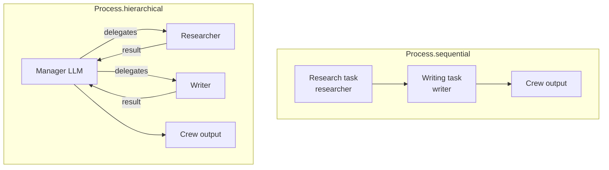
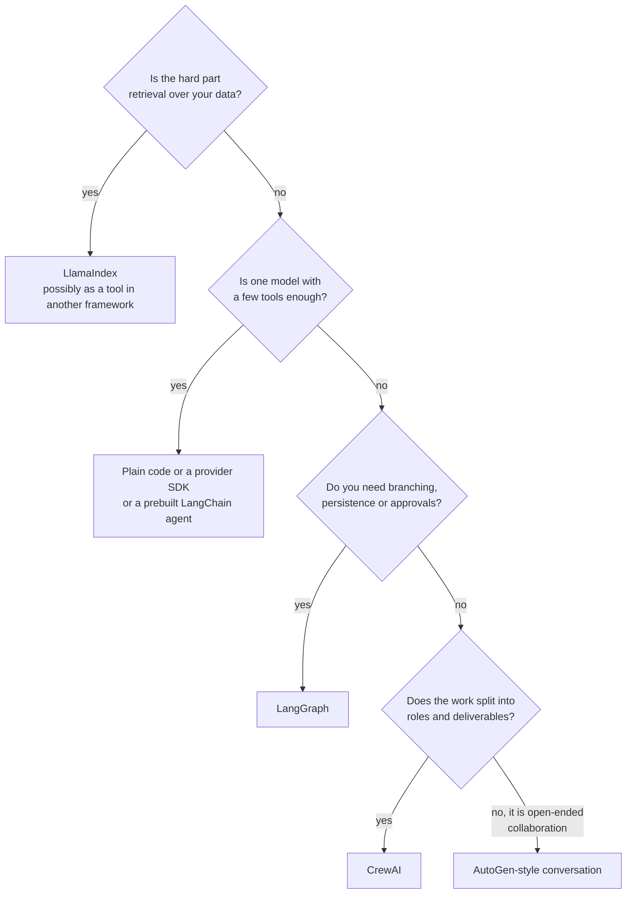

**CrewAI** organises agents the way you might organise a small team of people. You describe each team member by a **role**, a **goal** and a **backstory**, you write down the **tasks** that need doing and what a good result looks like, and you put them together in a **crew** that works through the tasks in a chosen **process**. The framework turns those descriptions into prompts, runs each agent's tool loop and passes results between tasks. For workflows that really are "research, then write, then review", this vocabulary is quick to read and quick to change, which explains much of CrewAI's popularity. This lesson maps it onto the agent fundamentals, shows a minimal crew, and finishes with a comparison of all five frameworks in this module.

> [!NOTE]
> The code targets the **CrewAI 1.x** family (checked against `crewai` 1.15). CrewAI is a standalone framework with its own agent loop, and it changes often, so confirm parameter names in the [CrewAI documentation](https://docs.crewai.com/) for your version. Running a crew needs an LLM API key, so no real output is shown.

## Roles, tasks and crews from first principles

| CrewAI concept | What it really is (Module 31 terms) |
| --- | --- |
| `Agent(role, goal, backstory)` | A system prompt assembled from three fields, plus an LLM and a tool list: one [agent loop](/learn/ai-agent-fundamentals/agent-architecture) |
| `Agent(tools=[...])` | The tools that agent's loop may call |
| `Task(description, expected_output, agent)` | The user message for one run of an agent's loop, with a stated success criterion |
| `Task(context=[...])` | Feeding earlier tasks' outputs into this task's prompt: hand-written [multi-step workflow](/learn/ai-agent-fundamentals/multi-step-workflows) plumbing |
| `Crew(agents, tasks, process)` | The orchestrator that decides the order in which tasks run and who does them |
| `Process.sequential` | A fixed pipeline: tasks run in the order listed |
| `Process.hierarchical` | A manager LLM [plans](/learn/ai-agent-fundamentals/planning-and-execution) and delegates tasks to agents, then reviews results |
| `crew.kickoff(inputs={...})` | Fill the `{placeholders}` in descriptions and run everything |

The role, goal and backstory fields are a form of [role prompting](/learn/prompt-engineering/role-prompting). They are not magic: a backstory that says "you are a meticulous fact-checker" helps only as much as that sentence would help in any system prompt. The real value of the structure is that it makes you write down, per agent and per task, who does what and what "done" means.

## A minimal sequential crew

```python
from crewai import Agent, Task, Crew, Process, LLM
from crewai.tools import tool

llm = LLM(model="openai/your-model-name", temperature=0)   # provider/model string

@tool("Word counter")
def count_words(text: str) -> int:
    """Count the words in a piece of text."""
    return len(text.split())

researcher = Agent(
    role="Product researcher",
    goal="Find the three most important facts about {product} for a buyer",
    backstory="You have reviewed cycling gear for years and value accuracy over hype.",
    llm=llm,
)

writer = Agent(
    role="Copywriter",
    goal="Write clear, honest product descriptions under 80 words",
    backstory="You write for a small bike shop whose customers dislike marketing fluff.",
    tools=[count_words],
    llm=llm,
)

research_task = Task(
    description="List the key facts a buyer should know about {product}.",
    expected_output="Three bullet points, one fact each.",
    agent=researcher,
)

writing_task = Task(
    description="Write a product description for {product} using the research.",
    expected_output="One paragraph under 80 words. Check the length with the tool.",
    agent=writer,
    context=[research_task],          # receives the researcher's output
)

crew = Crew(
    agents=[researcher, writer],
    tasks=[research_task, writing_task],
    process=Process.sequential,
)

result = crew.kickoff(inputs={"product": "a commuter bike helmet"})
print(result.raw)                      # final task's output as text
for task_output in result.tasks_output:
    print(task_output.raw[:80])
```

Each agent here still runs the tool loop you know: the writer may call `count_words`, read the result and revise. CrewAI decides the order (research first because it is listed first), injects the research into the writing task's prompt, and returns a `CrewOutput` whose `raw` is the final text and whose `tasks_output` holds every intermediate result. In a sequential crew earlier task outputs are passed forward automatically; `context` makes the dependency explicit and lets you choose exactly which outputs a task sees.

> [!TIP]
> `expected_output` is the most under-used field. "Three bullet points, one fact each" gives the agent a concrete target and gives you something to check. For machine-readable results, `Task` also accepts `output_pydantic` with a Pydantic model, the same idea as [structured outputs](/learn/working-with-llms/structured-outputs).

## Sequential versus hierarchical processes



| | Sequential | Hierarchical |
| --- | --- | --- |
| Who decides the order | You, by listing tasks | A manager agent, at run time |
| Configuration | Each task names its agent | Requires `manager_llm` or a custom `manager_agent` on the `Crew` |
| Predictability | High: same order every run | Lower: the manager may delegate differently each time |
| Cost | One loop per task | Extra manager calls for planning, delegation and review |
| Fits | Known pipelines | Open-ended goals where the steps are not known in advance |

Start with sequential. It is the CrewAI equivalent of the fixed workflows in Module 31, and most business processes are fixed workflows. Move to hierarchical only when you can show that a manager's flexibility improves results enough to justify the extra cost and unpredictability. For complex control flow (branches, loops, state), CrewAI also has **Flows**, an event-driven layer for chaining crews and plain Python steps; check the docs for its current API.

For larger projects, the `crewai create crew` command scaffolds a project in which agents and tasks are defined in configuration files rather than inline Python, which keeps prompts out of code and easy to review. The scaffold's file format has changed between versions (long-standing tutorials use YAML), another reason to check the docs for the version you install.

## What CrewAI adds and costs

CrewAI's abstractions read like a job description, which makes crews easy to explain to non-engineers and easy to modify. The costs follow from the same design. Several agents mean several loops and many tokens; a crew that could have been one agent with two tools costs more and is slower. The prompts CrewAI builds from your fields are partly hidden, so when an agent misbehaves you need `verbose=True` on agents or the crew (or a tracing integration) to see what it actually received. Delegation between agents (`allow_delegation=True`) adds flexibility and also new ways to loop; cap agent iterations with `max_iter`. And, as with every framework here, upgrades can change behaviour.

> [!KEY]
> A crew is a multi-step workflow with a role-based vocabulary. Use it when your problem decomposes naturally into roles and tasks with clear expected outputs. If your "crew" has one agent, or if you need fine control over state and branching, plain code or LangGraph will serve you better.

## Comparing the five frameworks

This table summarises the module. It describes design centres and typical use, not rankings: each of these projects overlaps with the others and keeps adding features.

| | LangChain | LangGraph | LlamaIndex | AutoGen | CrewAI |
| --- | --- | --- | --- | --- | --- |
| Core abstraction | Runnables composed with `\|`; chat models, messages, tools | State graph of nodes and edges | Documents, nodes, indexes, query engines | Agents that converse | Agents with roles, tasks, crews |
| Design centre | Integrations and a uniform model interface | Control flow, state and persistence | Connecting LLMs to your data (RAG) | Multi-agent conversation | Role-based multi-agent workflows |
| Agent loop | `create_agent` (built on LangGraph) | You draw it, or use a prebuilt agent | Workflow-based agents over tools and query engines | Turn-taking until a termination condition | Each agent runs its own loop per task |
| Persistence and human-in-the-loop | Via LangGraph | First-class: checkpointers, interrupts | Persisted indexes; agent state via workflows | Human as a participant | Human input on tasks; check docs |
| Best when | You need many integrations or provider flexibility | Branching, cycles, long-running or approval steps | Retrieval quality over many data sources is the hard part | Exploring agent collaboration, code-execution loops | Pipelines that map to roles and deliverables |
| Main costs | Abstraction layers, version churn | More code up front, reducer and state subtleties | Hidden defaults, large dependency tree | API redesigns, token-heavy and unpredictable flow | Hidden prompts, token cost of many agents |



Whatever you choose, the skills from Module 31 transfer: every framework is a loop, tools, memory and state with opinions attached. If you can sketch the plain-Python version of what a framework is doing, you can debug it, and you can leave it when it no longer fits.

## Exercises

**1.** Rewrite the two-task crew from this lesson as a description in Module 31 terms: how many agent loops run, what is in each system prompt, and what is in each user message?

<details>
<summary>Show solution</summary>

Two loops run, one per task. The researcher's system prompt is built from its role, goal and backstory (with `{product}` filled in); its user message is the research task's description and expected output. The writer's system prompt comes from its own three fields and lists the `count_words` tool; its user message is the writing task's description, expected output and the researcher's output as context. The writer's loop may include tool calls before its final answer.

</details>

**2.** A team proposes a hierarchical crew with a manager and five agents for a process that is always "extract fields from an invoice, validate them, write them to a spreadsheet". What would you suggest, and why?

<details>
<summary>Show solution</summary>

The steps are fixed and known in advance, so a manager adds cost and unpredictability without benefit. Use a sequential process (or plain code), probably with fewer agents: extraction and validation might be one LLM call with structured output followed by deterministic Python validation, and writing to the spreadsheet should be ordinary code, not an agent.

</details>

**3.** Using the comparison table, pick a framework (or plain code) for each case and justify it in one sentence: (a) a chatbot answering questions from 2,000 internal PDFs; (b) an expense-approval agent that must wait for a manager's sign-off over several days; (c) a single assistant that calls a weather API.

<details>
<summary>Show solution</summary>

(a) LlamaIndex, because retrieval quality over many documents is the hard part. (b) LangGraph, because it needs durable state and an interrupt that can be resumed days later via a checkpointer. (c) Plain code with the provider's SDK (or a prebuilt agent), because one model and one tool do not justify a framework.

</details>

```quiz
[
  {
    "q": "In CrewAI, what do `role`, `goal` and `backstory` mainly become?",
    "options": [
      "Database fields for the crew's memory",
      "Parts of the agent's system prompt",
      "Names of the tools the agent may call",
      "Training data for fine-tuning"
    ],
    "answer": 1,
    "why": "They are assembled into the prompt that steers the agent, a structured form of role prompting."
  },
  {
    "q": "What does `context=[research_task]` on a task do?",
    "options": [
      "Runs the research task again",
      "Gives the agent the researcher's tools",
      "Makes the research task's output available in this task's prompt",
      "Shares the researcher's API key"
    ],
    "answer": 2,
    "why": "Context passes earlier task outputs into the current task, making the dependency explicit."
  },
  {
    "q": "What does a hierarchical process require that a sequential one does not?",
    "options": [
      "A manager LLM or manager agent that delegates tasks",
      "A vector database",
      "A checkpointer",
      "Exactly one agent"
    ],
    "answer": 0,
    "why": "In hierarchical mode a manager plans and delegates, so the crew needs `manager_llm` or `manager_agent`."
  },
  {
    "q": "Which framework's design centre is durable state, branching and human approval steps?",
    "options": [
      "LlamaIndex",
      "CrewAI",
      "AutoGen",
      "LangGraph"
    ],
    "answer": 3,
    "why": "LangGraph models agents as state graphs with checkpointers and interrupts for persistence and human-in-the-loop."
  }
]
```
