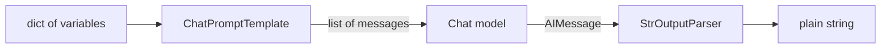
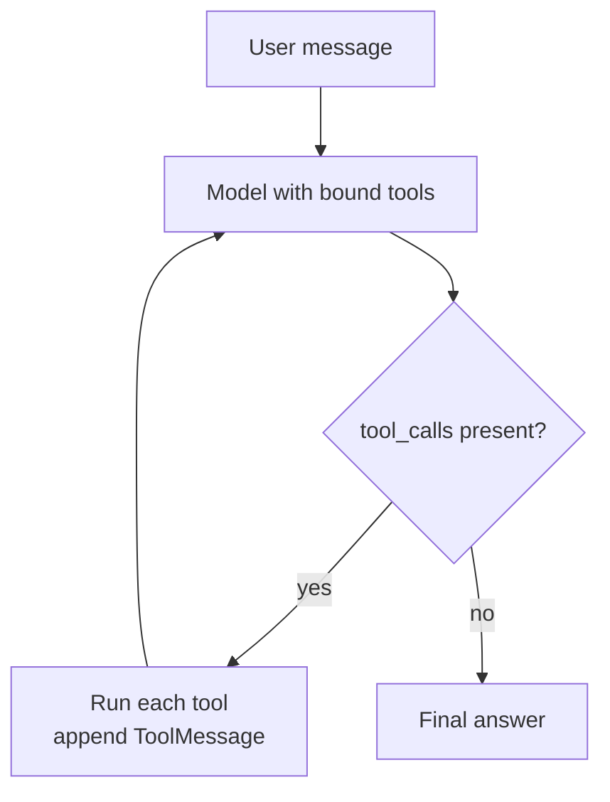

In the previous module you built agents from nothing: a loop that calls a model, parses tool calls, runs Python functions, appends the results to a message list and stops when the model gives a final answer. That code was perhaps a hundred lines, and you understood every one of them. **LangChain** is the most widely used library that packages those same pieces (messages, prompts, model clients, tools, the agent loop) behind common interfaces, so that you can swap a model provider in one line and reuse hundreds of ready-made integrations. This lesson maps LangChain's abstractions onto what you already know, shows the small core you will actually use, and is honest about what the library costs you.

> [!WARNING]
> LangChain changes quickly and has broken its API more than once. The examples here target the **1.x family** (`langchain` 1.x and `langchain-core` 1.x). The core pieces shown (messages, `ChatPromptTemplate`, the `|` composition, `@tool`, `bind_tools`) have been stable for a long time, but always check the [official documentation](https://docs.langchain.com/) for the version you install, and pin versions in your projects.

## From first principles to LangChain

Every concept in LangChain corresponds to something you wrote by hand in [Agent architecture](/learn/ai-agent-fundamentals/agent-architecture) and [Function calling](/learn/ai-agent-fundamentals/function-calling).

| What you built by hand | LangChain abstraction | Package |
| --- | --- | --- |
| A list of `{"role": ..., "content": ...}` dicts | `SystemMessage`, `HumanMessage`, `AIMessage`, `ToolMessage` | `langchain_core.messages` |
| An f-string that fills in a prompt | `ChatPromptTemplate` | `langchain_core.prompts` |
| A function that calls the provider's API | A chat model class such as `ChatOpenAI` | provider packages, such as `langchain_openai` |
| A JSON schema describing a tool | A function decorated with `@tool` | `langchain_core.tools` |
| Sending tool schemas with each request | `model.bind_tools([...])` | any tool-calling chat model |
| The `while` loop that runs tools until done | `create_agent` (built on LangGraph) | `langchain.agents` |
| Saving the message list between turns | Checkpointers (from LangGraph) | `langgraph` |

The package split matters. `langchain-core` holds the base interfaces and has few dependencies. Each provider lives in its own package (`langchain-openai`, `langchain-anthropic` and so on), so you install only what you use. The `langchain` package adds higher-level pieces such as the agent constructor.

## Messages and prompt templates

Messages are typed objects rather than dicts, which lets every provider package translate them into its own wire format. A `ChatPromptTemplate` is a message list with named placeholders:

```python
from langchain_core.prompts import ChatPromptTemplate

prompt = ChatPromptTemplate.from_messages([
    ("system", "You are a concise assistant for {product}."),
    ("human", "{question}"),
])

value = prompt.invoke({"product": "a bike shop", "question": "Do you sell helmets?"})
for message in value.to_messages():
    print(type(message).__name__, "|", message.content)
```

```output
SystemMessage | You are a concise assistant for a bike shop.
HumanMessage | Do you sell helmets?
```

Nothing here touches a model, so you can unit-test prompts in isolation, which is one of the genuinely useful habits LangChain encourages. If a variable is missing, `invoke` raises an error immediately rather than sending a half-filled prompt.

## LCEL: composing runnables with `|`

Prompts, models and output parsers all implement one interface, the **Runnable**: each has `invoke` (one input), `batch` (a list of inputs) and `stream` (yield output pieces as they arrive). Because they share the interface, they can be chained with the `|` operator. This is the **LangChain Expression Language (LCEL)**: the output of each step becomes the input of the next.



To run this without an API key, use the fake chat model that `langchain-core` ships for testing. It returns scripted responses in order:

```python
from langchain_core.language_models.fake_chat_models import FakeListChatModel
from langchain_core.output_parsers import StrOutputParser

model = FakeListChatModel(responses=["Yes, in three sizes."])
chain = prompt | model | StrOutputParser()

print(type(chain).__name__)
print(chain.invoke({"product": "a bike shop", "question": "Do you sell helmets?"}))
```

```output
RunnableSequence
Yes, in three sizes.
```

With a real provider, only the model line changes. The model name below is a placeholder: use one your provider currently offers.

```python
from langchain_openai import ChatOpenAI   # pip install langchain-openai

model = ChatOpenAI(model="your-model-name", temperature=0)   # reads OPENAI_API_KEY
chain = prompt | model | StrOutputParser()
answer = chain.invoke({"product": "a bike shop", "question": "Do you sell helmets?"})
```

Compare this with the plain-Python version: `messages = build_messages(product, question)`, `response = client.chat(...)`, `text = response.content`. The LCEL version is not shorter. What it buys you is uniformity: every chain gets `batch` (with concurrency), `stream` and async variants (`ainvoke`, `astream`) for free, and tracing tools can see each step.

> [!KEY]
> LCEL is function composition with a shared interface. `prompt | model | parser` means "call `prompt`, pass its output to `model`, pass that to `parser`". If you can describe your pipeline as a straight line of transformations, LCEL fits well. Branching, looping logic is better expressed in LangGraph, the subject of the [next lesson](/learn/agent-frameworks/langgraph).

## Tools: `@tool` and `bind_tools`

In [Tool usage](/learn/ai-agent-fundamentals/tool-usage) you wrote JSON schemas by hand. The `@tool` decorator builds the schema from the function's name, type hints and docstring:

```python
from langchain_core.tools import tool

@tool
def get_stock(item: str) -> int:
    """Return how many units of an item are in stock."""
    return {"helmet": 12, "lock": 3}.get(item, 0)

print(get_stock.name, "|", get_stock.description)
print(get_stock.args)
print(get_stock.invoke({"item": "helmet"}))
```

```output
get_stock | Return how many units of an item are in stock.
{'item': {'title': 'Item', 'type': 'string'}}
12
```

The docstring is not decoration: it becomes the description the model reads when deciding whether to call the tool, so write it as carefully as a prompt.

`model.bind_tools([get_stock])` returns a new runnable that sends the tool schemas with every request. When the model decides to use a tool, the returned `AIMessage` has a `tool_calls` list in a provider-neutral format. You can see the shape, and the step that executes the call, without a live model by constructing that message yourself:

```python
from langchain_core.messages import AIMessage

# What a tool-calling model returns (constructed by hand here)
reply = AIMessage(content="", tool_calls=[
    {"name": "get_stock", "args": {"item": "helmet"}, "id": "call_1", "type": "tool_call"}
])

tools_by_name = {"get_stock": get_stock}
for call in reply.tool_calls:
    result = tools_by_name[call["name"]].invoke(call)   # passing the whole call...
    print(repr(result))                                  # ...returns a ToolMessage
```

```output
ToolMessage(content='12', name='get_stock', tool_call_id='call_1')
```

Passing the whole tool call to `invoke` returns a `ToolMessage` already carrying the matching `tool_call_id`, which is exactly what you append to the history before calling the model again. With a real model the loop is the same one you wrote in Module 31:

```python
model_with_tools = ChatOpenAI(model="your-model-name").bind_tools([get_stock])

messages = [HumanMessage("How many helmets do you have?")]
while True:
    reply = model_with_tools.invoke(messages)
    messages.append(reply)
    if not reply.tool_calls:          # no tool requested: final answer
        break
    for call in reply.tool_calls:
        messages.append(tools_by_name[call["name"]].invoke(call))
print(reply.content)
```

(This snippet also needs `from langchain_core.messages import HumanMessage`. In real code, add a maximum number of iterations, as you did in [Planning and execution](/learn/ai-agent-fundamentals/planning-and-execution).)

## The prebuilt agent

You rarely need to write that loop. In the 1.x family, `langchain.agents.create_agent` builds it for you, implemented as a LangGraph graph:

```python
from langchain.agents import create_agent

agent = create_agent(
    model=ChatOpenAI(model="your-model-name"),
    tools=[get_stock],
    system_prompt="You are a helpful assistant for a bike shop.",
)
result = agent.invoke({"messages": [{"role": "user", "content": "Any helmets in stock?"}]})
print(result["messages"][-1].content)
```

The result is the full message history, so you can inspect every tool call the agent made. Older tutorials use `AgentExecutor`, `initialize_agent` or `LLMChain`; those belong to the pre-1.0 API and were moved out of the main package. If a tutorial imports them, it is out of date.



## What LangChain costs

| Benefit | Cost |
| --- | --- |
| Swap providers by changing one import and one constructor | Another layer between you and the provider: new provider features can lag behind in the wrapper |
| Hundreds of integrations: vector stores, document loaders, retrievers | Integrations vary in quality and maintenance; check each one you depend on |
| `batch`, `stream` and async on every runnable | Stack traces run through library internals, which makes errors harder to read |
| Tracing with LangSmith shows every step of a run | The most convenient observability is a commercial product (it is optional) |
| A shared vocabulary that many tutorials use | Version churn: code and tutorials from even a year ago may not run |

For debugging, `from langchain_core.globals import set_debug; set_debug(True)` prints every input and output passing through your runnables. Because the messages and tools are ordinary Python objects, you can also call each piece on its own with `invoke`, which is usually the fastest way to find which step is wrong.

## When to use it, and when not

Use LangChain when you want to switch between several model providers, when you need a particular integration it already has (a document loader, a vector store) and would otherwise write glue code, or when your team already uses LangGraph and LangSmith. Prefer the provider's own SDK, or the plain loop from Module 31, when you use a single provider, when you need its newest features on day one, or when the application is small enough that an extra dependency is more risk than help.

> [!TIP]
> You do not have to adopt all of LangChain. Many teams use only `langchain-core` messages and a provider package, or only one document loader, and write the rest in plain Python. Mixing is fine because the pieces are ordinary objects.

## Exercises

**1.** Write a `ChatPromptTemplate` with a system message that takes a `{tone}` variable and a human message that takes `{text}`. Invoke it with `tone="formal"` and print each message's type and content.

<details>
<summary>Show solution</summary>

```python
from langchain_core.prompts import ChatPromptTemplate

rewrite = ChatPromptTemplate.from_messages([
    ("system", "Rewrite the user's text in a {tone} tone."),
    ("human", "{text}"),
])
for m in rewrite.invoke({"tone": "formal", "text": "gonna be late, sorry"}).to_messages():
    print(type(m).__name__, "|", m.content)
```

```output
SystemMessage | Rewrite the user's text in a formal tone.
HumanMessage | gonna be late, sorry
```

</details>

**2.** Build `rewrite | FakeListChatModel(responses=["I apologise; I shall be delayed."]) | StrOutputParser()` and call `.batch` with two different inputs. How many responses does the fake model need, and why?

<details>
<summary>Show solution</summary>

`batch` calls the model once per input, so a fake model needs one scripted response per input (it cycles through its list). With two responses:

```python
from langchain_core.language_models.fake_chat_models import FakeListChatModel
from langchain_core.output_parsers import StrOutputParser

chain = rewrite | FakeListChatModel(responses=["Reply A", "Reply B"]) | StrOutputParser()
print(chain.batch([{"tone": "formal", "text": "hi"}, {"tone": "casual", "text": "Greetings"}]))
```

The output is a list of two strings. Because batched calls may run concurrently, do not rely on which scripted response goes to which input.

</details>

**3.** Write a `@tool` called `convert_km` that takes `km: float` and returns miles, and print its `args`. What would happen to the model's tool choices if you left out the docstring?

<details>
<summary>Show solution</summary>

```python
@tool
def convert_km(km: float) -> float:
    """Convert a distance in kilometres to miles."""
    return km * 0.621371

print(convert_km.args)
```

```output
{'km': {'title': 'Km', 'type': 'number'}}
```

Without a docstring, `@tool` raises a `ValueError` saying the function must have a docstring if no description is provided, because the description is what the model uses to decide when the tool applies. A vague description leads to the tool being ignored or misused.

</details>

```quiz
[
  {
    "q": "In LCEL, what does `prompt | model | parser` mean?",
    "options": [
      "Run the three steps in parallel and merge the results",
      "Call `prompt`, pass its output to `model`, then pass that output to `parser`",
      "Try `prompt`, then fall back to `model` and `parser` if it fails",
      "Send the prompt to the model through a Unix pipe"
    ],
    "answer": 1,
    "why": "The `|` operator composes runnables into a `RunnableSequence`: each step's output is the next step's input."
  },
  {
    "q": "What does `model.bind_tools([get_stock])` do?",
    "options": [
      "Runs `get_stock` before every model call",
      "Fine-tunes the model to use the tool",
      "Returns a runnable that sends the tool's schema with each request so the model can request it",
      "Executes any tool calls the model makes automatically"
    ],
    "answer": 2,
    "why": "Binding attaches tool schemas to requests. Executing the requested calls is still the job of your loop or of an agent such as `create_agent`."
  },
  {
    "q": "Where does a `@tool` get the description the model sees?",
    "options": [
      "From the function's docstring",
      "From the function's return type",
      "From the variable name it is assigned to",
      "It is generated by the model"
    ],
    "answer": 0,
    "why": "The decorator uses the function name as the tool name, the type hints for the argument schema and the docstring as the description."
  },
  {
    "q": "A tutorial imports `AgentExecutor` and `LLMChain` from `langchain`. What should you conclude?",
    "options": [
      "It is the recommended modern API",
      "It needs a paid LangSmith account",
      "It only works with OpenAI models",
      "It was written for the pre-1.0 API and is likely out of date"
    ],
    "answer": 3,
    "why": "Those classes belong to the older API and were moved out of the main package in the 1.x family. Check the current docs before following such tutorials."
  }
]
```
