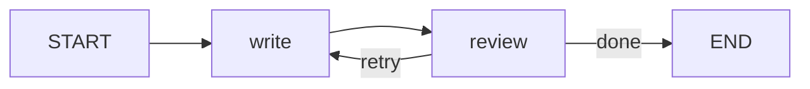
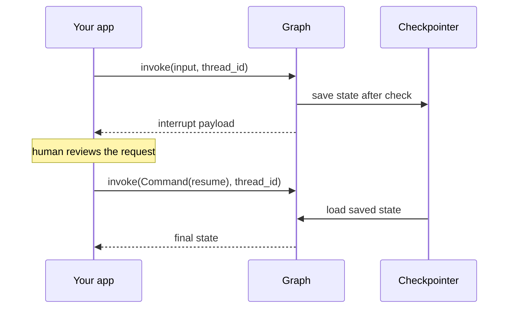

The agent loop from Module 31 is a small **state machine**: there is some state (the message list, a step counter, a plan), a handful of steps that read and update it (call the model, run tools, ask a human), and rules for which step comes next. While the rules are "call the model, run any tools, repeat", a `while` loop is perfect. When they grow ("retry the search at most twice, then ask a human if the refund is over a threshold, and resume tomorrow when they answer"), the loop turns into a tangle of flags. **LangGraph** makes the state machine explicit: you declare the state, the steps (nodes) and the transitions (edges), and the library runs it, saves it and lets you pause and resume it. It comes from the LangChain team and is the engine underneath LangChain's own agents, but it does not require LangChain: nodes are plain Python functions.

> [!NOTE]
> The code in this lesson targets the **LangGraph 1.x** family and was run with `langgraph` 1.2. The core graph API shown here (`StateGraph`, `add_node`, `add_edge`, `add_conditional_edges`, `START`, `END`, `compile`) has been stable across many releases, but check the [LangGraph documentation](https://docs.langchain.com/) for your installed version.

## Mapping the agent loop onto a graph

| First principle (Module 31) | LangGraph concept |
| --- | --- |
| The variables your loop carries between iterations | The **state**: a `TypedDict` (or Pydantic model) shared by all nodes |
| Each step of the loop (call model, run tools, reflect) | A **node**: a function that takes the state and returns an update |
| The `if` that decides what to do next | A **conditional edge**: a function that reads the state and names the next node |
| The `while True` | A **cycle** in the graph: an edge that points back to an earlier node |
| `break` | An edge to the special `END` node |
| Saving the conversation to disk | A **checkpointer**, which saves the state after every step |
| Pausing for approval ([Human-in-the-loop systems](/learn/ai-agent-fundamentals/human-in-the-loop-systems)) | An **interrupt**, resumed later with a `Command` |

## A first graph, no LLM required

Here is a writer-and-reviewer loop where both nodes are pure Python, so the output below is real. The writer produces a longer draft each attempt; the reviewer counts words; a routing function decides whether to loop again.

```python
import operator
from typing import Annotated, TypedDict
from langgraph.graph import StateGraph, START, END

class State(TypedDict):
    draft: str
    attempts: int
    log: Annotated[list[str], operator.add]   # reducer: append, do not overwrite

def write(state: State) -> dict:
    n = state["attempts"] + 1
    return {"draft": "word " * (3 * n), "attempts": n, "log": [f"write #{n}"]}

def review(state: State) -> dict:
    words = len(state["draft"].split())
    return {"log": [f"review: {words} words"]}

def route(state: State) -> str:
    if len(state["draft"].split()) >= 8 or state["attempts"] >= 5:
        return "done"
    return "retry"

builder = StateGraph(State)
builder.add_node("write", write)
builder.add_node("review", review)
builder.add_edge(START, "write")
builder.add_edge("write", "review")
builder.add_conditional_edges("review", route, {"retry": "write", "done": END})
graph = builder.compile()

result = graph.invoke({"draft": "", "attempts": 0, "log": []})
print(result["attempts"])
print(result["log"])
```

```output
3
['write #1', 'review: 3 words', 'write #2', 'review: 6 words', 'write #3', 'review: 9 words']
```



Three details carry most of LangGraph's design:

- **Nodes return partial updates.** `review` returns only `{"log": [...]}`; the other keys keep their values. You never mutate the state in place.
- **Reducers decide how updates combine.** By default a returned key overwrites the old value (as `draft` and `attempts` do). `Annotated[list[str], operator.add]` tells LangGraph to concatenate instead, which is why `log` accumulates. Message histories use the same idea with a reducer called `add_messages`.
- **Conditional edges map labels to nodes.** `route` returns a string; the dictionary turns it into the next node. The `attempts >= 5` guard is your iteration cap, the same safety stop you added by hand in [Planning and execution](/learn/ai-agent-fundamentals/planning-and-execution).

### Stepping through a run

```trace
{
  "title": "one run of the write/review graph",
  "code": [
    "state = {draft: '', attempts: 0, log: []}",
    "node = 'write'",
    "update = write(state)",
    "state = merge(state, update)",
    "update = review(state)",
    "state = merge(state, update)",
    "label = route(state)",
    "node = 'write' if label == 'retry' else END"
  ],
  "steps": [
    { "line": 1, "vars": { "attempts": "0", "words": "0", "log": "[]" }, "note": "invoke() starts with the input state. START points to write." },
    { "line": 4, "vars": { "attempts": "1", "words": "3", "log": "['write #1']" }, "note": "write returns draft, attempts and a one-item log. draft and attempts are overwritten; log is appended by its reducer." },
    { "line": 6, "vars": { "attempts": "1", "words": "3", "log": "['write #1', 'review: 3 words']" }, "note": "review returns only a log entry. Every other key is untouched." },
    { "line": 8, "vars": { "attempts": "1", "words": "3", "label": "'retry'" }, "note": "3 words is fewer than 8, so route returns 'retry' and the edge leads back to write." },
    { "line": 6, "vars": { "attempts": "2", "words": "6", "log": "[... 'review: 6 words']" }, "note": "Second pass: still too short, so another retry." },
    { "line": 8, "vars": { "attempts": "3", "words": "9", "label": "'done'" }, "note": "Third pass: 9 words. route returns 'done', the edge leads to END and invoke() returns the final state." }
  ]
}
```

To watch a real run step by step, use `stream` instead of `invoke`. With `stream_mode="updates"` each item is the update one node produced:

```python
for step in graph.stream({"draft": "", "attempts": 0, "log": []}, stream_mode="updates"):
    for node, update in step.items():
        print(node, "->", update["log"])
```

```output
write -> ['write #1']
review -> ['review: 3 words']
write -> ['write #2']
review -> ['review: 6 words']
write -> ['write #3']
review -> ['review: 9 words']
```

## The ReAct agent as a graph

Swap the writer for a model and the reviewer for a tool runner and you have the [ReAct loop](/learn/ai-agent-fundamentals/reasoning-and-planning). LangGraph provides `MessagesState` (a state with a `messages` key using the `add_messages` reducer), `ToolNode` (runs every tool call in the last AI message) and `tools_condition` (routes to `"tools"` if there are tool calls, otherwise to `END`). Below, a scripted function stands in for the LLM so the run is reproducible; in real code that node would call `model_with_tools.invoke(state["messages"])`.

```python
from langchain_core.messages import AIMessage, HumanMessage
from langchain_core.tools import tool
from langgraph.graph import MessagesState
from langgraph.prebuilt import ToolNode, tools_condition

@tool
def get_stock(item: str) -> int:
    """Return how many units of an item are in stock."""
    return {"helmet": 12, "lock": 3}.get(item, 0)

def scripted_model(state: MessagesState) -> dict:
    """Stands in for an LLM: asks for a tool once, then answers."""
    last = state["messages"][-1]
    if last.type == "human":
        call = {"name": "get_stock", "args": {"item": "helmet"}, "id": "call_1"}
        return {"messages": [AIMessage(content="", tool_calls=[call])]}
    return {"messages": [AIMessage(content=f"We have {last.content} helmets.")]}

builder = StateGraph(MessagesState)
builder.add_node("model", scripted_model)
builder.add_node("tools", ToolNode([get_stock]))
builder.add_edge(START, "model")
builder.add_conditional_edges("model", tools_condition)   # to "tools" or END
builder.add_edge("tools", "model")
agent = builder.compile()

result = agent.invoke({"messages": [HumanMessage("Any helmets?")]})
for m in result["messages"]:
    print(f"{m.type:<6}", m.content or m.tool_calls[0]["name"])
```

```output
human  Any helmets?
ai     get_stock
tool   12
ai     We have 12 helmets.
```

LangGraph also ships a one-line version, `create_react_agent` in `langgraph.prebuilt`. In the 1.x family it is deprecated in favour of `create_agent` from `langchain.agents` (covered in the [LangChain lesson](/learn/agent-frameworks/langchain)), which builds the same model-and-tools graph. Writing the graph yourself, as above, is worth doing once: when you later need a node the prebuilt agent lacks (a guardrail check, a planner, a summariser that trims old messages), you will know where it goes.

## Persistence and human-in-the-loop

Compile a graph with a **checkpointer** and LangGraph saves the state after every node, keyed by a `thread_id` you pass in the config. That gives you three things at once: conversation memory across calls, recovery after a crash, and the ability to pause. Inside a node, `interrupt(payload)` stops the run and returns the payload to the caller; later, `Command(resume=value)` restarts the run and `interrupt` returns `value`.

```python
from langgraph.checkpoint.memory import InMemorySaver
from langgraph.types import interrupt, Command

class Refund(TypedDict):
    amount: float
    approved: bool
    status: str

def check(state: Refund) -> dict:
    return {"status": "checked"}

def approve(state: Refund) -> dict:
    if state["amount"] > 100:
        answer = interrupt({"question": f"Approve refund of {state['amount']}?"})
        return {"approved": answer == "yes"}
    return {"approved": True}

def execute(state: Refund) -> dict:
    return {"status": "refunded" if state["approved"] else "rejected"}

b = StateGraph(Refund)
b.add_node("check", check)
b.add_node("approve", approve)
b.add_node("execute", execute)
b.add_edge(START, "check")
b.add_edge("check", "approve")
b.add_edge("approve", "execute")
b.add_edge("execute", END)
app = b.compile(checkpointer=InMemorySaver())

config = {"configurable": {"thread_id": "refund-42"}}
paused = app.invoke({"amount": 250.0, "approved": False, "status": "new"}, config)
print(paused["__interrupt__"][0].value)
print("waiting at:", app.get_state(config).next)

final = app.invoke(Command(resume="yes"), config)   # hours later, same thread_id
print(final)
```

```output
{'question': 'Approve refund of 250.0?'}
waiting at: ('approve',)
{'amount': 250.0, 'approved': True, 'status': 'refunded'}
```



> [!WARNING]
> When a run resumes, the interrupted node **starts again from its first line**. Any side effect placed before `interrupt` in the same node (sending an email, charging a card) will happen twice. Put side effects in a separate node after the approval, as `execute` does here.

`InMemorySaver` loses everything when the process exits; it is for development and tests. For production, LangGraph has database-backed checkpointers in separate packages (for example SQLite and Postgres).

## What LangGraph adds and costs

LangGraph's strengths are exactly the things that are tedious to get right by hand: durable state, pause and resume, streaming of intermediate steps, and a graph you can draw (`graph.get_graph().draw_mermaid()` returns a Mermaid description of the compiled graph). Its costs are the usual framework ones. State updates go through reducers, so a wrong reducer (overwriting a list you meant to append to) silently loses data. Errors surface from inside the runtime rather than your loop. A cycle without a stop condition runs until it hits the recursion limit and raises `GraphRecursionError`; the default limit has changed between versions, so set it explicitly with `{"recursion_limit": 25}` in the config. And the checkpoint format ties your saved conversations to the library.

> [!KEY]
> Reach for LangGraph when your agent needs **branching, cycles, persistence or human approval**. For a single linear pipeline, LCEL or plain functions are simpler. For a basic tool loop, the prebuilt agent is enough. The graph earns its keep when you would otherwise be writing your own state machine and storage layer.

## Exercises

**1.** Change `route` in the write/review graph so that it stops when the draft has at least 12 words. Predict the final `attempts` before running it.

<details>
<summary>Show solution</summary>

Drafts have 3, 6, 9, 12 words on attempts 1 to 4, so it stops after 4 attempts:

```python
def route(state: State) -> str:
    if len(state["draft"].split()) >= 12 or state["attempts"] >= 5:
        return "done"
    return "retry"
```

Rebuild and recompile the graph after changing the function, because `add_conditional_edges` captured the old one.

</details>

**2.** Remove the `Annotated[..., operator.add]` from `log` and run the graph again. What does `result["log"]` contain, and why?

<details>
<summary>Show solution</summary>

`['review: 9 words']`. Without a reducer each update overwrites the key, so only the last node's log entry survives. This is the most common LangGraph state bug: lists that should accumulate need a reducer.

</details>

**3.** In the refund graph, resume with `Command(resume="no")` instead. What is the final `status`? Then invoke a new thread with `amount=50.0`: does it pause?

<details>
<summary>Show solution</summary>

With `"no"`, `approved` becomes `False` and `status` is `"rejected"`. With an amount of 50 the `if` in `approve` is false, `interrupt` is never called, and the run goes straight to `"refunded"` without pausing. Use a new `thread_id` for the second run, otherwise you continue the old thread's saved state.

</details>

```quiz
[
  {
    "q": "A LangGraph node returns `{\"log\": [\"x\"]}` and the state also has a `draft` key. What happens to `draft`?",
    "options": [
      "It is deleted",
      "It is set to `None`",
      "It keeps its previous value",
      "The graph raises an error because the update is incomplete"
    ],
    "answer": 2,
    "why": "Nodes return partial updates. Keys not mentioned keep their values."
  },
  {
    "q": "What does `Annotated[list[str], operator.add]` do in a state definition?",
    "options": [
      "Makes updates to that key append to the existing list instead of replacing it",
      "Validates that every item is a string",
      "Sums the list into a single number",
      "Marks the key as read-only"
    ],
    "answer": 0,
    "why": "The second argument is a reducer: LangGraph combines old and new values with it, here by list concatenation."
  },
  {
    "q": "Why must you compile a graph with a checkpointer to use `interrupt`?",
    "options": [
      "Interrupts only work with LLM nodes",
      "The paused state must be saved somewhere so the run can resume later under the same `thread_id`",
      "Checkpointers make the graph run faster",
      "Without one, `interrupt` silently does nothing"
    ],
    "answer": 1,
    "why": "Pausing means the process may return or even exit. The checkpointer stores the state so `Command(resume=...)` can continue from it."
  },
  {
    "q": "A node sends an email and then calls `interrupt`. The human approves. What happens?",
    "options": [
      "The email is sent once, as expected",
      "The email is never sent",
      "The graph skips the node on resume",
      "The email is sent again, because the node re-runs from its start on resume"
    ],
    "answer": 3,
    "why": "Resuming re-executes the interrupted node from the top. Side effects belong in a node after the approval."
  }
]
```
