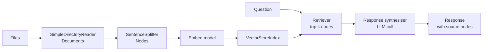
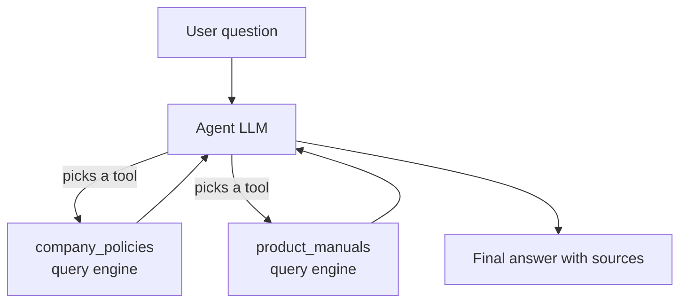

LangChain started as a general toolkit for chaining model calls. **LlamaIndex** started from a narrower question: how do you connect a language model to *your* data? Its centre of gravity is the pipeline you studied in [RAG Fundamentals](/learn/rag-fundamentals/what-is-rag): load documents, split them into chunks, embed and index them, retrieve the relevant pieces for a question and synthesise an answer from them. It also has agents, but its agents are typically used to reason *over* data sources. If your agent's main job is answering questions from a pile of PDFs, wiki pages or tables, LlamaIndex is the framework whose defaults are closest to what you need.

> [!NOTE]
> Examples here target the **`llama_index.core` package layout** used since v0.10 (they were checked against `llama-index-core` 0.14). LlamaIndex releases frequently and its agent APIs in particular have been redesigned, so confirm details in the [LlamaIndex documentation](https://docs.llamaindex.ai/) for your version. The code needs an embedding model and an LLM (by default, OpenAI via the `llama-index-llms-openai` and `llama-index-embeddings-openai` packages), so no outputs are shown except where marked as illustrative.

## The RAG pipeline in LlamaIndex terms

Each stage of the RAG pipeline you built by hand has a LlamaIndex name.

| RAG stage (Module 28) | LlamaIndex abstraction | What it holds or does |
| --- | --- | --- |
| [Document ingestion](/learn/rag-fundamentals/document-ingestion) | `SimpleDirectoryReader`, other readers | Turns files into `Document` objects (text plus metadata) |
| [Text chunking](/learn/rag-fundamentals/text-chunking) | Node parsers such as `SentenceSplitter` | Splits documents into `Node`s that remember their source |
| [Embedding generation](/learn/rag-fundamentals/embedding-generation) | `Settings.embed_model` | Embeds each node |
| Storing vectors | `VectorStoreIndex` over a vector store | In memory by default; many vector databases are supported |
| [Retrieval](/learn/rag-fundamentals/retrieval-mechanisms) | Retriever (`index.as_retriever()`) | Returns the top-k `NodeWithScore` objects |
| [Context construction](/learn/rag-fundamentals/context-construction) and [answer generation](/learn/rag-fundamentals/answer-generation) | Response synthesiser | Packs retrieved text into prompts and calls the LLM |
| The whole question-to-answer path | Query engine (`index.as_query_engine()`) | Retriever plus synthesiser |



## The five-line RAG

The famous LlamaIndex starter is short because every stage above has a default:

```python
from llama_index.core import VectorStoreIndex, SimpleDirectoryReader

documents = SimpleDirectoryReader("data").load_data()     # every readable file in ./data
index = VectorStoreIndex.from_documents(documents)         # chunk, embed, store in memory
query_engine = index.as_query_engine()
response = query_engine.query("How long do customers have to request a refund?")
print(response)
```

That hides several decisions worth knowing about, because they are the same ones you made explicitly in Module 28:

- **Which models?** Unless you configure otherwise, LlamaIndex uses OpenAI for both embeddings and generation and reads `OPENAI_API_KEY` from the environment. Without that key, `from_documents` fails at the embedding step.
- **How are documents chunked?** By a sentence-aware splitter with a default chunk size and overlap (1,024 and 200 tokens in the version checked). Whether that suits your documents is a question for [Chunking strategies](/learn/rag-fundamentals/chunking-strategies).
- **How many chunks are retrieved?** A small default `similarity_top_k` (2 in recent versions).
- **Where do vectors live?** In memory. Restart the process and you re-embed everything, which costs time and money.

## Making the defaults explicit

For anything beyond a demo, set these yourself. The `Settings` object holds global defaults; most constructors also accept the same things as arguments.

```python
from llama_index.core import Settings, VectorStoreIndex, SimpleDirectoryReader
from llama_index.core.node_parser import SentenceSplitter
from llama_index.llms.openai import OpenAI                    # pip install llama-index-llms-openai
from llama_index.embeddings.openai import OpenAIEmbedding     # pip install llama-index-embeddings-openai

Settings.llm = OpenAI(model="your-model-name", temperature=0)
Settings.embed_model = OpenAIEmbedding(model="your-embedding-model")

documents = SimpleDirectoryReader("data", required_exts=[".md", ".pdf"], recursive=True).load_data()
index = VectorStoreIndex.from_documents(
    documents,
    transformations=[SentenceSplitter(chunk_size=512, chunk_overlap=64)],
)

query_engine = index.as_query_engine(similarity_top_k=4)
response = query_engine.query("How long do customers have to request a refund?")

print(response)
for source in response.source_nodes:
    print(round(source.score, 3), source.node.metadata.get("file_name"))
```

An illustrative run (your text, scores and files will differ):

```output
Customers can request a refund within 30 days of delivery.
0.842 refund-policy.md
0.791 faq.md
0.655 shipping.md
0.612 terms.pdf
```

`response.source_nodes` is the feature to lean on: every answer comes with the chunks it was built from and their similarity scores, so you can show citations to users and debug bad answers by checking whether the right chunk was retrieved at all. That is the first question in [RAG evaluation](/learn/rag-fundamentals/rag-evaluation): was it a retrieval failure or a generation failure?

To skip re-embedding on every start, persist the index and load it back:

```python
index.storage_context.persist(persist_dir="./storage")

# later, in another process
from llama_index.core import StorageContext, load_index_from_storage
index = load_index_from_storage(StorageContext.from_defaults(persist_dir="./storage"))
```

For larger collections you would plug in a real vector database instead, through one of the `llama-index-vector-stores-*` integration packages; the concepts are those of the [Vector Databases](/learn/vector-databases/vector-embeddings) module.

> [!TIP]
> When you only need retrieval (for example, to feed chunks to your own agent loop or to a different framework), use `index.as_retriever(similarity_top_k=4).retrieve(question)`. It returns the scored nodes without making an LLM call, which is cheaper and much easier to test.

## Query engines as agent tools

Here LlamaIndex meets the agent ideas from Module 31. A query engine is a function from a question to an answer, which is exactly the shape of a tool. `QueryEngineTool` wraps one with a name and a description the model reads:

```python
from llama_index.core.tools import QueryEngineTool

policy_tool = QueryEngineTool.from_defaults(
    query_engine=query_engine,
    name="company_policies",
    description="Answers questions about refund, shipping and warranty policies.",
)
```

With several such tools (one per document collection: policies, product manuals, past tickets) an agent can decide which source to consult, possibly several in turn, which is the pattern often called **agentic RAG**. Recent versions provide workflow-based agents such as `FunctionAgent` (in `llama_index.core.agent.workflow`), which take a list of tools, an LLM and a system prompt, and are run asynchronously:

```python
from llama_index.core.agent.workflow import FunctionAgent

agent = FunctionAgent(
    tools=[policy_tool, manuals_tool],     # manuals_tool built the same way
    llm=Settings.llm,
    system_prompt="Answer customer questions using the tools. Cite the policy you used.",
)
response = await agent.run("Can I return a helmet I bought five weeks ago?")   # inside async code
```



The agent layer is the part of LlamaIndex that has changed most between versions (older code uses classes such as `ReActAgent.from_tools`, which recent releases replaced with workflow-based agents), so treat agent examples from older tutorials with suspicion. The data layer (readers, node parsers, indexes, retrievers, query engines) has been far more stable.

## What LlamaIndex adds and costs

| Adds | Costs |
| --- | --- |
| Many data readers and vector-store integrations | Large dependency footprint once you add integrations |
| Sensible RAG defaults, so a prototype takes minutes | Defaults are easy to forget: chunk size, top-k and the default model provider quietly shape quality and cost |
| Source nodes and scores on every response | Prompts inside synthesisers are hidden unless you look for them |
| Advanced retrieval options (re-ranking, routing between indexes) behind one interface | Another set of abstractions to learn on top of the RAG concepts |
| Persisted indexes | Persisted format is LlamaIndex-specific, a form of lock-in |

> [!KEY]
> LlamaIndex is a **data framework** first. Choose it when the hard part of your project is getting the right text in front of the model: many sources, messy formats, retrieval quality. If your hard part is control flow (branching, approval steps, long-running state), LangGraph or plain code is a better fit, and the two can be combined: a LlamaIndex retriever can be a tool inside a LangGraph agent.

## Exercises

**1.** A colleague's LlamaIndex prototype gives a confidently wrong answer. Write the two lines of code you would add to find out whether retrieval or generation is at fault, and say how you would interpret the result.

<details>
<summary>Show solution</summary>

```python
for s in response.source_nodes:
    print(round(s.score, 3), s.node.metadata.get("file_name"), s.node.get_content()[:200])
```

If none of the retrieved chunks contains the correct information, it is a retrieval failure: look at chunking, `similarity_top_k`, the embedding model or the query wording. If the right chunk is there and the answer is still wrong, it is a generation failure: look at the prompt, the response mode or the model.

</details>

**2.** You have 50,000 support tickets and a strict budget. Your script calls `VectorStoreIndex.from_documents` every time it starts. What two changes would you make, and why?

<details>
<summary>Show solution</summary>

Persist the index (`index.storage_context.persist(...)`, then `load_index_from_storage`) or, better at this scale, store vectors in a real vector database through an integration package, so you embed each ticket once instead of on every start. And configure `Settings.embed_model` deliberately (a cheaper or local embedding model may be adequate) rather than relying on the default provider. Re-embedding 50,000 documents on each start wastes both time and money.

</details>

**3.** Write a `QueryEngineTool` description for an index of product manuals that will help an agent choose correctly between it and the `company_policies` tool. What makes a good description?

<details>
<summary>Show solution</summary>

```python
manuals_tool = QueryEngineTool.from_defaults(
    query_engine=manuals_engine,
    name="product_manuals",
    description=(
        "Answers technical questions about specific products: assembly, "
        "sizing, maintenance and specifications. Not for refunds or shipping."
    ),
)
```

A good description says what the source covers, gives example topics and states what it does not cover, so the model can tell overlapping tools apart. It is a prompt, as tool docstrings were in [Tool usage](/learn/ai-agent-fundamentals/tool-usage).

</details>

```quiz
[
  {
    "q": "What does `index.as_query_engine()` combine?",
    "options": [
      "A document reader and a node parser",
      "A retriever and a response synthesiser",
      "An embedding model and a vector database",
      "Several agents in a group chat"
    ],
    "answer": 1,
    "why": "A query engine retrieves relevant nodes and then synthesises an answer from them with the LLM."
  },
  {
    "q": "You run the five-line LlamaIndex example without setting any models or API keys. Where does it fail?",
    "options": [
      "When reading the files",
      "When printing the response",
      "When embedding the documents, because the default embedding model is a hosted API that needs a key",
      "It works fully offline by default"
    ],
    "answer": 2,
    "why": "The defaults use a hosted provider for embeddings and generation, so `from_documents` needs credentials unless you configure local models."
  },
  {
    "q": "Why is `response.source_nodes` valuable?",
    "options": [
      "It shows which chunks the answer was built from, enabling citations and retrieval debugging",
      "It makes the query faster",
      "It contains the full text of every document in the index",
      "It lists the agent's tool calls"
    ],
    "answer": 0,
    "why": "Source nodes carry the retrieved text, metadata and scores, which let you separate retrieval failures from generation failures."
  },
  {
    "q": "Which part of LlamaIndex has changed most between versions, so older tutorials need extra caution?",
    "options": [
      "`SimpleDirectoryReader`",
      "`VectorStoreIndex.from_documents`",
      "Node parsers",
      "The agent classes"
    ],
    "answer": 3,
    "why": "The data layer has been relatively stable, while agent APIs were redesigned around workflows."
  }
]
```
