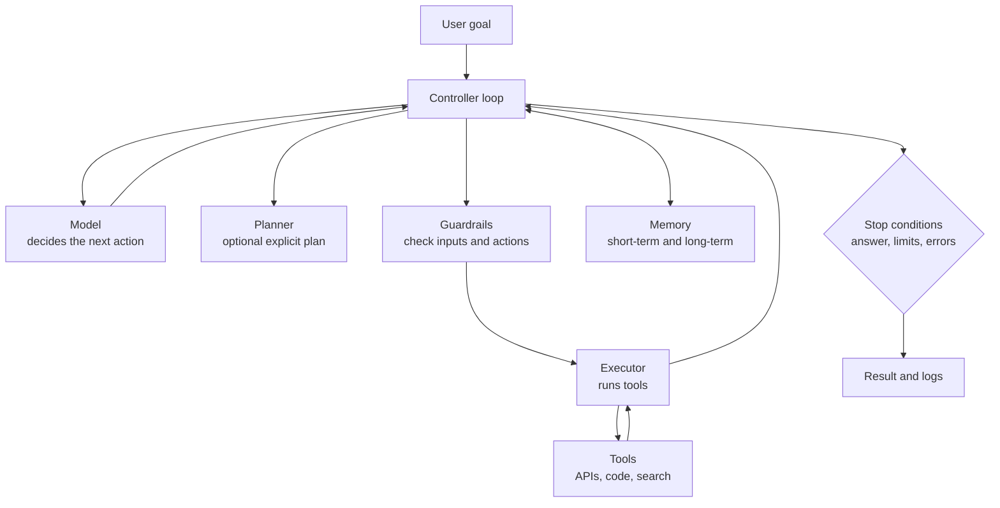

The twelve-line loop from [the previous lesson](/learn/ai-agent-fundamentals/what-is-an-ai-agent) is a real agent, but it is not one you could ship. It trusts every tool call, has no budget, forgets everything when it returns, and has only one way to stop. Production agents wrap the same loop in a handful of supporting components. Knowing what those components are, and what goes wrong without each one, lets you read any agent framework's design and see the same parts underneath, and lets you build your own without one.

## The components



| Component | Responsibility | What goes wrong without it |
| --- | --- | --- |
| **Model** | Reads the context and chooses the next action or the final answer | Nothing to decide anything |
| **Tools** | Typed functions the model can request | The agent can only talk, not act |
| **Memory** | Holds the conversation so far and anything recalled from past sessions | The model repeats work or loses track of the task |
| **Planner** | Breaks the goal into steps before or during execution | Long tasks wander; the model loses the thread |
| **Executor** | Validates and runs tool calls, catches errors, formats results | One bad call crashes the whole run |
| **Guardrails** | Checks inputs, tool arguments and outputs against policy | Harmful or unintended actions go through |
| **Stop conditions** | Decide when the run ends | Infinite loops and runaway cost |
| **Controller** | The loop that wires everything together and keeps state | |

Not every agent needs every component. A small agent may have no separate planner (the model plans implicitly, step by step) and no long-term memory. But every agent needs a model, tools, an executor that handles errors, and stop conditions.

## State: what the controller tracks

The controller owns the agent's **state**: everything needed to continue or resume a run. Writing it down as a single object makes the agent easier to log, test, pause and resume.

| Field | Why it is needed |
| --- | --- |
| `messages` | The context sent to the model on every step |
| `step` | Enforces the iteration limit |
| `tokens_used` | Enforces a cost budget |
| `tool_history` | Detects repeated identical calls |
| `status` | `running`, `done`, `stopped`, `waiting_for_human` |

## Stop conditions

A run should end for exactly one of a known set of reasons, and the result should say which.

| Stop reason | Trigger | Typical response |
| --- | --- | --- |
| `answer` | The model returns a final answer | Return it |
| `max_steps` | Step counter reaches the limit | Return partial progress and say the task was not finished |
| `budget` | Tokens or cost exceed the budget | Same as above; alert if it happens often |
| `loop` | The same tool call with the same arguments repeats | Stop, or tell the model it is repeating itself |
| `guardrail` | An action is blocked by policy | Stop or escalate to a human |

> [!KEY]
> An agent that stops with "I could not finish: step limit reached after 10 steps, here is what I found" is far more useful than one that silently returns nothing. Always record **why** a run ended.

## An agent class with the essentials

The code below builds a small but complete architecture: a tool registry, an executor that turns exceptions into messages, a guardrail that blocks certain tools, a token budget, loop detection and an iteration limit. The model is again a scripted stand-in so the code runs here; a real deployment would replace the `llm` callable with an API call that receives `state.messages` and the tool schemas.

```python
import json
from dataclasses import dataclass, field

@dataclass
class AgentState:
    messages: list
    step: int = 0
    tokens_used: int = 0
    tool_history: list = field(default_factory=list)
    status: str = "running"

def rough_tokens(text):
    return len(text) // 4 + 1          # crude estimate: about 4 characters per token

class Agent:
    def __init__(self, llm, tools, max_steps=8, token_budget=2_000, blocked=()):
        self.llm, self.tools = llm, tools
        self.max_steps, self.token_budget = max_steps, token_budget
        self.blocked = set(blocked)

    def guardrail(self, name, args):
        if name in self.blocked:
            return f"tool {name!r} is not allowed in this deployment"
        return None

    def execute(self, name, args):
        if name not in self.tools:
            return f"error: no tool named {name!r}"
        try:
            return str(self.tools[name](**args))
        except Exception as exc:                       # errors become observations
            return f"error: {type(exc).__name__}: {exc}"

    def run(self, task):
        state = AgentState(messages=[{"role": "user", "content": task}])
        while True:
            if state.step >= self.max_steps:
                state.status = "stopped: max_steps"; break
            if state.tokens_used >= self.token_budget:
                state.status = "stopped: budget"; break
            state.step += 1
            context = json.dumps(state.messages)
            state.tokens_used += rough_tokens(context)    # input tokens for this call
            decision = self.llm(state.messages)
            if "answer" in decision:
                state.status = "done"
                state.messages.append({"role": "assistant", "content": decision["answer"]})
                break
            name, args = decision["tool"], decision["args"]
            call = (name, json.dumps(args, sort_keys=True))
            if state.tool_history.count(call) >= 2:
                state.status = "stopped: loop"; break
            state.tool_history.append(call)
            blocked = self.guardrail(name, args)
            if blocked:
                state.status = f"stopped: guardrail ({blocked})"; break
            result = self.execute(name, args)
            print(f"  step {state.step}: {name}({args}) -> {result}")
            state.messages.append({"role": "assistant", "content": json.dumps(decision)})
            state.messages.append({"role": "tool", "content": result})
        print(f"  status={state.status} steps={state.step} tokens~{state.tokens_used}")
        return state
```

Now three scripted models exercise three different endings. The first finishes normally, recovering from a tool error along the way. The second gets stuck. The third tries a forbidden action.

```python
INVENTORY = {"widget": 12, "gadget": 0}

def stock_level(item):
    return INVENTORY[item]                 # raises KeyError for unknown items

def delete_item(item):
    INVENTORY.pop(item)
    return "deleted"

TOOLS = {"stock_level": stock_level, "delete_item": delete_item}

def good_llm(messages):
    seen = [m["content"] for m in messages if m["role"] == "tool"]
    if not seen:
        return {"tool": "stock_level", "args": {"item": "widgit"}}     # typo
    if seen[-1].startswith("error"):
        return {"tool": "stock_level", "args": {"item": "widget"}}     # corrects itself
    return {"answer": f"There are {seen[-1]} widgets in stock."}

def looping_llm(messages):
    return {"tool": "stock_level", "args": {"item": "gadget"}}

def reckless_llm(messages):
    return {"tool": "delete_item", "args": {"item": "gadget"}}

agent = Agent(None, TOOLS, blocked={"delete_item"})
for llm in (good_llm, looping_llm, reckless_llm):
    agent.llm = llm
    print(llm.__name__)
    agent.run("How many widgets do we have?")
```

```output
good_llm
  step 1: stock_level({'item': 'widgit'}) -> error: KeyError: 'widgit'
  step 2: stock_level({'item': 'widget'}) -> 12
  status=done steps=3 tokens~160
looping_llm
  step 1: stock_level({'item': 'gadget'}) -> 0
  step 2: stock_level({'item': 'gadget'}) -> 0
  status=stopped: loop steps=3 tokens~147
reckless_llm
  status=stopped: guardrail (tool 'delete_item' is not allowed in this deployment) steps=1 tokens~16
```

Three things to notice:

- In `good_llm`, the `KeyError` did not crash the program. The executor returned it as text, and the model used it to correct the typo. **Returning errors to the model** is how agents recover.
- The loop detector stopped `looping_llm` on its third identical call, long before the step limit of 8.
- The guardrail checked the action **before** execution. Checking after a destructive tool has run is too late.

## Iteration limits and budgets in practice

Choose limits from data, not guesswork. Run the agent on a set of realistic tasks, record how many steps successful runs take, and set the limit comfortably above that, for example a little above the largest step count you saw on successful runs. If many runs hit the limit, the problem is usually the tools or the prompt, not the limit.

A token budget is a better cost control than a step limit alone, because the cost of each step grows as the context grows. If step $k$ sends a context of $c_k$ tokens, the input tokens for the whole run are

$$
T_{\text{input}} = \sum_{k=1}^{n} c_k
$$

where $n$ is the number of steps. Since $c_k$ increases with $k$ (each step appends messages), total cost grows faster than linearly in the number of steps. You can see this in the outputs: three steps cost about 160 estimated tokens, while the five-step run in the first exercise below costs about 390, well over five-thirds as much.

## Separation of concerns

Keep the model's job narrow: choosing actions. Everything that must be guaranteed belongs in ordinary code around it.

| Must be guaranteed | Put it in | Not in |
| --- | --- | --- |
| A forbidden tool is never called | Guardrail code | A sentence in the system prompt |
| The run ends | Step limit and budget in the controller | Asking the model to "stop when done" |
| Tool arguments are valid | Schema validation in the executor | Hoping the model formats them right |
| Every action is recorded | Logging in the controller | The model's own summary of what it did |

> [!TIP]
> Prompts are suggestions to a probabilistic system; code is enforcement. Use the system prompt to make good behaviour likely and code to make bad behaviour impossible.

## Exercises

**1.** Write a scripted model that alternates between `stock_level("widget")` and `stock_level("gadget")` forever, and run it with `max_steps=5`. Which stop condition fires, the step limit or the loop detector, and why?

<details>
<summary>Show solution</summary>

```python
def alternating_llm(messages):
    n = sum(m["role"] == "tool" for m in messages)
    item = "widget" if n % 2 == 0 else "gadget"
    return {"tool": "stock_level", "args": {"item": item}}

Agent(alternating_llm, TOOLS, max_steps=5).run("Count stock")
```

```output
  step 1: stock_level({'item': 'widget'}) -> 12
  step 2: stock_level({'item': 'gadget'}) -> 0
  step 3: stock_level({'item': 'widget'}) -> 12
  step 4: stock_level({'item': 'gadget'}) -> 0
  status=stopped: loop steps=5 tokens~392
```

The detector did catch it, on step 5, because by then the `widget` call had appeared twice already. With `max_steps=4` the step limit would have fired first. A detector that counts any repeat is crude: some legitimate agents re-check the same value after changing something. Real systems often warn the model on the first repeat and stop only on later ones.

</details>

**2.** Where should each of these rules live, in the system prompt or in code? (a) "Be concise." (b) "Never transfer more than 500 units." (c) "Prefer the search tool before guessing."

<details>
<summary>Show solution</summary>

(a) System prompt: it is a style preference and violating it is harmless. (b) Code: a guardrail in the executor that rejects any transfer above 500, because it must always hold. (c) System prompt, possibly reinforced by a good tool description; it guides choices and is not a hard safety rule.

</details>

```quiz
[
  {
    "q": "A tool raises an exception during an agent run. What is usually the best response from the executor?",
    "options": [
      "Crash the run so the developer notices",
      "Silently return an empty string",
      "Return the error as a tool result so the model can adapt",
      "Retry the same call forever until it works"
    ],
    "answer": 2,
    "why": "Returning the error as an observation lets the model correct arguments or try another approach, as `good_llm` did with the typo."
  },
  {
    "q": "Why should a guardrail check a tool call before executing it rather than after?",
    "options": [
      "It is faster",
      "Some actions, such as deletions or payments, cannot be undone once executed",
      "Models cannot read guardrail messages after execution",
      "APIs require it"
    ],
    "answer": 1,
    "why": "A post-hoc check can only report the damage. Irreversible actions must be blocked before they run."
  },
  {
    "q": "Why does an agent's cost grow faster than linearly with the number of steps?",
    "options": [
      "Providers charge more for later calls",
      "Each step resends the whole growing context, so per-step input tokens increase",
      "Tools get slower over time",
      "The model generates longer answers when tired"
    ],
    "answer": 1,
    "why": "Step k sends everything from steps 1 to k-1 as input, so the sum of context sizes grows roughly quadratically."
  },
  {
    "q": "Which statement about the system prompt and code is most accurate?",
    "options": [
      "A clear enough system prompt can guarantee a tool is never misused",
      "Hard rules belong in code; the prompt makes good behaviour likely",
      "Code-level checks are unnecessary with modern models",
      "Stop conditions should be described in the prompt rather than enforced"
    ],
    "answer": 1,
    "why": "Models follow prompts probabilistically. Anything that must always hold needs enforcement in code."
  }
]
```
